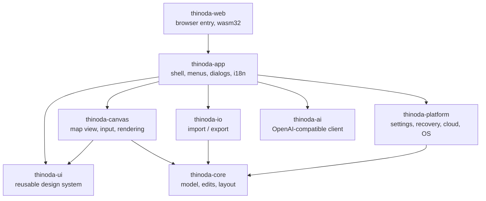

_Last updated: 2026-10-27 17:27:36 UTC (non-binding repository metadata)._ <!-- docs-stamp -->

# Architecture

| Crate | Responsibility | Depends on egui? |
|---|---|---|
| `thinoda-core` | Workbook/sheet/topic model, transactional edits + undo, layout engine for all structures, themes, templates, search, outline conversion | no |
| `thinoda-io` | `.thinoda`, XMind, FreeMind, OPML, Markdown, text, TextBundle Markdown, bounded DOCX text/hierarchy import; bounded MindManager `.mmap` read/write and `.xmmap` import with conversion reports; SVG/PNG/JPEG/PDF/Word/Excel/CSV export; format detection | no |
| `thinoda-platform` | Paths, settings (TOML), atomic file writes, crash recovery journal + panic hook, cloud folder detection, single instance, system theme; on wasm a `localStorage` virtual file system, downloads and browser printing | no |
| `thinoda-ai` | Blocking HTTP client (async `fetch` client on wasm) for models/completions/embeddings, bounded SSE, prompts, outline parser, polling `AiJob`/`AiStreamJob`/`AiEmbeddingJob`, local mock server | no |
| `thinoda-ui` | Design tokens, light/dark visuals, widgets, palette, toasts, dialogs, icons, fonts — **the reusable library for companion apps** | yes |
| `thinoda-canvas` | Interactive mind map widget: hit-testing, selection, drag & drop, inline editing, keyboard actions | yes |
| `thinoda-app` | eframe application, commands (`Cmd`), menus, panels, dialogs, CLI | yes |
| `thinoda-web` | Static web app entry: mounts `ThinodaApp` on a canvas with `eframe::WebRunner`, unsaved-changes and recovery page handlers ([docs/WEB.md](WEB.md)) | yes |
| `xtask` | `cargo xtask ci`, `icons`, `package` | no |

## Key decisions
- **Bounded document conversion (XV5, local implementation):** DOCX and
  TextBundle are parsed as data only, with validated ZIP paths/counts/expanded
  bytes and per-document XML/Markdown limits. TextBundle Markdown and DOCX
  paragraph/heading/list structure become an outline; unsupported content is
  reported for consent and the import dialog previews at most eight topics.
  External relationships are never resolved and document content is never
  executed. This does not claim Word page-layout or embedded-resource fidelity.
- **Embedded resources, local images and attachment topics (XV4, partial)**:
  `Sheet.resources` owns bounded immutable `Arc<[u8]>` blobs; subtree clipboard,
  full-sheet copy/merge and undo snapshots carry the bytes without deep-copying
  every history entry. SHA-256 content IDs use `thinoda-resource:<digest>` image
  references. `Topic.attachment` holds a resource URI plus its own portable
  basename, preserving different original names for identical bytes. Destination
  resource metadata wins when equal bytes deduplicate; branch
  copy includes only its referenced resources, while full-sheet copy preserves
  the entire store. Masked copies strip all resource bytes and references.
  Limits are 8 MiB/resource, 32 MiB/sheet, 64 MiB/workbook and 128 logical entries
  across a workbook, including repeated ownership across sheets. Document edits,
  sheet add/duplicate/merge and topic paste reject overflowing transactions
  without altering content/history. Unchanged stores are not rehashed on every
  title edit. Low-level public model mutation still requires validation, as with
  other model invariants.
  Native archives without formatted notes or resources stay version 2; resource-bearing archives use
  version 3 with bounded manifest metadata and raw `resources/<digest>` blobs,
  deduplicated across sheets. Imports validate names, sizes, digests, ownership
  and resource references without extracting paths or fetching URLs. Recovery
  uses bounded base64 fields; sheet clipboard uses version 2 only when bytes
  exist (resource-free clipboard remains version 1), retaining its 16 MiB
  encoded-payload limit. Older native readers reject version 3 rather than
  silently discarding bytes. Legacy reference-only image strings still load.
  Explicitly formatted notes use `NoteContent::Formatted` with
  `{"format":"markdown-v1","source":"..."}`; legacy plain notes serialize as their
  original JSON strings. Unknown format versions/fields are rejected. This is a
  source envelope, not a persisted rich-text AST. Formatting toolbar actions opt
  the whole note into Markdown, while typing preserves its existing syntax.
  Native archives containing these envelopes use version 4, with or without
  resource blobs, and sheet clipboard uses version 3. Older archive/clipboard
  versions cannot carry formatted envelopes. Recovery and internal subtree/
  outline copies retain the same type; draft conflict checks compare both source
  and format. The existing 16 KiB / 2,048-event / 32-depth preview/projection
  limits do not truncate stored source or prevent editing larger notes.
  XMind private metadata retains the envelope, but its standard plain-note field
  and other existing textual exporters still contain Markdown source; rich-text
  interchange and explicit export-loss reporting remain XV7 work.
  `images::decode` accepts only sniffed PNG/JPEG, checks encoded size and header
  dimensions before full decoder allocation (4096/side, 4 megapixels), then uses
  decoder width/height and 64 MiB allocation limits. Conversion to RGBA is bounded
  by that pixel limit. Original encoded bytes are never rewritten. Topic
  `image_size`/`image_below` have serialization defaults; finite positive sizing is
  capped at 1024 map units/side and checked by transactional edits and imports.
  Layout places the image above/below the title/labels. App insert/replace/reset
  uses a 160 × 100 fit without upscaling; proportional width uses source dimensions.
  Replace/remove releases an old image only when no image or attachment still
  references it; undo owns the old
  store. Masking clears bytes, references and sizing.
  Picker purpose carries a request ID; its app owner binds document key, active
  sheet/index/root, selected topic and revision. Browser uploads use request-scoped
  VFS scratch paths, removed after dispatch, not the document-open queue.
  Canvas context LRU caches up to 128 512² RGBA previews (<=128 MiB plus bounded
  decoder transient memory), including failures, keyed by stable resource URI.
  Offscreen images are not decoded. Texture creation occurs outside context-data
  locks. SVG embeds each referenced original blob once in data-URI definitions
  and reuses it with aspect-fitted transforms; shared raster/PDF/
  print/Pitch paths inherit image rendering and existing frame/scale limits.
  Visual output validates all resource types and references, including unsupported
  orphan blobs; unreferenced valid PNG/JPEG blobs have no visible placement.
  Legacy paths/URLs still load with a map placeholder but cannot produce silently
  incomplete visual output. Other non-native exports still refuse resource-bearing
  documents. Attachment topics also explicitly reject visual output until a
  supported representation exists (even if their bytes decode as images).
  `attachments::insert` adds one child, expands its parent and embeds opaque bytes
  within a Document transaction. A paperclip title and selected-topic inspector
  identify the file; the inspector shows its byte size, uninspected status and
  trust warning. Resource metadata uses `application/octet-stream`: no filename
  extension establishes trust, no attachment is decoded or imported as a workbook,
  and there is no type whitelist. Empty files follow the store's existing 1-byte
  minimum. If a later explicit Local Image action selects the same bytes,
  bounded verified image decoding may promote shared generic resource metadata
  to PNG/JPEG without changing any attachment's per-topic filename or bytes;
  undo restores the metadata. The attachment flow itself never decodes the file.
  `attachments::safe_name` strips paths, replaces controls/directional
  controls and unsafe punctuation, bounds UTF-8 length and handles reserved
  Windows device names. Loaded attachment names/references are validated too.
  Picker completion/cancellation uses the same ownership contract as images,
  independent request IDs and request-scoped `/AttachmentUploads` scratch paths.
  Save/Download is a second command, never an insertion side effect. Native uses
  a destination chooser and atomic byte write; browser uses VFS scratch delivery
  with an opaque download Blob MIME, safe filename and cleanup. No shell-open,
  system-default launch, URL fetching, scripts/macros or auto-open is involved.
  Selection-based image drop insertion reuses image ownership and bounded decode.
  Canvas image resizing stages a proportional outline in view state, bounded by
  `images::MAX_DISPLAY_SIZE`, and commits only on an owned release inside the
  canvas. Content/sheet/selection/camera/viewport changes and interrupted gestures
  cancel; labeled keyboard-operable handles supplement the inspector width field.
  Outliner thumbnails use the canvas's bounded resource decode/texture cache and
  only show valid embedded PNG/JPEGs with matching declared media types; legacy
  paths/URLs and opaque attachments remain untrusted. XMind import/export handles
  only the bounded SDK-compatible PNG/JPEG topic-image package pattern, with
  strict manifest/path checks; missing dimensions are derived from decoded bytes,
  missing alignment defaults to top, and unsupported explicit alignment or
  external references fail visibly. Attachment package interchange and installed
  XMind application compatibility remain unverified; resource-bearing fuzz
  fixtures are not yet available. External-app opening is not promised by this
  cross-platform contract.
- **Calendar inputs**: `thinoda_ui::date_field` combines an ISO text edit and
  localized, keyboard-operable month popup. The app supplies translated labels
  and `WorkCalendar::is_working_day` availability for task dates; exceptions allow
  every valid date. `chrono::Local` supplies the device-local Today on native and
  WASM. Picker choices only update planning drafts; existing core validation and
  atomic edits own Apply/Undo. Popup layering and Escape remain separate from
  their parent dialog.
- **One code base for desktop and web**: the web app is the same `thinoda-app`
  compiled to `wasm32-unknown-unknown`. Platform differences live behind
  `thinoda-platform::fs` (std::fs vs. `localStorage` VFS), `thinoda-app::files`
  (blocking vs. async pickers, downloads) and `cfg(target_arch = "wasm32")`
  branches for printing and AI; see [WEB.md](WEB.md).
- **egui + wgpu**: immediate-mode UI keeps the whole app in Rust, renders through Direct3D 12,
  Metal or Vulkan, and is testable headlessly with `egui_kittest` (AccessKit tree).
- **Commands**: every menu item, shortcut and palette entry maps to one `Cmd`; e2e tests call
  `ThinodaApp::exec` or press real keys.
  `Cmd::shortcut_id()` supplies explicit, nonlocalized built-in identities such as
  `file.save`, independently of numeric palette row IDs. `shortcut_commands()` and
  `shortcut_command(id)` expose the shortcut target registry without adding
  palette actions; Close Tab resolves to the active tab at lookup time.
  Payload-specific paths/templates/styles/clipboard text are not generic targets.
  `edit.paste` resolves to `MenuPaste` (request OS clipboard), not stored content.
  Registry membership is not availability or key ownership: callers must still
  use the command/focus guards. `Settings.shortcuts_overrides` remains inactive
  and preserves stable, legacy, numeric and unknown keys without guessing a
  migration. `Settings.keymaps` is a separate version-1 profile library:
  immutable Thinoda Standard/XMind-compatible presets and named user copies,
  with command-ID bindings and explicit empty lists for unassignment.
  Logical Command is Cmd on macOS and Ctrl elsewhere; physical Control remains
  distinguishable. Profile validation rejects duplicate/unknown identities,
  unknown keys, conflicting dispatch and reserved system/browser/text-editor
  gestures before activation. Invalid stored profiles are retained but produce
  a visible warning and use Standard rather than silently activating.
  Settings > Keyboard Shortcuts > Edit mappings stages profile selection,
  duplication, rename, delete, reset and key capture until Apply; Cancel leaves
  persisted settings unchanged. Apply writes settings atomically before changing
  live preferences and keeps failed saves open for retry. Changed assignments
  and aliases are reviewed in both Map and Outline contexts.
  All document windows share that canonical profile library. Successful Apply
  invalidates pending Settings pointer gestures, preserves the live sidebar
  selections when saving, and requests repaint of every owner viewport.
  AppKit application-menu aliases retain the resolved accelerators, including
  explicit unassignment, instead of reinstating fixed Settings/Quit bindings.
  Global, insertion and view dispatch honor the same ordered binding inventory;
  modified gestures take precedence over a general gesture of the same key,
  preserving Standard defaults except the corrected native macOS Cmd+W owner
  (Close Window, not a competing Close Tab). The canvas accepts host-supplied
  bindings while standalone consumers retain its defaults. Outline keeps visible
  row traversal rather than substituting canvas geometry for Up/Down.
  Menus, ribbon, palette, shortcut reference, native AppKit accelerators and the
  guide's active-shortcut table resolve the selected profile. Historical guide
  examples are explicitly labeled Standard. OS clipboard events and focused text
  editing retain ownership; IME candidate/commit frames cannot capture or apply
  a mapping. No profile imports or legacy-string activation are inferred.
- **Crash safety**: edits are journaled to the recovery directory every few seconds and on
  panic; saves are atomic (temp file + rename). On start the recovery dialog restores unsaved work.
  Native recovery locks explicitly unlock before closing their file descriptor:
  a concurrently forked child's duplicate must not delay orphan discovery after
  the owning session releases its lock. Orphan documents retain a shared lease
  until restoration/discard or the last handle is dropped.
  Suspension flushes while holding ownership and releases only on success.
  Suspended managers may queue in-memory work, but cannot flush/remove snapshots
  before resuming; cleanup must reacquire ownership so it cannot delete another
  process's claimed orphan.
  Restore validates every snapshot in a selected session before opening any of
  its maps or deleting its snapshots. Failed sessions stay claimed and visible
  for retry; other selected sessions can still restore. Explicit discard retains
  only documents whose deletion failed, with visible errors and logging.
  Post-restore cleanup errors are reported rather than silently ignored.
  Before opening restored maps and removing their originals, the app synchronously
  persists replacement snapshots in its current recovery session. Failed handoffs
  retain the original session for retry and attempt cleanup of new snapshot keys.
  The platform handoff writer holds session ownership and never queues a failed
  write for later resurrection. If recovery is unavailable, maps can still open,
  but their original snapshots remain on disk and a warning is shown.
  Focused Notes/Hyperlink drafts belong to `OpenDoc`, not only egui's temporary
  text buffer. They contribute to dirty/close detection and idle tracking.
  Commands, saves and native close handling commit them as one undo step;
  recovery overlays their current value on a copy without committing history.
  Missing file fingerprints or failed metadata checks count as an unverifiable
  external change: interactive saves require conflict resolution and autosave
  skips the write. Failed saves and canceled MindManager save consent revoke
  overwrite authorization so a later attempt asks again.
  Save As compares absolute/canonical destination identity, not just literal
  path spelling; aliases of the current file retain conflict protection.
  Source-preserving sheet saves/conversions use the same identity check and
  propagate identity errors instead of silently classifying them as distinct.
  Tab-close prompts and save continuations target the stable document key,
  never a retained vector index. Conflict/conversion decisions resume that same
  close only after a successful save leaves no unsaved work. Cancellation,
  failure or removal of the target ends the continuation, so subsequent saves
  cannot revive it or close a replacement tab.
  Drafts bind to the document, sheet index/root and topic, since duplicated
  sheets can share topic IDs. Changed or missing source fields fail explicitly
  and retain the draft instead of overwriting newer content. Single-line
  Hyperlink Escape still cancels rather than commits.
  Command-boundary flushes invalidate committed UI buffers, and unchanged field
  buffers follow model updates, so Undo cannot resurrect stale text. Toolbar
  Undo/Redo availability accounts for pending inspector changes.
  Native window-close requests and the explicit Quit command retain distinct
  intents through save-all continuation; cancel preserves the dirty workspace,
  while discard closes only after the shared close decision is accepted. The
  macOS Window menu exposes Close Window (Cmd+W) separately from the application
  menu's Quit (Cmd+Q), both entering the app's normal unsaved-work path.
  Documents can be assigned to same-process eframe secondary viewports with
  `show_viewport_immediate`; the stable document key maps to exactly one owning
  viewport, and each viewport has its own active-tab key. A child close commits
  pending inspector drafts and returns its documents to the root without closing
  them, preserving unsaved state. This is not yet per-window Save/Cancel/Discard:
  root/last-window shutdown uses the existing shared app lifecycle, while child
  close has no prompt because it returns the documents instead.
- **Dialogs**: every app dialog uses `thinoda_ui::Dialog` (UR7). It wraps a
  title-less `egui::Window` with one shared title row (icon, title,
  Minimize/Expand, Maximize/Restore, Close Window; Fluent 28 px caption buttons,
  16 px glyphs), resizing on all four edges and corners, opening height fitted to
  the app window with vertical scrolling for long content, and optional modal mode
  (Foreground layer, dimmed backdrop, Esc closes the topmost modal). Per-dialog
  maximized/hidden/restore state is stored in egui memory under the dialog id;
  restoring rewrites the `AreaState` so the window returns to its previous rect.
  Multi-page dialogs use `thinoda_ui::tab_bar` (icon tabs, `Role::Tab`).
  Button labels are translated via `i18n::dialog_labels()`.
- **Text input ownership**: Map and Outline use `MapView`'s per-edit IME
  state with the shared `protect_ime_candidate_keys` guard before drawing their
  title text widgets. Candidate
  Enter/Tab/Escape cannot trigger document commit or insertion, including the
  final composition-event frame. Dismissal restores ordinary title shortcuts;
  the Outline editor locks focus while its explicit Tab handling owns insertion.
  Labels keeps independent composition state and runs the same guard before
  menus can dismiss its popup. Its input locks focus only during composition,
  so ordinary Tab navigation resumes after dismissal; candidate keys cannot add
  provisional labels or discard the draft.
- **Toolbar focus**: shared icon/captioned toolbar buttons keep egui's standard
  keyboard activation and draw a two-logical-pixel focus outline in the semantic
  text color, independent of selection or user accent. Disabled parent UIs also
  disable captioned controls' accessibility state and interaction.
- **Main-menu commands**: the host-independent menu tree drives compact menus
  and the AppKit global-menu adapter. Windows desktop uses only the ribbon,
  without an attached HMENU bar or redundant hamburger; headless, web and Linux
  hosts retain the compact menu. The Win32 adapter remains a platform primitive,
  not an active application menu. Native callbacks only queue known enabled
  IDs and wakes the egui context; application-frame dispatch uses the producing
  snapshot and rechecks document/sheet/history, text focus and modal ownership.
  AppKit snapshots also capture the owning viewport. The focused viewport alone
  synchronizes and polls the global menu; deferred actions reselect the captured
  document for dispatch and restore the prior root selection afterward. This
  routing is covered by headless tests, not by live AppKit execution.
  Standard native editing items send text-edit events when a text field owns
  focus. Menu replacement drains pending commands first, and window destruction
  removes its subclass before dropping callback data. Native integration errors
  are logged and shown, with the compact menu retained. The Windows/macOS ribbon uses
  the same tree and snapshot dispatch, with Material Symbols icons, semantic group
  footers, a large primary command and two-row secondary columns. Width reduction first hides
  secondary captions, then collapses groups into menus; excess groups remain
  reachable through a bounded overflow menu rather than a scrolling button wall.
  Explanatory group text is available on hover and does not occupy command slots.
  Primary, labeled and compact controls use 32/24/16-point icons and at least
  44-point hit targets. Exhaustive command mappings use semantic Material Symbols
  glyphs, adding a small badge only for variants (sheet, AI, zone, sort);
  primary/secondary semantic colors differ in both themes.
  Dropdown chevrons reserve caption space and align with its vertical center.
  Ribbon-only task aliases are Home and Capture; native menu taxonomy is unchanged.
  Each command supplies one combined tooltip with its label, binding and help;
  a long primary caption never forces a separate oversized first tile.
  Ctrl+F1 persists collapse state; Alt+1 through Alt+8 opens
  a category, and Escape or an outside press dismisses a temporary opening.
  A visible Pin/Unpin Ribbon control uses that same persisted collapse preference:
  pinned ribbons stay expanded after actions, while unpinned tab previews close.
  Settings > Editor offers Compact Ribbon on every target, default on (persisted as
  `ribbon_compact`; the legacy `compact_ribbon` key is ignored). It also selects the
  compact tiers of the Outline ribbon. Standard geometry is opt-in; compact geometry uses a 160-point expanded panel instead of 200,
  34-point tab/secondary targets, 72-point primary controls, 24/20/16-point icons,
  four-point intra-group spacing and recalculated group widths/overflow budgets.
  Labels, semantic colors, shortcuts, pinning and popup command routing are shared;
  Outline and Quick Access retain their existing density.
  **Icon system (UR6).** `thinoda_ui::icons` is the only icon source: a pinned,
  subset Google Material Symbols Outlined font (Apache-2.0; FILL 0, GRAD 0,
  weight 400, optical size 20) whose glyphs are remapped to Supplementary Private
  Use Area-A so they never collide with text. `assets/icons/build_icon_font.py`
  regenerates the font and `icons.rs` from `material-symbols.txt`; tests check the
  manifest, unique glyphs and that every glyph renders. Rules: the same action
  uses the same symbol on every surface (ribbon, Quick Access, floating bar, node
  menu, header, footer, Outliner), resolved through `command_icons.rs`; Fit Map
  (`fit_screen`) is distinct from the Map/Outline switch (`account_tree` /
  `format_list_bulleted`); sizes follow Microsoft ribbon and Fluent tiers
  (`SIZE_SMALL` 16 for menus, Quick Access and status bar, `SIZE_TOOLBAR` 20, `SIZE_MEDIUM` 24, `SIZE_LARGE` 32 points);
  icons inherit the text/semantic color, so Light and Dark need no separate
  assets. Menu items show the same 16-point command icon in a reserved slot while
  their accessible name stays the localized label. The font is registered as a fallback of the Proportional and Monospace
  families on native and web; `ensure_icon_font` installs it on demand for hosts
  and test harnesses that did not run `install_fallbacks`.
  Short viewports switch to a bounded Ribbon menu. Tab-strip scrollbars cannot
  overlap tab hit targets; keyboard focus reveals horizontally clipped items.
  Pointer-driven ribbon commands are deferred past release so restoring a text
  field's focus delivers Undo/Cut/etc. to that field, not the map. The top bar
  includes a persisted customizable Save/Undo/Redo/Print Quick Access Toolbar;
  floating editing/topic controls remain contextual and
  keep their visibility settings. The Outline structural toolbar shares the icon
  controls and adapts between captioned tiles, labeled rows and compact icons;
  full accessible names, tooltips and all nine structural operations remain.
  Document tabs use a single rounded capsule around the name and its own close
  button. New Tab follows the last capsule inside the same scroll viewport,
  rather than being pinned across empty space. Navigation arrows stay fixed;
  per-document keys, focus reveal and shared unsaved-close decisions are retained.
  Scroll rows reserve the full capsule height plus vertical breathing room so
  borders are not clipped by a shorter default interaction row.
  AppKit integration uses the existing Objective-C platform bridge, not an
  additional menu dependency. It supplies the standard Thinoda/Services/Window
  menus, moves About/Settings/Quit into the application menu and leaves unsaved-work
  decisions in shared app commands. Key equivalents are derived from typed command
  bindings, never parsed from file names or translated labels. macOS snapshots
  omit formatted shortcut hints, so native menus can initialize before egui fonts.
  NSMenu delegates
  retain the current tree during tracking; queued selections and generation
  ownership prevent old native items from invoking a replacement tree's commands.
  Detaching disables the callback and restores the previous AppKit menu tree.
  Real AppKit SDK/lifecycle fixtures run only on macOS; Windows tests do not
  establish macOS UI/VoiceOver acceptance. Native viewport creation and AppKit
  focused-window routing, per-window close/save decisions, root/last-window
  lifecycle, recovery ownership, IPC/open/reopen routing, VoiceOver and
  multi-monitor behavior remain acceptance work.
  Native Linux uses an in-window row of the same eight shared menu categories
  when the available width supports it (at least 1400 logical points at the
  selected UI scale); narrower windows retain the compact
  hamburger. This is an app-owned eframe menu surface, not a GNOME global-menu
  exporter or a claim of Ubuntu/Orca host acceptance.
- **Touch navigation ownership**: `MapView` latches an owned or rejected
  multitouch sequence until all contacts lift. Owned two-finger input scales
  about the previous centroid, then translates to the current centroid. It
  bypasses the wheel/zoom fallback so synthesized zoom is not applied twice.
  Multitouch or touch cancellation discards pending topic/relationship drags and
  suppresses click/drop actions for that sequence. Single-finger blank-background
  dragging pans; mouse blank-background dragging retains rubber-band selection.
  Three-or-more-finger, popup and disabled states cancel ownership rather than
  acquiring it halfway through a gesture. No gesture creates a navigation undo
  entry. Hosts use `CanvasOutput::context_menu`, not the raw response's menu:
  it applies the same ownership guard to egui's synthesized long-touch secondary
  clicks and closes menus for suppressed sequences. Single-touch holds retain
  the upstream recognizer; no duplicate timer or platform gesture is installed.
  Canvas ownership survives the final raw touch until the synthesized primary
  pointer also releases, preventing late click-through. The shared
  `widgets::touch_activation_allowed` cancellation/multitouch latch is sampled
  each app frame, including while controls are hidden, and cached across layout
  passes. Outline title/disclosure/command activation and shared switches,
  segmented choices and color swatches use it. Symbol insertion/removal, default-
  color/contrast actions and color application share that guard in the inspector
  and context instance editor. Swatch IDs combine the individual layout UI's
  unique ID with the color, not the inherited scope ID: adjacent Fill/Border/
  Text/Line palettes must not capture one another's input. Color-based suffixes
  preserve keyboard focus when a custom swatch disappears. Scroll areas and text inputs keep
  upstream scrolling/text-selection behavior. Preview cards gate pointer
  activation with the same latch while retaining explicit keyboard activation;
  template double-click creation requires that guarded activation too. The
  structure launcher's popup toggle is guarded independently. This does not yet
  guard every standard egui button, slider or combo box. Sheet strip selection,
  creation, rename, arrows, context opening and commands share the latch without
  disabling scrolling or replacing egui's single-finger hold recognizer.
  The custom-theme editor retains a full staged-theme/role snapshot across each
  pointer sequence. Cancel, multitouch, focus loss or skipped editor frames restore
  its starting values through release, including changes made on earlier drag
  frames; rejected releases cannot save/apply or dismiss it via outside clicks.
  Settings pointer edits live in a separate staged profile until clean release;
  ordinary app behavior and settings writes continue to see the committed profile.
  Cancel, multitouch, focus loss, a disabled/hidden window, skipped frames or an
  intervening profile change reject the draft without replacing newer preferences.
  Language/title defaults update only after acceptance. Credential save/clear,
  connection tests, folder/install actions and shortcut navigation require accepted
  activation; rejected input retains the independent API-key text draft.
  Shared confirmation dialogs gate every button kind and backdrop dismissal
  with the same touch latch, so rejected releases cannot authorize saving,
  discarding, overwriting or canceling a pending decision. Clean mouse/touch
  and keyboard activation retain the normal confirmation behavior.
  Theme-library edit/remove launchers and quick-style save/remove launchers
  (including the removal menu action) share this latch. The quick-style name
  dialog also gates Save, Cancel and backdrop dismissal, preserving typed
  draft text and persisted library contents across rejected releases.
  Sheet-rename decisions use the same latch and a draft owner composed of the
  document key, active sheet index and model revision. A changed owner dismisses
  the dialog with a warning instead of renaming the current replacement target.
  IME candidate keys retain their existing protection before final confirmation.
  Print-preview output, retry and close decisions also share the latch,
  including backdrop dismissal; canceled input cannot initiate a print/PDF
  handoff. Page-setup gestures retain their starting settings through the primary
  pointer sequence; cancel, multitouch, focus loss and skipped dialog frames
  restore that snapshot through release without disabling page setup.
  Screenshot-editor crop, square/frame/color settings retain the same
  sequence-scoped rollback contract. Rejected releases cannot copy/save output
  or dismiss the editor; a canceled crop clears its provisional drag origin.
  Label-popup add/remove/suggestion/sort/apply/cancel actions use the touch latch;
  rejected outside releases retain the popup and its typed draft.
  Symbol-color and MindManager export consents bind to document key, sheet and
  revision after committing title edits. Switching/removing/changing the source
  revokes both decisions and symbol-loss authorization; tab-vector reordering
  alone does not transfer consent to the tab now occupying its old index.
  Masked-copy preview consent uses the same document/sheet/revision boundary;
  rejected touches cannot create or cancel a preview. Guide/shortcut filters,
  legal-document selection/copy/links and auxiliary dialog decisions share the
  cancellation latch without changing text selection or typed searches.
  Palette command selection/backdrop and Find/Replace navigation, options and
  replacement use the same latch. Rejected gestures preserve queries, replacement
  drafts, scope, selection and history. The palette's stable search input protects
  IME candidate Enter/Tab/Escape before commands or modal dismissal; deliberate
  keyboard execution resumes after composition.
  Backend/browser and real-device acceptance is tracked in PLAN/WEB.
- **Map toolbar layering**: floating editing/topic controls use normal egui area
  order, above the map but below auxiliary feature windows. Foreground menu/
  popup layers remain separate, so embedded browser Gantt controls are not
  visually covered or intercepted by map controls.
- **AI Pitch assistance**: the existing presentation editor captures its real
  candidate slide IDs/sources/frames and sends only numbered titles plus explicit
  instructions through `AiStreamJob::chat`. A bounded, closed JSON outline can
  select/reorder/retitle candidates, never supply new sources or frame geometry.
  Terminal output enters review without editing even the draft. Use replaces
  only the draft; normal presentation Apply persists one Undo transaction. Work
  is owned by source revision, draft generation, instructions and AI config.
  Editor close drops/cancels transport. Source drafts and changed/disabled settings
  invalidate pending output/review. Bounds are 64 candidates, 64 KiB title context,
  8192-byte instructions, 64 KiB output and 256-byte single-line result titles.
- **Semantic assistance**: the chat sidebar explicitly builds a session-only,
  source/configuration-owned index using `AiEmbeddingJob` and a separate explicit
  `embedding_model` preference; there is no chat-model fallback or automatic
  indexing. Current-sheet titles are bounded before cloning (500 topics/64 KiB,
  nonblank and at most 16 KiB each) and sent in sequential 128-input batches.
  Normalized finite vectors must retain one dimension across all batches and
  queries. Explicit query requests are limited to 8192 bytes; cosine search
  returns at most 20 matches with deterministic topic-ID tie-breaking. Local
  farthest-first spherical k-means visits 16 topics per frame, with up to eight
  centers/eight iterations. It previews a complete partition, then Apply adds a
  new outline-only sheet in one undo transaction without altering source content.
  Changed source/configuration/drafts cancel pending work and invalidate caches;
  changed queries discard late search results. No index or query is persisted.
- **AI generation harnesses**: persisted `AiProvider` defaults/migrates to OpenAI
  API; optional per-CLI models never overwrite the existing API settings/key.
  `thinoda-ai::harness` routes native Claude/Codex generation from both `Client`
  and `AiStreamJob`, retaining task parsing and role-labelled language/history
  instructions. CLI replies are buffered and emit a terminal result only, not
  fabricated streaming deltas. Discovery and documented non-inference auth probes
  use worker jobs; only statuses, not raw CLI diagnostics or identity/token
  details, reach the UI. Unsupported checks remain unknown.
  CLI adapters pass a bounded JSON transcript over stdin, never a shell command,
  and run in an empty temporary directory. Both pipes are drained concurrently,
  each capped at 2 MiB; prompts are capped at 256 KiB, requests at 300 seconds.
  Cancellation/drop/timeout terminates the process tree (Windows kill-on-close
  Job Object / POSIX process group), reaps the leader and joins pipe workers.
  Known Windows npm entry points are invoked via Node directly; arbitrary
  `.cmd`/`.bat` wrappers fail closed. No CLI credentials are inspected/persisted.
  Copilot discovery/login help is present but generation fails closed: no
  documented non-inference status or fully isolated user MCP/hooks invocation
  was found. This is a delivery blocker, not a completed integration.
  WASM rejects CLI generation without rewriting the selection or falling back.
  `embedding_config` is independent of generation provider; semantic indexing
  always uses the existing OpenAI-compatible embeddings API.
- **AI off the UI thread**: typed map requests use `AiStreamJob`; connection tests
  retain the existing nonstreaming `AiJob`. Native streaming uses abortable
  Tokio/reqwest I/O; browser streaming uses fetch ReadableStream/AbortController.
  The app drains at most 128 events per frame, previews deltas without mutation,
  and stages successful output for explicit review/Apply only after valid `[DONE]`.
  Apply to an existing map remains one undo step; generated maps open a separate
  unsaved document without changing the source. API requests require an
  OpenAI-compatible SSE server; nothing leaves the
  machine when a local server (LM Studio, Ollama) is used.
  Topic requests capture document key, active sheet/root and revision after title
  commit. Results for closed, changed or draft-editing sources are rejected with
  a visible explanation; unchanged background documents retain their original target
  without activating a different tab. The nonmodal review retains its output for
  inspection/discard when the source changes; Apply rechecks the document, drafts,
  endpoint, model, committed credential and temperature. New-map output also needs
  Apply. Review and prompt windows belong to the initiating document viewport and
  return to the root when that window closes. Cancel, closing the preview or
  disabling AI cancels transport and drops pending/partial output, so late
  events or re-enabling AI cannot revive it. Errors never turn partial text into
  an applicable result. Transport limits are 2 MiB response, 64 KiB SSE frame,
  1 MiB generated/queued text and 4096 data events, with configured request timeout.
  Existing nonstreaming client APIs remain available without silent streaming
  fallback. Browser runtime/CORS acceptance remains an F6 gate.
  The discussion sidebar uses `AiStreamJob<String>` and the same bounded event
  drain, without any map-edit path. `ChatState` owns session-only conversations by
  open-document key; a pending response retains its source key and viewport.
  Closing the source prunes its history and aborts the job; closing its native
  window returns pending viewport ownership to root. Hide/reopen and tab switches
  retain history, not disk persistence. Explicit Send snapshots selected subtrees
  or the sheet's central/floating trees into JSON containing IDs, titles and child
  IDs only. It rejects unfinished title/inspector edits and oversized context,
  and rechecks the snapshot immediately before dispatch. Completed user/assistant
  pairs, not partial or failed output, enter history. Cancel/disable preserves the
  draft; confirmed Clear affects only that conversation. Chat and typed map jobs
  cannot start concurrently, and an unapplied map review blocks chat dispatch.
  `AiResponseMode` is a serde-defaulted global preference (Balanced for legacy
  settings), used only as system-message guidance. Mode/scope changes and opening
  the panel are offline. Chat bounds: 500 context topics, 64 KiB serialized context,
  8192-byte prompt, 64 KiB reply, 256 KiB history, 32 messages and 64 conversations.
  Limits are explicit errors; no silent context/history truncation or indexing.
  The saved prompt library is distinct from session-only history: bounded
  `SavedPrompt { id, name, text }` values persist in AI preferences. The modal
  editor owns a draft, base library and viewport; Save validates then updates only
  the library in freshly parsed settings, rejecting observed library conflicts.
  It preserves unrelated/unknown fields and credential markers without consulting
  the credential store, and refuses to rewrite unmigrated plaintext credentials.
  Persistence failures retain the editor and leave runtime preferences unchanged.
  Use only copies into the composer; replacing a nonempty draft and deleting a
  saved prompt each require confirmation. Cancel/IME/canceled-touch guards apply
  before state-changing decisions; the map is disabled while the editor is open.
  Limits are 32 prompts, 80-byte names, 8192-byte texts and 128 KiB total UTF-8 data.
  Guided Rewrite/Translate/Grow/Reorganize/Refine commands capture `AiTarget` plus
  the chat context builder's bounded selected-subtree snapshot before opening
  their instruction dialog. Explicit Send rechecks ownership, revision, drafts
  and configuration before dispatching typed `AiTask::Transform`. Rewrite returns
  `OutputKind::Title`, growth `Subtopics`, and structural/translation operations
  `Sheet`. Apply requires the command's exact output kind and text/outline shape.
  New sheets are outline-only and use `Document::add_sheet` as one undo step;
  source metadata is never removed or silently represented as translated.
  All five reuse terminal SSE review/cancellation and viewport-return handling.
  Transformation responses are bounded to 64 KiB/500 lines before parsing;
  titles additionally require one nonempty line of at most 1024 UTF-8 bytes.
  Connection-test work and model lists belong to their endpoint and credential
  draft; changing either discards them, while choosing a model keeps the list.
  Generate requires accepted activation and retains rejected prompt drafts.
  Its stable text editor protects IME candidate keys before global shortcuts;
  deliberate Escape dismisses the prompt only after composition has ended.
- **Printing**: `thinoda-io::print` fits the complete current-sheet export SVG onto
  physical paper, rendering directly at 150/300 dpi with bounded page allocation
  (no viewport screenshots or full-map intermediate raster clipping). The app
  freezes a workbook snapshot after committing title edits, runs rendering/encoding
  on workers and rejects stale previews after settings changes. Preview, native
  printer page and paper-sized PDF use the same raster. `thinoda-platform::printing`
  validates dimensions and converts RGB to bounded opaque BGRA on a worker.
  The eframe adapter borrows its live window handle and invokes a compact native
  C++/C/Objective-C bridge synchronously on the main/window thread, never a rendering
  worker. Windows uses `IPrintManagerInterop` for the HWND and a WinRT
  `IPrintDocumentSource`/`IPrintDocumentPageSource` with a
  `IPrintPreviewPageCollection`. Pagination reads the selected printer's
  `PrintTaskOptions.GetPageDescription(1)`; Direct2D paints the full source page
  inside that page's imageable rectangle. DXGI surfaces populate the actual
  Windows system preview; `ID2D1PrintControl` writes the same drawing to the OS
  package target only when Windows requests `MakeDocument` after confirmation.
  D3D11 WARP avoids dependence on the application's GPU and supports x64/ARM64.
  macOS uses the AppKit modal printer/driver panel and NSPrintOperation;
  Linux uses GTK 3 PrintOperation, Cairo and desktop printer backends. No generated
  HTML, browser/viewer launcher or temporary print files remain. Native buffers are
  borrowed only for the synchronous call; the Windows COM source owns a pixel
  copy, serializes callbacks and disconnects retained preview targets on exit.
  Late callbacks return `RO_E_CLOSED`. Its STA modal message loop keeps the owner
  disabled until PrintTask completion, unregisters handlers and restores the
  owner's enabled state. Only `PrintTaskCompletion.Submitted` means submission;
  cancelled/abandoned tasks are cancellation, and HRESULT failures are errors.
  Showing the native UI alone is never reported as submission.
  The app preview stays modal during
  preparation, native UI and submission; cancellation retains it for retry.
  Native cancellation, submission acceptance and errors are distinct; no result
  confirms physical printing. OS paper changes fit the entire fixed preview page
  proportionally into the selected printable area without cropping/reflow.
  Driver options may further affect output. Linux respects page-setup and reported
  hardware margins; no hardware information means the selected setup is used.
  Native dialogs follow OS language/theme rather than app overrides.
  GTK cannot use a winit Wayland surface as a GtkWindow parent: the blocked app
  event loop guarantees editor modality, but compositor taskbar grouping may differ.
  Build requirements are the target's C toolchain, macOS AppKit SDK, or Linux GTK 3
  development files (`libgtk-3-dev`, `pkg-config`). These are already installed by CI.
  Linux runtime needs GTK 3 with a CUPS backend for physical printers.
  GTK/Cairo symbols are resolved from the host's `libgtk-3.so.0` (including its
  dependency scope); missing libraries/symbols are explicit errors. This keeps
  the existing AppImage packager from bundling a partial GTK without its CUPS
  modules or mixing bundled GTK and host modules. `.deb` already declares GTK 3;
  AppImage users also need host GTK 3. Build-time pkg-config supplies headers
  only, not a direct GTK link. Windows/macOS use their system APIs/frameworks.
  Unit/UI tests never submit jobs: they cover the same native fit function,
  bounded conversion, outcome mapping, immutable snapshots and modal behavior.
  Windows SDK-native tests additionally read back WARP preview pixels for
  page/imageable-area changes, retain interfaces after disconnect, distinguish
  completion states and serialize/reopen a one-page XPS package entirely in a
  memory stream (no printer/spooler). The Python native harness runs on Windows
  x64/ARM64 CI with strict C++ compilation. See [native printing](NATIVE-PRINTING.md)
  for API references, manual checks and platform limitations.
  Native driver behavior still requires smoke tests on Windows x64/ARM64,
  macOS Intel/ARM64 and Linux X11/Wayland.
- **Task scheduling**: a sheet's versioned `SchedulingData` owns its work
  calendar, topic-keyed tasks and finish-to-start dependencies; legacy
  `Topic.todo` remains an independent checkbox. Dates serialize as ISO
  date-only values, never UTC timestamps. Durations count working days
  inclusively, and dependency propagation starts successors on the next working
  date after predecessors finish. The core bounds dates to years 0001-9999,
  task durations to 3,650 days, tasks to 5,000 and dependencies/calendar
  exceptions to 20,000/5,000. Native `.thinoda` archive version 2 stores this
  schema; version 1 remains readable. Workbook validation is also used when
  recovering snapshots. App task/calendar drafts and Gantt views use these
  same validated, undoable edits.
- **Scheduling API**: `LocalDate` implements `FromStr`/`Display` and exposes
  ordinal, signed day-distance and checked calendar-day addition, with `MIN`/
  `MAX` bounds. `Weekday::ALL` and `Weekday::name()` expose stable weekday
  choices. `WorkCalendar::working_duration(start, finish)` counts inclusive
  working days; `finish_date(start, duration)` and `add_working_days` keep
  schedule arithmetic in core for any future editor or timeline.
- **Gantt export**: `thinoda_io::render_gantt(&Sheet)` returns deterministic
  topic-ID-ordered rows, computed finish-to-start dates, full chart bounds and
  SVG. `GanttDocument` also renders PNG/vector PDF or a paper-sized
  `PrintDocument` via the shared raster, PDF and print placement helpers.
  `export_gantt_csv` emits the same rows as UTF-8 CSV. Unscheduled tasks remain
  visible; an empty task table and invalid schedules return explicit errors.
  Chart exports are bounded to 6,000 inclusive timeline days, 5,000 task rows,
  4 MiB of UTF-8 task labels, and 16 MiB each for SVG and CSV; PNG adds 16,384
  pixels per side and 32 million total pixels. Print uses existing paper, DPI
  and page bounds. CSV is independently byte/row bounded and does not inherit
  the graphical timeline limit.
- **Task/Gantt app ownership**: `planning.rs` stages explicit Task/Work Calendar
  drafts owned by a document key, sheet, history revision and opening viewport.
  Apply validates the captured owner and applies task/dependency edits together.
  `gantt.rs` holds only a reference to the same document/sheet, not a second
  `OpenDoc`; native immediate viewports and the browser window project that
  shared schedule. Interactive bar/progress gestures reuse the existing
  owner-checked numeric staging helper and make one Undo edit on release.
  Native chart focus uses shared profile resolution and a restricted command
  surface; Close Window targets the auxiliary viewport, never Close Tab.
  Exports capture a sheet snapshot for bounded worker rendering and atomic
  file writes, followed by the existing desktop/browser delivery path.
  `PrintEditor` captures either a map or Gantt source and the preview viewport;
  closing Gantt returns an open print preview to the root without losing the
  rendered source. Cross-platform native visual/printing acceptance remains
  separate from headless ownership and rendering tests.
- **Zones and presentation state**: each sheet persists named `Zone` frames and
  unique floating-root membership, plus ordered `PresentationSlide` records.
  `PresentationSource` refers to a topic branch or Zone; `SlideFrame` is a
  bounded `Rect` with explicit origin and size. Limits are 256 Zones, 4,096
  memberships and 512 slides; Zone size is at least 100 by 100. Document
  wrappers make frame/membership/order changes undoable. Zone movement translates
  member floating roots; explicit Zone removal preserves topics and removes
  its Zone slides. Root deletion/reparenting cleans memberships and references;
  empty Zones and their slides are removed. Shared layout bounds include Zone
  frames, so Fit and full-map output account for frames outside topic bounds.
- **Presentation rendering**: `generate_presentation` creates branch slides in
  map order followed by Zone slides in Zone order. Single-slide SVG/PNG preview,
  multipage PDF and ordered PNG ZIP use the same saved frame crop. The renderer
  draws complete sheet relationships before SVG viewBox clipping, including
  links crossing Zone/slide edges. Output scale is finite in 0.1-8; raster
  bounds are 16,384 pixels per side, 16 million pixels per slide and 32 million
  total pixels per archive. PDF/ZIP output is capped at 128 MiB.
- **Zone/Pitch app ownership**: Zone and presentation editors capture document
  key, sheet root/index, revision and viewport, with explicit Apply/Cancel.
  Canvas Zone move/resize is staged until safe pointer release. Presentation
  preview holds at most one worker request and accepts only its current
  generation/index/theme result. Pitch holds an immutable sheet snapshot and
  layout, never another `OpenDoc`, and closes on source revision/identity change.
  Native player focus uses the shared keymap/native-menu resolver with a
  restricted command surface; local playback keys do not enter map shortcuts.
  Native fullscreen affects the player viewport only; browser expansion remains
  an in-app window. Presenter context uses the snapshot layout plus the active
  saved frame. `pitch_motion::Playback` paints live saved crops with the canvas
  renderer rather than waiting for raster-preview workers. Current/outgoing scenes
  are bounded to two immutable layouts; partial topic builds retain original
  geometry, hide incomplete connectors/relationships and defer group annotations.
  Motion is explicitly off by default; session-only transitions use a 350 ms
  smoothstep and honor the immediate Reduce motion switch. Popup state is sampled
  before drawing controls so popup dismissal cannot also consume a player shortcut.
  Output workers capture the current draft/player source, write
  atomically, and use the existing desktop/browser delivery path. Host visual
  acceptance remains separate from headless rendering and ownership evidence.
- **Localization**: app chrome uses the embedded English/German and
  ES/FR/DA/NL/PT-PT/PT-BR/IT/PL catalogs in `thinoda-app/src/i18n.rs`,
  `locales.txt` and `pt-BR.txt`. English strings are stable keys; the
  pipe-delimited catalog has an explicit translation in each column (the header
  specifies order). Brazilian Portuguese deliberately shares common Portuguese
  text with explicit regional overrides. Completeness tests cover literal calls
  and dynamically selected labels; missing runtime keys are logged before English
  fallback. Add a key to every catalog, preserve extension/shortcut tokens and
  review terminology in its actual UI. Autonyms in the language dropdown are not
  translated. Settings keeps stable snake-case enum values; Auto resolves complete
  locale subtags. Installer translations live in `assets/installer`; pinned
  packager contracts are checked by `.github/scripts/test_installer_languages.py`.
