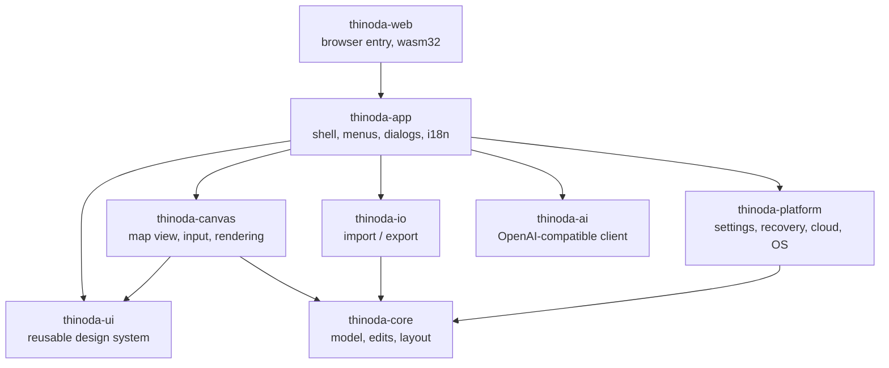

_Last updated: 2026-10-25 08:04:13 UTC (non-binding repository metadata)._ <!-- docs-stamp -->

# Architecture

| Crate | Responsibility | Depends on egui? |
|---|---|---|
| `thinoda-core` | Workbook/sheet/topic model, transactional edits + undo, layout engine for all structures, themes, templates, search, outline conversion | no |
| `thinoda-io` | `.thinoda`, XMind, FreeMind, OPML, Markdown, text; bounded MindManager `.mmap` read/write and `.xmmap` import with conversion reports; SVG/PNG/JPEG/PDF/Word/Excel/CSV export; format detection | no |
| `thinoda-platform` | Paths, settings (TOML), atomic file writes, crash recovery journal + panic hook, cloud folder detection, single instance, system theme; on wasm a `localStorage` virtual file system, downloads and browser printing | no |
| `thinoda-ai` | Blocking HTTP client (async `fetch` client on wasm) for `/v1/models` + `/v1/chat/completions`, prompts, outline parser, background `AiJob`, mock server for tests | no |
| `thinoda-ui` | Design tokens, light/dark visuals, widgets, palette, toasts, dialogs, icons, fonts — **the reusable library for companion apps** | yes |
| `thinoda-canvas` | Interactive mind map widget: hit-testing, selection, drag & drop, inline editing, keyboard actions | yes |
| `thinoda-app` | eframe application, commands (`Cmd`), menus, panels, dialogs, CLI | yes |
| `thinoda-web` | Static web app entry: mounts `ThinodaApp` on a canvas with `eframe::WebRunner`, unsaved-changes and recovery page handlers ([docs/WEB.md](WEB.md)) | yes |
| `xtask` | `cargo xtask ci`, `icons`, `package` | no |

## Key decisions
- **One code base for desktop and web**: the web app is the same `thinoda-app`
  compiled to `wasm32-unknown-unknown`. Platform differences live behind
  `thinoda-platform::fs` (std::fs vs. `localStorage` VFS), `thinoda-app::files`
  (blocking vs. async pickers, downloads) and `cfg(target_arch = "wasm32")`
  branches for printing and AI; see [WEB.md](WEB.md).
- **egui + wgpu**: immediate-mode UI keeps the whole app in Rust, renders through Direct3D 12,
  Metal or Vulkan, and is testable headlessly with `egui_kittest` (AccessKit tree).
- **Commands**: every menu item, shortcut and palette entry maps to one `Cmd`; e2e tests call
  `ThinodaApp::exec` or press real keys.
  `Cmd::shortcut_id()` supplies explicit, nonlocalized built-in identities such as
  `file.save`, independently of numeric palette row IDs. `shortcut_commands()` and
  `shortcut_command(id)` expose the shortcut target registry without adding
  palette actions; Close Tab resolves to the active tab at lookup time.
  Payload-specific paths/templates/styles/clipboard text are not generic targets.
  `edit.paste` resolves to `MenuPaste` (request OS clipboard), not stored content.
  Registry membership is not availability or key ownership: callers must still
  use the command/focus guards. `Settings.shortcuts_overrides` remains inactive
  and preserves stable, legacy, numeric and unknown keys without guessing a
  migration. `Settings.keymaps` is a separate version-1 profile library:
  immutable Thinoda Standard/XMind-compatible presets and named user copies,
  with command-ID bindings and explicit empty lists for unassignment.
  Logical Command is Cmd on macOS and Ctrl elsewhere; physical Control remains
  distinguishable. Profile validation rejects duplicate/unknown identities,
  unknown keys, conflicting dispatch and reserved system/browser/text-editor
  gestures before activation. Invalid stored profiles are retained but produce
  a visible warning and use Standard rather than silently activating.
  Settings > Keyboard Shortcuts > Edit mappings stages profile selection,
  duplication, rename, delete, reset and key capture until Apply; Cancel leaves
  persisted settings unchanged. Apply writes settings atomically before changing
  live preferences and keeps failed saves open for retry. Changed assignments
  and aliases are reviewed in both Map and Outline contexts.
  All document windows share that canonical profile library. Successful Apply
  invalidates pending Settings pointer gestures, preserves the live sidebar
  selections when saving, and requests repaint of every owner viewport.
  AppKit application-menu aliases retain the resolved accelerators, including
  explicit unassignment, instead of reinstating fixed Settings/Quit bindings.
  Global, insertion and view dispatch honor the same ordered binding inventory;
  modified gestures take precedence over a general gesture of the same key,
  preserving Standard defaults except the corrected native macOS Cmd+W owner
  (Close Window, not a competing Close Tab). The canvas accepts host-supplied
  bindings while standalone consumers retain its defaults. Outline keeps visible
  row traversal rather than substituting canvas geometry for Up/Down.
  Menus, ribbon, palette, shortcut reference, native AppKit accelerators and the
  guide's active-shortcut table resolve the selected profile. Historical guide
  examples are explicitly labeled Standard. OS clipboard events and focused text
  editing retain ownership; IME candidate/commit frames cannot capture or apply
  a mapping. No profile imports or legacy-string activation are inferred.
- **Crash safety**: edits are journaled to the recovery directory every few seconds and on
  panic; saves are atomic (temp file + rename). On start the recovery dialog restores unsaved work.
  Native recovery locks explicitly unlock before closing their file descriptor:
  a concurrently forked child's duplicate must not delay orphan discovery after
  the owning session releases its lock. Orphan documents retain a shared lease
  until restoration/discard or the last handle is dropped.
  Suspension flushes while holding ownership and releases only on success.
  Suspended managers may queue in-memory work, but cannot flush/remove snapshots
  before resuming; cleanup must reacquire ownership so it cannot delete another
  process's claimed orphan.
  Restore validates every snapshot in a selected session before opening any of
  its maps or deleting its snapshots. Failed sessions stay claimed and visible
  for retry; other selected sessions can still restore. Explicit discard retains
  only documents whose deletion failed, with visible errors and logging.
  Post-restore cleanup errors are reported rather than silently ignored.
  Before opening restored maps and removing their originals, the app synchronously
  persists replacement snapshots in its current recovery session. Failed handoffs
  retain the original session for retry and attempt cleanup of new snapshot keys.
  The platform handoff writer holds session ownership and never queues a failed
  write for later resurrection. If recovery is unavailable, maps can still open,
  but their original snapshots remain on disk and a warning is shown.
  Focused Notes/Hyperlink drafts belong to `OpenDoc`, not only egui's temporary
  text buffer. They contribute to dirty/close detection and idle tracking.
  Commands, saves and native close handling commit them as one undo step;
  recovery overlays their current value on a copy without committing history.
  Missing file fingerprints or failed metadata checks count as an unverifiable
  external change: interactive saves require conflict resolution and autosave
  skips the write. Failed saves and canceled MindManager save consent revoke
  overwrite authorization so a later attempt asks again.
  Save As compares absolute/canonical destination identity, not just literal
  path spelling; aliases of the current file retain conflict protection.
  Source-preserving sheet saves/conversions use the same identity check and
  propagate identity errors instead of silently classifying them as distinct.
  Tab-close prompts and save continuations target the stable document key,
  never a retained vector index. Conflict/conversion decisions resume that same
  close only after a successful save leaves no unsaved work. Cancellation,
  failure or removal of the target ends the continuation, so subsequent saves
  cannot revive it or close a replacement tab.
  Drafts bind to the document, sheet index/root and topic, since duplicated
  sheets can share topic IDs. Changed or missing source fields fail explicitly
  and retain the draft instead of overwriting newer content. Single-line
  Hyperlink Escape still cancels rather than commits.
  Command-boundary flushes invalidate committed UI buffers, and unchanged field
  buffers follow model updates, so Undo cannot resurrect stale text. Toolbar
  Undo/Redo availability accounts for pending inspector changes.
  Native window-close requests and the explicit Quit command retain distinct
  intents through save-all continuation; cancel preserves the dirty workspace,
  while discard closes only after the shared close decision is accepted. The
  macOS Window menu exposes Close Window (Cmd+W) separately from the application
  menu's Quit (Cmd+Q), both entering the app's normal unsaved-work path.
  Documents can be assigned to same-process eframe secondary viewports with
  `show_viewport_immediate`; the stable document key maps to exactly one owning
  viewport, and each viewport has its own active-tab key. A child close commits
  pending inspector drafts and returns its documents to the root without closing
  them, preserving unsaved state. This is not yet per-window Save/Cancel/Discard:
  root/last-window shutdown uses the existing shared app lifecycle, while child
  close has no prompt because it returns the documents instead.
- **Text input ownership**: Map and Outline use `MapView`'s per-edit IME
  state with the shared `protect_ime_candidate_keys` guard before drawing their
  title text widgets. Candidate
  Enter/Tab/Escape cannot trigger document commit or insertion, including the
  final composition-event frame. Dismissal restores ordinary title shortcuts;
  the Outline editor locks focus while its explicit Tab handling owns insertion.
  Labels keeps independent composition state and runs the same guard before
  menus can dismiss its popup. Its input locks focus only during composition,
  so ordinary Tab navigation resumes after dismissal; candidate keys cannot add
  provisional labels or discard the draft.
- **Toolbar focus**: shared icon/captioned toolbar buttons keep egui's standard
  keyboard activation and draw a two-logical-pixel focus outline in the semantic
  text color, independent of selection or user accent. Disabled parent UIs also
  disable captioned controls' accessibility state and interaction.
- **Main-menu commands**: the host-independent menu tree drives compact menus
  and the AppKit global-menu adapter. Windows desktop uses only the ribbon,
  without an attached HMENU bar or redundant hamburger; headless, web and Linux
  hosts retain the compact menu. The Win32 adapter remains a platform primitive,
  not an active application menu. Native callbacks only queue known enabled
  IDs and wakes the egui context; application-frame dispatch uses the producing
  snapshot and rechecks document/sheet/history, text focus and modal ownership.
  AppKit snapshots also capture the owning viewport. The focused viewport alone
  synchronizes and polls the global menu; deferred actions reselect the captured
  document for dispatch and restore the prior root selection afterward. This
  routing is covered by headless tests, not by live AppKit execution.
  Standard native editing items send text-edit events when a text field owns
  focus. Menu replacement drains pending commands first, and window destruction
  removes its subclass before dropping callback data. Native integration errors
  are logged and shown, with the compact menu retained. The Windows/macOS ribbon uses
  the same tree and snapshot dispatch, with original vector icons, semantic group
  footers, a large primary command and two-row secondary columns. Width reduction first hides
  secondary captions, then collapses groups into menus; excess groups remain
  reachable through a bounded overflow menu rather than a scrolling button wall.
  Explanatory group text is available on hover and does not occupy command slots.
  Primary, labeled and compact controls use 32/24/16-point icons and at least
  44-point hit targets. Exhaustive command mappings use semantic line glyphs and
  action badges; primary/secondary semantic colors differ in both themes.
  Dropdown chevrons reserve caption space and align with its vertical center.
  Ribbon-only task aliases are Home and Capture; native menu taxonomy is unchanged.
  Each command supplies one combined tooltip with its label, binding and help;
  a long primary caption never forces a separate oversized first tile.
  Ctrl+F1 persists collapse state; Alt+1 through Alt+8 opens
  a category, and Escape or an outside press dismisses a temporary opening.
  A visible Pin/Unpin Ribbon control uses that same persisted collapse preference:
  pinned ribbons stay expanded after actions, while unpinned tab previews close.
  Settings > Editor offers Compact Ribbon, default off. Standard geometry remains
  unchanged; compact geometry uses a 160-point expanded panel instead of 200,
  34-point tab/secondary targets, 72-point primary controls, 24/20/16-point icons,
  four-point intra-group spacing and recalculated group widths/overflow budgets.
  Labels, semantic colors, shortcuts, pinning and popup command routing are shared;
  Outline and Quick Access retain their existing density.
  Short viewports switch to a bounded Ribbon menu. Tab-strip scrollbars cannot
  overlap tab hit targets; keyboard focus reveals horizontally clipped items.
  Pointer-driven ribbon commands are deferred past release so restoring a text
  field's focus delivers Undo/Cut/etc. to that field, not the map. The top bar
  includes a persisted customizable Save/Undo/Redo/Print Quick Access Toolbar;
  floating editing/topic controls remain contextual and
  keep their visibility settings. The Outline structural toolbar shares the icon
  controls and adapts between captioned tiles, labeled rows and compact icons;
  full accessible names, tooltips and all nine structural operations remain.
  Document tabs use a single rounded capsule around the name and its own close
  button. New Tab follows the last capsule inside the same scroll viewport,
  rather than being pinned across empty space. Navigation arrows stay fixed;
  per-document keys, focus reveal and shared unsaved-close decisions are retained.
  Scroll rows reserve the full capsule height plus vertical breathing room so
  borders are not clipped by a shorter default interaction row.
  AppKit integration uses the existing Objective-C platform bridge, not an
  additional menu dependency. It supplies the standard Thinoda/Services/Window
  menus, moves About/Settings/Quit into the application menu and leaves unsaved-work
  decisions in shared app commands. Key equivalents are derived from typed command
  bindings, never parsed from file names or translated labels. macOS snapshots
  omit formatted shortcut hints, so native menus can initialize before egui fonts.
  NSMenu delegates
  retain the current tree during tracking; queued selections and generation
  ownership prevent old native items from invoking a replacement tree's commands.
  Detaching disables the callback and restores the previous AppKit menu tree.
  Real AppKit SDK/lifecycle fixtures run only on macOS; Windows tests do not
  establish macOS UI/VoiceOver acceptance. Native viewport creation and AppKit
  focused-window routing, per-window close/save decisions, root/last-window
  lifecycle, recovery ownership, IPC/open/reopen routing, VoiceOver and
  multi-monitor behavior remain acceptance work.
  Native Linux uses an in-window row of the same eight shared menu categories
  when the available width supports it (at least 1400 logical points at the
  selected UI scale); narrower windows retain the compact
  hamburger. This is an app-owned eframe menu surface, not a GNOME global-menu
  exporter or a claim of Ubuntu/Orca host acceptance.
- **Touch navigation ownership**: `MapView` latches an owned or rejected
  multitouch sequence until all contacts lift. Owned two-finger input scales
  about the previous centroid, then translates to the current centroid. It
  bypasses the wheel/zoom fallback so synthesized zoom is not applied twice.
  Multitouch or touch cancellation discards pending topic/relationship drags and
  suppresses click/drop actions for that sequence. Single-finger blank-background
  dragging pans; mouse blank-background dragging retains rubber-band selection.
  Three-or-more-finger, popup and disabled states cancel ownership rather than
  acquiring it halfway through a gesture. No gesture creates a navigation undo
  entry. Hosts use `CanvasOutput::context_menu`, not the raw response's menu:
  it applies the same ownership guard to egui's synthesized long-touch secondary
  clicks and closes menus for suppressed sequences. Single-touch holds retain
  the upstream recognizer; no duplicate timer or platform gesture is installed.
  Canvas ownership survives the final raw touch until the synthesized primary
  pointer also releases, preventing late click-through. The shared
  `widgets::touch_activation_allowed` cancellation/multitouch latch is sampled
  each app frame, including while controls are hidden, and cached across layout
  passes. Outline title/disclosure/command activation and shared switches,
  segmented choices and color swatches use it. Symbol insertion/removal, default-
  color/contrast actions and color application share that guard in the inspector
  and context instance editor. Swatch IDs combine the individual layout UI's
  unique ID with the color, not the inherited scope ID: adjacent Fill/Border/
  Text/Line palettes must not capture one another's input. Color-based suffixes
  preserve keyboard focus when a custom swatch disappears. Scroll areas and text inputs keep
  upstream scrolling/text-selection behavior. Preview cards gate pointer
  activation with the same latch while retaining explicit keyboard activation;
  template double-click creation requires that guarded activation too. The
  structure launcher's popup toggle is guarded independently. This does not yet
  guard every standard egui button, slider or combo box. Sheet strip selection,
  creation, rename, arrows, context opening and commands share the latch without
  disabling scrolling or replacing egui's single-finger hold recognizer.
  The custom-theme editor retains a full staged-theme/role snapshot across each
  pointer sequence. Cancel, multitouch, focus loss or skipped editor frames restore
  its starting values through release, including changes made on earlier drag
  frames; rejected releases cannot save/apply or dismiss it via outside clicks.
  Settings pointer edits live in a separate staged profile until clean release;
  ordinary app behavior and settings writes continue to see the committed profile.
  Cancel, multitouch, focus loss, a disabled/hidden window, skipped frames or an
  intervening profile change reject the draft without replacing newer preferences.
  Language/title defaults update only after acceptance. Credential save/clear,
  connection tests, folder/install actions and shortcut navigation require accepted
  activation; rejected input retains the independent API-key text draft.
  Shared confirmation dialogs gate every button kind and backdrop dismissal
  with the same touch latch, so rejected releases cannot authorize saving,
  discarding, overwriting or canceling a pending decision. Clean mouse/touch
  and keyboard activation retain the normal confirmation behavior.
  Theme-library edit/remove launchers and quick-style save/remove launchers
  (including the removal menu action) share this latch. The quick-style name
  dialog also gates Save, Cancel and backdrop dismissal, preserving typed
  draft text and persisted library contents across rejected releases.
  Sheet-rename decisions use the same latch and a draft owner composed of the
  document key, active sheet index and model revision. A changed owner dismisses
  the dialog with a warning instead of renaming the current replacement target.
  IME candidate keys retain their existing protection before final confirmation.
  Print-preview output, retry and close decisions also share the latch,
  including backdrop dismissal; canceled input cannot initiate a print/PDF
  handoff. Page-setup gestures retain their starting settings through the primary
  pointer sequence; cancel, multitouch, focus loss and skipped dialog frames
  restore that snapshot through release without disabling page setup.
  Screenshot-editor crop, square/frame/color settings retain the same
  sequence-scoped rollback contract. Rejected releases cannot copy/save output
  or dismiss the editor; a canceled crop clears its provisional drag origin.
  Label-popup add/remove/suggestion/sort/apply/cancel actions use the touch latch;
  rejected outside releases retain the popup and its typed draft.
  Symbol-color and MindManager export consents bind to document key, sheet and
  revision after committing title edits. Switching/removing/changing the source
  revokes both decisions and symbol-loss authorization; tab-vector reordering
  alone does not transfer consent to the tab now occupying its old index.
  Masked-copy preview consent uses the same document/sheet/revision boundary;
  rejected touches cannot create or cancel a preview. Guide/shortcut filters,
  legal-document selection/copy/links and auxiliary dialog decisions share the
  cancellation latch without changing text selection or typed searches.
  Palette command selection/backdrop and Find/Replace navigation, options and
  replacement use the same latch. Rejected gestures preserve queries, replacement
  drafts, scope, selection and history. The palette's stable search input protects
  IME candidate Enter/Tab/Escape before commands or modal dismissal; deliberate
  keyboard execution resumes after composition.
  Backend/browser and real-device acceptance is tracked in PLAN/WEB.
- **AI off the UI thread**: `AiJob` runs on a worker thread; the app polls it each frame and applies
  the result as one undo step. Works with any OpenAI-compatible server; nothing leaves the
  machine when a local server (LM Studio, Ollama) is used.
  Topic requests capture document key, active sheet/root and revision after title
  commit. Results for closed, changed or draft-editing sources are rejected with
  a visible warning; unchanged background documents retain their original target
  without activating a different tab. Disabling AI drops pending result ownership
  so re-enabling it cannot revive that result; already-running bounded HTTP work
  is not forcibly aborted.
  Connection-test work and model lists belong to their endpoint and credential
  draft; changing either discards them, while choosing a model keeps the list.
  Generate requires accepted activation and retains rejected prompt drafts.
  Its stable text editor protects IME candidate keys before global shortcuts;
  deliberate Escape dismisses the prompt only after composition has ended.
- **Printing**: `thinoda-io::print` fits the complete current-sheet export SVG onto
  physical paper, rendering directly at 150/300 dpi with bounded page allocation
  (no viewport screenshots or full-map intermediate raster clipping). The app
  freezes a workbook snapshot after committing title edits, runs rendering/encoding
  on workers and rejects stale previews after settings changes. Preview, native
  printer page and paper-sized PDF use the same raster. `thinoda-platform::printing`
  validates dimensions and converts RGB to bounded opaque BGRA on a worker.
  The eframe adapter borrows its live window handle and invokes a compact native
  C++/C/Objective-C bridge synchronously on the main/window thread, never a rendering
  worker. Windows uses `IPrintManagerInterop` for the HWND and a WinRT
  `IPrintDocumentSource`/`IPrintDocumentPageSource` with a
  `IPrintPreviewPageCollection`. Pagination reads the selected printer's
  `PrintTaskOptions.GetPageDescription(1)`; Direct2D paints the full source page
  inside that page's imageable rectangle. DXGI surfaces populate the actual
  Windows system preview; `ID2D1PrintControl` writes the same drawing to the OS
  package target only when Windows requests `MakeDocument` after confirmation.
  D3D11 WARP avoids dependence on the application's GPU and supports x64/ARM64.
  macOS uses the AppKit modal printer/driver panel and NSPrintOperation;
  Linux uses GTK 3 PrintOperation, Cairo and desktop printer backends. No generated
  HTML, browser/viewer launcher or temporary print files remain. Native buffers are
  borrowed only for the synchronous call; the Windows COM source owns a pixel
  copy, serializes callbacks and disconnects retained preview targets on exit.
  Late callbacks return `RO_E_CLOSED`. Its STA modal message loop keeps the owner
  disabled until PrintTask completion, unregisters handlers and restores the
  owner's enabled state. Only `PrintTaskCompletion.Submitted` means submission;
  cancelled/abandoned tasks are cancellation, and HRESULT failures are errors.
  Showing the native UI alone is never reported as submission.
  The app preview stays modal during
  preparation, native UI and submission; cancellation retains it for retry.
  Native cancellation, submission acceptance and errors are distinct; no result
  confirms physical printing. OS paper changes fit the entire fixed preview page
  proportionally into the selected printable area without cropping/reflow.
  Driver options may further affect output. Linux respects page-setup and reported
  hardware margins; no hardware information means the selected setup is used.
  Native dialogs follow OS language/theme rather than app overrides.
  GTK cannot use a winit Wayland surface as a GtkWindow parent: the blocked app
  event loop guarantees editor modality, but compositor taskbar grouping may differ.
  Build requirements are the target's C toolchain, macOS AppKit SDK, or Linux GTK 3
  development files (`libgtk-3-dev`, `pkg-config`). These are already installed by CI.
  Linux runtime needs GTK 3 with a CUPS backend for physical printers.
  GTK/Cairo symbols are resolved from the host's `libgtk-3.so.0` (including its
  dependency scope); missing libraries/symbols are explicit errors. This keeps
  the existing AppImage packager from bundling a partial GTK without its CUPS
  modules or mixing bundled GTK and host modules. `.deb` already declares GTK 3;
  AppImage users also need host GTK 3. Build-time pkg-config supplies headers
  only, not a direct GTK link. Windows/macOS use their system APIs/frameworks.
  Unit/UI tests never submit jobs: they cover the same native fit function,
  bounded conversion, outcome mapping, immutable snapshots and modal behavior.
  Windows SDK-native tests additionally read back WARP preview pixels for
  page/imageable-area changes, retain interfaces after disconnect, distinguish
  completion states and serialize/reopen a one-page XPS package entirely in a
  memory stream (no printer/spooler). The Python native harness runs on Windows
  x64/ARM64 CI with strict C++ compilation. See [native printing](NATIVE-PRINTING.md)
  for API references, manual checks and platform limitations.
  Native driver behavior still requires smoke tests on Windows x64/ARM64,
  macOS Intel/ARM64 and Linux X11/Wayland.
- **Task scheduling**: a sheet's versioned `SchedulingData` owns its work
  calendar, topic-keyed tasks and finish-to-start dependencies; legacy
  `Topic.todo` remains an independent checkbox. Dates serialize as ISO
  date-only values, never UTC timestamps. Durations count working days
  inclusively, and dependency propagation starts successors on the next working
  date after predecessors finish. The core bounds dates to years 0001-9999,
  task durations to 3,650 days, tasks to 5,000 and dependencies/calendar
  exceptions to 20,000/5,000. Native `.thinoda` archive version 2 stores this
  schema; version 1 remains readable. Workbook validation is also used when
  recovering snapshots. App task/calendar drafts and Gantt views use these
  same validated, undoable edits.
- **Scheduling API**: `LocalDate` implements `FromStr`/`Display` and exposes
  ordinal, signed day-distance and checked calendar-day addition, with `MIN`/
  `MAX` bounds. `Weekday::ALL` and `Weekday::name()` expose stable weekday
  choices. `WorkCalendar::working_duration(start, finish)` counts inclusive
  working days; `finish_date(start, duration)` and `add_working_days` keep
  schedule arithmetic in core for any future editor or timeline.
- **Gantt export**: `thinoda_io::render_gantt(&Sheet)` returns deterministic
  topic-ID-ordered rows, computed finish-to-start dates, full chart bounds and
  SVG. `GanttDocument` also renders PNG/vector PDF or a paper-sized
  `PrintDocument` via the shared raster, PDF and print placement helpers.
  `export_gantt_csv` emits the same rows as UTF-8 CSV. Unscheduled tasks remain
  visible; an empty task table and invalid schedules return explicit errors.
  Chart exports are bounded to 6,000 inclusive timeline days, 5,000 task rows,
  4 MiB of UTF-8 task labels, and 16 MiB each for SVG and CSV; PNG adds 16,384
  pixels per side and 32 million total pixels. Print uses existing paper, DPI
  and page bounds. CSV is independently byte/row bounded and does not inherit
  the graphical timeline limit.
- **Task/Gantt app ownership**: `planning.rs` stages explicit Task/Work Calendar
  drafts owned by a document key, sheet, history revision and opening viewport.
  Apply validates the captured owner and applies task/dependency edits together.
  `gantt.rs` holds only a reference to the same document/sheet, not a second
  `OpenDoc`; native immediate viewports and the browser window project that
  shared schedule. Interactive bar/progress gestures reuse the existing
  owner-checked numeric staging helper and make one Undo edit on release.
  Native chart focus uses shared profile resolution and a restricted command
  surface; Close Window targets the auxiliary viewport, never Close Tab.
  Exports capture a sheet snapshot for bounded worker rendering and atomic
  file writes, followed by the existing desktop/browser delivery path.
  `PrintEditor` captures either a map or Gantt source and the preview viewport;
  closing Gantt returns an open print preview to the root without losing the
  rendered source. Cross-platform native visual/printing acceptance remains
  separate from headless ownership and rendering tests.
- **Localization**: app chrome uses the embedded English/German and
  ES/FR/DA/NL/PT-PT/PT-BR/IT/PL catalogs in `thinoda-app/src/i18n.rs`,
  `locales.txt` and `pt-BR.txt`. English strings are stable keys; the
  pipe-delimited catalog has an explicit translation in each column (the header
  specifies order). Brazilian Portuguese deliberately shares common Portuguese
  text with explicit regional overrides. Completeness tests cover literal calls
  and dynamically selected labels; missing runtime keys are logged before English
  fallback. Add a key to every catalog, preserve extension/shortcut tokens and
  review terminology in its actual UI. Autonyms in the language dropdown are not
  translated. Settings keeps stable snake-case enum values; Auto resolves complete
  locale subtags. Installer translations live in `assets/installer`; pinned
  packager contracts are checked by `.github/scripts/test_installer_languages.py`.
