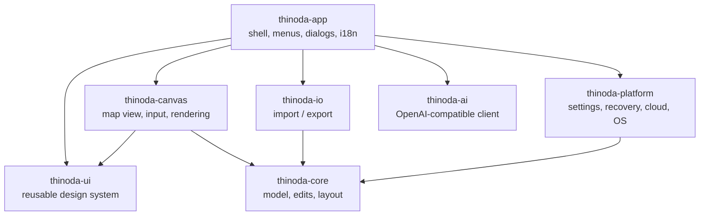

_Last updated: 2026-10-18 08:43:41 UTC (non-binding repository metadata)._ <!-- docs-stamp -->

# Architecture

| Crate | Responsibility | Depends on egui? |
|---|---|---|
| `thinoda-core` | Workbook/sheet/topic model, transactional edits + undo, layout engine for all structures, themes, templates, search, outline conversion | no |
| `thinoda-io` | `.thinoda`, XMind, FreeMind, OPML, Markdown, text, MindManager import; SVG/PNG/JPEG/PDF/Word/Excel/CSV export; format detection | no |
| `thinoda-platform` | Paths, settings (TOML), atomic file writes, crash recovery journal + panic hook, cloud folder detection, single instance, system theme | no |
| `thinoda-ai` | Blocking HTTP client for `/v1/models` + `/v1/chat/completions`, prompts, outline parser, background `AiJob`, mock server for tests | no |
| `thinoda-ui` | Design tokens, light/dark visuals, widgets, palette, toasts, dialogs, icons, fonts — **the reusable library for companion apps** | yes |
| `thinoda-canvas` | Interactive mind map widget: hit-testing, selection, drag & drop, inline editing, keyboard actions | yes |
| `thinoda-app` | eframe application, commands (`Cmd`), menus, panels, dialogs, CLI | yes |
| `xtask` | `cargo xtask ci`, `icons`, `package` | no |

## Key decisions
- **egui + wgpu**: immediate-mode UI keeps the whole app in Rust, renders through Direct3D 12,
  Metal or Vulkan, and is testable headlessly with `egui_kittest` (AccessKit tree).
- **Commands**: every menu item, shortcut and palette entry maps to one `Cmd`; e2e tests call
  `ThinodaApp::exec` or press real keys.
- **Crash safety**: edits are journaled to the recovery directory every few seconds and on
  panic; saves are atomic (temp file + rename). On start the recovery dialog restores unsaved work.
- **AI off the UI thread**: `AiJob` runs on a worker thread; the app polls it each frame and applies
  the result as one undo step. Works with any OpenAI-compatible server; nothing leaves the
  machine when a local server (LM Studio, Ollama) is used.
- **Printing**: `thinoda-io::print` fits the complete current-sheet export SVG onto
  physical paper, rendering directly at 150/300 dpi with bounded page allocation
  (no viewport screenshots or full-map intermediate raster clipping). The app
  freezes a workbook snapshot after committing title edits, runs rendering/encoding
  on workers and rejects stale previews after settings changes. Preview, native
  printer page and paper-sized PDF use the same raster. `thinoda-platform::printing`
  validates dimensions and converts RGB to bounded opaque BGRA on a worker.
  The eframe adapter borrows its live window handle and invokes a compact native
  C/Objective-C bridge synchronously on the main/window thread, never a rendering
  worker. Windows uses an owned PrintDlg and real StartDoc/StretchDIBits/EndDoc GDI
  submission; macOS uses the AppKit modal printer/driver panel and NSPrintOperation;
  Linux uses GTK 3 PrintOperation, Cairo and desktop printer backends. No generated
  HTML, browser/viewer launcher or temporary print files remain. Native buffers are
  borrowed only for the synchronous call. The app preview stays modal during
  preparation, native UI and submission; cancellation retains it for retry.
  Native cancellation, submission acceptance and errors are distinct; no result
  confirms physical printing. OS paper changes fit the entire fixed preview page
  proportionally into the selected printable area without cropping/reflow.
  Driver options may further affect output. Linux respects page-setup and reported
  hardware margins; no hardware information means the selected setup is used.
  Native dialogs follow OS language/theme rather than app overrides.
  GTK cannot use a winit Wayland surface as a GtkWindow parent: the blocked app
  event loop guarantees editor modality, but compositor taskbar grouping may differ.
  Build requirements are the target's C toolchain, macOS AppKit SDK, or Linux GTK 3
  development files (`libgtk-3-dev`, `pkg-config`). These are already installed by CI.
  Linux runtime needs GTK 3 with a CUPS backend for physical printers.
  GTK/Cairo symbols are resolved from the host's `libgtk-3.so.0` (including its
  dependency scope); missing libraries/symbols are explicit errors. This keeps
  the existing AppImage packager from bundling a partial GTK without its CUPS
  modules or mixing bundled GTK and host modules. `.deb` already declares GTK 3;
  AppImage users also need host GTK 3. Build-time pkg-config supplies headers
  only, not a direct GTK link. Windows/macOS use their system APIs/frameworks.
  Unit/UI tests never submit jobs: they cover the same native fit function,
  bounded conversion, outcome mapping, immutable snapshots and modal behavior.
  Native driver behavior still requires smoke tests on Windows x64/ARM64,
  macOS Intel/ARM64 and Linux X11/Wayland.
