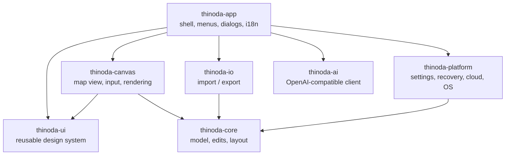

# Architecture

| Crate | Responsibility | Depends on egui? |
|---|---|---|
| `thinoda-core` | Workbook/sheet/topic model, transactional edits + undo, layout engine for all structures, themes, templates, search, outline conversion | no |
| `thinoda-io` | `.thinoda`, XMind, FreeMind, OPML, Markdown, text, MindManager import; SVG/PNG/JPEG/PDF/Word/Excel/CSV export; format detection | no |
| `thinoda-platform` | Paths, settings (TOML), atomic file writes, crash recovery journal + panic hook, cloud folder detection, single instance, system theme | no |
| `thinoda-ai` | Blocking HTTP client for `/v1/models` + `/v1/chat/completions`, prompts, outline parser, background `AiJob`, mock server for tests | no |
| `thinoda-ui` | Design tokens, light/dark visuals, widgets, palette, toasts, dialogs, icons, fonts — **the reusable library for companion apps** | yes |
| `thinoda-canvas` | Interactive mind map widget: hit-testing, selection, drag & drop, inline editing, keyboard actions | yes |
| `thinoda-app` | eframe application, commands (`Cmd`), menus, panels, dialogs, CLI | yes |
| `xtask` | `cargo xtask ci`, `icons`, `package` | no |

## Key decisions
- **egui + wgpu**: immediate-mode UI keeps the whole app in Rust, renders through Direct3D 12,
  Metal or Vulkan, and is testable headlessly with `egui_kittest` (AccessKit tree).
- **Commands**: every menu item, shortcut and palette entry maps to one `Cmd`; e2e tests call
  `ThinodaApp::exec` or press real keys.
- **Crash safety**: edits are journaled to the recovery directory every few seconds and on
  panic; saves are atomic (temp file + rename). On start the recovery dialog restores unsaved work.
- **AI off the UI thread**: `AiJob` runs on a worker thread; the app polls it each frame and applies
  the result as one undo step. Works with any OpenAI-compatible server; nothing leaves the
  machine when a local server (LM Studio, Ollama) is used.
