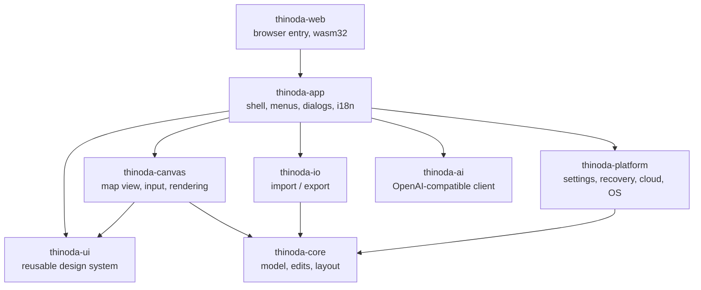

_Last updated: 2026-10-23 06:58:00 UTC (non-binding repository metadata)._ <!-- docs-stamp -->

# Architecture

| Crate | Responsibility | Depends on egui? |
|---|---|---|
| `thinoda-core` | Workbook/sheet/topic model, transactional edits + undo, layout engine for all structures, themes, templates, search, outline conversion | no |
| `thinoda-io` | `.thinoda`, XMind, FreeMind, OPML, Markdown, text; bounded MindManager `.mmap` read/write and `.xmmap` import with conversion reports; SVG/PNG/JPEG/PDF/Word/Excel/CSV export; format detection | no |
| `thinoda-platform` | Paths, settings (TOML), atomic file writes, crash recovery journal + panic hook, cloud folder detection, single instance, system theme; on wasm a `localStorage` virtual file system, downloads and browser printing | no |
| `thinoda-ai` | Blocking HTTP client (async `fetch` client on wasm) for `/v1/models` + `/v1/chat/completions`, prompts, outline parser, background `AiJob`, mock server for tests | no |
| `thinoda-ui` | Design tokens, light/dark visuals, widgets, palette, toasts, dialogs, icons, fonts — **the reusable library for companion apps** | yes |
| `thinoda-canvas` | Interactive mind map widget: hit-testing, selection, drag & drop, inline editing, keyboard actions | yes |
| `thinoda-app` | eframe application, commands (`Cmd`), menus, panels, dialogs, CLI | yes |
| `thinoda-web` | Static web app entry: mounts `ThinodaApp` on a canvas with `eframe::WebRunner`, unsaved-changes and recovery page handlers ([docs/WEB.md](WEB.md)) | yes |
| `xtask` | `cargo xtask ci`, `icons`, `package` | no |

## Key decisions
- **One code base for desktop and web**: the web app is the same `thinoda-app`
  compiled to `wasm32-unknown-unknown`. Platform differences live behind
  `thinoda-platform::fs` (std::fs vs. `localStorage` VFS), `thinoda-app::files`
  (blocking vs. async pickers, downloads) and `cfg(target_arch = "wasm32")`
  branches for printing and AI; see [WEB.md](WEB.md).
- **egui + wgpu**: immediate-mode UI keeps the whole app in Rust, renders through Direct3D 12,
  Metal or Vulkan, and is testable headlessly with `egui_kittest` (AccessKit tree).
- **Commands**: every menu item, shortcut and palette entry maps to one `Cmd`; e2e tests call
  `ThinodaApp::exec` or press real keys.
  `Cmd::shortcut_id()` supplies explicit, nonlocalized built-in identities such as
  `file.save`, independently of numeric palette row IDs. `shortcut_commands()` and
  `shortcut_command(id)` expose the shortcut target registry without adding
  palette actions; Close Tab resolves to the active tab at lookup time.
  Payload-specific paths/templates/styles/clipboard text are not generic targets.
  `edit.paste` resolves to `MenuPaste` (request OS clipboard), not stored content.
  Registry membership is not availability or key ownership: callers must still
  use the command/focus guards. `Settings.shortcuts_overrides` remains inactive
  and preserves stable, legacy, numeric and unknown keys without guessing a
  migration. Activating overrides still requires a versioned binding format,
  conflict/reserved-key policy and explicit editor/reset behavior.
- **Crash safety**: edits are journaled to the recovery directory every few seconds and on
  panic; saves are atomic (temp file + rename). On start the recovery dialog restores unsaved work.
  Focused Notes/Hyperlink drafts belong to `OpenDoc`, not only egui's temporary
  text buffer. They contribute to dirty/close detection and idle tracking.
  Commands, saves and native close handling commit them as one undo step;
  recovery overlays their current value on a copy without committing history.
  Drafts bind to the document, sheet index/root and topic, since duplicated
  sheets can share topic IDs. Changed or missing source fields fail explicitly
  and retain the draft instead of overwriting newer content. Single-line
  Hyperlink Escape still cancels rather than commits.
  Command-boundary flushes invalidate committed UI buffers, and unchanged field
  buffers follow model updates, so Undo cannot resurrect stale text. Toolbar
  Undo/Redo availability accounts for pending inspector changes.
- **Text input ownership**: Map and Outline use `MapView`'s per-edit IME
  state with the shared `protect_ime_candidate_keys` guard before drawing their
  title text widgets. Candidate
  Enter/Tab/Escape cannot trigger document commit or insertion, including the
  final composition-event frame. Dismissal restores ordinary title shortcuts;
  the Outline editor locks focus while its explicit Tab handling owns insertion.
  Labels keeps independent composition state and runs the same guard before
  menus can dismiss its popup. Its input locks focus only during composition,
  so ordinary Tab navigation resumes after dismissal; candidate keys cannot add
  provisional labels or discard the draft.
- **Toolbar focus**: shared icon/captioned toolbar buttons keep egui's standard
  keyboard activation and draw a two-logical-pixel focus outline in the semantic
  text color, independent of selection or user accent. Disabled parent UIs also
  disable captioned controls' accessibility state and interaction.
- **AI off the UI thread**: `AiJob` runs on a worker thread; the app polls it each frame and applies
  the result as one undo step. Works with any OpenAI-compatible server; nothing leaves the
  machine when a local server (LM Studio, Ollama) is used.
- **Printing**: `thinoda-io::print` fits the complete current-sheet export SVG onto
  physical paper, rendering directly at 150/300 dpi with bounded page allocation
  (no viewport screenshots or full-map intermediate raster clipping). The app
  freezes a workbook snapshot after committing title edits, runs rendering/encoding
  on workers and rejects stale previews after settings changes. Preview, native
  printer page and paper-sized PDF use the same raster. `thinoda-platform::printing`
  validates dimensions and converts RGB to bounded opaque BGRA on a worker.
  The eframe adapter borrows its live window handle and invokes a compact native
  C++/C/Objective-C bridge synchronously on the main/window thread, never a rendering
  worker. Windows uses `IPrintManagerInterop` for the HWND and a WinRT
  `IPrintDocumentSource`/`IPrintDocumentPageSource` with a
  `IPrintPreviewPageCollection`. Pagination reads the selected printer's
  `PrintTaskOptions.GetPageDescription(1)`; Direct2D paints the full source page
  inside that page's imageable rectangle. DXGI surfaces populate the actual
  Windows system preview; `ID2D1PrintControl` writes the same drawing to the OS
  package target only when Windows requests `MakeDocument` after confirmation.
  D3D11 WARP avoids dependence on the application's GPU and supports x64/ARM64.
  macOS uses the AppKit modal printer/driver panel and NSPrintOperation;
  Linux uses GTK 3 PrintOperation, Cairo and desktop printer backends. No generated
  HTML, browser/viewer launcher or temporary print files remain. Native buffers are
  borrowed only for the synchronous call; the Windows COM source owns a pixel
  copy, serializes callbacks and disconnects retained preview targets on exit.
  Late callbacks return `RO_E_CLOSED`. Its STA modal message loop keeps the owner
  disabled until PrintTask completion, unregisters handlers and restores the
  owner's enabled state. Only `PrintTaskCompletion.Submitted` means submission;
  cancelled/abandoned tasks are cancellation, and HRESULT failures are errors.
  Showing the native UI alone is never reported as submission.
  The app preview stays modal during
  preparation, native UI and submission; cancellation retains it for retry.
  Native cancellation, submission acceptance and errors are distinct; no result
  confirms physical printing. OS paper changes fit the entire fixed preview page
  proportionally into the selected printable area without cropping/reflow.
  Driver options may further affect output. Linux respects page-setup and reported
  hardware margins; no hardware information means the selected setup is used.
  Native dialogs follow OS language/theme rather than app overrides.
  GTK cannot use a winit Wayland surface as a GtkWindow parent: the blocked app
  event loop guarantees editor modality, but compositor taskbar grouping may differ.
  Build requirements are the target's C toolchain, macOS AppKit SDK, or Linux GTK 3
  development files (`libgtk-3-dev`, `pkg-config`). These are already installed by CI.
  Linux runtime needs GTK 3 with a CUPS backend for physical printers.
  GTK/Cairo symbols are resolved from the host's `libgtk-3.so.0` (including its
  dependency scope); missing libraries/symbols are explicit errors. This keeps
  the existing AppImage packager from bundling a partial GTK without its CUPS
  modules or mixing bundled GTK and host modules. `.deb` already declares GTK 3;
  AppImage users also need host GTK 3. Build-time pkg-config supplies headers
  only, not a direct GTK link. Windows/macOS use their system APIs/frameworks.
  Unit/UI tests never submit jobs: they cover the same native fit function,
  bounded conversion, outcome mapping, immutable snapshots and modal behavior.
  Windows SDK-native tests additionally read back WARP preview pixels for
  page/imageable-area changes, retain interfaces after disconnect, distinguish
  completion states and serialize/reopen a one-page XPS package entirely in a
  memory stream (no printer/spooler). The Python native harness runs on Windows
  x64/ARM64 CI with strict C++ compilation. See [native printing](NATIVE-PRINTING.md)
  for API references, manual checks and platform limitations.
  Native driver behavior still requires smoke tests on Windows x64/ARM64,
  macOS Intel/ARM64 and Linux X11/Wayland.
- **Localization**: app chrome uses the embedded English/German and
  ES/FR/DA/NL/PT-PT/PT-BR/IT/PL catalogs in `thinoda-app/src/i18n.rs`,
  `locales.txt` and `pt-BR.txt`. English strings are stable keys; the
  pipe-delimited catalog has an explicit translation in each column (the header
  specifies order). Brazilian Portuguese deliberately shares common Portuguese
  text with explicit regional overrides. Completeness tests cover literal calls
  and dynamically selected labels; missing runtime keys are logged before English
  fallback. Add a key to every catalog, preserve extension/shortcut tokens and
  review terminology in its actual UI. Autonyms in the language dropdown are not
  translated. Settings keeps stable snake-case enum values; Auto resolves complete
  locale subtags. Installer translations live in `assets/installer`; pinned
  packager contracts are checked by `.github/scripts/test_installer_languages.py`.
