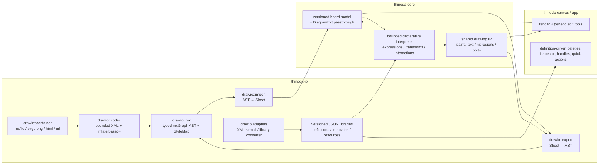

_Last updated: 2026-11-17 09:13:00 UTC (non-binding repository metadata)._ <!-- docs-stamp -->

# draw.io integration: binding architecture contracts

This document keeps the contracts that already govern shipped draw.io code:
confirmed user decisions, file-format essentials, the ownership, JSON stencil
DSL, model, UX, security, guardrail and licensing contracts. Section numbers
are kept from the former combined plan so existing references remain valid.
The current research, gap analysis, concept and phased plan with its progress
record live in [DRAWIO.md](DRAWIO.md). The previous phase plan and its
progress log were retired on 2026-11-17 and remain available in git history.

## 1. Problem & goal

### Sankey interoperability

Sankey sheets use native format **v25**. A draw.io export carries a versioned
`thinodaSankey` model attribute containing mode, explicit source masses, stages,
semantic weights and topic notes, mapped by exported cell IDs. Ordinary
`strokeWidth` is never interpreted as a flow weight on import. The extension is
validated on a candidate and remapped onto editable topics/connectors. The v2
extension records endpoint, displayed-label and stroke-width baselines. Deleted,
reconnected, rotated or visually edited cells, unknown versions and invalid
semantic metadata fall back atomically to ordinary editable cells with an explicit
import warning. Weights, stages, sources and extension-only notes are not restored
in that fallback. XML structure, nesting and size limits still reject unsafe
documents rather than invoking this fallback. Widths are never guessed as weights.

Other draw.io editors may strip this extension. Their view uses approximate
proportional strokes, not Thinoda's shared split/merge ribbon geometry. The stroke
uses the same effective global scale as native ribbons, capped at draw.io's
supported stroke maximum; tiny widths may also render differently externally.
Unset links are dashed with a `—%` label; explicit zero has no visible band.
The color scale overrides per-link colors when enabled. Its legend is inspector-only,
not part of exported artwork; numeric labels are exported. The export preflight
discloses these limitations. Save a `.thinoda` master for authoritative
editable data. SVG/PNG/PDF preserve the rendered ribbons but not editable flow
semantics; XMind's private Thinoda snapshot retains the native graph.

Users want to open, edit, save, import, export and copy/paste draw.io diagrams in
Thinoda, without leaving the app and without breaking existing documents, formats or
exports. "Full support" is defined measurably by three tiers, tracked in a published
**support matrix** (`docs/DRAWIO.md`) with release gates:
- **Lossless**: 100 % of cells/attributes/styles round-trip for every file (gate: all
  corpus + fuzz-derived files).
- **Rendered**: all core mxGraph handlers, all 34 markers, all edge styles, all bundled
  generic libraries render faithfully (gate: ≥ 98 % of handlers used by bundled libraries
  and core sidebar palettes; visual diff vs. draw.io reference SVGs within tolerance).
- **Editable**: every rendered element editable via Thinoda UI (gate per phase).
Anything outside a tier is reported in diagnostics as "preserved, shown approximately".

**Confirmed decisions (user):**
1. draw.io content is **converted into Thinoda's native board model**; core is extended
   (waypoints, ports, layers, dash/fonts, generic stencil shapes …) and anything not yet
   modeled is kept in a **lossless passthrough envelope** so it survives round-trips.
2. **`.drawio` is a first-class editable format**: Open edits in place, Save writes
   `.drawio` back; loss preflight only when something cannot be represented.
3. **Stencils**: bundle Apache-2.0 generic libraries; vendor icon sets (AWS, Azure, GCP,
   Cisco, …) via an **optional, user-triggered library download**, faithful placeholder
   until available.
4. **Declarative objects (user clarification, 2026-11-12):** all new shape-specific
   geometry and behavior belong in extensible JSON library documents. Implement a
   shared, bounded interpreter, not another Rust enum variant or renderer branch
   for each shape. This supersedes the earlier proposal to port individual
   JavaScript shapes into Rust. Existing native shapes need a staged, non-breaking
   migration; the shared bounded interpreter and initial persistence, rendering
   and library integration are implemented for the current DSL subset, while
   full language and library coverage remain roadmap work (see section 3.1.2).


## 2. File format essentials

- Containers: `.drawio`/`.dio`/`.xml` (`<mxfile host agent version etag modified type
  compressed>` with N `<diagram id name>` pages, each compressed text **or** literal
  `<mxGraphModel>`); legacy bare `<mxGraphModel>`; `.drawio.svg`; `.drawio.png`;
  `.drawio.html`; PDF with embedded XML; `#R<compressed>` URLs.
- `mxGraphModel` attributes: dx, dy, grid, gridSize, guides, tooltips, connect, arrows,
  fold, page, pageScale, pageWidth, pageHeight, background, backgroundGradient, math,
  shadow, adaptiveColors, backgroundImage.
- Cells: id 0 = root, id 1.. = layers (children of 0, `visible`, `locked` style), vertices
  & edges with `parent` (layer/group/container/edge for labels), `source/target`,
  `collapsed`, `connectable`, `visible`. Geometry: x/y/w/h, `relative`, `sourcePoint/
  targetPoint/offset`, `<Array as="points">` waypoints, `alternateBounds`.
- Edge labels = child vertices of the edge (relative geometry: x ∈ [-1,1] along edge +
  pixel `offset`).
- `<UserObject>`/`<object>` wrappers: `label`, arbitrary custom attributes (Edit Data),
  `placeholders="1"` with `%name%`, `tooltip`, `link` (URL, `data:page/id,…`, actions),
  `tags`.
- Style string: `[stylename|key=value];…` — leading tokens are named styles, `none`
  removes inherited keys; unknown keys must be preserved.
- Stencils: `shape=mxgraph.<ns>.<name>` resolved from XML stencil sets
  (`<shape><background><foreground><connections>` path language) or JS-coded shapes;
  `shape=stencil(<deflate-base64 XML>)` inline stencils.
- Security: `html=1` labels are untrusted HTML (sanitise / convert, never render raw);
  deflate/base64 bombs; deep nesting; huge cell counts; external image URLs (no auto-fetch).


## 3. Concept

### 3.1 Architecture



- New module tree `crates/thinoda-io/src/drawio/` (container, codec, mx, style, import,
  export, stencil, sanitize, tests) — mirrors existing `xmind.rs`/`mindmanager.rs` pattern.
- **Typed mxGraph AST** (`MxFile → MxDiagram → MxGraphModel → MxCell{id, parent, value:
  Label|UserObject, style: StyleMap, geometry, …}`) is an internal intermediate; it is
  *not* persisted. `StyleMap` keeps **ordered** key/value pairs + leading named tokens so
  export can reproduce untouched styles in their original order.

#### 3.1.1 Round-trip ownership contract (resolves passthrough lifecycle)
Three storage levels, each with a single authoritative owner:
| Level | Type | Contents |
|---|---|---|
| Workbook | `DrawIoDocumentExt` (new optional `Workbook` field) | mxfile attrs (host, agent, version, etag, type, compressed), container kind (`.drawio`/`.drawio.svg`/`.drawio.png`), compression policy, page order, unknown top-level children, source fingerprint |
| Sheet | `DrawIoPageExt` | `<diagram id name>`, mxGraphModel attrs not first-class, unknown model children, **tombstones** of deleted source cell ids |
| Object | `DrawIoCellExt` | `source_id`, `style_rest` (ordered unmapped keys), `attrs_rest` (unknown attrs/children, bounded), **owned-key mask** |

Rules (each backed by a test):
1. **Ownership table** per mapped style/attribute (`fillColor→style.fill`, `gradientColor→
   style.gradient`, …) is versioned adapter/schema data, enforced by generic code,
   not an informal convention. A key is either first-class *or* in
   `style_rest`, never both (validated). Editing a first-class field never touches
   `style_rest`; first-class fields that become unset are emitted as draw.io defaults.
   Keys whose meaning *depends* on an owned key (e.g. `gradientDirection` when gradient is
   removed, `arcSize` when `rounded=0`) are listed in the table as **dependents** and
   dropped together with their owner.
2. **Ids**: export uses `source_id` when present and unique; new objects get fresh ids
   (`<sheet-prefix>-<n>` collision-checked against all cells and tombstones). Copies keep
   `style_rest`/`attrs_rest` (unknown styling survives) but **clear `source_id`**, except
   one case: the board clipboard payload gains a provenance envelope
   `{ document_uuid, sheet_id, transfer_token, disposition: Copy|Cut }`; `source_id` is
   kept **only** when a completed Cut is pasted once into the same document (token
   matches, not yet consumed). Duplicate, Copy, stale/second paste of a cut, OS-serialized
   payloads and cross-document pastes all clear it. Tests for each case.
3. **Deletion** removes the object and its passthrough; its id goes into tombstones (only
   to avoid id reuse). Unknown cells that could not be mapped at all are imported as
   **opaque preserved objects** (selectable, movable, deletable placeholder with bounds) —
   never invisible hidden data — so the user can see and delete them.
4. **Reparent/group/ungroup** re-computes geometry in the new parent's space (§3.2.1); the
   passthrough follows the object.
5. **Undo**: passthrough blobs are immutable `Arc<…>`, shared across snapshots and counted
   once in history memory accounting.
6. **Privacy**: `masked_copy`/`mask_canvas` masks labels, tooltips, links, properties,
   HTML labels and drops `attrs_rest` text content.
7. **Budgets**: cumulative caps per object, sheet and workbook for passthrough bytes;
   exceeding them is an import diagnostic, not silent truncation.
8. **Non-draw.io documents** never get these fields; a native sheet saved to draw.io gets
   fresh ids and default envelope.

**As implemented in D6** (`thinoda_core::drawio_passthrough`, native v37, board
clipboard v30): objects carry `DrawioCellPassthrough { source_id, style, attributes }`
and sheets carry `DrawioPagePassthrough { diagram_id, model_attributes, cell_ids }`.
Deviations from the rules above: the workbook level, opaque objects for unmappable cells
and cut-once provenance are deferred to D10, so every clipboard copy clears `source_id`.
Tombstones (`cell_ids`) list only cells that became canvas objects, because topic and
zone ids are regenerated on each import. Export prefers a stored source id over the
generated `o{id}` (Sankey connectors always use `o{id}`), which keeps renumbered
re-imports stable. Object passthrough is an immutable `Arc`, shared across undo snapshots.

**As implemented in D7 (markers):** the 18 library marker kinds need native v38,
board clipboard v31 and sheet clipboard v27. Private XMind snapshots use
`THINODA-XMIND-MARKER-LIBRARY-1`, and recovery uses
`THINODA-RECOVERY-MARKER-LIBRARY-1` (`THINODA-RECOVERY-INK-MARKER-LIBRARY-1`
with pending ink). draw.io names map through one shared table in
`thinoda_io::drawio`, used by import, export and the loss check.

**As implemented in D7 (line jumps):** `CanvasConnector.line_jumps:
Option<LineJumps { style, size }>` (size 0-999, default 6) needs native v39,
board clipboard v32 and sheet clipboard v28. Private XMind snapshots use
`THINODA-XMIND-LINE-JUMPS-1`, and recovery uses `THINODA-RECOVERY-LINE-JUMPS-1`
(`THINODA-RECOVERY-INK-LINE-JUMPS-1` with pending ink). The scene stores the
derived jump paths on `SceneGeometry::Polyline`; renderers paint
`connector_stroke_paths`, while hit testing keeps the plain stroke.

**As implemented in D7 (edge routes):** `ConnectorRoute` gained
`ElbowHorizontal`, `ElbowVertical`, `SideToSide`, `TopToBottom` and
`EntityRelation` (`ConnectorRoute::ALL` is the menu order). They need native
v40, board clipboard v33 and sheet clipboard v29. Private XMind snapshots use
`THINODA-XMIND-EDGE-ROUTES-1`, and recovery uses
`THINODA-RECOVERY-EDGE-ROUTES-1` (`THINODA-RECOVERY-INK-EDGE-ROUTES-1` with
pending ink). `thinoda_core::scene` routes them before the waypoint path, using
`waypoints[0]` as the hint when `uses_waypoint_hint` is true.

- **Native format gates:** v10 covers connector waypoints, v11 covers open and
  block connector markers, v12 adds classic and thin markers, v13 adds marker
  sizes, v14 adds marker fill overrides, v15 adds diamond markers, v16 adds
  oval markers, v17 adds half-circle markers, v18 adds bar markers, v19 adds
  adjustable rectangle corners, v20 adds rectangle outline sides, v21 adds
  double ellipses, v22 adds fixed connector attachments, v23 adds standard
  draw.io rectangle rounding, and v24 adds final-state shapes. Every later field
  or passthrough representation that a v24
  reader cannot preserve must require a higher native version, with
  `required_native_version` choosing the oldest version that can represent the
  complete workbook. Older builds must reject that version instead of silently
  dropping data. Version sheet/board clipboard, recovery and private XMind
  envelopes separately whenever an older reader could otherwise ignore new
  data; reject forged older envelopes too.

#### 3.1.2 JSON stencil DSL and interpreter contract (proposed, 2026-11-12)

**Boundary.** Rust implements reusable language operations, validation, rendering
backends and undoable document commands. JSON defines the objects: geometry,
defaults, parameter ranges, modifiers, handles, transformation policies, paints,
text regions, metadata fields, connection constraints, markers, composition,
import/export bindings and library entries. A new shape expressible in the
language must require only a library change, not rebuilding Thinoda or adding
`ShapeKind` cases. Safety limits and opcode semantics are interpreter contracts;
an untrusted library cannot redefine them.

**Source-format distinction.** A draw.io library entry can be an entire
`mxGraphModel` fragment, group or image, not just a stencil. XML stencils describe
geometry and connection points, but some published shapes use registered
JavaScript renderers; the official editor notes that only XML shapes offer
Edit Shape. Therefore library ingestion needs separate adapters:

- Thinoda JSON packages: validate, resolve and compile directly.
- draw.io XML stencils, including inline compressed stencils: translate supported
  drawing/state instructions and constraints into the JSON DSL.
- draw.io `mxlibrary` entries: convert diagram fragments into JSON instance
  templates, preserving groups, connectors, labels and referenced definitions;
  sanitize and package embedded image resources separately.
- Registered JavaScript shapes: resolve through declarative aliases and JSON
  definitions supplied by a compatible library. Do not execute or attempt
  unrestricted automatic translation of third-party JavaScript.
- Unsupported instructions, dynamic functions, missing definitions and newer
  capabilities: retain bounded original data and show an explicit placeholder
  and diagnostic. Successful parsing alone is not rendering or editing support.

References: [official custom-shape language](https://www.drawio.com/docs/manual/shapes/shape-complex-create-edit/)
and [official library format](https://www.drawio.com/docs/reference/format-custom-shape-library/).
Both were rechecked alongside the published editor on 2026-11-12.

Recorded editor flows and regression targets:

| Interaction / locator | Observed outcome and acceptance target |
|---|---|
| Search textbox, `Message` palette button | Inserts an editable envelope; Thinoda must resolve a definition rather than choose a native enum variant |
| `Style` tab | Fill, line and opacity are instance style inputs; changing them must not replace the definition |
| `Text` tab | Font, alignment, label position and spacing are distinct from body geometry; external labels must not be forced into the shape |
| `Anordnen` / Arrange tab, `Vertikal` / Vertical flip | The open flap reflects while the rectangular body remains rectangular; all four directions and both flip axes need matrix tests |
| Connector-owned message in the BPMN example | The symbol remains a shape, separate from connector text; relative position, offsets and parent-edge anchoring need preservation |

The official renderer supplied reference points for 16 direction/reflection
combinations at rotation 37 degrees, all 12 message connection constraints,
and six relative edge-child positions. The supplied BPMN file contains seven
messages on its first page and six on its second. These observations and
generated regression cases are retained with the shelved prototype for the
definition-based implementation; they are not a completed acceptance claim.

**Package and instance ownership.** A JSON package has a stable namespaced ID,
schema version, DSL version, revision, required capabilities, licensing metadata,
definitions, reusable fragments, templates and resource references. An instance
stores its definition identity/content hash, parameter overrides, style
overrides, label/data values, transform and parent/anchor references, not another
copy of its drawing program. Relative edge-child placement is an instance
relationship, not a one-time flattening into absolute coordinates. Ownership
and definition/include dependencies must be acyclic; ordinary connector graphs
may contain cycles. A workbook retains the deduplicated transitive definition/resource
closure needed to open it offline. Installation or update of a library must
not silently change existing documents. An explicit, previewed, undoable
upgrade changes their pinned definitions. Clipboard, recovery and private XMind
snapshots carry the same closure and reject forged older feature envelopes.
Immutable definitions/resources are shared across undo snapshots and counted
once in history memory accounting. Editing a handle changes instance parameters,
not the shared definition or unrelated instances.

**Language proposal.** Use a typed JSON AST rather than executable strings.
Literals and explicit expression nodes such as
`{"op":"mul","args":[{"var":"width"},0.5]}` support finite arithmetic,
comparisons, conditionals and bounded geometric functions. Parameters have
types, units, defaults and valid ranges. Dependencies are resolved before
evaluation; cycles and non-finite results are errors. No `eval`, JavaScript,
arbitrary function calls, file access, network access or unbounded loops.
Schema extensions are namespaced and preserved; an unknown rendering operation
is not silently ignored. Required capability declarations distinguish an
unsupported program from harmless additional metadata.

| Definition area | Declarative contract and generic interpreter responsibility |
|---|---|
| Geometry | Lines, rectangles, ellipses, quadratic/cubic curves, arcs, open/closed compound subpaths and fill rules; separate fill and stroke paths |
| Paint | Fill/stroke/text roles, theme tokens, explicit transparent versus inherited colors, opacity, widths, dashes, joins, caps and gradients; ordered save/restore state |
| Transform | Explicit coordinate spaces, transform order, aspect policy, rotation/reflection and nested matrices; resizing versus stroke scaling defined independently |
| Modifiers/handles | Typed parameters, constraints, handle positions and bounded drag-to-parameter expressions; keyboard-adjustable generic controls with accessible labels |
| Text/data | Label regions, padding, alignment, wrapping, rich-text capability, notes, links and typed metadata fields; sanitized content and reusable Thinoda inspector controls |
| Connections | Named anchors, normalized/absolute coordinates, inset versus projected ports, perimeter paths/functions, routing constraints and marker definitions |
| Composition/merging | References, ordered child instances, groups/containers, clipping and explicit union/intersection/difference/xor operations; geometric merging is distinct from grouping or graph merging |
| Quick actions | Declared intents such as set parameter, insert template and connect named ports; executed only through generic, validated, undoable app commands |
| Interchange | Data-defined shape/style aliases, property ownership, parameter mappings and export recipes; unowned source metadata remains preserved |
| Capabilities | Explicit language/backend requirements; unsupported operations retain editable identity and source with visible limitations rather than false fidelity |

Illustrative envelope definition fragment, not a released schema:

```json
{
  "id": "thinoda.general/envelope",
  "dslVersion": 1,
  "parameters": {},
  "defaults": {"size": [120, 80]},
  "drawing": [
    {
      "op": "rect",
      "id": "body",
      "rect": [0, 0, {"var": "width"}, {"var": "height"}],
      "paint": {"fill": {"style": "fill"}, "stroke": {"style": "stroke"}}
    },
    {
      "op": "path",
      "closed": false,
      "commands": [
        {"op": "move", "to": [0, 0]},
        {"op": "line", "to": [
          {"op": "mul", "args": [{"var": "width"}, 0.5]},
          {"op": "mul", "args": [{"var": "height"}, 0.5]}
        ]},
        {"op": "line", "to": [{"var": "width"}, 0]}
      ],
      "paint": {"fill": "none", "stroke": {"style": "stroke"}}
    }
  ],
  "hitRegion": {"path": "body"},
  "perimeter": {"path": "body"},
  "ports": [
    {"at": [0.15, 0.05], "perimeter": false},
    {"at": [0.5, 0], "perimeter": true},
    {"at": [0.85, 0.05], "perimeter": false},
    {"at": [0, 0.3], "perimeter": true},
    {"at": [0, 0.5], "perimeter": true},
    {"at": [0, 0.7], "perimeter": true},
    {"at": [1, 0.3], "perimeter": true},
    {"at": [1, 0.5], "perimeter": true},
    {"at": [1, 0.7], "perimeter": true},
    {"at": [0.15, 0.95], "perimeter": false},
    {"at": [0.5, 1], "perimeter": true},
    {"at": [0.85, 0.95], "perimeter": false}
  ]
}
```

The package supplies common style defaults and UI metadata too; omitted fields
in this illustrative fragment are not permission to hardcode envelope behavior.
Parameter/label/handle definitions will be exercised by more demanding folder,
rounded-rectangle and compound-shape fixtures before freezing schema v1.

**Shared execution.** Compile validated definitions once into an immutable
program. Evaluate it against instance parameters, style, text metrics and
transforms into a renderer-neutral drawing IR plus hit regions, bounds, label
regions, handles and ports. Canvas, thumbnails, SVG/raster/PDF, printing and
editable presentation export consume that result. Backends must not switch on
shape IDs. Unsupported backend capabilities enter the existing loss preflight.
Cache keys include definition hash and every relevant instance/style/text input;
changing a modifier cannot leave stale geometry, hit tests or connectors.

**Bounded execution.** Keep current library file, entry, expansion and retained
data budgets as ingestion ceilings. Add cumulative JSON node/depth, expression
instruction, reference/include depth, state/clip-stack, path segment, resource,
text layout, boolean-operation and generated-output limits. Charge nested
definitions and repetition to the same evaluation budget. Reject invalid
references, dependency cycles and non-finite values before document mutation.
Limits come from trusted engine policy, never library requests. A bounded
unsupported definition remains distinguishable from a resource-limit failure.

**Migration and acceptance order (supersedes per-shape Rust additions).**

1. **ST0 - Contract:** agree package/instance ownership and typed DSL, JSON Schema,
   capability/version rules, budgets and source adapters. Define representative
   geometry, handles, text, connector and compound-object fixtures.
2. **ST1 - Pure interpreter:** implement bounded parsing, validation, dependency
   resolution, expression evaluation and drawing/interaction IR. No UI or
   document writes during evaluation. Include malformed and budget-boundary tests.
3. **ST2 - Generic persistence (partially delivered):** add one generic
   stencil-instance representation with parent/anchor relationships and pinned
   definition/resource closure; update native, clipboard, recovery and XMind
   gates. Per-sheet closure persistence and those format gates are implemented;
   workbook-global deduplication remains open. Keep legacy document readers and
   behavior intact.
4. **ST3 - Shared consumers:** connect renderer backends, bounds/hit testing,
   selection, modifiers, accessible handles, inspector, insertion and connectors
   to the same evaluated definition. Add Undo/Redo and cross-renderer tests.
5. **ST4 - Data-only first library:** implement the envelope as JSON, then
   parameterized rounded rectangles and folders. Reuse the official-editor
   measurements and supplied examples, including connector-owned BPMN symbols.
   Do not add a native `Envelope` enum variant.
6. **ST5 - Existing shapes:** migrate the 31 legacy shape kinds behind stable
   compatibility aliases in bounded batches. Preserve defaults, document
   appearance, ports, old files and existing UX. Remove superseded shape-specific
   rendering code only after equivalence gates pass.
7. **ST6 - Third-party import:** convert XML stencils and library fragments,
   resolve dependencies and resources, and provide installation/version/diagnostic
   UX. Unsupported procedural shapes remain explicit; no automatic code loading.
8. **ST7 - Coverage:** expand definitions, compound geometry, modifiers, labels,
   containers, markers and routing recipes against the supplied screenshots and
   published editor. Publish per-capability/per-library rendered, editable and
   source-preservation coverage, not a blanket claim of draw.io parity.

**Rubber-duck critique.** Simply moving coordinate arrays to JSON would retain
hardcoded ports, handles, labels and export mappings; all are included in the
definition contract. Treating every library item as a shape would lose templates
and groups, so definitions and instance templates are separate. Looking up the
latest installed revision would change old diagrams, hence pinned workbook
closures. A string formula language would invite script execution and ambiguous
evaluation, hence a typed AST and shared budgets. Unknown operations cannot be
silently skipped. Boolean merging and compound fills need real shared IR
support, not a single filled polygon. Shape parameters cannot mutate unrelated
document state; generic undoable commands mediate interactions.

The unfinished, hardcoded envelope prototype is shelved rather than shipped
(stash `4c94f800385fc47277ff9b46f0705510de00f451`). It provides useful source
measurements, corpus findings and regression ideas for ST4, not a completed
implementation. Its last full-workspace attempt failed while compiling tests
because Windows exhausted paging-file capacity; no full-suite success is claimed.

**Implementation status.**

- **ST1 implemented:** `thinoda_core::stencil` parses `thinoda.stencil-package`
  v1 JSON (`deny_unknown_fields`), validates versions, capabilities, namespaced
  extensions, identifiers, parameters, expression arity/variables, colors,
  include targets and cycles, then evaluates a definition into the
  renderer-neutral `StencilRender` (painted paths with fill/stroke state,
  texts, outline, label rect, perimeter-projected ports and handles). The
  draw.io canvas state machine is mirrored: the background geometry is painted
  by the first foreground paint, geometry ops replace the current path,
  `save`/`restore` scope paint state, fixed aspect scales uniformly and centres,
  and `strokeWidth` is `inherit` or a frame-scaled factor. Expressions are a
  typed AST (no string evaluation); handles map pointer positions back to
  clamped parameter values. Steps, points, depth and include nesting share
  trusted budgets. Definitions requiring unknown capabilities load but refuse to
  evaluate with `UnsupportedCapability`.
- **ST4 partially implemented:** `crates/thinoda-core/stencils/thinoda-general.json`
  defines Message (envelope with the 12 measured draw.io constraints), Rounded
  Rectangle, Folder (left/right tab choice), Note, Card, Cube, Document and
  Cylinder purely as data, each with parameters, handles, ports and a draw.io
  style mapping. Rust contains no per-definition code.
- **ST6 partially implemented:** `thinoda_io::drawio_stencil` converts
  `<shapes>`/`<shape>` XML and compressed inline `stencil(...)` payloads into a
  package: every drawing, style, text and path element maps to a DSL op; local
  `include-shape` references become includes; `<image>`, external includes and
  painting inside a `<path>` become definition capabilities (`drawio.image`,
  `drawio.include-shape`, `drawio.element.path.*`) with diagnostics, and the bounded
  original XML is kept in the `drawio.source` extension. Conversion follows
  draw.io's renderer (`mxStencil.drawNode`, 2026-11-17 revision): elements it
  ignores are ignored with a diagnostic; state setters inside a path apply as if
  placed before it; a shape element inside a path replaces it; stray path
  commands extend the open path or are ignored; `fillalpha`/`strokealpha` set
  the global alpha.
  The existing Stencils panel's import picker also accepts versioned JSON
  packages. Installed packages retain their original JSON in `stencils.json`,
  display searchable/collapsible sections, preview through the shared
  interpreter, and support click, keyboard and drag insertion with Undo/Redo.
  Package tags participate in search; section tooltips show package ID, revision
  and license. Unsupported definitions retain their capability diagnostics and
  cannot insert a misleading fallback. Duplicate package IDs (including built-in
  IDs) are rejected atomically; removing a package leaves existing pinned objects
  unchanged. XML template libraries and JSON packages share installation-count
  and serialized-size limits; damaged saved packages prevent overwriting the
  existing library file.
- **ST2 partially implemented:** `CanvasObject.stencil` holds an optional
  `StencilRef` (package, definition, explicit parameter overrides), validated
  at every load, paste and recovery boundary; new references pin a definition
  SHA-256 and use native format v27, while legacy hashless stencil references
  remain supported at v26. A mismatched installed definition refuses to render
  as a different revision. When a stencil is inserted, its validated
  transitive same-package `include` closure is embedded as an
  `application/json` resource in that sheet's `ResourceStore`; hydration
  verifies package identity, definition hash and resource digest before the
  closure can render. This supports offline restore through native v28,
  clipboard v21, recovery envelope v3 and private XMind stencil snapshot v3;
  hash-only references retain their v27/v20/recovery-v2/XMind-v2 gates, and
  hashless references retain v26/v19/recovery-v1/XMind-v1 compatibility. These
  are separate per-sheet resource stores rather than a workbook-global stencil
  closure map, so cross-sheet storage deduplication remains open. Missing or
  mismatched embedded closures fail closed rather than resolving to a different
  installed revision.
  Masked copies remove stencil references along with embedded resources: stencil
  programs and metadata can contain private text, so the legacy fallback is used
  rather than leaking source data or leaving broken resource references.
- **ST3 partially implemented:** `stencil_object` evaluates instances for the
  scene (bounds, hit regions, perimeter), the egui canvas renderer (earcut
  fills, dashed/closed strokes, aligned stencil texts), the SVG/PDF/PNG export
  renderer and label editing rects. draw.io export writes the definition's
  native style plus `thinodaStencilPackage`/`thinodaStencilDefinition`/
  `thinodaStencilParam.*`; bound draw.io parameters (for example `size`) are
  written from the resolved values and win on re-import, so edits made in
  draw.io survive. A resolvable reference bypasses legacy shape classification
  and its approximation warnings. The Stencils pane lists each data package as
  a built-in section ("Parametric shapes") whose entries insert as stencil
  objects through the ordinary draw.io pipeline. On import, draw.io `direction`
  turns the stencil frame (quarter turns swap its sides); `flipH`/`flipV` are
  reported as a formatting approximation. An unknown package keeps the
  classified native fallback shape and geometry (even for styles that would
  otherwise become cards or text), so references survive repeated round trips.
  The inspector shows the stencil title in the Shape field; picking any
  built-in shape converts the object (undoably) and hides outline options a
  stencil cannot carry. Its typed parameter inspector supports reset-to-default;
  selected stencil handles expose their definition labels, drag with live shape
  preview, and adjust by keyboard arrows (Shift uses larger steps). Each drag
  commits as one undoable edit on release. Definition connections supply visible
  connector points, and automatic endpoints clip to the stencil outline.
- **ST4 import resolver partially implemented:** plain draw.io style names are
  resolved through data, not code. Each definition's `interchange.drawio.import`
  map binds style keys to parameters (with absent values for draw.io's own
  defaults and `fixedSize` variants). The built-in `thinoda.drawio` package
  ("draw.io shapes") defines 32 draw.io shapes in JSON: tape, data storage,
  internal storage, corner, tee, or/xor gates, loop limit, display, manual
  input, curly bracket, sequential data, or/summing junctions, data store,
  dimension, switch, UML actor/frame/module/component/lollipop/required
  interface, isometric square, the arrows2 arrow and U-turn, the basic partial
  concentric ellipse and arc, and the infographic ribbon, shaded cube, pyramid
  step and cylinder. `thinoda.general` now maps folder, cube and message.
  Inline `shape=stencil(<deflate-base64 XML>)` cells are converted by the
  existing stencil-XML adapter into the `drawio.inline` package. Their
  definition IDs are content-addressed (`stencil-<SHA-256 prefix>`), and export
  writes the original payload back unchanged. All inline stencils on a page
  share one bundled JSON resource, so stencil-heavy files such as
  `infographic-rockpool.drawio` (556 distinct inline stencils) stay within the
  128-resource-per-sheet limit. Installed built-in definitions are pinned by
  hash alone and embed no closure, because the shipped revision is immutable.
  Existing built-in definitions must therefore never be edited in place. Visual
  export skips referenced stencil JSON resources rather than decoding them as
  images. JSON floats now parse exactly (`serde_json/float_roundtrip`), so
  definition hashes and parameter values survive the native round trip.
  Not covered: `flipH`/`flipV`, label positions bound to stencil text, BPMN
  task/event markers, sequence lifelines, tables, mockups, gradients and the
  remaining mxgraph libraries. These keep their classified fallback and
  disclosure.
- **ST4 user libraries (D4):** a draw.io stencil library file (`<shapes
  name="mxgraph.x">`, for example a vendor family) imported through the
  library picker is converted by `import_drawio_stencil_library` into the
  package `user.drawio.<x>`. Every shape gets draw.io's alias
  `lowercase(namespace + ".") + lowercase(name with "_")` in the package's
  `drawio.import` map and as its native draw.io style. Files beyond the package
  limits, including the 4 MiB compact-JSON size that reload enforces, are split
  into `user.drawio.<x>.part-N` packages; each definition stays with the
  definitions it includes (aws4: two parts of 525 shapes, about 3 MB each).
  The app publishes its installed packages to a process-wide registry
  (`set_user_stencil_packages`) on load, import and removal. The importer
  resolves plain shape names through it after the built-in maps and the bundle,
  and explicit references through it after the bundle. Diagrams opened after
  installing a library therefore show its shapes instead of placeholders.
- **ST4 JS-coded shapes (D5):** 34 definitions in `thinoda.drawio` reproduce 35
  draw.io shapes drawn by JavaScript (floorplan, mockup, BPMN event, gateway
  and task, C4 person, lean mapping, callouts). Keyword style keys bind to
  `choice` parameters through `{"style": key, "values": [...]}`: the option
  index is the value, import maps the keyword and export writes it back. A key
  that is missing or holds an unknown keyword takes the definition's `absent`
  rule, which follows draw.io's own default. Icon-table shapes
  (`networks2.icon`, `aws4.resourceIcon`) and `electrical.logic_gate` stay
  fallbacks.
- **Next:** add explicit revision-update previews for ST6 and implement ST5 legacy
  migration. Extend the data-driven import map to further mxgraph libraries.
  Revisit workbook-global closure deduplication before adding larger
  third-party stencil libraries.

**Local-library verification (2026-11-13).** The published editor (32.7.2) was
inspected live: More Shapes separates catalog selection and preview from
Apply/Cancel, while File > Open Library exposes local-device libraries separately.
Thinoda reuses its existing local-import action rather than pretending JSON
installation is the complete draw.io catalog manager. The supplied
`bpmn-2-example.png` was inspected for its message symbols; the live message
shape at 60 x 40 emits the outer rectangle and flap path `(0,0) -> (30,20) ->
(60,0)`, with twelve measured connection constraints. A JSON-installed message
is checked against those coordinates and perimeter flags after keyboard
insertion; drag insertion and Undo/Redo are covered too. All definitions in the
test package are restored offline after removing/reinstalling the library.
These checks do not claim support for every BPMN container, procedural shape,
external image, library resource dependency or draw.io object variation.

### 3.2 Core model extensions (all `#[serde(default, skip_serializing_if)]`)

#### 3.2.1 Scene hierarchy & geometry (resolves parent-tree/relative-geometry gap)

The [common container contract](SCENE-CONTAINERS.md) is the authoritative
refinement for nested swimlane structure and editing shared with
socio-technical diagrams. Header orientation is independent of stacking;
plain containers and table cells need different growth policies. There is
one scene parent tree, no BPMN inference on import and no semantic parent tree
duplicating occurrence ancestry. Existing flat groups and Zones are unchanged.
The proposals below remain the wider target, not a claim of shipped hierarchy.

- New `parent: Option<SceneParent>` on `CanvasObject` where `SceneParent = Layer(id) |
  Object(id)` (container/group/vertex **or connector** — edge labels and edge-attached
  children). `None` = default layer = today's behaviour.
- `CanvasGroup` stays for Thinoda's existing flat groups (no semantic change). draw.io
  groups/containers are **objects** of kind `Container { style: Group|Container|Swimlane|
  Table|TableRow|Cell, collapsed, alternate_size }`, so nesting is a tree with
  cycle/depth validation (max depth bound). Thinoda's group commands on draw.io sheets
  create `Container{Group}` objects; on non-draw.io sheets they keep using `CanvasGroup`.
- Geometry modes: `rect` stays **sheet-space** for every object (so all existing
  hit-testing, selection, zones and exports keep working); a derived `local_geometry`
  is computed only at draw.io import/export (parent offset composition; relative
  geometry for edge labels/children). Moving a container moves descendants (sheet-space
  update in one undoable command).
- Edge labels: `ConnectorLabel { id: LabelId, text, rich, position ∈ [-1,1], offset,
  style, source_id }` list on the connector (multiple labels, stable ids); the existing
  single `label: String` is the serialized form while there is exactly one unpositioned
  default label (v≤9 byte-identity, 3.2.3 pattern). A label cell with extra
  children/styling that can't map becomes an opaque preserved child.
- Paint order: within a layer, draw.io order = depth-first tree order; Thinoda stores
  objects in that order inside `CanvasLayer.objects` and z-order commands operate among
  siblings of the same parent (tested).
- Rotation: both systems rotate clockwise around the frame centre (board.rs
  `normalize_rotation`) — direct mapping. `direction` (north/south/east/west) is a
  separate stencil-orientation field applied to geometry, not to the frame; `flipH/V`
  likewise. Perimeter (`perimeter=…`) is a per-shape property used by the router.
- `visible=0` → object `hidden` flag (rendered nowhere, listed in Layers panel);
  `connectable=0` → no ports offered.
- Edge-to-edge connections: `Endpoint::Object` may reference a connector (nearest point
  on its path); edge-to-label connections use new `Endpoint::Label { connector, label:
  LabelId }`. Both validated (no self/cyclic edge chains that cannot be routed),
  round-trip tested with multiple labels and an edge attached to a specific label.

#### 3.2.2 Field extensions
| Area | Extension |
|---|---|
| Shapes | `ShapeKind` stays; add `CanvasObjectKind::Stencil { name: StencilRef, label }` (namespaced id like `mxgraph.flowchart.document`, core JS-shape id, or inline-stencil resource id); built-in draw.io core shapes map to existing `ShapeKind` **only when geometry is pixel-identical** (golden-tested), else to `Stencil`. |
| Text | `CanvasObjectKind::Text` (free text) and `Image { resource | external_url, aspect }`; `LabelStyle { font_family, font_size, bold/italic/underline/strike, align, v_align, wrap, spacing, label_position, background, border }`; rich labels reuse the v8 inline-text model; HTML→rich text mapping table (b/i/u/s/font/color/br/p/ul/ol/li/a/sub/sup) with anything else kept as preserved HTML + plain-text fallback. Fonts: family name kept; missing fonts fall back via existing font stack, noted in diagnostics. |
| Connection style | Per object `ConnectionStyle { perimeter: Option<Perimeter>, perimeter_spacing, ports: PortPolicy (Default per kind / Constraints(list) / None), connectable }`; `None` = default derived from `ShapeKind`/stencil (Phase 1 uses only these derived defaults). Imported non-default values affect routing, hit-testing, export (tested). |
| Style | `ObjectStyle` += `dash: Option<DashPattern>`, `fill_opacity`, `stroke_opacity`, `gradient: Option<Gradient>`, `shadow`, `rounded + arc_size`, `flip_h/v`, `direction`, `fill_style`, `sketch`. Colors: `ThemedColor = Fixed(Color) | Default | None | LightDark(Color, Color)`. |
| Connectors | `waypoints: Arc<[Vec2]>` (stored and interactively editable); `route` += `Orthogonal`, `EntityRelation`, `Isometric`, `Segment`, `Loop`, `SideToSide`, `TopToBottom` (Elbow kept); `start_marker/end_marker: Option<Marker { kind: ArrowKind(34), filled, size }>`; `Endpoint::Port { object, x, y, dx, dy, perimeter }`; labels per 3.2.1; `jump: Option<LineJump>`; dash. |
| Structure | Named **layers** `Vec<BoardLayer { id, name, visible, locked }>` in `CanvasLayer`; objects reference layer via `parent`. |
| Metadata | Per-object `link: Option<Link>` (`Url` w/ scheme allow-list, `Sheet(SheetId)`, `Action(raw)` preserved-only), `tooltip`, `properties: Vec<(String,String)>`, `tags`, `placeholders`. |
| Sheet | `DiagramPage { page_size, page_scale, grid, background, background_image, math, adaptive_colors }` in `BoardSettings`. |

#### 3.2.3 Connector marker migration (compatibility-critical)
- Keep `arrow_start`/`arrow_end` bools **as the serialized form** for legacy
  triangles; add optional `start_marker`/`end_marker` fields for exact draw.io
  shapes. `None` retains the historical Thinoda triangle and is distinct from
  draw.io's notched `Classic`. Custom deserialization rejects inconsistent
  booleans and markers. The eventual in-memory API derives booleans from
  `Marker`; until then both are validated. Files without new marker data retain
  their legacy representation, and older builds reject new marker variants
  through version gates rather than silently ignoring them.
- Same pattern for every other extended field: legacy representation preserved, new
  field present only when it carries information, `required_native_version` detects
  every new field (construct one workbook per new field and assert its minimum
  supported version, plus rejection of forged manifests with older versions).

Mind-map topics/cards remain untouched; draw.io import produces **hidden-root board
sheets** (`SheetRootMode::Hidden`) so mind-map features stay unaffected.


### 3.3 Format detection & file handling
- New `Format::DrawIo` (`.drawio`, `.dio`), `Format::DrawIoSvg` (`*.drawio.svg`),
  `Format::DrawIoPng` (`*.drawio.png`); `from_path` gains a **full-file-name** check
  before the extension check so `x.drawio.svg` != plain SVG export.
- `detect_format`: for `.xml`, keep FIM sniff first, then sniff `<mxfile>`/`<mxGraphModel>`
  root; plain `.svg`/`.png` with embedded `mxfile` content are offered as draw.io on
  **import/open** (sniff), while Export to plain SVG/PNG stays unchanged.
- `import_read_policy` gets explicit draw.io entries (outer file-size limits per container,
  never the unbounded `fs::read` fallback); inflate is bounded by absolute size + ratio.
- Direct dependency `miniz_oxide` (raw deflate + zlib), verified on wasm32, recorded in
  THIRD_PARTY_NOTICES; `cargo deny`/license check updated.
- Read-only (import-only) sources: `.drawio.html`, PDF-embedded, `#R` URLs; `.vsdx`
  deferred (backlog).

### 3.4 UX & UI integration (Thinoda look & feel, not a draw.io clone)

#### 3.4.1 Shape placement & on-canvas editing — draw.io behaviour (user requirement)
Today: picking a shape arms `BoardTool::Shape(kind)`; every click/drag creates a shape,
but selection handles, rotation, label editing and connector creation are suppressed
until the user switches back to Select (`controls()` gates on `BoardTool::Select`,
board_input.rs ~884). New behaviour, for **every board sheet** (not only draw.io), for all
shape-library items (29 built-ins, bundled/vendor stencils, library images):
1. **Pick**: click a library tile → shape is *armed* (tile highlighted; a translucent
   ghost of the shape at default size follows the pointer, snapped to grid). Or **drag**
   the tile onto the canvas → ghost while dragging, created at drop point (drag-drop
   creates exactly one shape and does not change the armed state). Keyboard/AccessKit:
   Enter/Space on a tile inserts at a free spot near the viewport centre (right of the
   current selection if any), selects it and arms the shape (screen-reader announcement).
2. **Hover = edit**: while armed, whenever the pointer is over a shape (the new one *or*
   any existing shape) or over its affordance zone, the ghost hides and that shape shows
   draw.io-style affordances: drag body = move; corner/edge handles = resize; rotate
   handle = turn; double-click / F2 / start typing on the selected shape = edit label;
   four **direction arrows** = click to clone+connect in that direction, drag to draw a
   connector and drop on another shape/port to connect (modifiers as in draw.io:
   Ctrl/Cmd+click = clone only, Shift+click = connector only, Ctrl/Cmd+drag onto empty
   space = connected clone at the drop point); port dots on hover. Clicking a shape
   selects it — it never creates on top.
3. **Click empty space = create**: a click on empty canvas creates another instance of
   the armed shape centred at the (snapped) point and selects it; click-drag on empty
   canvas keeps today's drag-to-size creation.
- **Leave armed mode**: Esc, clicking the armed tile again, choosing another tool, or V.
  A compact hint chip on the board toolbar shows "Click empty space to add · Esc to finish"
  (localised, dismissible, announced once).
- **Hit priority** (tested): handles > direction arrows/ports > object body (incl. small
  hover tolerance) > zones/frames > empty canvas. Topics, cards, ink and frames count as
  "not empty" (click selects, never creates on top).
- **Touch/pen** (no hover): tap empty = create; the created/selected shape shows the same
  affordances; tap a shape = select; long-press on an object opens the context menu as
  today. Direction arrows: tap = default clone+connect; press-and-hold on an arrow
  (0.6 s without moving) opens the quick-shape popover. This replaces the planned
  "more" chevron: the hold is limited to the arrow, so the object long-press context
  menu is unaffected, and the arrows stay uncluttered; tested.
- **Undo**: separate gestures are separate history entries (create, move, rotate, label
  edit). Each **compound quick action** — click-empty create, clone+connect, quick-shape
  insert+connect, drop-on-empty create+connect — is **one atomic edit / one undo entry**;
  acceptance tests assert a single Undo restores the exact prior workbook and selection.
- Sticky/Text/Frame/Connector tools keep their current behaviour (they enter text editing
  or connector drawing immediately); the armed-shape model is reused later for stencils.
- Existing tests that assert "no controls while a creation tool is active" are updated to
  the new contract; new canvas tests cover every row above incl. touch and AccessKit.

#### 3.4.1a Connector & quick-action parity with draw.io (user requirement)
Observed in app.diagrams.net (user screenshots) and to be fully inventoried from the live
app + its shortcuts reference in Phase 0 (each gesture recorded with modifier variants):
- **Shape-aware perimeters**: connectors end exactly on the visible outline (ellipse,
  rhombus, triangle, hexagon, cylinder, parallelogram, callout, stencil outlines,
  rotated/flipped shapes) — today Thinoda clips to the (rotated) bounding rect
  (`clip_to_rect`/`clip_to_rotated_rect`, layout.rs 686/709). New `Perimeter` per
  `ShapeKind`/stencil (draw.io perimeter names), `perimeterSpacing`, used by router,
  hit-testing and export.
- **Floating vs fixed ends**: drop on the shape body/outline → *floating* (end slides
  along the perimeter, outline highlighted); drop on a connection point (×) → *fixed*
  port. Endpoint handles show state like draw.io (filled = connected, outline-highlight =
  floating, × = fixed point); connection points (`×`) appear
  on hover over any shape while dragging an end (built-ins: 4/8/16 default points per
  shape kind; stencils: `<constraint>`s). The current partial implementation exposes
  16 points for rectangles, rounded rectangles and rectangular topics, and eight
  for ellipses, double ellipses and diamonds. Points can start or terminate a
  connector; Shift fixes arbitrary positions, Alt drops a free point and
  Alt+Shift attaches without fixing, and focused endpoints support keyboard
  editing.
  Other built-in shapes, named ports and stencil constraints remain planned.
- **Direction arrows on hover** (light-blue ↑→↓←): click = clone + connect in that
  direction (respecting spacing/grid, avoiding overlaps); drag = draw connector, drop on a
  shape/port to connect or on empty space to create a connected clone; hold/hover on an
  arrow → **quick-shape popover** (recent + related shapes, e.g. circle/rect/ellipse/
  diamond as in screenshot 2) → click inserts that shape connected in that direction.
  Modifier variants follow draw.io's own arrow tooltip (implemented in 1b): click =
  clone + connect (or connect to an existing neighbour in that slot), Ctrl/Cmd+click =
  clone without connector, Shift+click = connector without clone, drag = connector to the
  drop target or a free end, Ctrl/Cmd+drag = connected clone at the drop point. Keyboard:
  each arrow is a Tab stop after the selection's resize/rotate handles; Enter/Space (with
  the same modifiers) activates it and keeps focus on the new shape's arrow for chaining.
  Quick-shape popover (1b part 2): resting the mouse 0.6 s on an arrow, holding it down
  the same time (touch), or Shift+F10 on a focused arrow opens a 5×2 tile picker beside
  the arrow — the source's own kind first, then common draw.io shapes; hovering or
  focusing a tile ghosts that shape and its connector at the target slot; click/Enter
  inserts it connected (one undo entry). Arrow keys/Tab move between tiles, Esc closes
  and refocuses the arrow, a click outside closes without acting on the board, and the
  mouse-opened picker closes when the pointer leaves the arrow and picker.
  Alt+Shift+Arrow and similar draw.io shortcuts stay unmapped because Alt+Arrow already
  duplicates in Thinoda.
- **Connect from outline**: hovering near a shape's outline highlights it; dragging from
  there starts a connector (no tool switch). Edge-to-edge connections supported.
- **Selected-edge floating toolbar** (screenshot 1): line style (straight/curved/…),
  end-arrow picker, waypoint style (straight/orthogonal/elbow/curved/entity relation),
  add/edit label (A), "…" opens the full connector inspector. Positioned near the edge
  midpoint, never covering the edge; keyboard reachable; reuses existing board toolbar
  widgets/icons. Selected **shape** quick toolbar likewise (fill, stroke, text, style
  presets, "…"), following the same visual language. *Phase 1d used the left board
  toolbar; later slices moved those controls to top contextual overlays.
  Object-adjacent floating toolbars remain open.*
- **Virtual bends**: midpoint dots on each segment of the selected edge; drag = create
  waypoint; orthogonal edges drag whole segments; double-click waypoint = remove;
  "Clear waypoints" in toolbar "…".
- **Selection handles** (screenshot 2): 8 resize handles, rotate handle top-right,
  Shift = keep aspect, Alt = from centre, grid/guide snapping with smart guides.
- **Labels on edges**: double-click edge = add label at that position; drag label along
  the path (stores position ∈ [-1,1] + offset).
- **Reconnect**: drag an end from one shape to another; dragging a connected shape keeps
  edges attached and re-routes.
- **Deletion semantics** (Phase 8): *Delete* keeps today's behaviour — incident
  connectors survive with ends converted to free points (board.rs ~1855-1913); *Delete
  all* (Ctrl+Delete, as draw.io) also removes incident connectors, transitively removing
  edges attached to removed edges/labels; locked items block the command with a message;
  one atomic undo entry. Command tests for incoming/outgoing/shared/edge-chain cases.
- Every action is undoable, localized, AccessKit-named and keyboard-reachable; touch uses
  the same affordances on the selected item (no hover needed).

#### 3.4.2 Files & dialogs
- **Open/Import**: draw.io files in the normal Open dialog filter ("draw.io diagram"),
  drag-and-drop onto window/web drop zone, recent files with a draw.io badge. Multi-page
  files become sheets (tabs) with original page names.
- **Import report**: structured `ImportDiagnostic { code, severity, count, page,
  examples, preserved: bool, action: Option<DiagnosticAction> }` (e.g. "3 AWS icons shown
  as placeholders — *Download AWS library*", "2 math labels shown as source"). The coarse
  `ImportWarning` is *derived* from diagnostics, so the existing exhaustive matches
  (ui.rs, cloud_program.rs) keep compiling. Transport: `ImportReport` gains
  `diagnostics: Vec<ImportDiagnostic>`; `OpenDoc::from_import_report` stores them in a
  transient `pending_import_diagnostics` consumed by the report dialog (not persisted);
  identical path for desktop, wasm, cloud/VFS loaders; `DiagnosticAction` dispatches an
  app `Cmd` (e.g. open Libraries manager). Tests per loader + action callback.
  **Preserved-but-unrendered** items are
  informational (no destructive-consent prompt); only real data loss requires consent.
- **Save loss preflight**: reuse `export_preflight.rs`; lists only items that cannot
  round-trip (mind-map topics → boxes+edges, ink → freehand path stencils, …); one-click
  "Save as .thinoda instead".

#### 3.4.3 Editing surfaces
- **Shape library**: extend `shape_library` with sections (Thinoda, General, Flowchart,
  Basic, Arrows, UML, BPMN, ER, Network, Mockup, Tables/Containers) + "More libraries…"
  manager; search over names/tags; recents row; keyboard navigable; tiles render real
  stencil geometry; tiles are drag sources (3.4.1).
- **Inspector**: extend board context controls in the same visual language: Style,
  Text, Arrange (position/size/rotation/flip/z-order/layer), Connector (route tiles,
  34-marker grid, sizes, line jumps, waypoint reset), Data (link, tooltip, properties,
  tags). Advanced: "draw.io style" text field, validated on apply, writes through the
  ownership table (3.1.1).
- **Connectors**: waypoint handles (drag to add/move, double-click remove); fixed
  attachments use Shift or Enter/Space today. The supported default connection
  points can also be cycled with Home/End. Named ports, other default point sets
  and Tab between individual ports remain planned.
- **Layers panel**: compact side panel (View menu + board toolbar), visibility/lock,
  rename, reorder, move selection to layer; hidden when only the default layer exists.
- **Clipboard**: copy also as draw.io XML; paste of draw.io XML / compressed payloads /
  `#R` links inserts at cursor; size-capped like existing board clipboard payloads.
- **Dark mode**: `default`/`light-dark()` resolve against Thinoda's Light/Dark/Auto theme.
- **Accessibility**: localized accessible names for tiles, arrows, ports, markers; all
  controls keyboard-operable; announcements for create/connect/layer changes.
- **Localization**: every new string in `i18n.rs` for all 10 languages.
- **Web parity**: same flows in wasm (file picker/download, drag-drop, clipboard API).

### 3.5 Editable-format document contract (doc.rs)
- `is_native` stays Thinoda|XMind; new `DocFormat::is_editable_foreign()` = XMind|DrawIo*
  used by `from_import_report` (keep source path only for editable formats),
  `prepare_save`/`finish_save` (write same container + compression policy from
  `DrawIoDocumentExt`), autosave & crash recovery (recovery snapshots retain a
  versioned native workbook and restore origin metadata), cloud/VFS save paths.
- Source fingerprint (size+mtime+hash) captured on open; Save detects external change
  and offers *Overwrite / Save as… / Reload*.
- Mixed workbooks (user adds a mind-map sheet to a draw.io document): sheets are
  exported per 3.4.2 preflight; nothing silently dropped.
- Embedded containers (`.drawio.svg/.png`) re-render their image part on save.
- Tests: every other import format still opens protected/conversion-only; XMind
  behaviour unchanged; save-reopen-save is stable (idempotent bytes for uncompressed).

### 3.6 Security acceptance criteria
- Reject DTD/entities (same as fim.rs/mindmanager.rs); bounded XML depth/attr/text sizes.
- Cumulative caps: cells, pages, passthrough bytes, data-URI bytes and inline-stencil
  bytes checked before allocation (declared/encoded lengths). **Inflate** is incremental
  into fixed-size chunks with a hard output ceiling and ratio check enforced *during*
  decoding (checked arithmetic, shared budget across nested containers e.g. PNG zTXt →
  mxfile → compressed diagram); tests assert abort before a measured peak-memory bound
  (native + wasm).
- HTML labels parsed into an inert internal rich-text representation; unknown markup kept
  as escaped text; never rendered as HTML, never scripts/styles/iframes.
- Embedded SVG images sanitized (no scripts/external refs) or rasterized via resvg with
  external loading disabled; never auto-fetch images, fonts or libraries.
- Link scheme allow-list (http, https, mailto, internal page links); `data:action/…` and
  others preserved but not executable; opening links asks as today.
- Adversarial corpus (zip-bomb deflate, billion-laughs, deep nesting, huge style strings,
  cyclic parents, id collisions) in unit tests + `drawio_import` fuzz target in CI smoke.

### 3.7 Non-breaking guardrails
- All model additions optional/defaulted; existing documents serialize byte-identically
  (golden tests over all existing fixtures). Each new version is required only when
  its new data is present.
- `Format` additions don't change existing extension mapping (sniffing only on open).
- **Exhaustive-consumer inventory** (Phase 0) of `CanvasObjectKind`, `ShapeKind`,
  `Endpoint`, `ConnectorRoute`, `Format`, `ExportLoss`, `ImportWarning`, `BoardTool`;
  each phase that extends one updates all listed consumers.
- Rendering is not shared today (canvas render.rs vs io render/board.rs) → Phase 4
  introduces renderer-neutral scene primitives used by both; parity tests compare canvas
  scene, SVG/PNG/PDF/print/presentation/thumbnail, hit-testing and bounds.
- Undo memory accounting counts `Arc` passthrough once; `masked_copy` masks new text.
- In-progress UI stays behind an internal setting until its phase completes; each phase
  ships green CI.

### 3.8 Licensing
- draw.io/mxgraph and generic stencils: Apache-2.0, plus the `stencils/LICENSE`
  restriction (no use of the icon sets, stencils or derivatives as assets in
  Atlassian products or the Atlassian marketplace; end-user diagram output exempt).
  Bundled packages ship with a NOTICE reproducing both texts and stating that the
  data was converted to JSON. Only converted stencil data is bundled; Rust code is
  written from spec; per-library provenance manifest (upstream version, file
  SHA-256, license per file).
  Implemented in D2: `crates/thinoda-io/stencils/drawio/NOTICE` quotes the
  restriction verbatim beside `LICENSE-APACHE`; `catalog.json` records the
  upstream version, bundle and translator revisions, the license and each
  source file's SHA-256; THIRD_PARTY_NOTICES.md points to both files.
- Platform look-alike families (Android, iOS, Material) are treated like vendor sets.
- Vendor sets (AWS, Azure, GCP, Cisco, IBM, …) not bundled; optional user-triggered
  download from pinned URL + SHA-256, vendor terms shown first; PRIVACY.md updated.

