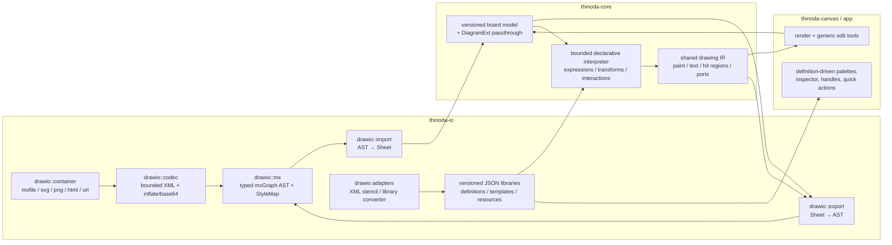

_Last updated: 2026-11-10 17:42:36 UTC (non-binding repository metadata)._ <!-- docs-stamp -->

# draw.io (diagrams.net) support: research, concept and phase plan

Status: 🟡 in progress — Milestone A (codec, import, export) landed 2026-11-05; see [§4.1](#41-implementation-progress). Tracked in [BACKLOG](BACKLOG.md#p1--drawio-diagram-support-user-request-2026-11-05) and [PLAN](PLAN.md#drawio-diagram-support-2026-11-05).

## 1. Problem & goal

### Sankey interoperability

Sankey sheets use native format **v25**. A draw.io export carries a versioned
`thinodaSankey` model attribute containing mode, explicit source masses, stages,
semantic weights and topic notes, mapped by exported cell IDs. Ordinary
`strokeWidth` is never interpreted as a flow weight on import. The extension is
validated on a candidate and remapped onto editable topics/connectors. The v2
extension records endpoint, displayed-label and stroke-width baselines. Deleted,
reconnected, rotated or visually edited cells, unknown versions and invalid
semantic metadata fall back atomically to ordinary editable cells with an explicit
import warning. Weights, stages, sources and extension-only notes are not restored
in that fallback. XML structure, nesting and size limits still reject unsafe
documents rather than invoking this fallback. Widths are never guessed as weights.

Other draw.io editors may strip this extension. Their view uses approximate
proportional strokes, not Thinoda's shared split/merge ribbon geometry. The stroke
uses the same effective global scale as native ribbons, capped at draw.io's
supported stroke maximum; tiny widths may also render differently externally.
Unset links are dashed with a `—%` label; explicit zero has no visible band.
The color scale overrides per-link colors when enabled. Its legend is inspector-only,
not part of exported artwork; numeric labels are exported. The export preflight
discloses these limitations. Save a `.thinoda` master for authoritative
editable data. SVG/PNG/PDF preserve the rendered ribbons but not editable flow
semantics; XMind's private Thinoda snapshot retains the native graph.

Users want to open, edit, save, import, export and copy/paste draw.io diagrams in
Thinoda, without leaving the app and without breaking existing documents, formats or
exports. "Full support" is defined measurably by three tiers, tracked in a published
**support matrix** (`docs/DRAWIO.md`) with release gates:
- **Lossless**: 100 % of cells/attributes/styles round-trip for every file (gate: all
  corpus + fuzz-derived files).
- **Rendered**: all core mxGraph handlers, all 34 markers, all edge styles, all bundled
  generic libraries render faithfully (gate: ≥ 98 % of handlers used by bundled libraries
  and core sidebar palettes; visual diff vs. draw.io reference SVGs within tolerance).
- **Editable**: every rendered element editable via Thinoda UI (gate per phase).
Anything outside a tier is reported in diagnostics as "preserved, shown approximately".

**Confirmed decisions (user):**
1. draw.io content is **converted into Thinoda's native board model**; core is extended
   (waypoints, ports, layers, dash/fonts, generic stencil shapes …) and anything not yet
   modeled is kept in a **lossless passthrough envelope** so it survives round-trips.
2. **`.drawio` is a first-class editable format**: Open edits in place, Save writes
   `.drawio` back; loss preflight only when something cannot be represented.
3. **Stencils**: bundle Apache-2.0 generic libraries; vendor icon sets (AWS, Azure, GCP,
   Cisco, …) via an **optional, user-triggered library download**, faithful placeholder
   until available.
4. **Declarative objects (user clarification, 2026-11-12):** all new shape-specific
   geometry and behavior belong in extensible JSON library documents. Implement a
   shared, bounded interpreter, not another Rust enum variant or renderer branch
   for each shape. This supersedes the earlier proposal to port individual
   JavaScript shapes into Rust. Existing native shapes need a staged, non-breaking
   migration; the JSON interpreter is not implemented yet.

## 2. Research summary

### 2.1 Live investigation (app.diagrams.net, build 32.6.10)
- Compression verified from `Graph.compress/decompress`:
  `base64( deflateRaw( encodeURIComponent(xml) ) )`; decode reverses and applies
  `zapGremlins` (strip control chars). Optional zlib variant (`deflate`) exists.
- 832 registered shape handlers (`mxCellRenderer.defaultShapes`), ~200 sidebar palettes.
- 34 arrow markers: classic, classicThin, block, blockThin, open, openThin, oval, baseDash,
  doubleBlock, diamond, diamondThin, manyOptional, dash, box, cross, circle, circlePlus,
  halfCircle, async, openAsync, mermaidExtension, mermaidDiamond, ERone, ERmandOne, ERmany,
  ERoneToMany, ERzeroToMany, ERzeroToOne, sysML* (6).
- Edge styles: orthogonal, elbow, entityRelation, loop, sideToSide, topToBottom, segment,
  isometric, sequence (+ `curved=1`, straight = none).
- Perimeters: rectangle, ellipse, rhombus, triangle, hexagon(2), center, lifeline,
  orthogonal, backbone, callout, parallelogram, trapezoid, step, cloud, outline, …
- Default vertex style: `shape=label; perimeter=rectanglePerimeter; fontSize=12;
  fontFamily=Helvetica; align=center; verticalAlign=middle; fillColor/strokeColor/fontColor=default`.
  Default edge: `shape=connector; endArrow=classic; rounded=1; fontSize=11;
  labelBackgroundColor=default`.
- **Colors may be `default`, `none`, `#rrggbb`, or `light-dark(a,b)`**; the model has an
  `adaptiveColors` setting (dark-mode adaptation).
- Named stylesheet entries: text, edgeLabel, label, icon, swimlane, group, ellipse, rhombus,
  triangle, line, image, roundImage, rhombusImage, arrow, fancy, color presets, plain-*.
- Sketch mode (`sketch=1`, rough.js, `fillStyle` hachure/solid/zigzag/cross-hatch/dashed/
  zigzag-line), `fontStyle` bitmask bold=1 italic=2 underline=4 strike=8.
- Export surface: PNG/SVG/PDF/JPEG/VSDX/HTML/XML/URL, animated GIF; embedded-diagram PNG via
  `zTXt` chunk keyword `mxfile` (legacy `tEXt`), SVG via root `content` attribute.

### 2.2 File format essentials (jgraph/drawio + mxgraph, Apache-2.0)
- Containers: `.drawio`/`.dio`/`.xml` (`<mxfile host agent version etag modified type
  compressed>` with N `<diagram id name>` pages, each compressed text **or** literal
  `<mxGraphModel>`); legacy bare `<mxGraphModel>`; `.drawio.svg`; `.drawio.png`;
  `.drawio.html`; PDF with embedded XML; `#R<compressed>` URLs.
- `mxGraphModel` attributes: dx, dy, grid, gridSize, guides, tooltips, connect, arrows,
  fold, page, pageScale, pageWidth, pageHeight, background, backgroundGradient, math,
  shadow, adaptiveColors, backgroundImage.
- Cells: id 0 = root, id 1.. = layers (children of 0, `visible`, `locked` style), vertices
  & edges with `parent` (layer/group/container/edge for labels), `source/target`,
  `collapsed`, `connectable`, `visible`. Geometry: x/y/w/h, `relative`, `sourcePoint/
  targetPoint/offset`, `<Array as="points">` waypoints, `alternateBounds`.
- Edge labels = child vertices of the edge (relative geometry: x ∈ [-1,1] along edge +
  pixel `offset`).
- `<UserObject>`/`<object>` wrappers: `label`, arbitrary custom attributes (Edit Data),
  `placeholders="1"` with `%name%`, `tooltip`, `link` (URL, `data:page/id,…`, actions),
  `tags`.
- Style string: `[stylename|key=value];…` — leading tokens are named styles, `none`
  removes inherited keys; unknown keys must be preserved.
- Stencils: `shape=mxgraph.<ns>.<name>` resolved from XML stencil sets
  (`<shape><background><foreground><connections>` path language) or JS-coded shapes;
  `shape=stencil(<deflate-base64 XML>)` inline stencils.
- Security: `html=1` labels are untrusted HTML (sanitise / convert, never render raw);
  deflate/base64 bombs; deep nesting; huge cell counts; external image URLs (no auto-fetch).

### 2.3 Thinoda baseline when the plan was written

This inventory records the starting point, not the current feature set.
Implementation progress and phase critiques are maintained in section 4.1.
- Board model (`crates/thinoda-core/src/board.rs`): `CanvasObjectKind = Shape | Ink |
  Connector` (331-341); 29 `ShapeKind`s; `ObjectStyle {fill, stroke, text_color,
  stroke_width, opacity}` (218-242); connector `{from/to: Topic|Object|Point, route:
  Straight|Elbow|Curve, waypoints, arrow_start/end: bool, label, color, width}`; flat
  groups (no nesting), lock flags, single `CanvasLayer` with `Band::{Below,Above}` paint
  bands; cards (Sticky/Text/Image) are floating topics; zones are sheet-level.
- **Missing for draw.io**: exact routing, ports/fixed connection points, arrow-type enum, dash
  patterns, fonts/size/alignment per shape, gradients, shadows, rounded/arcSize params,
  flip, named layers (visibility/lock), nested groups/containers, swimlanes/tables, free
  text & image objects, hyperlinks/custom properties/tooltips on objects, stencil shapes,
  rich labels on shapes, line jumps, unknown-data preservation (serde ignores unknown).
- I/O (`crates/thinoda-io/src/lib.rs`): central `Format` enum with IMPORTABLE/EXPORTABLE,
  `from_path` (extension only → `.drawio.svg` double extensions need special handling),
  `detect_format` (`.xml` is sniffed for FIM first, then falls back), `ImportReport` +
  `ImportWarning` consent flow, `ExportLoss` preflight (`board_export.rs`),
  `NATIVE_FORMAT_VERSION = 10` with `required_native_version` gating.
- Deps already present: `quick-xml 0.42`, `base64 0.23`, `image` (png/jpeg), `resvg 0.48`.
  Raw-deflate/zlib is only *transitive* (via `zip`) → a **direct** dependency (e.g.
  `miniz_oxide`) must be added, wasm-checked and license-noted.
- Document lifecycle (`crates/thinoda-app/src/doc.rs`): `is_native` = Thinoda|XMind
  (20-21) → only these are writable in place; other imports are conversion-only with the
  source path protected (`from_import_report` 263-295); `prepare_save` (614-625) allows
  native + MindManager. **XMind is the precedent for a writable foreign format.**
- `import_read_policy` (lib.rs 495) bounds only known formats; others fall back to
  unbounded `fs::read` (570). Existing XML importers reject DOCTYPE (fim.rs 190,
  mindmanager.rs 420).
- `ImportWarning` is a small `Copy` enum mapped exhaustively in ui.rs (~7439) and
  cloud_program.rs (2172-2179) — no room for counts/details/actions.
- Canvas and IO have **separate** board renderers (thinoda-canvas/src/render.rs ~1080/1178,
  thinoda-io/src/render/board.rs ~184), both calling `unit_outline` — not one shared path.
- Undo memory accounting (thinoda-core/src/document.rs 161-223) and `mask_canvas`
  (board.rs 1294-1307, used by `Workbook::masked_copy`) only know today's text fields.
- Copy/paste assigns fresh native ids (thinoda-core/src/clipboard/board.rs 28-29).
- Groups are flat; objects have a single global `rect`; no parent hierarchy.
- UI: `board_ui.rs` (shape library 1395, connector controls 1038, route tiles, color/width
  pickers), `menus.rs`/`native_menus.rs`, `export_preflight.rs`, `board_clipboard.rs`
  (board payload + HTML/plain representations), `i18n.rs` (11 languages incl. Auto).
- CI: fmt, clippy (`-D warnings`, also wasm32 for web crates), tests, importer mutation
  tests, fuzz smoke (XMind/FreeMind/OPML), Playwright browser tests.

## 3. Concept

### 3.1 Architecture



- New module tree `crates/thinoda-io/src/drawio/` (container, codec, mx, style, import,
  export, stencil, sanitize, tests) — mirrors existing `xmind.rs`/`mindmanager.rs` pattern.
- **Typed mxGraph AST** (`MxFile → MxDiagram → MxGraphModel → MxCell{id, parent, value:
  Label|UserObject, style: StyleMap, geometry, …}`) is an internal intermediate; it is
  *not* persisted. `StyleMap` keeps **ordered** key/value pairs + leading named tokens so
  export can reproduce untouched styles in their original order.

#### 3.1.1 Round-trip ownership contract (resolves passthrough lifecycle)
Three storage levels, each with a single authoritative owner:
| Level | Type | Contents |
|---|---|---|
| Workbook | `DrawIoDocumentExt` (new optional `Workbook` field) | mxfile attrs (host, agent, version, etag, type, compressed), container kind (`.drawio`/`.drawio.svg`/`.drawio.png`), compression policy, page order, unknown top-level children, source fingerprint |
| Sheet | `DrawIoPageExt` | `<diagram id name>`, mxGraphModel attrs not first-class, unknown model children, **tombstones** of deleted source cell ids |
| Object | `DrawIoCellExt` | `source_id`, `style_rest` (ordered unmapped keys), `attrs_rest` (unknown attrs/children, bounded), **owned-key mask** |

Rules (each backed by a test):
1. **Ownership table** per mapped style/attribute (`fillColor→style.fill`, `gradientColor→
   style.gradient`, …) is versioned adapter/schema data, enforced by generic code,
   not an informal convention. A key is either first-class *or* in
   `style_rest`, never both (validated). Editing a first-class field never touches
   `style_rest`; first-class fields that become unset are emitted as draw.io defaults.
   Keys whose meaning *depends* on an owned key (e.g. `gradientDirection` when gradient is
   removed, `arcSize` when `rounded=0`) are listed in the table as **dependents** and
   dropped together with their owner.
2. **Ids**: export uses `source_id` when present and unique; new objects get fresh ids
   (`<sheet-prefix>-<n>` collision-checked against all cells and tombstones). Copies keep
   `style_rest`/`attrs_rest` (unknown styling survives) but **clear `source_id`**, except
   one case: the board clipboard payload gains a provenance envelope
   `{ document_uuid, sheet_id, transfer_token, disposition: Copy|Cut }`; `source_id` is
   kept **only** when a completed Cut is pasted once into the same document (token
   matches, not yet consumed). Duplicate, Copy, stale/second paste of a cut, OS-serialized
   payloads and cross-document pastes all clear it. Tests for each case.
3. **Deletion** removes the object and its passthrough; its id goes into tombstones (only
   to avoid id reuse). Unknown cells that could not be mapped at all are imported as
   **opaque preserved objects** (selectable, movable, deletable placeholder with bounds) —
   never invisible hidden data — so the user can see and delete them.
4. **Reparent/group/ungroup** re-computes geometry in the new parent's space (§3.2.1); the
   passthrough follows the object.
5. **Undo**: passthrough blobs are immutable `Arc<…>`, shared across snapshots and counted
   once in history memory accounting.
6. **Privacy**: `masked_copy`/`mask_canvas` masks labels, tooltips, links, properties,
   HTML labels and drops `attrs_rest` text content.
7. **Budgets**: cumulative caps per object, sheet and workbook for passthrough bytes;
   exceeding them is an import diagnostic, not silent truncation.
8. **Non-draw.io documents** never get these fields; a native sheet saved to draw.io gets
   fresh ids and default envelope.

- **Native format gates:** v10 covers connector waypoints, v11 covers open and
  block connector markers, v12 adds classic and thin markers, v13 adds marker
  sizes, v14 adds marker fill overrides, v15 adds diamond markers, v16 adds
  oval markers, v17 adds half-circle markers, v18 adds bar markers, v19 adds
  adjustable rectangle corners, v20 adds rectangle outline sides, v21 adds
  double ellipses, v22 adds fixed connector attachments, v23 adds standard
  draw.io rectangle rounding, and v24 adds final-state shapes. Every later field
  or passthrough representation that a v24
  reader cannot preserve must require a higher native version, with
  `required_native_version` choosing the oldest version that can represent the
  complete workbook. Older builds must reject that version instead of silently
  dropping data. Version sheet/board clipboard, recovery and private XMind
  envelopes separately whenever an older reader could otherwise ignore new
  data; reject forged older envelopes too.

#### 3.1.2 JSON stencil DSL and interpreter contract (proposed, 2026-11-12)

**Boundary.** Rust implements reusable language operations, validation, rendering
backends and undoable document commands. JSON defines the objects: geometry,
defaults, parameter ranges, modifiers, handles, transformation policies, paints,
text regions, metadata fields, connection constraints, markers, composition,
import/export bindings and library entries. A new shape expressible in the
language must require only a library change, not rebuilding Thinoda or adding
`ShapeKind` cases. Safety limits and opcode semantics are interpreter contracts;
an untrusted library cannot redefine them.

**Source-format distinction.** A draw.io library entry can be an entire
`mxGraphModel` fragment, group or image, not just a stencil. XML stencils describe
geometry and connection points, but some published shapes use registered
JavaScript renderers; the official editor notes that only XML shapes offer
Edit Shape. Therefore library ingestion needs separate adapters:

- Thinoda JSON packages: validate, resolve and compile directly.
- draw.io XML stencils, including inline compressed stencils: translate supported
  drawing/state instructions and constraints into the JSON DSL.
- draw.io `mxlibrary` entries: convert diagram fragments into JSON instance
  templates, preserving groups, connectors, labels and referenced definitions;
  sanitize and package embedded image resources separately.
- Registered JavaScript shapes: resolve through declarative aliases and JSON
  definitions supplied by a compatible library. Do not execute or attempt
  unrestricted automatic translation of third-party JavaScript.
- Unsupported instructions, dynamic functions, missing definitions and newer
  capabilities: retain bounded original data and show an explicit placeholder
  and diagnostic. Successful parsing alone is not rendering or editing support.

References: [official custom-shape language](https://www.drawio.com/docs/manual/shapes/shape-complex-create-edit/)
and [official library format](https://www.drawio.com/docs/reference/format-custom-shape-library/).
Both were rechecked alongside the published editor on 2026-11-12.

Recorded editor flows and regression targets:

| Interaction / locator | Observed outcome and acceptance target |
|---|---|
| Search textbox, `Message` palette button | Inserts an editable envelope; Thinoda must resolve a definition rather than choose a native enum variant |
| `Style` tab | Fill, line and opacity are instance style inputs; changing them must not replace the definition |
| `Text` tab | Font, alignment, label position and spacing are distinct from body geometry; external labels must not be forced into the shape |
| `Anordnen` / Arrange tab, `Vertikal` / Vertical flip | The open flap reflects while the rectangular body remains rectangular; all four directions and both flip axes need matrix tests |
| Connector-owned message in the BPMN example | The symbol remains a shape, separate from connector text; relative position, offsets and parent-edge anchoring need preservation |

The official renderer supplied reference points for 16 direction/reflection
combinations at rotation 37 degrees, all 12 message connection constraints,
and six relative edge-child positions. The supplied BPMN file contains seven
messages on its first page and six on its second. These observations and
generated regression cases are retained with the shelved prototype for the
definition-based implementation; they are not a completed acceptance claim.

**Package and instance ownership.** A JSON package has a stable namespaced ID,
schema version, DSL version, revision, required capabilities, licensing metadata,
definitions, reusable fragments, templates and resource references. An instance
stores its definition identity/content hash, parameter overrides, style
overrides, label/data values, transform and parent/anchor references, not another
copy of its drawing program. Relative edge-child placement is an instance
relationship, not a one-time flattening into absolute coordinates. Ownership
and definition/include dependencies must be acyclic; ordinary connector graphs
may contain cycles. A workbook retains the deduplicated transitive definition/resource
closure needed to open it offline. Installation or update of a library must
not silently change existing documents. An explicit, previewed, undoable
upgrade changes their pinned definitions. Clipboard, recovery and private XMind
snapshots carry the same closure and reject forged older feature envelopes.
Immutable definitions/resources are shared across undo snapshots and counted
once in history memory accounting. Editing a handle changes instance parameters,
not the shared definition or unrelated instances.

**Language proposal.** Use a typed JSON AST rather than executable strings.
Literals and explicit expression nodes such as
`{"op":"mul","args":[{"var":"width"},0.5]}` support finite arithmetic,
comparisons, conditionals and bounded geometric functions. Parameters have
types, units, defaults and valid ranges. Dependencies are resolved before
evaluation; cycles and non-finite results are errors. No `eval`, JavaScript,
arbitrary function calls, file access, network access or unbounded loops.
Schema extensions are namespaced and preserved; an unknown rendering operation
is not silently ignored. Required capability declarations distinguish an
unsupported program from harmless additional metadata.

| Definition area | Declarative contract and generic interpreter responsibility |
|---|---|
| Geometry | Lines, rectangles, ellipses, quadratic/cubic curves, arcs, open/closed compound subpaths and fill rules; separate fill and stroke paths |
| Paint | Fill/stroke/text roles, theme tokens, explicit transparent versus inherited colors, opacity, widths, dashes, joins, caps and gradients; ordered save/restore state |
| Transform | Explicit coordinate spaces, transform order, aspect policy, rotation/reflection and nested matrices; resizing versus stroke scaling defined independently |
| Modifiers/handles | Typed parameters, constraints, handle positions and bounded drag-to-parameter expressions; keyboard-adjustable generic controls with accessible labels |
| Text/data | Label regions, padding, alignment, wrapping, rich-text capability, notes, links and typed metadata fields; sanitized content and reusable Thinoda inspector controls |
| Connections | Named anchors, normalized/absolute coordinates, inset versus projected ports, perimeter paths/functions, routing constraints and marker definitions |
| Composition/merging | References, ordered child instances, groups/containers, clipping and explicit union/intersection/difference/xor operations; geometric merging is distinct from grouping or graph merging |
| Quick actions | Declared intents such as set parameter, insert template and connect named ports; executed only through generic, validated, undoable app commands |
| Interchange | Data-defined shape/style aliases, property ownership, parameter mappings and export recipes; unowned source metadata remains preserved |
| Capabilities | Explicit language/backend requirements; unsupported operations retain editable identity and source with visible limitations rather than false fidelity |

Illustrative envelope definition fragment, not a released schema:

```json
{
  "id": "thinoda.general/envelope",
  "dslVersion": 1,
  "parameters": {},
  "defaults": {"size": [120, 80]},
  "drawing": [
    {
      "op": "rect",
      "id": "body",
      "rect": [0, 0, {"var": "width"}, {"var": "height"}],
      "paint": {"fill": {"style": "fill"}, "stroke": {"style": "stroke"}}
    },
    {
      "op": "path",
      "closed": false,
      "commands": [
        {"op": "move", "to": [0, 0]},
        {"op": "line", "to": [
          {"op": "mul", "args": [{"var": "width"}, 0.5]},
          {"op": "mul", "args": [{"var": "height"}, 0.5]}
        ]},
        {"op": "line", "to": [{"var": "width"}, 0]}
      ],
      "paint": {"fill": "none", "stroke": {"style": "stroke"}}
    }
  ],
  "hitRegion": {"path": "body"},
  "perimeter": {"path": "body"},
  "ports": [
    {"at": [0.15, 0.05], "perimeter": false},
    {"at": [0.5, 0], "perimeter": true},
    {"at": [0.85, 0.05], "perimeter": false},
    {"at": [0, 0.3], "perimeter": true},
    {"at": [0, 0.5], "perimeter": true},
    {"at": [0, 0.7], "perimeter": true},
    {"at": [1, 0.3], "perimeter": true},
    {"at": [1, 0.5], "perimeter": true},
    {"at": [1, 0.7], "perimeter": true},
    {"at": [0.15, 0.95], "perimeter": false},
    {"at": [0.5, 1], "perimeter": true},
    {"at": [0.85, 0.95], "perimeter": false}
  ]
}
```

The package supplies common style defaults and UI metadata too; omitted fields
in this illustrative fragment are not permission to hardcode envelope behavior.
Parameter/label/handle definitions will be exercised by more demanding folder,
rounded-rectangle and compound-shape fixtures before freezing schema v1.

**Shared execution.** Compile validated definitions once into an immutable
program. Evaluate it against instance parameters, style, text metrics and
transforms into a renderer-neutral drawing IR plus hit regions, bounds, label
regions, handles and ports. Canvas, thumbnails, SVG/raster/PDF, printing and
editable presentation export consume that result. Backends must not switch on
shape IDs. Unsupported backend capabilities enter the existing loss preflight.
Cache keys include definition hash and every relevant instance/style/text input;
changing a modifier cannot leave stale geometry, hit tests or connectors.

**Bounded execution.** Keep current library file, entry, expansion and retained
data budgets as ingestion ceilings. Add cumulative JSON node/depth, expression
instruction, reference/include depth, state/clip-stack, path segment, resource,
text layout, boolean-operation and generated-output limits. Charge nested
definitions and repetition to the same evaluation budget. Reject invalid
references, dependency cycles and non-finite values before document mutation.
Limits come from trusted engine policy, never library requests. A bounded
unsupported definition remains distinguishable from a resource-limit failure.

**Migration and acceptance order (supersedes per-shape Rust additions).**

1. **ST0 - Contract:** agree package/instance ownership and typed DSL, JSON Schema,
   capability/version rules, budgets and source adapters. Define representative
   geometry, handles, text, connector and compound-object fixtures.
2. **ST1 - Pure interpreter:** implement bounded parsing, validation, dependency
   resolution, expression evaluation and drawing/interaction IR. No UI or
   document writes during evaluation. Include malformed and budget-boundary tests.
3. **ST2 - Generic persistence:** add one generic stencil-instance representation
   with parent/anchor relationships and pinned workbook definition/resource
   closure; update native, clipboard,
   recovery and XMind gates. Keep legacy document readers and behavior intact.
4. **ST3 - Shared consumers:** connect renderer backends, bounds/hit testing,
   selection, modifiers, accessible handles, inspector, insertion and connectors
   to the same evaluated definition. Add Undo/Redo and cross-renderer tests.
5. **ST4 - Data-only first library:** implement the envelope as JSON, then
   parameterized rounded rectangles and folders. Reuse the official-editor
   measurements and supplied examples, including connector-owned BPMN symbols.
   Do not add a native `Envelope` enum variant.
6. **ST5 - Existing shapes:** migrate the 31 legacy shape kinds behind stable
   compatibility aliases in bounded batches. Preserve defaults, document
   appearance, ports, old files and existing UX. Remove superseded shape-specific
   rendering code only after equivalence gates pass.
7. **ST6 - Third-party import:** convert XML stencils and library fragments,
   resolve dependencies and resources, and provide installation/version/diagnostic
   UX. Unsupported procedural shapes remain explicit; no automatic code loading.
8. **ST7 - Coverage:** expand definitions, compound geometry, modifiers, labels,
   containers, markers and routing recipes against the supplied screenshots and
   published editor. Publish per-capability/per-library rendered, editable and
   source-preservation coverage, not a blanket claim of draw.io parity.

**Rubber-duck critique.** Simply moving coordinate arrays to JSON would retain
hardcoded ports, handles, labels and export mappings; all are included in the
definition contract. Treating every library item as a shape would lose templates
and groups, so definitions and instance templates are separate. Looking up the
latest installed revision would change old diagrams, hence pinned workbook
closures. A string formula language would invite script execution and ambiguous
evaluation, hence a typed AST and shared budgets. Unknown operations cannot be
silently skipped. Boolean merging and compound fills need real shared IR
support, not a single filled polygon. Shape parameters cannot mutate unrelated
document state; generic undoable commands mediate interactions.

The unfinished, hardcoded envelope prototype is shelved rather than shipped
(stash `4c94f800385fc47277ff9b46f0705510de00f451`). It provides useful source
measurements, corpus findings and regression ideas for ST4, not a completed
implementation. Its last full-workspace attempt failed while compiling tests
because Windows exhausted paging-file capacity; no full-suite success is claimed.

**Implementation status.**

- **ST1 implemented:** `thinoda_core::stencil` parses `thinoda.stencil-package`
  v1 JSON (`deny_unknown_fields`), validates versions, capabilities, namespaced
  extensions, identifiers, parameters, expression arity/variables, colors,
  include targets and cycles, then evaluates a definition into the
  renderer-neutral `StencilRender` (painted paths with fill/stroke state,
  texts, outline, label rect, perimeter-projected ports and handles). The
  draw.io canvas state machine is mirrored: the background geometry is painted
  by the first foreground paint, geometry ops replace the current path,
  `save`/`restore` scope paint state, fixed aspect scales uniformly and centres,
  and `strokeWidth` is `inherit` or a frame-scaled factor. Expressions are a
  typed AST (no string evaluation); handles map pointer positions back to
  clamped parameter values. Steps, points, depth and include nesting share
  trusted budgets. Definitions requiring unknown capabilities load but refuse to
  evaluate with `UnsupportedCapability`.
- **ST4 partially implemented:** `crates/thinoda-core/stencils/thinoda-general.json`
  defines Message (envelope with the 12 measured draw.io constraints), Rounded
  Rectangle, Folder (left/right tab choice), Note, Card, Cube, Document and
  Cylinder purely as data, each with parameters, handles, ports and a draw.io
  style mapping. Rust contains no per-definition code.
- **ST6 partially implemented:** `thinoda_io::drawio_stencil` converts
  `<shapes>`/`<shape>` XML and compressed inline `stencil(...)` payloads into a
  package: every drawing, style, text and path element maps to a DSL op; local
  `include-shape` references become includes; `<image>`, external includes and
  unknown elements become definition capabilities (`drawio.image`,
  `drawio.include-shape`, `drawio.element.*`) with diagnostics, and the bounded
  original XML is kept in the `drawio.source` extension.
- **Next:** ST2 generic stencil instances in documents and ST3 rendering,
  hit testing, handles and connectors in the editor; then the library-install
  UX for ST6 and the ST5 legacy migration.

### 3.2 Core model extensions (all `#[serde(default, skip_serializing_if)]`)

#### 3.2.1 Scene hierarchy & geometry (resolves parent-tree/relative-geometry gap)
- New `parent: Option<SceneParent>` on `CanvasObject` where `SceneParent = Layer(id) |
  Object(id)` (container/group/vertex **or connector** — edge labels and edge-attached
  children). `None` = default layer = today's behaviour.
- `CanvasGroup` stays for Thinoda's existing flat groups (no semantic change). draw.io
  groups/containers are **objects** of kind `Container { style: Group|Container|Swimlane|
  Table|TableRow|Cell, collapsed, alternate_size }`, so nesting is a tree with
  cycle/depth validation (max depth bound). Thinoda's group commands on draw.io sheets
  create `Container{Group}` objects; on non-draw.io sheets they keep using `CanvasGroup`.
- Geometry modes: `rect` stays **sheet-space** for every object (so all existing
  hit-testing, selection, zones and exports keep working); a derived `local_geometry`
  is computed only at draw.io import/export (parent offset composition; relative
  geometry for edge labels/children). Moving a container moves descendants (sheet-space
  update in one undoable command).
- Edge labels: `ConnectorLabel { id: LabelId, text, rich, position ∈ [-1,1], offset,
  style, source_id }` list on the connector (multiple labels, stable ids); the existing
  single `label: String` is the serialized form while there is exactly one unpositioned
  default label (v≤9 byte-identity, 3.2.3 pattern). A label cell with extra
  children/styling that can't map becomes an opaque preserved child.
- Paint order: within a layer, draw.io order = depth-first tree order; Thinoda stores
  objects in that order inside `CanvasLayer.objects` and z-order commands operate among
  siblings of the same parent (tested).
- Rotation: both systems rotate clockwise around the frame centre (board.rs
  `normalize_rotation`) — direct mapping. `direction` (north/south/east/west) is a
  separate stencil-orientation field applied to geometry, not to the frame; `flipH/V`
  likewise. Perimeter (`perimeter=…`) is a per-shape property used by the router.
- `visible=0` → object `hidden` flag (rendered nowhere, listed in Layers panel);
  `connectable=0` → no ports offered.
- Edge-to-edge connections: `Endpoint::Object` may reference a connector (nearest point
  on its path); edge-to-label connections use new `Endpoint::Label { connector, label:
  LabelId }`. Both validated (no self/cyclic edge chains that cannot be routed),
  round-trip tested with multiple labels and an edge attached to a specific label.

#### 3.2.2 Field extensions
| Area | Extension |
|---|---|
| Shapes | `ShapeKind` stays; add `CanvasObjectKind::Stencil { name: StencilRef, label }` (namespaced id like `mxgraph.flowchart.document`, core JS-shape id, or inline-stencil resource id); built-in draw.io core shapes map to existing `ShapeKind` **only when geometry is pixel-identical** (golden-tested), else to `Stencil`. |
| Text | `CanvasObjectKind::Text` (free text) and `Image { resource | external_url, aspect }`; `LabelStyle { font_family, font_size, bold/italic/underline/strike, align, v_align, wrap, spacing, label_position, background, border }`; rich labels reuse the v8 inline-text model; HTML→rich text mapping table (b/i/u/s/font/color/br/p/ul/ol/li/a/sub/sup) with anything else kept as preserved HTML + plain-text fallback. Fonts: family name kept; missing fonts fall back via existing font stack, noted in diagnostics. |
| Connection style | Per object `ConnectionStyle { perimeter: Option<Perimeter>, perimeter_spacing, ports: PortPolicy (Default per kind / Constraints(list) / None), connectable }`; `None` = default derived from `ShapeKind`/stencil (Phase 1 uses only these derived defaults). Imported non-default values affect routing, hit-testing, export (tested). |
| Style | `ObjectStyle` += `dash: Option<DashPattern>`, `fill_opacity`, `stroke_opacity`, `gradient: Option<Gradient>`, `shadow`, `rounded + arc_size`, `flip_h/v`, `direction`, `fill_style`, `sketch`. Colors: `ThemedColor = Fixed(Color) | Default | None | LightDark(Color, Color)`. |
| Connectors | `waypoints: Arc<[Vec2]>` (stored and interactively editable); `route` += `Orthogonal`, `EntityRelation`, `Isometric`, `Segment`, `Loop`, `SideToSide`, `TopToBottom` (Elbow kept); `start_marker/end_marker: Option<Marker { kind: ArrowKind(34), filled, size }>`; `Endpoint::Port { object, x, y, dx, dy, perimeter }`; labels per 3.2.1; `jump: Option<LineJump>`; dash. |
| Structure | Named **layers** `Vec<BoardLayer { id, name, visible, locked }>` in `CanvasLayer`; objects reference layer via `parent`. |
| Metadata | Per-object `link: Option<Link>` (`Url` w/ scheme allow-list, `Sheet(SheetId)`, `Action(raw)` preserved-only), `tooltip`, `properties: Vec<(String,String)>`, `tags`, `placeholders`. |
| Sheet | `DiagramPage { page_size, page_scale, grid, background, background_image, math, adaptive_colors }` in `BoardSettings`. |

#### 3.2.3 Connector marker migration (compatibility-critical)
- Keep `arrow_start`/`arrow_end` bools **as the serialized form** for legacy
  triangles; add optional `start_marker`/`end_marker` fields for exact draw.io
  shapes. `None` retains the historical Thinoda triangle and is distinct from
  draw.io's notched `Classic`. Custom deserialization rejects inconsistent
  booleans and markers. The eventual in-memory API derives booleans from
  `Marker`; until then both are validated. Files without new marker data retain
  their legacy representation, and older builds reject new marker variants
  through version gates rather than silently ignoring them.
- Same pattern for every other extended field: legacy representation preserved, new
  field present only when it carries information, `required_native_version` detects
  every new field (construct one workbook per new field and assert its minimum
  supported version, plus rejection of forged manifests with older versions).

Mind-map topics/cards remain untouched; draw.io import produces **hidden-root board
sheets** (`SheetRootMode::Hidden`) so mind-map features stay unaffected.


### 3.3 Format detection & file handling
- New `Format::DrawIo` (`.drawio`, `.dio`), `Format::DrawIoSvg` (`*.drawio.svg`),
  `Format::DrawIoPng` (`*.drawio.png`); `from_path` gains a **full-file-name** check
  before the extension check so `x.drawio.svg` != plain SVG export.
- `detect_format`: for `.xml`, keep FIM sniff first, then sniff `<mxfile>`/`<mxGraphModel>`
  root; plain `.svg`/`.png` with embedded `mxfile` content are offered as draw.io on
  **import/open** (sniff), while Export to plain SVG/PNG stays unchanged.
- `import_read_policy` gets explicit draw.io entries (outer file-size limits per container,
  never the unbounded `fs::read` fallback); inflate is bounded by absolute size + ratio.
- Direct dependency `miniz_oxide` (raw deflate + zlib), verified on wasm32, recorded in
  THIRD_PARTY_NOTICES; `cargo deny`/license check updated.
- Read-only (import-only) sources: `.drawio.html`, PDF-embedded, `#R` URLs; `.vsdx`
  deferred (backlog).

### 3.4 UX & UI integration (Thinoda look & feel, not a draw.io clone)

#### 3.4.1 Shape placement & on-canvas editing — draw.io behaviour (user requirement)
Today: picking a shape arms `BoardTool::Shape(kind)`; every click/drag creates a shape,
but selection handles, rotation, label editing and connector creation are suppressed
until the user switches back to Select (`controls()` gates on `BoardTool::Select`,
board_input.rs ~884). New behaviour, for **every board sheet** (not only draw.io), for all
shape-library items (29 built-ins, bundled/vendor stencils, library images):
1. **Pick**: click a library tile → shape is *armed* (tile highlighted; a translucent
   ghost of the shape at default size follows the pointer, snapped to grid). Or **drag**
   the tile onto the canvas → ghost while dragging, created at drop point (drag-drop
   creates exactly one shape and does not change the armed state). Keyboard/AccessKit:
   Enter/Space on a tile inserts at a free spot near the viewport centre (right of the
   current selection if any), selects it and arms the shape (screen-reader announcement).
2. **Hover = edit**: while armed, whenever the pointer is over a shape (the new one *or*
   any existing shape) or over its affordance zone, the ghost hides and that shape shows
   draw.io-style affordances: drag body = move; corner/edge handles = resize; rotate
   handle = turn; double-click / F2 / start typing on the selected shape = edit label;
   four **direction arrows** = click to clone+connect in that direction, drag to draw a
   connector and drop on another shape/port to connect (modifiers as in draw.io:
   Ctrl/Cmd+click = clone only, Shift+click = connector only, Ctrl/Cmd+drag onto empty
   space = connected clone at the drop point); port dots on hover. Clicking a shape
   selects it — it never creates on top.
3. **Click empty space = create**: a click on empty canvas creates another instance of
   the armed shape centred at the (snapped) point and selects it; click-drag on empty
   canvas keeps today's drag-to-size creation.
- **Leave armed mode**: Esc, clicking the armed tile again, choosing another tool, or V.
  A compact hint chip on the board toolbar shows "Click empty space to add · Esc to finish"
  (localised, dismissible, announced once).
- **Hit priority** (tested): handles > direction arrows/ports > object body (incl. small
  hover tolerance) > zones/frames > empty canvas. Topics, cards, ink and frames count as
  "not empty" (click selects, never creates on top).
- **Touch/pen** (no hover): tap empty = create; the created/selected shape shows the same
  affordances; tap a shape = select; long-press on an object opens the context menu as
  today. Direction arrows: tap = default clone+connect; press-and-hold on an arrow
  (0.6 s without moving) opens the quick-shape popover. This replaces the planned
  "more" chevron: the hold is limited to the arrow, so the object long-press context
  menu is unaffected, and the arrows stay uncluttered; tested.
- **Undo**: separate gestures are separate history entries (create, move, rotate, label
  edit). Each **compound quick action** — click-empty create, clone+connect, quick-shape
  insert+connect, drop-on-empty create+connect — is **one atomic edit / one undo entry**;
  acceptance tests assert a single Undo restores the exact prior workbook and selection.
- Sticky/Text/Frame/Connector tools keep their current behaviour (they enter text editing
  or connector drawing immediately); the armed-shape model is reused later for stencils.
- Existing tests that assert "no controls while a creation tool is active" are updated to
  the new contract; new canvas tests cover every row above incl. touch and AccessKit.

#### 3.4.1a Connector & quick-action parity with draw.io (user requirement)
Observed in app.diagrams.net (user screenshots) and to be fully inventoried from the live
app + its shortcuts reference in Phase 0 (each gesture recorded with modifier variants):
- **Shape-aware perimeters**: connectors end exactly on the visible outline (ellipse,
  rhombus, triangle, hexagon, cylinder, parallelogram, callout, stencil outlines,
  rotated/flipped shapes) — today Thinoda clips to the (rotated) bounding rect
  (`clip_to_rect`/`clip_to_rotated_rect`, layout.rs 686/709). New `Perimeter` per
  `ShapeKind`/stencil (draw.io perimeter names), `perimeterSpacing`, used by router,
  hit-testing and export.
- **Floating vs fixed ends**: drop on the shape body/outline → *floating* (end slides
  along the perimeter, outline highlighted); drop on a connection point (×) → *fixed*
  port. Endpoint handles show state like draw.io (filled = connected, outline-highlight =
  floating, × = fixed point); connection points (`×`) appear
  on hover over any shape while dragging an end (built-ins: 4/8/16 default points per
  shape kind; stencils: `<constraint>`s). The current partial implementation exposes
  16 points for rectangles, rounded rectangles and rectangular topics, and eight
  for ellipses, double ellipses and diamonds. Points can start or terminate a
  connector; Shift fixes arbitrary positions, Alt drops a free point and
  Alt+Shift attaches without fixing, and focused endpoints support keyboard
  editing.
  Other built-in shapes, named ports and stencil constraints remain planned.
- **Direction arrows on hover** (light-blue ↑→↓←): click = clone + connect in that
  direction (respecting spacing/grid, avoiding overlaps); drag = draw connector, drop on a
  shape/port to connect or on empty space to create a connected clone; hold/hover on an
  arrow → **quick-shape popover** (recent + related shapes, e.g. circle/rect/ellipse/
  diamond as in screenshot 2) → click inserts that shape connected in that direction.
  Modifier variants follow draw.io's own arrow tooltip (implemented in 1b): click =
  clone + connect (or connect to an existing neighbour in that slot), Ctrl/Cmd+click =
  clone without connector, Shift+click = connector without clone, drag = connector to the
  drop target or a free end, Ctrl/Cmd+drag = connected clone at the drop point. Keyboard:
  each arrow is a Tab stop after the selection's resize/rotate handles; Enter/Space (with
  the same modifiers) activates it and keeps focus on the new shape's arrow for chaining.
  Quick-shape popover (1b part 2): resting the mouse 0.6 s on an arrow, holding it down
  the same time (touch), or Shift+F10 on a focused arrow opens a 5×2 tile picker beside
  the arrow — the source's own kind first, then common draw.io shapes; hovering or
  focusing a tile ghosts that shape and its connector at the target slot; click/Enter
  inserts it connected (one undo entry). Arrow keys/Tab move between tiles, Esc closes
  and refocuses the arrow, a click outside closes without acting on the board, and the
  mouse-opened picker closes when the pointer leaves the arrow and picker.
  Alt+Shift+Arrow and similar draw.io shortcuts stay unmapped because Alt+Arrow already
  duplicates in Thinoda.
- **Connect from outline**: hovering near a shape's outline highlights it; dragging from
  there starts a connector (no tool switch). Edge-to-edge connections supported.
- **Selected-edge floating toolbar** (screenshot 1): line style (straight/curved/…),
  end-arrow picker, waypoint style (straight/orthogonal/elbow/curved/entity relation),
  add/edit label (A), "…" opens the full connector inspector. Positioned near the edge
  midpoint, never covering the edge; keyboard reachable; reuses existing board toolbar
  widgets/icons. Selected **shape** quick toolbar likewise (fill, stroke, text, style
  presets, "…"), following the same visual language. *Phase 1d used the left board
  toolbar; later slices moved those controls to top contextual overlays.
  Object-adjacent floating toolbars remain open.*
- **Virtual bends**: midpoint dots on each segment of the selected edge; drag = create
  waypoint; orthogonal edges drag whole segments; double-click waypoint = remove;
  "Clear waypoints" in toolbar "…".
- **Selection handles** (screenshot 2): 8 resize handles, rotate handle top-right,
  Shift = keep aspect, Alt = from centre, grid/guide snapping with smart guides.
- **Labels on edges**: double-click edge = add label at that position; drag label along
  the path (stores position ∈ [-1,1] + offset).
- **Reconnect**: drag an end from one shape to another; dragging a connected shape keeps
  edges attached and re-routes.
- **Deletion semantics** (Phase 8): *Delete* keeps today's behaviour — incident
  connectors survive with ends converted to free points (board.rs ~1855-1913); *Delete
  all* (Ctrl+Delete, as draw.io) also removes incident connectors, transitively removing
  edges attached to removed edges/labels; locked items block the command with a message;
  one atomic undo entry. Command tests for incoming/outgoing/shared/edge-chain cases.
- Every action is undoable, localized, AccessKit-named and keyboard-reachable; touch uses
  the same affordances on the selected item (no hover needed).

#### 3.4.2 Files & dialogs
- **Open/Import**: draw.io files in the normal Open dialog filter ("draw.io diagram"),
  drag-and-drop onto window/web drop zone, recent files with a draw.io badge. Multi-page
  files become sheets (tabs) with original page names.
- **Import report**: structured `ImportDiagnostic { code, severity, count, page,
  examples, preserved: bool, action: Option<DiagnosticAction> }` (e.g. "3 AWS icons shown
  as placeholders — *Download AWS library*", "2 math labels shown as source"). The coarse
  `ImportWarning` is *derived* from diagnostics, so the existing exhaustive matches
  (ui.rs, cloud_program.rs) keep compiling. Transport: `ImportReport` gains
  `diagnostics: Vec<ImportDiagnostic>`; `OpenDoc::from_import_report` stores them in a
  transient `pending_import_diagnostics` consumed by the report dialog (not persisted);
  identical path for desktop, wasm, cloud/VFS loaders; `DiagnosticAction` dispatches an
  app `Cmd` (e.g. open Libraries manager). Tests per loader + action callback.
  **Preserved-but-unrendered** items are
  informational (no destructive-consent prompt); only real data loss requires consent.
- **Save loss preflight**: reuse `export_preflight.rs`; lists only items that cannot
  round-trip (mind-map topics → boxes+edges, ink → freehand path stencils, …); one-click
  "Save as .thinoda instead".

#### 3.4.3 Editing surfaces
- **Shape library**: extend `shape_library` with sections (Thinoda, General, Flowchart,
  Basic, Arrows, UML, BPMN, ER, Network, Mockup, Tables/Containers) + "More libraries…"
  manager; search over names/tags; recents row; keyboard navigable; tiles render real
  stencil geometry; tiles are drag sources (3.4.1).
- **Inspector**: extend board context controls in the same visual language: Style,
  Text, Arrange (position/size/rotation/flip/z-order/layer), Connector (route tiles,
  34-marker grid, sizes, line jumps, waypoint reset), Data (link, tooltip, properties,
  tags). Advanced: "draw.io style" text field, validated on apply, writes through the
  ownership table (3.1.1).
- **Connectors**: waypoint handles (drag to add/move, double-click remove); fixed
  attachments use Shift or Enter/Space today. The supported default connection
  points can also be cycled with Home/End. Named ports, other default point sets
  and Tab between individual ports remain planned.
- **Layers panel**: compact side panel (View menu + board toolbar), visibility/lock,
  rename, reorder, move selection to layer; hidden when only the default layer exists.
- **Clipboard**: copy also as draw.io XML; paste of draw.io XML / compressed payloads /
  `#R` links inserts at cursor; size-capped like existing board clipboard payloads.
- **Dark mode**: `default`/`light-dark()` resolve against Thinoda's Light/Dark/Auto theme.
- **Accessibility**: localized accessible names for tiles, arrows, ports, markers; all
  controls keyboard-operable; announcements for create/connect/layer changes.
- **Localization**: every new string in `i18n.rs` for all 10 languages.
- **Web parity**: same flows in wasm (file picker/download, drag-drop, clipboard API).

### 3.5 Editable-format document contract (doc.rs)
- `is_native` stays Thinoda|XMind; new `DocFormat::is_editable_foreign()` = XMind|DrawIo*
  used by `from_import_report` (keep source path only for editable formats),
  `prepare_save`/`finish_save` (write same container + compression policy from
  `DrawIoDocumentExt`), autosave & crash recovery (recovery snapshots retain a
  versioned native workbook and restore origin metadata), cloud/VFS save paths.
- Source fingerprint (size+mtime+hash) captured on open; Save detects external change
  and offers *Overwrite / Save as… / Reload*.
- Mixed workbooks (user adds a mind-map sheet to a draw.io document): sheets are
  exported per 3.4.2 preflight; nothing silently dropped.
- Embedded containers (`.drawio.svg/.png`) re-render their image part on save.
- Tests: every other import format still opens protected/conversion-only; XMind
  behaviour unchanged; save-reopen-save is stable (idempotent bytes for uncompressed).

### 3.6 Security acceptance criteria
- Reject DTD/entities (same as fim.rs/mindmanager.rs); bounded XML depth/attr/text sizes.
- Cumulative caps: cells, pages, passthrough bytes, data-URI bytes and inline-stencil
  bytes checked before allocation (declared/encoded lengths). **Inflate** is incremental
  into fixed-size chunks with a hard output ceiling and ratio check enforced *during*
  decoding (checked arithmetic, shared budget across nested containers e.g. PNG zTXt →
  mxfile → compressed diagram); tests assert abort before a measured peak-memory bound
  (native + wasm).
- HTML labels parsed into an inert internal rich-text representation; unknown markup kept
  as escaped text; never rendered as HTML, never scripts/styles/iframes.
- Embedded SVG images sanitized (no scripts/external refs) or rasterized via resvg with
  external loading disabled; never auto-fetch images, fonts or libraries.
- Link scheme allow-list (http, https, mailto, internal page links); `data:action/…` and
  others preserved but not executable; opening links asks as today.
- Adversarial corpus (zip-bomb deflate, billion-laughs, deep nesting, huge style strings,
  cyclic parents, id collisions) in unit tests + `drawio_import` fuzz target in CI smoke.

### 3.7 Non-breaking guardrails
- All model additions optional/defaulted; existing documents serialize byte-identically
  (golden tests over all existing fixtures). Each new version is required only when
  its new data is present.
- `Format` additions don't change existing extension mapping (sniffing only on open).
- **Exhaustive-consumer inventory** (Phase 0) of `CanvasObjectKind`, `ShapeKind`,
  `Endpoint`, `ConnectorRoute`, `Format`, `ExportLoss`, `ImportWarning`, `BoardTool`;
  each phase that extends one updates all listed consumers.
- Rendering is not shared today (canvas render.rs vs io render/board.rs) → Phase 4
  introduces renderer-neutral scene primitives used by both; parity tests compare canvas
  scene, SVG/PNG/PDF/print/presentation/thumbnail, hit-testing and bounds.
- Undo memory accounting counts `Arc` passthrough once; `masked_copy` masks new text.
- In-progress UI stays behind an internal setting until its phase completes; each phase
  ships green CI.

### 3.8 Licensing
- draw.io/mxgraph and generic stencils: Apache-2.0 → THIRD_PARTY_NOTICES; only stencil
  XML data is bundled, Rust code written from spec; per-library provenance manifest
  (source repo commit, file SHA-256, license per file).
- Vendor sets (AWS, Azure, GCP, Cisco, IBM, …) not bundled; optional user-triggered
  download from pinned URL + SHA-256, vendor terms shown first; PRIVACY.md updated.

## 4. Phase plan

Each phase: implement → tests → CI gates (fmt, clippy native+wasm32 `-D warnings`, tests,
importer mutation tests, fuzz smoke, browser tests when UI touched) → written critique →
commit with explicit pathspecs (never `git add -A`).

Status describes the entire phase, not an individual checkpoint. A phase is
complete only after its acceptance criteria, tests and written critique are
complete. The import MVP is complete for the board model available at Milestone
A; it is not completion of the broader Phase 6 requirements below.

| # | Phase | Status | Depends on | Outcome |
|---|---|---|---|---|
| 0 | Foundations | Partial | — | ADR/issue, complete corpus, provenance, consumer and interaction inventories, benchmarks, docs |
| 1 | Shape placement, quick actions & perimeters | Partial | 0 | draw.io-style pick / hover-edit / click-to-create, direction arrows, quick-shape popover, floating toolbars, true-outline connectors |
| 2 | Codec, AST & security | Partial | 0 | Bounded read/write of every container to typed AST |
| 3 | Core scene model & round-trip contract | Partial | 0 | Hierarchy, version-gated fields, ownership/passthrough, marker migration |
| 4 | Renderer-neutral primitives & parity | Partial | 3 | One scene description for canvas + all exports |
| 5 | Stencil engine & generic baseline | Partial | 3, 4 | Stencil parser, core JS shapes, constraints → ports, bundled generic libs |
| 6 | Import MVP | MVP complete; phase partial | 2, 3, 4, 5 | Open `.drawio` → board sheets, diagnostics, hierarchy, layers and page links |
| 7 | Editable document contract & save-back | Partial | 6 | Save `.drawio` in place, preflight, round-trip guarantee |
| 8 | Connector editing UX | Partial | 1, 7 | Waypoints, ports, markers, routes, jumps |
| 9 | Style, text, data UX + library sections | Partial | 1, 5, 7 | Inspector, rich labels, links/properties, picker sections |
| 10 | Layers, containers, swimlanes, tables | Partial | 7 | Structure editing beyond current frame approximations |
| 11 | Embedded containers & clipboard | Partial | 7 | `.drawio.svg/png` read+write, html/pdf/`#R`, clipboard interop |
| 12 | Vendor library download | Open | 5, 9 | Optional libraries manager |
| 13 | Advanced fidelity | Partial | 7 | Sketch, math, placeholders, adaptive colors, page view, tooltips |
| 14 | Hardening & release | Partial | all | Perf budgets, fuzz, a11y, i18n, docs |

The completed marker, contextual-toolbar and adjustable-radius slices below do
not close their parent phases. Fixed ports, advanced routing, generic stencils,
source-preserving save-back, bounded PDF import, the full fuzz campaign and
real-device/accessibility acceptance remain open. The combined Freeform,
ink, clipboard, presentation and release gates are tracked in
[PLAN.md](PLAN.md#latest-task-and-release-continuation).

**User-directed continuation:** update the target-specific canvas context menus so
Image card is in Tools, Zones immediately follows Styles, and Board is followed
by separate Grid and Align menus. Cover placement, command availability, dispatch,
localization and short-window scrolling. In parallel, resolve the reported
Windows pen-ink interruption and add an atomic SVG representation alongside the
existing Copy Sheet data where the platform supports it. Rebuild and launch the
current Windows app for review after these changes; record platform and physical
device limitations rather than claiming unverified acceptance.

**Additional requested UI slices:** show the FIM format tab only when the
active sheet has FIM data, and fall back to an available tab when that context
changes. Use the standard action-icon color for Shape library and Image card,
leaving Board minimap distinct. Move the pen, highlighter and eraser options
from the board rail into a separate contextual strip. Both that strip and the
Whole-card text strip must overlay the canvas without changing its bounds.
Move the selected connector's properties and quick actions from the board rail
into their own top contextual strip, preserving their behavior, ownership and
accessibility while allowing it to coexist with the other strips.
Move the selected shape's Change shape, Fill color, Outline color, Outline width,
Edit label and formatting actions from the board rail into a matching top
contextual strip. Add a Text color control for every shape label, including an
automatic-color option and the existing palette/custom picker. Preserve undo,
selection and popup ownership, compact layouts, localization, and the label's
appearance in editing, persistence and supported exports.
Keep the board rail permanently low enough to leave room for these strips,
including in compact windows; opening a strip must not move the rail. Verify
tool values and dispatch, focus and input ownership, accessibility,
localization, and window/sheet transitions.

**Reported follow-ups — completed locally:** left, center and right alignment
now visibly position the complete title row inside sticky notes and text cards,
including the editor and supported exports. Expanded shape and connector color
mixers grow to their contents when the viewport allows and scroll when it does
not. Tests and the critique below cover the requested slices; they do not close
the broader rendering, accessibility or device-acceptance phases.

**Card alignment and color mixer — critique:** the title row includes TODO,
marker, link and note adornments, so their widths must also be reserved before
wrapping. Ordinary topics and image cards retain their previous layout.
Oversized adornments or very narrow cards can still overflow, and rotated card
editors remain upright at the rotated title position. draw.io alignment
interchange covers sticky and text cards, not general shape labels or
source-preserving save-back.

Opening a mixer must not pin an automatic color or create an undo step, but a
deliberate edit can still choose that same color as an explicit override.
Native regressions cover selection ownership, cancellation, undo/redo,
persistence, compact windows and both themes. The all-language sizing check
runs in a child process to avoid races from the process-wide locale. The
affected library suites passed 1,851 tests with four ignored, and export,
corpus and fuzz-seed integrations passed 61 with three ignored. After the final
picker change, the complete app library suite passed 868 tests with two ignored,
and 27 focused color tests passed with eight test threads. Native and
WebAssembly Clippy passed with warnings denied; a final production web build
passed nine Chromium card and toolbar journeys. Light/dark GPU previews were
inspected in wide and compact windows. Physical touch, screen readers and
external Office acceptance remain open.

**FIM tab slice — critique:** visibility follows FIM data on the active sheet,
not the current topic selection, so the document-level inspector remains
reachable even for an unbound selection. A stale FIM selection falls back to
Style on ordinary sheets; returning to a FIM sheet makes the tab available
again. The FIM source and draft workflows are unchanged. Physical
assistive-technology acceptance remains open.

**Contextual-toolbar slice — critique:** the Shape library and Image card use
the other tool actions' colour; the minimap retains its distinct tone. Ink
settings now live in a separate scrollable overlay, and Whole-card text no
longer changes the canvas bounds. Both strips can coexist without overlapping,
including on compact canvases, and clicks on them do not start ink underneath.
The toolbox normally reserves room for the strips. When the canvas is too short
to fit both, it is temporarily hidden rather than moved over a strip; existing
menu commands remain the fallback. Popup ownership is invalidated on tool,
sheet, document and instance changes. Keyboard, theme, locale and draft
regressions are covered; physical touch and assistive-technology acceptance
remain open.

**Connector-toolbar slice — critique:** a single selected connector now shows
its route, start/end arrows, colour, width, label editor and format shortcut in
a horizontally scrollable top overlay instead of the board rail. The selection,
undo steps, guarded popup ownership and disabled-state behavior are unchanged;
shape controls were still in the rail at this point, superseded by the
shape-toolbar slice below. The overlay leaves the canvas and rail stationary,
and remains usable when a very short canvas hides the rail.
Keyboard, compact layouts, localization and canceled/multitouch actions are
covered. Physical stylus and assistive-technology acceptance remain open.

**Shape-toolbar slice — critique:** a single selected shape now shows its
shape, fill, outline, outline width, text colour, label editor and format
shortcut in the same kind of top overlay. The left rail is again only for
board tools. Text colour uses the existing whole-label style; Auto uses the
same contrast calculation as the canvas and inline editor. Selection and
revision guards, popup ownership, disabled states, palette alpha, undo and
redo remain in force. Shape and connector options remain available while a
shape tool is armed, without preventing another placement; switching tools
invalidates open colour drafts. Keyboard undo and redo also work while the
contextual strip retains focus, following the active shortcut profile without
intercepting text edits or open popups. An open picker consumes the first outside
click to dismiss itself, following the existing popup behavior. The strip
scrolls in compact windows; very short canvases hide the rail rather than
shifting it. Regression coverage includes
all shape kinds, empty labels, stale colour drafts, keyboard use, themes,
localization, and native, clipboard, draw.io and SVG output. Rich-text span
colours are not introduced, and physical-device and screen-reader acceptance
remain open.

**Shape label edit-mode clarity — critique:** double-clicking starts inline
label editing. The editor no longer paints an opaque rectangle over a shape,
which had hidden parts of rounded and rotated outlines. Only the active
object's original label is suppressed while editing; its geometry and other
objects remain visible. A contrasting edge around editable glyphs helps over
transparent fills without covering the content underneath. An empty label has
a non-persistent prompt, and localized visual and accessible guidance explains
Enter, outside click/tap, Shift+Enter and Escape. The editor stays upright for
rotated shapes. Connector labels retain their existing backdrop.

The editing hint replaces the competing armed-shape hint and explicitly says
that clicking empty canvas also places the armed shape. Label editing and
placement remain separate undo steps. Exact plain-Enter matching fixes a prior
case where Shift+Enter committed instead of inserting a line. A double-click
could also leave the editor visible but unfocused when egui cleared focus at
the end of the opening click. A single later-frame retry is restricted to the
same focused viewport, with no competing focus; a newer click is still delivered
to its intended target. Finish keys and IME candidate keys belong to the editor
only while it owns keyboard input. Before an outside press, queued editor input
is applied and the draft is finished before canvas, minimap, toolbar, menu or
document-tab actions can change focus or the active document. Input after a
finish key remains available to the next owner, and rejected commits retain the
draft and report an error. The input-only pass uses a separate UI scope so it
does not change host widget IDs or invalidate the pending click. The floating
guidance yields when there is insufficient space outside the edited object and
its editor; a compact status-bar summary remains, with the full instructions
on hover and in the editor's accessible description. Zen mode temporarily
shows the status bar while preserving the canvas position. The insert toolbar
also yields when it would overlap a label editor. Regression tests cover empty
labels, guidance, focus, IME candidate keys, pending input, undo, compact
canvases, and visible outlines and contrast in both themes. Validation included
1,342 app/canvas library tests (four ignored), 18 label-editor integration
tests, three GPU visual tests, native and WebAssembly Clippy with warnings
denied, a production web build, and all nine toolbar/editing journeys across
Chromium, Firefox and WebKit. The floating
guidance may still cover other board content; narrow status text can truncate
and hover instructions are not a complete touch-device solution. The glyph
edge is an editing-only readability aid, not part of exported text. Complex
multi-pointer ordering, physical IMEs, multiple viewports, simultaneous resize,
physical input devices and real screen-reader acceptance remain open.

**Pen/touch slice — critique:** a confirmed pen-owned browser stroke retains its
samples when later verified touch contacts arrive, including a pen-first start
batched with touch in the same frame. Suppressed contacts remain locked out
until released, and cancellation and focus changes still preserve recoverable
input. The diagnostic distinguishes the host-recognized input source from the
selected ink tool. Eframe emits the primary pointer move immediately before the
changed touches in the same handler; regression coverage includes a different
non-primary contact and quarantines an inconsistent event sequence. Browser
emulation and controller regressions do not establish which events the user's
physical Windows pen generates. Touch-first gestures,
unmatched or ambiguous input, and native Windows pen identity remain unresolved;
do not treat this as hardware palm rejection or a verified device fix.

**Copy Sheet slice — critique:** the existing versioned sheet text and SVG are
prepared from the same active-sheet snapshot, including validated drafts, image
resources and the current visual theme. Windows publishes both formats within
one owned clipboard transaction; supported browsers write one multi-format
clipboard item. An unavailable or rejected SVG produces an explicit text-only
warning where the text write succeeds. Newer copy operations invalidate pending
cut completion and skip a stale browser fallback if superseded before it starts;
browser writes already in flight cannot be recalled.
macOS and Linux still copy only the editable text, with a warning; native
recipient compatibility, real system clipboard behavior, and browser-specific
SVG handling remain to be verified on each host. The browser regressions use an
in-page clipboard and the native transaction tests use a fake; neither changes
the system clipboard. Windows follows
[Chromium's registered SVG format](https://chromium.googlesource.com/chromium/src/+/main/ui/base/clipboard/clipboard_format_type_win.cc)
and [UTF-8/NUL-terminated clipboard data](https://chromium.googlesource.com/chromium/src/+/main/ui/base/clipboard/clipboard_win.cc);
SVG is offered first, following [Windows format-order guidance](https://learn.microsoft.com/en-us/windows/win32/dataxchg/clipboard-formats),
while Thinoda reads the sheet text explicitly. Browser SVG availability is checked through
[`ClipboardItem.supports`](https://developer.mozilla.org/en-US/docs/Web/API/ClipboardItem/supports_static).

**Context-menu slice — critique:** Tools now includes Image card alongside the
other drawing and card tools; applicable target menus place Zones after Styles
and Grid and Align after Board. The existing commands, icons and target-specific
availability are reused. The extra groups make some menus longer, so the existing
scrolling and localized short-window checks remain important. Blank canvas,
topics and board objects have different applicable actions; Zone and annotation
menus retain their specialized layouts. Physical touch and assistive-technology
acceptance are still open.

Phase 1 is independent of draw.io file support and delivers the requested interaction
change early; it only uses today's `Endpoint::Object` connections (port-precise
connections arrive in Phase 8 without changing the gestures).

### Phase 0 — Foundations (`p0-foundations`)
- GitHub issue + ADR (CONTRIBUTING requires discussion for major formats/deps/assets).
- Fixture corpus `crates/thinoda-io/tests/fixtures/drawio/` authored in app.diagrams.net
  with own content (all containers, compression modes, legacy model, multi-page, layers,
  groups, containers, swimlane, table, all 34 markers, all edge styles, waypoints,
  ports, edge labels, UserObject/properties/placeholders, links, html, math, sketch,
  light-dark, data-URI + external images, inline stencil, vendor shape).
- Provenance manifest for bundled stencil libraries; exhaustive-consumer inventory;
  **interaction inventory** of draw.io (every hover/drag/click/modifier/keyboard gesture
  for shapes, edges, arrows, popovers, toolbars — screenshots + notes) as acceptance
  checklist for Phases 1 and 8;
  benchmark targets (e.g. 5k cells / 5 MB: open < 1.5 s desktop, < 4 s web; save < 1 s;
  peak memory < 3x file+model; pan p95 frame < 16 ms desktop / < 33 ms web).
- `docs/DRAWIO.md` + BACKLOG/PLAN entries + feature→field→phase mapping appendix.

### Phase 1 — Shape placement, quick actions & perimeters (`p1-shape-placement`)
- Implement 3.4.1: armed state + ghost preview, tile drag source/drop target (desktop +
  web), keyboard insert-at-free-spot, hover affordances while armed (lift the
  `BoardTool::Select` gate in `controls()` for armed shape mode with the hit-priority
  table), click-empty create, exit rules, hint chip, touch behaviour, undo granularity.
- From 3.4.1a, everything that needs **no model change**: shape-aware perimeters for the
  29 built-in `ShapeKind`s (derived defaults, nothing persisted), direction arrows
  (click/drag/drop variants), quick-shape popover, connect-from-outline, edge-to-edge drop
  onto an edge path (existing `Endpoint::Object` already accepts any object id — verify;
  else deferred to Phase 8), selected-edge floating toolbar (straight/elbow/curve routes
  and start/end arrow toggles that exist today), shape quick toolbar, add/edit the
  existing single edge label (positioned label dragging → Phase 8), reconnect.
- i18n + AccessKit names; update affected tests (board_tests.rs, board_ui.rs
  shape_library tests, fim_authoring) and add new ones; browser test for web drag-drop;
  FREEFORM.md/user docs updated.

### Phase 2 — Codec, AST & security (`p2-codec-ast`)
- `drawio::codec` (bounded raw/zlib inflate via `miniz_oxide`, base64 tolerant,
  percent-decode, zapGremlins; writer identical to draw.io); `drawio::mx` typed AST
  with ordered `StyleMap`; geometry incl. points/offset/alternateBounds.
- `import_read_policy` entries; all 3.6 criteria; `drawio_import` fuzz target.
- Tests: AST round-trip over corpus; golden compressed string from the live app.

### Phase 3 — Core scene model & round-trip contract (`p3-core-model`)
- 3.1.1 + 3.2 in `thinoda-core`: `SceneParent`, containers, edge labels, layers,
  Text/Image/Stencil/opaque kinds, style/connector/metadata fields, `DrawIoDocumentExt`/
  `DrawIoPageExt`/`DrawIoCellExt`, ownership table, tombstones, marker migration.
- `required_native_version` gates every field at the first version that supports
  it: v10 covers waypoints, v11 covers open/block markers, v12 covers classic
  and thin markers, v13 covers marker sizes, v14 covers marker fill overrides,
  v15 covers diamond markers, v16 covers oval markers, v17 covers half-circle
  markers, v18 covers bar markers, v19 covers adjustable rectangle corners,
  v20 covers rectangle outline sides, v21 covers double ellipses, v22 covers
  fixed connector attachments, v23 covers standard draw.io rectangle rounding,
  and v24 covers final-state shapes. Subsequent additions need a higher version.
  Reject forged older manifests and version the other persistence envelopes too;
  `validate.rs` checks cycles, depth, layers/ports/parents and ownership.
- Undo accounting, `mask_canvas`, clipboard provenance envelope (3.1.1 rule 2) updated.
- Tests: golden byte-identity of existing fixtures; edit/delete/dup/group/ungroup/
  cross-doc paste/undo/save-reopen lifecycle tests.

### Phase 4 — Renderer-neutral primitives & parity (`p4-render-parity`)
- Scene primitive layer (paths, fills incl. gradient/hatch, strokes incl. dash, markers,
  text runs, images, clips) consumed by canvas and thinoda-io renderers.
- Rendering for every 3.2 field; `ExportLoss` entries for PPTX/other approximations.
- Parity tests canvas vs SVG/PNG/PDF/print/presentation/thumbnails, hit-testing, bounds.

### Phase 5 — Stencil engine & generic baseline (`p5-stencils`)
- Implement the JSON DSL/interpreter and staged migration in §3.1.2 (ST0-ST7).
- Convert XML stencil instructions, inline `stencil(…)` and constraints into JSON
  definitions; translate library fragments into JSON templates.
- Define JS-coded source shapes declaratively in libraries; do not port each one
  into a Rust shape variant. Unsupported procedural content remains preserved
  with an explicit placeholder.
- Bundle versioned JSON generic libraries (compressed, lazy, size budget in CI);
  library index, pinned revisions and resource/dependency closure.
- Unknown stencil → placeholder (bounds + label + icon), data preserved.
- Prioritize `folder` and `mxgraph.floorplan.office_chair`, which recur in the
  supplied examples: a source scan of all 88 files found 73 folders, including
  14 containers, and 596 office chairs. A folder needs its absolute tab size and
  left/right position, separate tab and body subpaths, rounded corners and
  optional symbol retained; bounded header labels and nested container behavior
  also require attention. In draw.io's
  [folder renderer](https://github.com/jgraph/drawio/blob/dev/src/main/webapp/js/grapheditor/Shapes.js),
  the tab path remains open when stroked but is closed implicitly when filled,
  while the body path is closed. Tab dimensions default to 60 by 20; bounded
  label margins use separate defaults of 15 when those properties are absent.
  Thinoda's single filled polygon plus open detail strokes and shape-keyed fill
  cache cannot express this faithfully without compound-path, hit-testing,
  export, label and persistence design.
  Until those features are represented, rectangle and container approximations
  must report the loss rather than claim folder fidelity.

### Phase 6 — Import MVP (`p6-import`)
- Formats/sniffing (3.3); pages → hidden-root sheets; AST → model mapping incl.
  hierarchy, labels, layers, links (page link ↔ `SheetId` map); `ImportDiagnostic`.
- Open dialog filter, drag-drop, recents, web picker; mutation tests + fuzz smoke.

### Phase 7 — Editable document contract & save-back (`p7-save-back`)
- 3.5 in doc.rs; `drawio::export` (ownership merge, stable ids, compression policy,
  page-link rewrite on rename/duplicate/delete); preflight; Save As variants.
- Round-trip property tests: draw.io → Thinoda → draw.io semantically equal for every
  corpus file; Thinoda-native sheet → draw.io → Thinoda stable.

### Phase 8 — Connector editing UX (`p8-connectors`)
- Implemented locally (2026-11-12): visible perimeter points and keyboard
  attachment cycling cover all 31 native shape kinds, projecting polygonal
  stencils onto their actual outlines rather than the bounding rectangle.
  Other Phase 8 follow-ups remain: stencil constraints, orthogonal segment
  dragging, all route styles in the edge
  toolbar, 34-marker picker, line jumps, multiple edge labels, smart guides; direction
  arrows/quick-shape popover become port-aware; stencil perimeters; persisted
  `ConnectionStyle` editing; positioned/multiple label dragging; Delete vs Delete all.

### Phase 9 — Style, text & data UX (`p9-style-text-data`)
- Inspector sections, rich label editing on shapes, link/tooltip/properties/tags
  editors, advanced style field, `BoardStyleClipboard` extension, library sections in the
  shape picker (stencil tiles inherit Phase 1 pick/drag/hover behaviour).

### Phase 10 — Layers, containers, swimlanes, tables (`p10-structure`)
- Layers panel; containers (move children, collapse/expand, drop-into highlight);
  swimlane & table editing.

### Phase 11 — Embedded containers & clipboard (`p11-embedded-clipboard`)
- `.drawio.svg` / `.drawio.png` read+write; html/PDF/`#R` import; clipboard copy as
  draw.io / paste from draw.io (native + web), size-capped.
- PDF import must handle both URI-encoded `/Info` `/Subject` metadata and
  `application/vnd.jgraph.mxfile` embedded attachments, as documented in the
  [draw.io file format](https://github.com/jgraph/drawio/wiki/File-Format). Bound aggregate
  cross-reference, object-stream and attachment decoding, including nesting and
  cycles, before using a parser on untrusted files; do not identify metadata by
  scanning arbitrary PDF stream bytes.
- Parser evaluation: `zpdf-parser` 0.18.0 has per-filter and cache limits, but
  its [open and object-resolution paths](https://github.com/Xero-Team/zpdf/blob/8779a86/crates/zpdf-parser/src/lib.rs)
  also perform automatic repair scans and may re-decode streams after cache
  admission stops. Its [cross-reference traversal](https://github.com/Xero-Team/zpdf/blob/8779a86/crates/zpdf-parser/src/xref.rs)
  does not expose a caller-controlled aggregate decoding budget. These controls
  alone do not satisfy the importer's strict, aggregate-bounded requirement.
- `lopdf` 0.46.0 offers strict parsing and a
  [load-time decompression limit](https://docs.rs/lopdf/0.46.0/lopdf/struct.LoadOptions.html)
  for each object or cross-reference stream, but that limit defaults to
  unbounded and is not an aggregate budget across the document. Multiple
  streams can therefore exceed the intended total before the caller extracts
  an attachment. Do not add it as-is; evaluate a parser or controlled fork with
  an enforceable aggregate budget, including WebAssembly compatibility.
- `oxpdf` advertises bounded parsing, but its
  [1.5.0 registry release](https://crates.io/api/v1/crates/oxpdf/1.5.0) is
  yanked as of this review. Its published claims are not evidence of an
  aggregate budget or WebAssembly suitability; do not adopt it without a fresh
  registry and source review.

### Phase 12 — Vendor library download (`p12-vendor-libraries`)
- Libraries manager; pinned manifest (URL, version, SHA-256, license URL); cache dir /
  IndexedDB; placeholders re-render after download; offline; PRIVACY/NOTICES.

### Phase 13 — Advanced fidelity (`p13-fidelity`)
- Sketch (deterministic seed) & hatch fills, math via `thinoda_core::equations`,
  placeholders `%name%`, adaptive colors, page view/background image, tooltips, page links.

### Phase 14 — Hardening & release (`p14-hardening`)
- Benchmarks vs Phase 0 targets, support-matrix tier gates (§1), fuzz CI, a11y audit,
  i18n completeness, user guide,
  CHANGELOG (release-please conventional commits).

### 4.1 Implementation progress

**Milestone A — codec, import and native-model export (2026-11-05).** A vertical slice
of Phases 2, 6, 7 and 11 that maps draw.io onto *today's* board model, before the
Phase 3 scene-model extensions exist:

- `crates/thinoda-io/src/drawio.rs`: bounded XML DOM (no DTDs or unknown entities,
  depth/element/page/size caps), raw-deflate and zlib inflation with an output cap,
  `.drawio` / `.dio` / bare `mxGraphModel` / `.drawio.svg` (`content`) /
  `.drawio.png` (`tEXt`, `zTXt`, `iTXt`) containers and content sniffing.
- Import: pages → hidden-root sheets; nested and relative geometry, groups, swimlanes /
  containers → frames, notes → sticky cards, text, lines, edges with deferred, free and
  labelled endpoints, rotation and `direction`, colours and opacity, links. Anything
  without a native equivalent (dashes, waypoints, rich HTML, images, unknown stencils,
  hidden or orphan cells, custom properties) becomes a placeholder or is dropped and is
  reported through the existing `ImportWarning` consent dialog; the source file is never
  overwritten.
- Export (`File › Export › draw.io` and Save As `.drawio`): uncompressed
  `mxfile` with one page per sheet. Board content round-trips idempotently
  (`thinoda*` style keys carry cards, ink, bands and frame clipping). Mind-map
  topics, relationships, boundaries and summaries are flattened to shapes and connectors;
  the board loss preflight lists *Mind-map topics and links flattened to shapes*, *Topic
  notes, labels, markers or tasks omitted*, *Presentation slides omitted*, inline text
  formatting and board grid/snap settings at that milestone. The grid checkpoint
  below records the current, more specific behavior. Sheets with equations or embedded resources
  are refused, as for other editable formats.
- Opening a `.drawio` file imports a copy (like MindManager): Save asks for a
  destination and cannot overwrite the imported source. In-place, lossless save-back
  needs the Phase 3 ownership/passthrough model and remains Phase 7 work. Autosave stays
  limited to native formats.

At this milestone, Phases 1, 3–5 and 8–14, ink pressure, clipboard interop,
`.drawio.png` drag-and-drop and the Phase 0 fixture corpus remained open.
Subsequent checkpoints below record partial progress.

**UX addition — GitHub corner mark (user request, 2026-11-05).** Like diagrams.net's
lower-right GitHub kitten, Thinoda shows the GitHub mark (Primer Octicons
`mark-github`, MIT; notice in THIRD_PARTY_NOTICES) at the far right of the status bar
and of the home screen's template actions. It is a real button: muted until hovered or
focused, a translated tooltip and accessible name (*Thinoda on GitHub*, all UI
languages) plus the URL, Enter/Space or click opens <https://github.com/AxelWol/Thinoda>
through the guarded URL opener, and it never edits the document. Status bars narrower
than 480 pt omit it so sheet tabs and status controls keep their room; it stays
reachable from the home screen and About. Covered by `tests/github_badge.rs` and
`tests/bottom_bar.rs`.

**Phase 1a — armed-shape placement (draw.io behaviour).** Picking a shape tile now
*arms* it instead of hijacking every click:

- While a shape is armed, hovering existing content (board objects, frame edges and
  title bands, mind-map topics, selection handles) shows the normal Select cursor and
  hover feedback; pressing there selects, moves, resizes or rotates exactly like the
  Select tool. Only a click or tap on empty space (a frame *interior* counts as empty)
  creates the armed shape, as one undoable edit. A translucent, snapped ghost outline of
  the shape follows the pointer over empty space (no crosshair over content).
- Exit rules: Esc or V returns to Select (so type-to-edit cannot start with "v" while
  armed); clicking the armed tile again disarms it. With a board selection, Enter/Space
  edit its label instead of creating another shape.
- A translated hint chip under the toolbar (*Click empty space to add · Esc to finish*)
  explains the mode. It is dismissible for the session, and hidden on canvases narrower
  than 520 pt or shorter than 160 pt. egui has no live-region API, so it is not announced;
  the armed tile's selected state remains the accessible signal.
- Touch: a tap on content selects, a tap on empty space creates; drags behave as in
  Select mode.
- Tests: `armed_shape_*` in `board_tests.rs` (mouse, touch, keyboard, undo
  granularity) and `armed_shape_hint_*` in `board_ui.rs`.

**Phase 1b — direction arrows (draw.io behaviour).** A single, unlocked, ungrouped
shape shows four accent arrows (↑→↓←) just outside its bounds when it is selected or
hovered (arrows hide when the shape is smaller than 40 pt on screen; cards, connectors
and topics get none):

- Click: if another shape or topic sits in the next slot in that direction (one shape
  extent plus an 80 pt gap, draw.io's default edge length), connect to it and select it;
  otherwise insert an unlabelled clone there (stepping further while the slot is
  occupied) connected by a new connector, and select the clone so clicks can chain.
  Ctrl/Cmd+click inserts only the clone; Shift+click inserts only a connector ending in
  the neighbour or a free point.
- Drag: a dashed preview follows the pointer and outlines the target under it. Release on
  a shape/topic connects to it; release on empty space leaves a free end, or with
  Ctrl/Cmd drops a connected clone centred on the (snapped) point (ghost outline while
  dragging). Releasing on the source does nothing.
- Each compound action is one undo entry (`Document::add_connected_canvas_object`).
- Keyboard and assistive tech: the selection's arrows are Tab stops after its resize and
  rotate handles ("Add connected shape above/to the right/below/to the left").
  Enter/Space activate them (Ctrl/Cmd and Shift variants included) and focus the same
  arrow on the result. Hover-only arrows are not focusable and use separate widget ids.
  The quick-shape picker footer (translated) explains the click, modifier and drag
  variants and how to open the picker, replacing the earlier tooltip.
- Touch: tapping an arrow behaves like a click.
- The rotate handle moved to the top-right corner (draw.io's position) so it no longer
  collides with the up arrow.
- Tests: `direction_arrow_*` and `hover_arrows_*` in `board_tests.rs`, and
  `connected_object_is_one_undoable_edit_and_rolls_back_on_failure` in `document.rs`.

**Phase 1b part 2 — quick-shape popover.** Resting the mouse 0.6 s on an arrow,
pressing and holding it (touch path; a release after the hold no longer clicks), or
Shift+F10 on a focused arrow opens an egui popup beside the arrow, aligned to its
direction. It lists ten tiles (the source's own kind first, then rectangle, rounded
rectangle, ellipse, diamond, triangle, hexagon, parallelogram, cylinder, cloud,
document), each an AccessKit button named after the translated shape. Hovering or
focusing a tile paints a ghost of that shape plus a dashed connector at the slot the
arrow would fill. Clicking a tile or pressing Enter/Space inserts the clone with that
shape, connected, as one "Add connected shape" undo entry; keyboard use then focuses
the same arrow on the new shape. Tab/Shift+Tab and the arrow keys move between tiles
(wrapping horizontally, by row vertically). Esc closes and refocuses the arrow; a click
outside closes it without acting on the board; a mouse-opened picker closes when the
pointer leaves the arrow and picker. The picker also closes when the document, sheet,
camera or tool changes or an editor opens. Resting again on the same arrow needs the
pointer to leave it first. Tests: `quick_picker_*` in `board_tests.rs`.

**Phase 1c — shape-aware perimeters.** Free connectors attached to a shape now end on
its visible outline instead of its bounding box, like draw.io's shape perimeters.
`scene::EndTarget::clip` casts a ray from the shape's centre towards the other end and
takes the outermost crossing with the rotated outline from `shape_geometry`. Using the
outermost crossing means concave shapes (star, cloud, callout, plus) end on their outer
edge. Shapes whose box centre is not strictly inside the outline (the right triangle)
cast from the outline's area centroid. Rectangle, process and predefined-process keep
the rotated-rect clip, as do topics, cards, images and text. Straight, elbow and curve
routes all use it. Hit-testing, rendering, SVG/PDF export and template layout go
through `scene::connector_path`, so they all follow. Shapes have no flip fields yet;
flips and stored `Perimeter` overrides arrive with the Phase 3 model. Tests:
`connectors_end_on_shape_perimeters` (every `ShapeKind`, rotated) and
`polygon_clip_takes_the_outermost_crossing` in `scene/tests.rs`.

**Phase 1d — contextual edge and shape controls.** This slice originally placed
selected-object actions in the left board toolbar. The later connector- and
shape-toolbar slices supersede that placement with stationary top overlays.
- **Shapes**: "Change shape" opens the shape library with the current shape selected;
  "Fill color" (with "No fill"), "Outline color" (with "Auto") and "Outline width".
  The size, label, description and opacity stay unchanged. Choosing a width while the
  outline is automatic pins the automatic color, because the automatic outline is
  always drawn at 2 px.
- **Shapes and connectors**: "Edit label" starts inline editing, as F2 does. "More
  formatting options" toggles the Format panel, like draw.io's "…".
- The color and width menus are shared with the connector controls. Each change is one
  undo step. Locked or grouped items show the controls disabled. Changes are rejected
  when the document, sheet, selection or revision changed since the frame was drawn.
  Open menus close when the selection changes or label editing starts.
Tests: `shape_context_tests.rs`; `connector_context_tests.rs` still passes unchanged.

**Phase 1e — library drag-and-drop and keyboard insert.** The Shape library opened
from the toolbar now also inserts shapes directly, like draw.io's sidebar:
- **Drag** a tile (mouse or pen) onto the board. The menu closes as soon as the drag
  starts so the board is visible. A snapped ghost of the shape follows the pointer, and
  releasing creates one default-size shape centred on the point and selects it, as one
  undo step. The armed tool does not change. Esc cancels the drag (an armed tool stays
  armed). Releasing over the toolbar, a popup, the minimap or any other overlay creates
  nothing. Touch swipes keep scrolling the grid, so touch inserts by tapping a tile to
  arm it and then tapping empty space.
- **Shift+Enter** on a focused tile inserts the shape at a free spot without arming it.
  The spot is to the right of the current selection (same centre line) or at the
  viewport centre, then the nearest grid cell ring around it that overlaps no topic or
  object (zones and connectors are ignored); the new shape is selected and revealed, so
  repeated Shift+Enter builds a row. *Deviation from 3.4.1:* plain Enter/Space and
  AccessKit activation keep only arming the tile, as Phase 1a and the existing library
  tests require; Shift+Enter is the keyboard counterpart of dragging.
- With a shape armed, Enter/Space on the board (nothing selected) also uses the free-spot
  search instead of dropping onto content at the viewport centre.
- A translated caption under the search field (*Drag onto the board or press
  Shift+Enter to insert*) explains both; it is omitted when the popup is too small, so
  the tiles keep their room. "Change shape" uses the same grid without dragging or the
  caption, and Shift+Enter there still just chooses.
- Tests: `library_drop_*`, `inserted_shapes_land_in_free_space_beside_the_selection` and
  `armed_keyboard_insert_avoids_content_at_the_viewport_centre` in `board_tests.rs`, and
  `shape_insert_tests.rs` (Shift+Enter, plain activation, real mouse drag from the tile).

**Phase 1f — connect from the outline, edge-to-edge and reconnect.** Hovering just
outside a single, unlocked, ungrouped shape (an 8 px screen band beyond the body's hit
tolerance) highlights its outline in the accent colour and shows a crosshair; the shape's
direction arrows stay visible. Dragging from that band draws a dashed connector preview
that behaves exactly like an arrow drag: release on a topic, card, shape or connector to
connect to it, on empty space to leave a free end, or with Ctrl/Cmd on empty space to
drop a connected clone; each is one undo step. A press inside the body still moves the
shape, and selection handles still take priority. With a shape armed the band counts as
content, so it never creates a shape there (no ghost) and a drag from it still connects.
- **Edge-to-edge:** dropping a connector end, arrow drag or outline drag on another
  connector attaches as `Endpoint::Object(connector)` (cycles stay rejected). The end now
  meets the target halfway along its path (`board::polyline_midpoint`, shared with the
  export renderer's label anchor) instead of at its bounding-box centre. Today's straight,
  elbow and curve routes are point-symmetric, so both agree; the change keeps ends on the
  path once Phase 8 adds waypoints.
- **Reconnect:** verified that dragging the existing *Connector From/To* handles onto a
  shape, connector or empty space already re-targets the end as one "Reconnect connector"
  undo step (`connector_creation_and_endpoint_edits_are_undoable`); no change needed.
- Tests: `dragging_from_a_shape_outline_draws_a_connector_and_the_body_still_moves`,
  `outline_drag_onto_a_connector_attaches_edge_to_edge` and
  `armed_shapes_treat_the_outline_band_as_content` in `board_tests.rs`;
  `edge_to_edge_ends_meet_a_bent_target_on_its_path` and
  `polyline_midpoint_follows_length` in core.

**Phase 1e browser drag checkpoint and critique.** A debug-build regression
drags a triangle from the library onto a board with an existing shape in
headless Chromium, Firefox and WebKit. It checks the drop position, selection,
direct-typing label editing including the first character, unchanged tool
behavior, separate undo/redo for insertion and labeling, and no insertion after
Escape or a drop over the toolbar. The keyboard-creation test also clears the
previous sticky selection before arming a shape, matching the selection
contract. Together with the native gesture tests, this closes the previously
missing focused web drag check. The browser test uses a fixed viewport and
coordinates because egui controls are not yet exposed as DOM accessibility
targets; layout changes may require updating it. It exercises synthetic mouse
input, not physical mouse, pen or touch devices. Assistive technology and
broader device, browser and release-build acceptance remain open.

**Phase 11 (clipboard slice) — paste from draw.io, copy as draw.io.** draw.io copies a
selection as `encodeURIComponent(<mxGraphModel>…)` plain text and reads either that form
or raw XML back. Thinoda now matches both directions:
- **Paste:** *Paste* (menu, Ctrl/Cmd+V, context menu) recognises clipboard text that
  starts with `<mxGraphModel`, `<mxfile` or their `%3C`-encoded forms when no Thinoda rich
  data is present. `thinoda_io::drawio_clipboard::decode` runs it through the hardened
  import codec (same 16 MiB cap) and the result lands centred in the visible board area as
  one "Paste from draw.io" undo step, selected. If the importer had to simplify first-page
  content, a warning toast says so; possible omitted content, omitted container frames and
  extra pages are reported in a persistent, localized warning. Unparseable data shows an error
  toast and leaves the sheet alone. If the first page has no pasteable items, paste is
  rejected and the user is told that later pages were not pasted. FIM sheets refuse the
  paste.
- **Copy:** *Edit ▸ Copy as draw.io* (also in the board item context menu and the ribbon's
  Clipboard group) exports the selected board items through the export codec and writes the
  `encodeURIComponent` form as plain text, so pasting in diagrams.net yields editable
  cells. Conversion losses are listed in a persistent, localized warning after the
  clipboard write; pending text edits are committed first, but the conversion does not
  otherwise change the source document. Ordinary *Copy* is unchanged (readable text plus
  Thinoda's private rich format).
- Limits: container membership from draw.io (Thinoda zones) is not part of a board
  clipboard fragment, so pasted children arrive as free items; multi-page `mxfile` text
  pastes its first page. The warning reports these omissions; it does not preserve them.
- Tests: `drawio_clipboard` unit tests in thinoda-io (detection, plain/encoded decode,
  round trip, rejection, JS-compatible encoding) and
  `drawio_clipboard_text_pastes_as_one_undoable_selection`,
  `copy_as_drawio_writes_plain_encoded_model_that_pastes_back` and
  `malformed_drawio_text_reports_an_error_without_editing` in the app.

**Clipboard omission safeguard and rubber-duck review.** Preparing a board
fragment used to discard imported frames and later pages without adding an
import warning. The decoder now reports the number of frames on the first
page and the number of additional pages, and the app shows those details in a
sticky warning. Sticky notifications do not expire on a timer, but remain
subject to the normal five-notification queue limit. It still pastes only the
first page and leaves its children outside the omitted frames. An empty or
frame-only first page is rejected without editing the workbook; when later
pages exist, the error says they were not pasted.

The review also found that prefix detection accepted a byte-order mark which
the decoder did not remove. Raw and URI-encoded byte-order marks, spaces,
tabs and line breaks now follow the same detection and decoding rules. The
review also caught encoded whitespace followed by plain XML: decoding the
whole string corrupted or rejected literal percent signs in the XML. Only the
prefix is stripped in that case; fully encoded XML is still decoded normally.
Regression cases cover combined and multiple losses, warning deduplication,
clean and encoded input, sticky notice lifetime, localized messages,
first-page selection and one-step undo. The supplied diagram corpus checks
reported counts against the imported workbook, and the draw.io fuzz target
now validates successful clipboard fragments and their omission warnings.

Validation covered 19 clipboard I/O tests, seven app clipboard tests, 29
localization tests, five corpus tests using the 88 supplied diagrams, and five
deterministic fuzz-seed tests. Native, WebAssembly and fuzz Clippy passed with
warnings denied. A fresh web build passed the synthetic paste/undo journey in
Chromium, Firefox and WebKit; screenshots showed both omission counts. This
browser journey does not programmatically inspect the egui warning text, which
is asserted by the app tests. A 21-second AddressSanitizer smoke completed
14,054 executions; it does not meet the separate 30-minute campaign gate.

These are disclosure safeguards, not preservation of frames or pages. The
importer can also detach connectors and simplify other source attributes before
fragment preparation; the new counts do not cover every such loss. Retain the
source diagram. Real system clipboard, assistive-technology and longer
sanitizer-campaign acceptance remain open.

**Connector-attachment disclosure and rubber-duck review.** Edges attached
to imported groups or frames currently become free endpoints at the area
centre. A referenced terminal that cannot be imported may similarly fall back
to the source's explicit endpoint. Both cases now raise a distinct conversion
warning for local, link and cloud imports. Clipboard paste shows a sticky,
localized warning as well, including alongside frame or page omission counts.
The source diagram remains unchanged.

The review distinguished actual detachments from intentionally free endpoints
and from shaped containers that remain attachable objects. It also checked
edges processed before their terminals, and ensures the warning is raised only
when the connector itself was added; a skipped connector keeps the existing
unsupported-data warning. Local and link imports, cloud confirmation and
cancel, and the strict no-confirmation API retain their consent safeguards.
At this checkpoint clipboard warnings aggregated all imported pages, so the
attachment notice said *may* when the affected page might not be pasted. The
later first-page warning checkpoint narrows this behavior. The toast remains
subject to the normal five-notification queue limit.

The draw.io importer, supplied example corpus and deterministic fuzz seeds,
clipboard, link, localization and cloud tests passed, as did strict native,
WebAssembly and fuzz Clippy. The synthetic paste and undo journey passed in
Chromium, Firefox and WebKit; screenshots showed the warning, while actual
system clipboard and assistive-technology acceptance remain open. A 21-second
AddressSanitizer smoke completed 20,419 executions without a reported
failure; this does not meet the separate 30-minute acceptance campaign gate.

This is not attachment preservation: moving a group or frame does not move the
free endpoint, and the fallback does not reproduce draw.io perimeter or fixed
port routing. The versioned scene model, editing, copy/paste, renderers and
exports still need real group/frame endpoints before this phase can be closed.

**Malformed point safeguards and rubber-duck review.** The importer now uses
the same validation for `mxPoint` connector endpoints, offsets and waypoints.
An explicitly invalid, empty or non-finite coordinate discards the
whole point and reports unsupported data; a missing coordinate still defaults
to zero. A connector without a usable terminal is omitted rather than gaining
an invented endpoint. An attached connector remains attached if only an unused
fallback point is malformed. Invalid offsets and ink points are also discarded
as whole points. File and link imports use the existing conversion-consent
flow; the original diagram is not overwritten.

The review found that the existing clipboard notice said only “simplified”,
even when a connector had been omitted. It now says content may have been
omitted or simplified, and stays visible for unsupported-data warnings as well
as counted frame/page omissions and detached attachments. Formatting-only
warnings still expire normally. The message is localized in every supported
language. An unpasteable first page leaves the document unchanged and reports
that there are no pasteable items. Paste warnings can include issues from
later, unpasted pages, so the wording says *may*; they do not identify
individual objects. Persistent notices remain subject to the five-toast cap.

Regression coverage includes invalid and missing coordinates, strict import
consent, attached endpoints, nested offsets, ink, link and clipboard decoding,
paste and undo, the supplied examples and deterministic fuzz seeds. A debug web
build passed synthetic malformed and detached connector paste/undo journeys in
Chromium, Firefox and WebKit; screenshots showed the notice, while app tests
assert its wording and lifetime. A 22-second AddressSanitizer smoke completed
11,529 executions without a reported failure; this does not meet the separate
30-minute acceptance campaign gate. At that checkpoint, the separate
`mxGeometry` x/y/width/height parser still needed validation; the following
checkpoint addresses it. These safeguards do not preserve malformed source
data, establish complete geometry fidelity, or replace real system-clipboard
and assistive-technology acceptance.

**Malformed vertex geometry safeguards and rubber-duck review.** An explicitly
empty, invalid or non-finite `mxGeometry` x, y, width or height, or a negative
width or height, now reports unsupported data instead of silently substituting
or clamping a coordinate. A vertex with such a frame and its descendants are
omitted rather than placed using a fabricated parent geometry. Missing
attributes still default to zero, negative positions and zero dimensions
remain valid, and unrelated vertices survive. Importing a file or published
link retains the conversion-consent flow; paste reports possible omissions and
remains one undoable edit. The original source is not overwritten.

The review checked both orders of deferred edge resolution: an edge to an
omitted vertex is retained as a reported detached connector only when an
explicit usable fallback exists; otherwise it is omitted with a warning.
Malformed edge or edge-label frame attributes also warn, but do not discard an
otherwise usable connector or its label because those frame fields are not
currently used for their placement. Offsets and waypoint validation remain
independent. If the first clipboard page contains no pasteable items, the
paste is rejected without changing the document. Warnings are aggregated, can
include later unpasted pages and do not identify individual cells.

The draw.io importer, corpus, deterministic fuzz seeds, app clipboard and link
tests passed, as did strict native, WebAssembly and fuzz Clippy. An independent
inspection of the 88 supplied XML/diagram files found no rejected attributes
among 8,099 vertex geometries; this checks these four frame attributes, not all
conversion fidelity. A debug web build passed the synthetic paste/undo journey
in Chromium, Firefox and WebKit; screenshots showed the notice, while app tests
assert its wording and lifetime. A 21-second AddressSanitizer smoke completed
10,148 executions without a reported failure; it is not the separate 30-minute
acceptance campaign.

This is a loss safeguard, not malformed-data recovery or lossless save-back.
Other style and metadata values may still be approximated or defaulted, valid
numeric attributes can still produce unsupported composite geometry, and
warning details are not cell-specific. Connector attachment preservation, real
system clipboard, accessibility and device acceptance remain open.

**Out-of-range connector points and rubber-duck review.** Finite draw.io points
can also fall outside Thinoda's board coordinate range, including after parent
translation or floating-point overflow. Rather than reject a whole usable
connector or ink stroke because of one such point, import now discards the
unrepresentable point and reports unsupported data. A usable attached endpoint
is retained even if its unused fallback is out of range; an unresolved endpoint
without a usable point still causes the connector to be omitted. For an
out-of-range group/frame centre, an explicit usable endpoint can instead be
retained as a reported detached connector. Without one, the connector is
omitted. Local files, links and clipboard use their existing warning and
consent paths.

The review checked the limit *after* parent-coordinate translation against the
same predicate as core board validation: a large local value can legitimately
translate back into range, while a locally valid value can translate out of
range. Boundary values, arithmetic overflow, all-invalid ink, attached and
unresolved ends, both deferred-edge orders and clipboard undo have regressions.
The previously failing connector and group-fallback cases now retain their
usable content without fabricating coordinates.

The importer, supplied corpus and deterministic seed tests passed, as did
clipboard and link tests and strict native, WebAssembly and fuzz Clippy. An
independent inspection of the 88 supplied diagrams found no newly rejected
points among 2,291 finite edge points after parent translation; this is not a
complete visual or source-preservation comparison. A debug web build passed the
synthetic connector paste/undo journey in Chromium, Firefox and WebKit, with
the warning visible in screenshots. A 21-second AddressSanitizer smoke
completed 19,476 executions without a reported failure; the separate 30-minute
acceptance campaign remains open.

Dropping a point can change the route or join ink segments across the gap, so
the result is an approximation, not recovery of the original path. Connectors
whose remaining extent or waypoint count exceeds board limits can still be
omitted. Other composite geometry, accurate fixed ports, source-preserving
save-back and real system clipboard and accessibility acceptance remain open.

**Explicit appearance diagnostics and rubber-duck review.** Import now reports
the existing Formatting warning for explicitly unresolved or theme-dependent
fill, stroke and font colors, as well as swimlane body colors. It also reports
invalid or out-of-range opacity and stroke-width values that are defaulted or
clamped. A `light-dark(...)` color may still become its light alternative;
inherited and other unresolved values can still fall back to Thinoda defaults.
Supported explicit colors and transparent fill/stroke values remain accepted;
removed font colors retain the existing default-text handling and warning.
Files, self-contained links and clipboard text use the same conversion
diagnostic and existing consent paths. Formatting-only clipboard paste uses a
temporary simplification toast, not the persistent omission/detachment warning.

The review found that explicitly written `default`, inherited and adaptive
colors could previously pass without a warning; malformed nonfinite opacity
and clamped stroke widths had similar gaps. A follow-up regression exposed the
separate `swimlaneFillColor` path and is now covered too. Tests distinguish
transparent `none`, valid numeric limits and supported explicit colors from
invalid or unresolved values, and exercise shapes, connectors, ink, strict
import, links, clipboard, native round trips and undo. A scan of 88 supplied
diagram files also found explicit default, inherited and adaptive colors in
real styles; occurrence counts are not a visual-fidelity measurement.

Validation passed 130 draw.io I/O library tests, five supplied-corpus tests,
five deterministic fuzz-seed tests and 14 app clipboard tests. Native,
WebAssembly and fuzz Clippy passed with warnings denied. A debug web build
passed the synthetic shape-paste and undo journey in Chromium, Firefox and
WebKit; screenshots show the temporary notice and the app test asserts its
wording. A 22-second AddressSanitizer smoke completed 10,337 executions
without a reported failure; it is not the 30-minute acceptance campaign.

This is conservative disclosure, not color resolution or comprehensive
appearance preservation. Missing color keys, named styles and other fields
can still be approximated without a specific warning; some explicit but
visually unused values may warn. Swimlane frames are themselves visual
approximations, and neither dark-theme alternatives nor the original source
styles are retained. The generic warning is not cell-specific. Renderer parity,
source-preserving save-back and real clipboard and accessibility acceptance
remain open.

**Static CSS colors and rubber-duck review (partial Phases 6, 9 and 13).**
The published editor and the supplied UML activity diagram use CSS colors as
well as hex. Import resolves named colors, `transparent`, RGB/RGBA,
HSL/HSLA, HWB and three-, four-, six- and eight-digit hex to editable 8-bit
sRGB. CSS alpha and the corresponding draw.io opacity are combined. Shapes,
lines, connectors, ink, cards, swimlane colors, mockup rectangles and partial
rectangles use the same resolver. Native storage retains the converted colors;
draw.io export now keeps hidden nonblack RGB components with zero opacity
instead of replacing them with `none`.

The review found several ways a seemingly complete parser would be misleading.
Commas inside `rgb(...)` previously broke the light alternative of
`light-dark(...)`; bounded, nested alternatives are now parsed as CSS, the
light value is retained when resolvable, and loss of the dark alternative is
reported. Missing delimiters, trailing tokens and nonfinite hue are rejected
with a Formatting warning. The historical bare-hex and multiple-`#` fallbacks
remain for compatibility but still warn. Dynamic colors, unsupported color
spaces and HSL/HWB missing components are not silently converted. The parser
limits color-function nesting to 16 levels.

Transparent sticky and text-card fills are no longer replaced by default
colors; they warn because card outlines are coupled to fill. Explicit card
outline colors warn because they are not independently represented. Swimlane
body colors remain stored but are rendered as translucent frame tints; visible
bodies, explicit header or label colors and transparent outlines therefore
warn. These disclosures do not make those presentations faithful.

Validation passed 218 I/O library tests, six supplied-corpus tests, six
deterministic fuzz-seed tests and 15 app clipboard tests. The expanded alpha
cases also passed individually. A debug web build passed the synthetic
color-paste and undo journey in Chromium, Firefox and WebKit. An isolated SVG
probe of 30%-alpha paint at 50% fill opacity produced alpha 39 in all three
engines, matching the imported 8-bit result; this is not a full renderer
comparison. Formatting, native/WebAssembly/fuzz Clippy with warnings denied,
and regenerated license notices passed. A 21-second Linux AddressSanitizer
smoke completed 9,394 executions without a reported failure; it is not the
separate 30-minute acceptance campaign.

Conversion still flattens source CSS into 8-bit colors and does not preserve
the original expression. `light-dark(...)` alternatives that the parser cannot
resolve, `var(...)`, `currentColor`, Lab/OKLab and wide-gamut colors can remain
unresolved. Draw.io's page-wide adaptive mode can also alter otherwise fixed
colors in dark mode, and is not comprehensively detected for ordinary shapes.
Real system clipboards, physical accessibility acceptance, renderer parity and
source-preserving save-back remain open.

**Double-ellipse disclosure and rubber-duck review (partial Phases 6, 9 and 13).**
The published [double-ellipse renderer](https://raw.githubusercontent.com/jgraph/drawio/c72c9a98b7a6ce392556ed04c05e0ff19f43f5c3/src/main/webapp/mxgraph/src/shape/mxDoubleEllipse.js)
draws an inset inner outline and uses inset label bounds. At this checkpoint,
Thinoda imported the shape as an editable single ellipse and reported a
Formatting warning instead of silently implying a faithful conversion. Frame, rotation, colors,
label and supported connector attachments remain editable. A double-ellipse
container instead becomes a frame and follows the existing container-loss
warning. Simple ellipses and three verified flowchart ellipse stencils do not
gain this warning.

The review checked that the warning reaches strict file import, published
links and clipboard conversion; the strict importer requires confirmation.
An app regression checks the localized simplification notice and undo, while
browser screenshots show the notice during synthetic paste. The warning is
generic, not cell-specific, and formatting-only paste notices are temporary.
It is conservative even when the missing inner outline would not be visible.
At this checkpoint the original double-ellipse identity and label inset were
not stored in the converted workbook. The later editable-double-ellipse
checkpoint describes the current behavior and remaining limitations.

Validation passed 119 draw.io library tests, six supplied-corpus tests, six
deterministic fuzz-seed tests and 16 app clipboard tests. Separate tests checked
strict confirmation, geometry and shaped containers. The synthetic paste and
undo journey passed in Chromium, Firefox and WebKit. Formatting and native,
WebAssembly and fuzz Clippy passed with warnings denied. A 22-second Linux
AddressSanitizer smoke completed 9,223 executions without a reported failure;
the separate 30-minute acceptance campaign and real system clipboard and
accessibility acceptance remain open.

**Flowchart annotation approximation and rubber-duck review (partial Phases 6,
9 and 13).** The published [flowchart stencil](https://app.diagrams.net/stencils/flowchart.xml)
defines `Annotation 1` as an open, three-sided path that is stroked but not
filled. An explicit `shape=mxgraph.flowchart.annotation_1` now imports as an
editable transparent rectangle with its top, bottom and left outline sides
enabled. Supported stroke color, opacity, frame, direction, rotation, label and
ordinary object attachments remain editable. A Formatting warning makes the
approximation subject to the existing import-confirmation flow. The three
brackets in the supplied requirements-flow diagram now retain their open sides,
dimensions, rotation and black two-unit stroke instead of becoming filled
rectangle placeholders.

The review found that an explicit source fill must not fill this stencil, even
when it is red; the importer therefore makes the converted shape transparent.
With stylesheet defaults suppressed and no stroke, it retains an invisible
stroke. A collapsed source frame paints no stencil, so zero-width or zero-height
imports disable all four sides while keeping the stroke color. If the user
subsequently enlarges such a shape, the sides must be re-enabled manually.
Bare named-style tokens are not mistaken for an explicit stencil.

This is not faithful stencil support. The source is one continuous path, while
the native partial-rectangle paths can differ in caps, joins and translucent
overlaps. Source label placement, fixed connection constraints and pointer hit
behavior are not preserved; selection and ordinary attachment routing use the
full rectangle. Export writes a `partialRectangle`, not the original stencil,
and does not preserve source identity or provide lossless save-back.
Formatting warnings are generic and formatting-only clipboard notices are
temporary. Keep the original file, and retain exact paths, source identity,
ports, labels and hit testing as open work in the parent phases.

Validation passed 124 selected draw.io library tests plus a separate direction
regression, seven supplied-corpus tests, six deterministic fuzz-seed tests and
17 app clipboard tests. Import, strict confirmation, link and clipboard
conversion, native and draw.io round trips, direction, rotation, collapsed
frames, transparent fills and PNG/SVG pixels have targeted checks. Synthetic
paste, outline-side editing and undo passed in Chromium, Firefox and WebKit.
Formatting and native, WebAssembly and fuzz Clippy passed with warnings denied.
A 22-second Linux AddressSanitizer smoke completed 10,141 executions without a
reported failure or reproducer; the separate 30-minute acceptance campaign and
real system clipboard, accessibility and viewer acceptance remain open.

**Flowchart process interchange and rubber-duck review (partial Phases 6, 9 and
13).** The published [flowchart stencil](https://app.diagrams.net/stencils/flowchart.xml)
uses a rounded rectangle whose corner radius is 6% of the shorter dimension.
Thinoda's native Process has square corners. An explicit
`shape=mxgraph.flowchart.process` therefore imports as an editable Process with
a Formatting warning instead of silently claiming the rounded source is
preserved. Supported frame, direction, rotation, colors, label and ordinary
attachments remain editable. Bare named-style tokens are not treated as an
explicit stencil.

The review also found that exporting a native square Process as the rounded
stencil changed its appearance in draw.io. Native processes now export as
`shape=rectangle;rounded=0;thinodaShape=process;`. Thinoda restores Process
identity only while that explicit square-rectangle geometry and marker remain;
changing the shape or enabling rounding in draw.io takes precedence. The marker
is a Thinoda extension, so another editor may strip it and older Thinoda versions
will read the rectangle without recovering Process identity. Native `.thinoda`
workbooks are unchanged.

A second edge case is a zero-width or zero-height Process: Thinoda can paint
its outline, while draw.io hides the exported rectangle. File and editable-image
export preflight now report affected visible outlines on the exported sheets.
**Copy as draw.io** shows a localized sticky warning; the strict clipboard API
refuses the lossy copy. The imported source stencil itself is also invisible
when collapsed, so its square approximation may become visible; the import
warning is conservative even when rounded corners would not otherwise show.
The browser journey also exposed that **Copy as draw.io** was missing from the
command palette; it is now available there as well as in the menus.

This is not source-preserving stencil support. Exact rounded corners, original
stencil identity, label placement, fixed connection constraints and hit testing
remain open, as do source-preserving save-back and real clipboard, viewer and
accessibility acceptance. Formatting-only paste notices are temporary, and the
converted workbook does not remember the source approximation for later export
warnings. Keep the original draw.io file.

Validation passed 155 selected draw.io library tests, eight supplied-corpus
tests, six deterministic fuzz-seed tests, 76 app clipboard tests, 19 export
preflight tests and 29 localization tests. Palette and keymap regressions also
passed. The two synthetic paste/copy journeys passed in Chromium, Firefox and
WebKit; screenshots show the conversion and collapsed-outline notices. A
published draw.io probe confirmed that the tagged zero-width and zero-height
rectangles are hidden while their labels remain visible. Formatting and native,
WebAssembly and fuzz Clippy passed with warnings denied. A 21-second Linux
AddressSanitizer smoke completed 9,442 executions without a reported failure or
reproducer; it does not satisfy the separate 30-minute acceptance campaign.

**Unsupported shapes and named-style disclosure (partial Phases 5, 6 and
11).** The supplied floorplan examples contain 596
`mxgraph.floorplan.office_chair` cells. The published
[floorplan stencil](https://app.diagrams.net/stencils/floorplan.xml) uses two
filled curved paths for an office chair, which the current single-outline shape
model cannot faithfully represent. Unrecognized shape or standalone named-style
identifiers still become editable rectangle placeholders; file and link import
now identify that conversion explicitly, and clipboard paste shows a localized
sticky notice. The existing generic `Other` warning is retained for consumers
that rely on it. The new warning is an additional public `ImportWarning`
variant, so Rust consumers with exhaustive matches must handle it.

The review also found that a named style combined with an explicit shape was
silently ignored. Such combinations now report a Formatting warning, including
styles whose properties might in fact be overridden; this is deliberately
conservative rather than a stylesheet resolver. draw.io's
[stylesheet documentation](https://jgraph.github.io/mxgraph/docs/js-api/files/view/mxStylesheet-js.html)
describes named styles and default suppression. At this checkpoint clipboard
warnings aggregated all source pages; the later first-page warning checkpoint
narrows their scope. The message remains conservative about exactly which
first-page object was replaced.

This is disclosure, not chair or generic-stencil support. Source identifiers,
the original shape/style data, exact appearance, counts, affected-object
locations, hierarchy, ports and source-preserving save-back remain open.
Converted files can no longer warn about source shapes whose identities were
lost, and the notice does not cover every possible stylesheet or appearance
loss. Unknown shaped containers and image resources follow their existing
separate frame and resource warnings. Keep the original file.

Validation passed 158 selected draw.io I/O library tests, nine supplied-corpus
tests, six deterministic fuzz-seed tests, 75 app clipboard tests, 15 link tests
and 29 localization tests. The synthetic paste and undo journey passed against
a debug web build in Chromium, Firefox and WebKit; screenshots were inspected
for the warning, while the browser test itself asserts the converted shape and
undo rather than the toast text. App tests assert the sticky notice and
cancelable link warning. Formatting and native, WebAssembly and fuzz Clippy
passed with warnings denied. Real system clipboard and accessibility acceptance
remain open.

**Grid and snapping checkpoint (partial Phases 6, 7 and 11).** Import now follows
the published editor's usual defaults: absent grid attributes enable a 10-unit
grid and snapping, while `grid="0"` disables both. A numeric prefix in `gridSize`
is read as in JavaScript; invalid or nonpositive sizes fall back to 10, and
positive values outside Thinoda's 4–512 range are clamped. Invalid or
out-of-range sizes, numeric prefixes with trailing nonnumeric text, and
malformed or stale Thinoda grid metadata produce a specific, localized
conversion warning. The source remains protected. Grid settings do not travel
with clipboard fragments, so grid-only warnings are suppressed for paste
without suppressing actual content warnings.

Export writes ordinary draw.io grid visibility and size plus `thinodaGrid` and
`thinodaSnap` model attributes for direct Thinoda reimport. It restores those
attributes only when both are valid and their visibility agrees with the current
draw.io grid. A per-sheet preflight warns when dot grids or independent
visibility and snapping cannot be represented by draw.io's coupled controls;
editable images count only the selected sheet, while `.drawio` counts all pages.
Native workbooks keep the existing independent settings.

**Rubber-duck self-critique.** The published diagrams.net editor drops unknown
`mxGraphModel` attributes when it saves. Therefore the private attributes do
not provide cross-editor preservation: after such a save Thinoda imports the
editor's current visible grid and coupled snapping instead. An editor that
retains the attributes but changes the grid to the same visibility cannot be
distinguished from an unchanged direct round trip. Thinoda renders a single
weight of grid line rather than draw.io's minor/major lines. These are editing
preferences, not a claim of visual or source fidelity; keep a `.thinoda` copy
and the original draw.io file. Other page settings and lossless save-back remain
open. The new warning and export-loss variants are public API additions that
exhaustive Rust matches must handle.

Validation passed 163 draw.io I/O library tests, ten supplied-corpus tests and
48 board-export consent integrations, including grid-enabled and grid-disabled
examples and per-page round trips. The CLI rejects an unconfirmed grid
approximation without overwriting an existing destination; confirmed conversion
retains the native settings for direct reimport. Six synthetic
import-and-placement journeys passed against a production web build across
Chromium, Firefox and WebKit. Native, WebAssembly and fuzz Clippy checks passed
with warnings denied. The grid and snap controls still need physical-device and
accessibility acceptance.

**Page-background checkpoint (partial Phases 6, 7 and 11).** Explicit draw.io
page colors now become existing per-sheet Thinoda backgrounds, used by the
canvas and visual exports and retained in native files. An absent, empty or
`none` background still follows the sheet theme. The import report identifies
approximations caused by finite page view, adaptive or translucent colors,
unresolved values, gradients and background images. Page-only warnings are
suppressed when pasting cells, while content warnings remain. Source protection
and cancelable conversion consent are unchanged.

Export writes the same explicit color as both alternatives in
`light-dark(color,color)`, rather than changing the page's global
`adaptiveColors` setting and thereby changing shape appearance. The current
published draw.io editor displays this in both themes and retains it through
its color dialog, save and reopen. A translucent background is counted in the
export preflight because the two editors may composite it over different
underlying colors; editable images count the selected sheet and `.drawio` counts
all sheets.

Validation passed 146 draw.io codec tests, 22 clipboard tests, ten supplied-
corpus tests (including an explicit scan of all 88 supplied files), six
deterministic fuzz-seed tests, background-specific app and export-consent tests,
and the all-language label catalog check. A production web build passed both
background journeys in Chromium, Firefox and WebKit. Workspace and fuzz
formatting, native and WebAssembly Clippy, and fuzz Clippy passed with warnings
denied. A 21-second Linux AddressSanitizer smoke completed 9,450 executions
without a reported failure or reproducer; the separate 30-minute acceptance
campaign remains open.

**Rubber-duck self-critique.** Thinoda extends a finite draw.io page color
across the canvas; page boundaries and geometry are not reproduced. Dynamic
light/dark alternatives are reduced to a light-side color, and gradients and
background images are not retained. The published editor's safe-color and
adaptive-color parsers accept different subsets of CSS, so the import warning
is deliberately conservative for nested, unusually spelled and otherwise
unrecognized expressions even when some happen to render identically. Equal
`light-dark` export depends on modern color support: older or third-party
viewers may not understand it, and they are not covered by the opaque-color
preflight. Keep the original and a `.thinoda` copy; this is not source-preserving
save-back. New warning and export-loss variants are public API additions that
exhaustive Rust matches must handle.

**Folded-note checkpoint (partial Phases 5, 6 and 11).** Ordinary draw.io
`note` and `note2` vertices import as editable sticky cards, retaining their
labels, supported alignment, color, center, rotation and supported connections.
Dimensions below Thinoda's 16-unit minimum are enlarged. Import identifies the
appearance change, including on clipboard paste and link import; notes used as
containers or with image styles may become frames, image cards or placeholders
instead. Thinoda's existing sticky cards and image cards without an exportable
image still export as draw.io notes; file, editable-image and clipboard export
reports the number of affected cards. The current published editor renders a
fold on both source variants and on the `shape=note` Thinoda export.

**Rubber-duck self-critique.** This is an editable approximation, not a native
folded-note stencil. Fold size, its stroke or shading, `note2` label margins,
ports and source style are not retained, and other appearance differences can
remain. The specific warning also appears when reopening existing Thinoda
draw.io exports that use a note shape: their corner really does differ in
draw.io. The warning is conservative even when a source has no visible fold;
at this checkpoint clipboard warnings included pages that were not pasted.
The later first-page warning checkpoint narrows their scope. Export counts
image-card placeholders only when they use the same
note fallback as the writer. New import-warning and export-loss variants are
public API additions that exhaustive Rust matches must handle. Keep the original
and a native copy; faithful geometry and source-preserving save-back remain open.

Validation passed 253 IO library tests, 11 supplied-corpus tests, six
deterministic fuzz-seed tests, 62 selected draw.io app tests, the additional
source-protection and all-language label tests, and 52 board-export preflight
tests. The production web build and the paste/copy/undo journey passed in
Chromium, Firefox and WebKit; the warning screenshots were inspected.
Formatting and native, WebAssembly and fuzz Clippy passed with warnings denied.
A 21-second Linux AddressSanitizer smoke completed 9,125 executions without a
reported failure or reproducer. It does not satisfy the separate 30-minute fuzz
campaign; physical-device, system-clipboard, accessibility and viewer acceptance
also remain open.

**Clipboard warning scope and rubber-duck review (partial Phase 11).**
Pasting a multi-page `mxfile` still takes only the first page and reports the
number of omitted pages. Content-conversion warnings now come from that first
page rather than from pages that were never pasted. File and link imports still
report warnings from every page; the clipboard continues to parse and import
the entire source and rejects malformed later pages. Page-grid and background
warnings remain excluded from fragments, and an omitted-page or frame loss
still adds the generic `Other` warning to the public clipboard result.

The change deliberately adjusts the public `DrawioPaste::warnings` behavior.
First-page warnings are still page-level, not item-level: a warning can concern
an omitted frame rather than a pasted item. An empty first page remains an
error, even when later pages contain items. This improves the notice but does
not preserve extra pages, containers, source styles or fixed attachments, and
it does not remove existing parsing limits or make malformed later pages
silently acceptable.

Validation passed 255 IO library tests, 11 supplied-corpus tests, six
deterministic fuzz-seed tests and 64 selected draw.io application tests. The
multi-page paste and folded-note paste/copy/undo journeys passed in Chromium,
Firefox and WebKit against a production build; the warning screenshots were
inspected. Two older app tests initially expected warnings from omitted pages;
they now check both first-page warnings and their absence for later pages.
Workspace and fuzz formatting and native, WebAssembly and fuzz Clippy passed
with warnings denied. A 21-second Linux AddressSanitizer smoke completed 8,086
executions without a reported failure or reproducer. It does not satisfy the
separate 30-minute-per-target fuzz campaign; real system clipboard,
physical-device and accessibility acceptance also remain open.

**Editable double-ellipse checkpoint (partial Phases 3, 4, 6, 9 and 11).**
Standalone draw.io double ellipses now retain their two outlines, label, frame,
rotation, supported colors and ordinary connector attachments as editable
Thinoda shapes. The inner outline and label bounds share the published
[automatic inset](https://raw.githubusercontent.com/jgraph/drawio/c72c9a98b7a6ce392556ed04c05e0ff19f43f5c3/src/main/webapp/mxgraph/src/shape/mxDoubleEllipse.js)
or an explicit `margin`. The localized shape library and inspector support
automatic or custom insets, locking, undo and redo; same-kind quick inserts
retain the custom inset. Native files use version 21 only when needed, and the
sheet and board clipboard, XMind and recovery envelopes are similarly gated.

Import reports unsupported label layout and font sizes, unresolved or adaptive
colors, invalid insets and label bounds that cannot be represented. Double
ellipses used as containers still become frames with a formatting warning.
Export and **Copy as draw.io** report visible shapes whose appearance may
differ; supported shape identity and insets survive direct reimport. The
conversion warning does not preserve the source style or enable save-back.

**Rubber-duck self-critique.** Review found that the automatic canvas outline
uses two units when neither fill nor stroke is set, even if the stored stroke
width differs. Geometry, label bounds, insertion previews, visual exports and
draw.io export now use that same effective width. Review also identified a
missing copy/export appearance warning, and a label-size gap: explicit 11px
and removal of draw.io's 12px vertex default use mxGraph's 11px fallback. Those
cases now warn when a label is present, while ordinary 12px and empty labels do
not acquire that warning. Shape-library navigation tests no longer assume
fixed positions after adding a tile. The first browser pixel probe also
included the inspector's matching red color swatch; it now isolates the board
region and verifies the detected shape's bounds before counting both outlines.

This is editable interoperability, not exact visual parity: ellipses use
48-segment outlines, canvas labels do not wrap like draw.io labels, visual
exports may wrap differently from the canvas, and text styling and adaptive
colors remain incomplete. Oversized insets can collapse label bounds; valid
values are retained but reported when clamping is necessary. At this
checkpoint, other shape labels still used the generic font-size check; the
follow-on checkpoint below closes that specific gap. Inspector and clipboard tests do not replace
physical-device, system-clipboard or screen-reader acceptance; visual exports
still need broader Office and PDF viewer acceptance. Keep the original draw.io
file and a native copy. The new
shape and export-loss variants are public API additions that exhaustive Rust
matches must handle. The parent phases remain partial.

Validation passed 2,172 tests across the five affected library suites, with
four ignored; after the font-warning change, the I/O library and interchange
integrations passed 332 tests, with three ignored, and the application library
passed 906 tests, with two ignored. Shape-label editing passed 18 tests, and
three separately enabled GPU label-visual tests passed. All 88
supplied diagrams passed the corpus checks, including three double ellipses
in one file. The production web build passed the paste, edit, copy and undo
journey in Chromium, Firefox and WebKit; the outline and copy-warning
screenshots were inspected. Native, WebAssembly and fuzz Clippy passed with
warnings denied. The final Linux AddressSanitizer smoke completed 9,425
executions in 22 seconds without a reported failure or reproducer. This short
run does not satisfy the separate 30-minute-per-target acceptance campaign.

**Canvas label-size and folded-label diagnostics (partial Phases 6, 9 and 11).**
Nonempty converted shape and connector labels now report a formatting loss
when their draw.io size differs from Thinoda's 12-unit canvas font. The
[published default stylesheet](https://raw.githubusercontent.com/jgraph/drawio/c72c9a98b7a6ce392556ed04c05e0ff19f43f5c3/src/main/webapp/styles/default.xml)
sets a vertex size of 12 and an edge size of 11; a removed font size or
suppressed vertex defaults also fall back to 11. Named styles are treated
conservatively because their font-size precedence and other effects are not
resolved; in the published default stylesheet, the single built-in `ellipse`,
`rhombus` and `triangle` styles do not override the default label style. A
separate child label is still folded into its connector, but now reports a
formatting loss even at size 12 because its independent placement and style
are not retained.

Labeled board connectors and flattened mind-map relationships now export with
`fontSize=12`, matching their canvas text at normal zoom. Unlabeled edges are
unchanged. This intentionally changes those labels' appearance in draw.io
from its 11px edge default. The native canvas, conversion diagnostic and
writer share the font-size constant. Visual exports use size 14 for shape
labels and size 12 for connector labels, with different wrapping from the
canvas.

**Rubber-duck self-critique.** A named `edgeLabel` after an `ellipse` can
change the vertex's size without an explicit `shape` key, so testing only
edge styles missed a real loss. The built-in `text` and `label` named styles
also change alignment or other text properties even at size 12; treating every
single token as a faithful shape was incorrect. Child labels can have their own
position, colors and styles; checking only their font size would incorrectly
imply that the folded result is faithful. These cases now warn. Named-style
warnings can be conservative even when a later explicit size is 12, because
the named style's other properties are not preserved. The warning is generic,
not a per-label count or a retained source style. Cards, rich text, full style
precedence, independent label editing and placement, and source-preserving
save-back remain open. Board label minimum size at low zoom and visual exports
can also differ from draw.io. Keep the original file and a native copy; these
diagnostics do not establish full appearance fidelity.

Validation passed 310 I/O and interchange tests, 907 app library tests and 494
canvas library tests (two ignored in each library), 18 shape-label editing
tests and three GPU label-visual tests. All 88 supplied diagrams passed the
corpus round trip and rendering check. Nine production-browser paste, warning,
edit, copy and undo journeys passed across Chromium, Firefox and WebKit; the
warning screenshots were inspected. The named-text warning regression failed
against the previous build and passed after the fix. One initial browser run
hit a stale preview listener; the final run verified the actual build's assets
and stopped the isolated listeners afterward. Native, WebAssembly and fuzz
Clippy passed with warnings denied. A 22-second Linux AddressSanitizer smoke
completed 7,913 executions without a reported failure; it is not the separate
30-minute-per-target acceptance campaign.

**HTML-label plain-text conversion (partial Phases 6, 9 and 11).** HTML labels
on shapes, connectors and cards now use the existing bounded HTML tokenizer
instead of searching for the next `>` character. Semicolon-terminated named and
numeric character references, including multi-code-point names, nonbreaking
spaces and HTML's Windows-1252 numeric replacements, are retained as editable
text. Text after block elements and common `<br>` boundaries is separated into
lines; comments and script/style/template content are not displayed. Decoding
happens once, after tokenization, so encoded markup stays literal text. Non-HTML
labels are unchanged. Discarded formatting and hidden content report a Formatting warning.
If the tokenizer rejects the label or exceeds its memory budget, import retains
the raw label as inert text and reports both Formatting and Other; the normal
board text-length limit still applies.

**Rubber-duck self-critique.** The browser's `innerText` alone overcounts some
line breaks beside `<br>` and block elements. Measuring the published app's
browser layout exposed that discrepancy, so adjacent explicit and block
boundaries share a line break instead. HTML text arrives in chunks that can
split character references; conversion buffers each text node before decoding.
The existing entity decoder does not handle C1 numeric replacements or legacy
semicolonless references: the former are mapped explicitly, while ambiguous
unresolved references remain literal and report a conservative warning. Zero,
surrogate and out-of-range numeric code points use the browser replacement
character and warn. This is not rich-text import or an HTML/CSS renderer:
inline links, list markers, styling, CSS visibility and whitespace, malformed
implicit closures and some layouts can still differ. Attribute-bearing and
unsupported elements warn, but warnings cannot identify each affected label.
Keep the original file; full styling, independent labels and source-preserving
save-back remain open.

Validation passed 537 I/O tests (10 ignored), including deterministic mutations
and parser limits, and 908 app library tests (two ignored). All 88 supplied
diagrams passed the corpus round-trip and rendering check. Three production-web
paste, warning, edit, copy and undo journeys passed in Chromium, Firefox and
WebKit; the warning screenshots were inspected. Native, WebAssembly and fuzz
Clippy passed with warnings denied. A 22-second Linux AddressSanitizer smoke
completed 7,090 executions without a reported failure; it is not the separate
30-minute-per-target acceptance campaign.

**HTML-label whitespace disclosure (partial Phases 6, 9 and 11).** draw.io's
HTML labels can collapse ordinary whitespace even though Thinoda retains it as
editable plain text. Imports now warn about common cases of potentially
collapsed leading, trailing, repeated, tab or newline whitespace, including
runs split across inline elements and decoded character references. Single
inter-word spaces and nonbreaking spaces do not warn by themselves. File, link
and clipboard imports share the same warning and keep the original text.

**Rubber-duck self-critique.** The published editor uses normal HTML whitespace
layout for common labels; an offscreen browser probe confirmed that adjacent
spans collapse a repeated space while nonbreaking spaces stay distinct. This is
a conservative diagnostic, not an HTML/CSS renderer: it does not interpret
`white-space` styles or automatic wrapping, and can warn for content whose CSS
preserves whitespace. Other layout differences remain possible. Keep the
source file until rich-text and source-preserving save-back are implemented.

Validation passed 539 I/O tests (10 ignored), including chunk boundaries,
non-HTML labels and deterministic mutations, and 909 app library tests (two
ignored). All 88 supplied diagrams passed the corpus checks; none changed its
number of warning kinds. The new browser regression failed against the previous
build because no warning appeared. Both HTML-label journeys then passed in
Chromium, Firefox and WebKit on the production build, and the warning
screenshots were inspected. Native, WebAssembly and fuzz Clippy passed with
warnings denied. A 21-second Linux AddressSanitizer smoke completed 8,994
executions without a reported failure; the longer acceptance campaign remains
open.

**Embedded PNG drop checkpoint and critique (partial Phase 11).** Dropping a
file explicitly named `.drawio.png` now opens its embedded diagram through the
same bounded, conversion-only import and warning flow as File › Open, on desktop
and in the browser. The original source is not overwritten. A file with that
suffix but no embedded diagram reports an open error rather than inserting an
image. Ordinary PNG/JPEG drops retain their image behavior, and the image picker
can still insert a `.drawio.png` as a picture. Browser diagram drops use the
existing 64 MiB document-upload limit and durable document staging; image drops
retain their separate 8 MiB per-image limit.

The suffix deliberately disambiguates the drop: an ordinary `.png` containing
draw.io data is still inserted as an image when dropped, but can be imported as
a diagram through File › Open. This is not a general choice dialog or lossless
save-back. Native drop and staging tests cover source
preservation, invalid files, ordinary images and limits; browser tests use
synthetic file drops in Chromium, Firefox and WebKit. They exercise a generated
`zTXt` fixture and a labelled PNG exported from the published diagrams.net editor
(that export uses percent-encoded `tEXt`); codec tests also cover compressed and
uncompressed `iTXt` and Unicode. A filename collision and a leading-dot name
remain document drops even when browser staging changes their suffix. The
published fixture is a single simple shape, not evidence of complete format
fidelity. Physical file-manager and device acceptance remain open.

**Editable image export checkpoint and critique (partial Phase 11).** Export now
offers **draw.io SVG (editable)** and **draw.io PNG (editable)**. Each contains
the current sheet's ordinary visual preview and a draw.io conversion of that
same sheet, embedded in the SVG root's `content` attribute or in a PNG `mxfile`
text chunk. Other sheets are not included. Before choosing a destination the
GUI always discloses this scope and warns that embedded data can extend beyond
the preview and is not redacted; the CLI emits the same disclosure. The existing
conversion-loss report and content safeguards also apply to the exported sheet.
The source workbook and imported source file are not overwritten or marked
saved. These formats are export-only: opening one imports a converted copy, and
neither Save As nor lossless save-back is implemented.

The published diagrams.net editor accepted and allowed editing a generated SVG
and PNG containing a simple shape. Its PNG reader rejected an otherwise valid
PNG when `mxfile` followed `IDAT`; placing the metadata directly after `IHDR`
made it editable. The writer now checks its rendered container, size and PNG
checksums, and a regression asserts that ordering. Compound-extension detection
also preserves support for filenames containing non-Unicode characters. Browser
tests cover disclosure and cancellation, downloads, metadata, source preservation
and re-opening in Chromium, Firefox and WebKit. Their import wait is restricted
to the canvas so a similarly colored sidebar swatch cannot give a false positive.
The stable shortcut-registry contract was also updated to include both new export
commands after a later targeted check exposed the missing entries.
This single-shape external-editor check
does not establish fidelity for complex files, external editors, physical
devices or all existing content; unsupported FIM provenance, equations and
resources can block export, and conversion losses remain possible. Multi-sheet
embedded exports, lossless round trips and save-back remain future work.

**Legacy embedded image compatibility and critique (partial Phase 11).**
Opening SVG diagrams now accepts URI-encoded XML and base64-encoded XML or
URI text, in addition to the previously supported compressed form. Diagram
detection parses the decoded XML root, including declarations, rather than
mistaking similarly named elements for diagrams. PNG import also recognizes
the legacy `mxGraphModel` metadata keyword alongside `mxfile` in `tEXt`,
`zTXt` and `iTXt` chunks; invalid `iTXt` compression flags and methods are
rejected. Existing input and inflation limits still apply. Ordinary `.png`
drops remain images; explicitly named `.drawio.png` drops remain documents.

Synthetic regression cases cover these encodings, Unicode, bare graph models,
invalid metadata and ordinary-image detection. The URI-encoded, four-page
[`svgfile.svg`](https://github.com/jgraph/drawio-diagrams/blob/dev/diagrams/svgfile.svg)
from the published draw.io examples also imported and validated all four pages.
That check establishes compatibility with this container variant, not complete
conversion fidelity: unsupported shapes and styles can still produce warnings.

**Published link import checkpoint and critique (partial Phase 11).** **File >
Import draw.io link…** and the command palette accept a self-contained `#R`
fragment or an HTTP(S) URL containing one. The dialog decodes URI-encoded XML
or compressed diagram data locally, without opening or fetching the URL; it
imports all supported pages into an unsaved, pathless native copy. A link is
limited to 64 MiB, and the existing XML, decompression and page limits apply.
The transient link text is not added to recent files or retained in the dialog's
undo history after import or cancellation. Ordinary paste remains ordinary
paste. When conversion drops or simplifies content, the existing confirmation
previews up to eight drawing labels on the active page and lists the warnings
separately before the copy is created; cancellation preserves the current
document and the link's source is never changed.

The codec tests include a simple link generated by the published diagrams.net
editor with **Publish > Link > Include a copy of my diagram**, plus multi-page,
compressed, malformed and oversized cases. The app tests cover retry, cancellation,
conversion consent, viewport ownership, IME input, size limits and ordinary
paste. Chromium, Firefox and WebKit coverage exercises the command, warning
cancellation, source preservation and a successful converted import without
network requests. This review also caught a duplicate icon beside the existing
file import, an over-expanded input dialog and a misleading empty outline
preview for board-only diagrams; the new command has a distinct link badge, its
editor is height-bounded with nearby actions, and the confirmation separates
drawing labels from warnings. The checks do not establish fidelity for complex
diagrams or every published-link variant:
remote-reference (`#U`) and cloud links, PDF containers, lossless
round-tripping and save-back remain unimplemented.

**Embedded HTML import (partial Phase 11).** File Open, Import and drop accept
`.html` and `.htm` containing one `div.mxgraph` viewer with inline diagram XML.
The source is parsed as inert data, without executing scripts or loading its
viewer, images or remote diagram URLs. The result uses the existing conversion
warnings and opens as a dirty native copy; the HTML source is not overwritten.
Remote-only viewers, missing or malformed metadata, and multiple viewers are
rejected rather than silently fetching or discarding diagrams. Input, HTML
parser memory and element counts, and the existing XML and inflation limits
are bounded. Embedded PDF and lossless save-back remain separate work.

**HTML slice critique.** The published-editor fixture covers an actual inline
viewer, while synthetic cases exercise multiple pages, Unicode and entities,
inert markup, malformed inputs and parser limits. Source protection and the
existing conversion-warning consent are reused rather than introducing a
separate save-back path. Chromium, Firefox and WebKit open and drop the
published fixture, save a native copy, and verify that neither the viewer
script nor an external image is requested. This intentionally supports a
single self-contained viewer, not arbitrary HTML or remote URLs; legacy
semicolonless HTML character references are not guaranteed. The streaming
parser's memory budget is not a global process-memory limit: decoding the JSON
and XML can require additional bounded copies.

**Legacy HTML compatibility and critique (partial Phase 11).** Older viewers
store compressed or URI-encoded diagram data in their first nested `div`
instead of `data-mxgraph`. The importer also accepts an HTML-escaped XML model
there. The parser uses source offsets for the text so character references
split across input chunks are decoded together. It requires explicitly closed
viewer and payload elements and a text-only payload: ambiguous, malformed or
nested markup is rejected rather than reading unrelated page content. Multiple
viewers, decompression beyond the existing limit, and remote-only viewers remain
unsupported. The imported file still opens as an unsaved converted copy with
warning consent and source protection. Synthetic legacy wrappers and an
independently compressed graph exercise both encoding paths. Chromium, Firefox
and WebKit open the published current-format fixture and drop a compressed
legacy viewer, save native copies, and make no external requests. These checks
do not prove compatibility with every historical HTML export or fidelity for
every shape.

**Corpus validation (docs/draw-io-examples).** `crates/thinoda-io/tests/drawio_corpus.rs`
runs every `.drawio`/`.xml`/`.dio` file in the example corpus
(currently 87 files from jgraph/drawio-diagrams:
templates, floor plans, mockups, AWS/Azure, BPMN, C4, UML, network and
infographic diagrams). For each file it checks format detection, import with
report, `Workbook::validate`, the same source URI-encoded as a `#R` fragment
(identical workbook and warnings), draw.io export → re-import (same page count,
grid, background and no lost items), native `.thinoda` round trip, SVG export
and clipboard decoding, each under `catch_unwind`. The current corpus passes
87/87 with no panics; earlier checkpoints passed 88/88 and 89/89 for earlier
corpora. The committed examples are Apache-2.0; see the corpus README for
provenance and the license. The test skips when the folder is absent and
honours `THINODA_DRAWIO_CORPUS`. Run:
`cargo test -p thinoda-io --release --test drawio_corpus -- --nocapture`.

The initial gap analysis from the corpus (8,180 vertices, 1,876 edges) set the
fidelity order below. Some initial gaps, including partial rectangles, delay
shapes and waypoints, have since received partial or complete import support;
see the later checkpoints for current limits.
1. **Images** — 200 image cells in 21 files: 32 inline `data:` URIs (PNG/SVG), the rest
   remote or `img/lib/...` built-in libraries. Inline images are importable; remote URLs
   stay labelled placeholders (never fetched).
2. **Unmapped built-in shapes** — partialRectangle, folder, cube, message, delay,
   endState, waypoint, umlActor/Lifeline/Frame, `mxgraph.arrows2.*`, `mxgraph.basic.*`.
3. **Vendor stencils** — floorplan (1,070), mockup (461), cabinets, infographic,
   salesforce, AWS, BPMN, network (Phases 5 and 12).
4. **HTML labels** — near-universal styled spans (Phase 9 rich text).
5. **Custom data** — `object`/`UserObject` attributes such as C4 metadata (Phase 9).

**Inline images (fidelity slice 1).** `shape=image` cells (and `image=` on other vertices)
with a `data:` URI become Thinoda image cards: PNG/JPEG bytes are validated and stored as
sheet resources; SVG (base64 or percent-encoded) is rasterised with usvg at 2× display
size (64–1024 px) using the bundled fonts and a resolver that never reads files or the
network, and SVGZ is refused. The card is transparent (draw.io images have no fill), fits
the picture to the cell unless `imageAspect=0`, and keeps the cell's top-left so edges stay
attached. Remote, `img/lib/...`, GIF and undecodable sources stay labelled placeholders
whose alt text is the source URL (data URIs are not echoed) and raise the Resources
warning. Export writes `shape=image;thinodaCard=image;image=data:<mime>,<base64>` plus the
display size, and the export gate allows resources for draw.io only when every resource
is a PNG/JPEG picture of an image card. Tests: `inline_png_and_svg_images_become_transparent_image_cards`,
`remote_and_unsupported_images_stay_placeholders_with_their_source`,
`image_cards_round_trip_their_pixels_and_size`; the earlier corpus passed 89/89.

**Shape label editing (user-reported bug, fixed).** Typing on a selected shape
swallowed the first character (the seeded character was selected and replaced by the next
keystroke), the editor used the default UI text colour (unreadable on light fills in dark
mode) and was aligned top-left while the rendered label is centred. Fix: keep the cursor
after the seeded text, use the renderer's contrast colour and composited fill, centre the
editor both ways and match the label font size (`render::board_label_colors` is shared by
the renderer and the editor). Tests: `typing_on_a_selected_shape_keeps_every_character`,
`label_editor_text_contrasts_with_the_shape_fill_in_both_themes`.

**Built-in shape aliases (fidelity slice 2).** Measured on the corpus, the most frequent
unmapped built-ins now import as the nearest Thinoda shape instead of an "unknown"
rectangle. At that checkpoint, exact aliases included `partialRectangle` (all sides), `mxgraph.basic.rect`,
`mxgraph.bootstrap.rect`/`rrect`, `delay`. Approximated, reported as a Formatting loss:
`folder`, `cube`, `message`, `umlFrame` → rectangle; `endState`,
`mxgraph.basic.partConcEllipse` → ellipse; `mxgraph.arrows2.arrow` → arrow. At that
checkpoint, a `partialRectangle` with hidden sides dropped its outline rather than
drawing invented lines. The later partial-rectangle checkpoint below replaces
that fallback with retained, editable sides.
`waypoint` becomes a 6 px dot in the stroke colour at the cell centre, and edges still
attach to it. Dedicated outlines (folder tab, cube depth, envelope, UML actor/frame tab,
and other stencils) stay with Phase 4/13. Tests:
`built_in_shape_aliases_map_to_their_thinoda_equivalents`,
`waypoints_become_small_dots_in_the_stroke_color`; the earlier corpus passed 89/89.

**Connector waypoints (fidelity slice 3; partial Phases 3 and 8).** Explicit
draw.io connector points import in sheet coordinates and export relative to
their parent; the native model retains them through save, undo/redo,
copy/paste, connector moves and group rotation. The points are shared between
history snapshots, with limits of 1,024 per connector and 200,000 per sheet.
Native format v10 is required only when at least one connector has points;
older documents without them retain their previous version and serialization.
Waypoint-bearing sheet and board clipboard data use versions 6 and 3,
respectively, and recovery and private XMind snapshots use waypoint-aware
envelopes. Readers reject forged older clipboard and recovery versions. Older
Thinoda versions cannot restore the versioned private XMind snapshot and
instead fall back to XMind's public content, where canvas objects are omitted;
the XMind export preflight already warns about that loss.

Straight routes pass through their points; curves use sampled quadratic spans;
elbow routes use a horizontal-first orthogonal approximation. Rendering,
hit-testing, visual export, labels and the label editor use the same resolved
path. Edge-to-edge attachments meet the path midpoint, and deleting the
target leaves the endpoint there. No-point connectors keep their previous
routing. Import reports a Formatting warning when draw.io routing hints need
approximation; the original routing style of a curved orthogonal edge is not
preserved. Malformed waypoint coordinates are omitted with an import warning.
draw.io file export currently detaches connector-to-connector
attachments at the target's path midpoint and requires consent through a
localized loss warning; the public export API also rejects that loss unless
explicitly authorized. Copy as draw.io reports that loss after copying in a
persistent warning, including attachments to connectors outside the copied
selection; its report-returning API exposes losses in the prepared fragment,
while the text-only encoder refuses those lossy conversions. Callers must report
any losses incurred while preparing a fragment. Exact mxGraph routing, fixed
ports and lossless style preservation remain future work.

Regression coverage includes coordinate and native-version round trips,
parent-relative groups, limits, transforms, history, clipboard, path hit
testing, label editing, attachment deletion, persistence versioning and export
preflight. The 89-file example corpus passes with 564 waypoint-bearing edges;
the corpus test additionally checks waypoint paths and native workbook
equality, not only page and item counts.

**Interactive waypoint editing (partial Phase 8).** A selected, unlocked
connector shows its explicit waypoints and smaller insertion handles on
straight, elbow and curved paths. Drag an insertion handle to add a point or an
existing handle to move it; double-click an existing point to remove it. A
drag previews the route without changing the document and commits one undoable
edit on release. The connector-route popup and inspector can clear all points.
Controls have localized names and instructions: use Tab to focus them,
Enter or an arrow key to insert, arrow keys to move, and Delete to remove.
Endpoint controls retain their existing order and behavior. Waypoint-limit,
locked, stale-control and invalid-coordinate errors are localized.

**Waypoint editing critique.** Clipped or offscreen controls are not offered;
insertion handles close to existing controls are hidden to reduce overlap, so
some short segments require zooming in. Coincident explicit points remain
separately keyboard-addressable, but their pointer targets can overlap.
Insertion follows logical point order even when clipping or coincident points
collapse rendered vertices; generated elbow bends are not independent
waypoints. Keyboard movement that takes a handle out of the viewport or a
clipping frame returns focus to the connector. The existing no-point curve uses
a cubic approximation, whereas the
first waypoint switches it to sampled quadratic spans, so adding a point can
change its appearance. Elbow-segment dragging, exact draw.io routing and
physical-device and real assistive-technology acceptance remain open. Gesture
cancellation and revision guards prevent a stale preview from modifying a
changed document; locked connectors cannot be edited.

**Connector approximation warnings and critique (partial Phases 3, 4 and 8).**
The first safeguard reported a formatting warning for non-classic marker shapes,
non-default marker sizes or fills, fixed entry/exit points and offsets, port
references and direction constraints, and non-default perimeter spacing.
File and link imports use the existing confirmation and source protection;
clipboard pastes remain undoable and show a simplification warning. The
supplied `board-visual-tutorial.drawio` demonstrates open arrowheads, custom
sizes and fixed ports. Default-sized, filled classic markers and plain
connectors keep their existing no-warning round trip. Empty arrow names and
leading-semicolon default suppression now correctly remove the end arrow; an
explicit `defaultEdge` restores it in style order. This is a safeguard, not
marker or port support by itself.

**Open and block connector markers (partial Phases 3, 4 and 8).** Default-size
open and filled block arrows at either end now retain their type through draw.io
file, editable SVG/PNG, link and clipboard conversions. The localized connector
inspector changes each enabled arrow's style; toolbar toggles, style copy and
undo preserve valid marker state. The core scene supplies shared marker geometry
and stroke shortening to canvas and vector/raster/presentation exports,
including hit and lasso selection. Native v11, sheet clipboard v7, board
clipboard v4, separate marker-aware recovery envelopes (including pending
ink), and private XMind snapshots reject older readers and forged older tags.
Documents without custom
markers retain their earlier serialization and version. All 89 supplied
diagram files round-trip their 140 imported open/block marker edges through
draw.io; the live published editor's marker coordinates and line insets also
match the tested straight and diagonal defaults. The underlying proportions
can also be checked against the
[mxGraph marker implementation](https://github.com/jgraph/mxgraph/blob/master/javascript/src/js/shape/mxMarker.js).

**Critique at this slice.** This covered only two published marker types. The
then-existing classic arrow was a legacy triangle, not draw.io's notched arrow;
the following slice addresses that distinction. Short overlapping markers still
collapse the connecting stroke, curved/elbow routing remains approximate, and
pixel-identical parity, physical-device and screen-reader acceptance have not
been established. The in-memory representation keeps booleans alongside
optional kinds with validation, rather than the eventual derived marker API in
§3.2.3. Lossless save-back and editable ports remain open.
As with other private-only board content, a Thinoda XMind snapshot is ignored
when public content or embedded images were changed externally; importing then
uses the public XMind representation, which cannot restore those markers.
Unreadable legacy snapshots without recognizable marker fields can also fall
back to public content; the original XMind file should be retained.

**Classic and thin connector markers (partial Phases 3, 4 and 8).** Default-size
classic, classicThin, openThin and blockThin arrows are distinct editable marker
kinds. An implicit draw.io default end arrow becomes an explicit notched classic
marker. Native v12, sheet clipboard v8, board clipboard v5, extended recovery
envelopes (with and without pending ink), and private XMind marker snapshots
protect these kinds from older readers. Open/block-only documents remain v11;
old native triangle arrows retain their original rendering and serialization.
The inspector labels the legacy triangle separately from exact classic arrows.
All 89 supplied diagram files round-trip their 1,028 imported marker-bearing
edges with these representations. Browser journeys in Chromium, Firefox and
WebKit exercise offline link import, keyboard activation, legacy markers and
the native v12 gate.

The shared geometry includes the classic notch and thin widths; canvas fill uses
triangulation rather than a convex-polygon shortcut. Native triangle arrows are
approximated by draw.io classic arrows outside Thinoda, and the export/clipboard
loss report now discloses this. Thinoda-specific style hints retain the legacy
triangle on a subsequent import if the corresponding arrow remains unchanged;
changing its marker, size or fill takes precedence over that hint.

**Critique at this slice.** Six of the published marker types have
default-size representations, not the complete marker family. At this
checkpoint custom sizes, unfilled markers, other shapes and fixed ports
required approximation warnings; the later marker-size and hollow-marker
slices address the first two. Warnings remain generic. Older draw.io exports
lack the legacy hints, and a third-party editor can remove them, so legacy
identity cannot always be recovered from draw.io alone. Geometry, routing,
XMind private-data and accessibility limitations described above remain. The
source draw.io file and a native copy should still be retained; lossless
save-back remains unimplemented.

**Marker sizes (partial Phases 3, 4 and 8).** A scan of all 89 supplied diagrams,
including compressed pages, found non-default sizes on 219 classic arrow ends,
36 open, 19 blockThin, 17 classicThin and 13 block ends.
In the published editor the start and end size fields are independent, default
to 6 pt, accept fractional values and clamp interactive input to 0–999 pt.
Thinoda now preserves bounded per-end sizes for supported marker shapes and uses
them for canvas rendering, selection, lasso and visual exports. The inspector
exposes each size independently and preserves it when switching between
supported styles. Native v13, sheet clipboard v9, board clipboard v6, recovery
envelopes with and without pending ink, and private XMind snapshots protect
the new data from older readers. Default-sized markers keep their older formats.
The published editor's marker paths were also checked at size 12.5 and stroke
width 2 for all six supported styles, including their line-trimming positions.
The affected library suites passed 1,855 tests with four ignored, the board
export and I/O integration suites passed 61 with one ignored, and all 89
supplied diagrams passed the corpus round trip. Native and WebAssembly Clippy
passed with warnings denied. The production web build passed all 12 link-import
journeys across Chromium, Firefox and WebKit, including sized-marker native
save and the existing conversion-consent cases.

**Critique and remaining work.** Sizes on a disabled or unsupported marker
remain unrepresented and produce a formatting warning when non-default;
out-of-range or malformed values also warn and are approximated. Legacy
Thinoda triangles have no adjustable size. Sizes use finite `f32` values, so
arbitrary source decimal precision is not lossless. At this checkpoint, the six
supported shapes did not cover hollow arrows; the following slice addresses
that subset. Other marker families, fixed ports and the remaining routing and
save-back limitations above remain.

**Hollow connector markers (partial Phases 3, 4 and 8).** Classic and block
arrows, including their thin variants, preserve independent draw.io `startFill`
and `endFill` settings. They paint a closed outline without filling its interior,
while the shortened connector stroke, hit testing and lasso selection respect
that hollow geometry. Open arrows always paint as open; their saved fill choice
is retained when switching to a closed arrow. The localized inspector exposes
independent fill controls with undo and style-copy support. Native v14, sheet
clipboard v10, board clipboard v7, recovery envelopes with and without pending
ink, and private XMind snapshots protect fill overrides from older readers.
Documents without overrides keep their earlier format versions.

The affected library suites passed 1,866 tests with four ignored, and the
strengthened inspector, context-toolbar, interchange and export tests were
rerun separately. All 89 supplied diagrams passed the corpus round trip.
SVG and presentation paths, PNG pixels and rasterized PDF pixels verify
unfilled marker interiors; the PDF check also verifies the outline. The editable
PowerPoint output is checked for closed, unfilled geometry. Native and
WebAssembly Clippy passed with warnings denied, and the production web build
passed all 15 link-import journeys across Chromium, Firefox and WebKit.

**Critique and remaining work.** Only fill values `0` and `1` on supported
markers are represented. Malformed values, non-default fills on disabled or
unsupported markers, other marker families, fixed ports, and the routing and
lossless save-back limitations above still require warnings or further work.
At this checkpoint, a scan of explicit arrow ends in the supplied corpus found
17 `oval`, eight `diamondThin` and four `halfCircle` markers not yet
represented; the following slice addresses diamonds.
Selecting a legacy triangle or disabling an arrow intentionally clears its
draw.io fill choice; undo restores it. XMind's public representation does not
preserve these private-only board objects after external edits. The shared
four-point filled-marker triangulation was only checked against a concave classic
arrow; the following slice checks it against convex diamonds too. Actual
PowerPoint rendering, physical-device and real screen-reader acceptance have
not been established.

**Diamond connector markers (partial Phases 3, 4 and 8).** Filled and hollow
`diamond` and `diamondThin` ends use distinct draw.io tip offsets, widths and
shortened connector strokes, with independent per-end sizes and fill choices.
The localized inspector supports both styles. Native v15, sheet clipboard v11,
board clipboard v8, recovery envelopes with and without pending ink, and private
XMind snapshots v5 protect these markers from older readers. Other documents keep
the oldest version capable of representing their contents.

The geometry was compared with the published editor for horizontal and
diagonal connectors, including a non-default size and stroke width. The canvas
mesh is checked for complete coverage of both classic and diamond outlines;
hit testing and lasso selection distinguish hollow interiors from their
outlines. The affected Rust library suites passed 1,872 tests with four ignored;
the board-export, I/O and corpus suites also passed. All 89 supplied diagrams
passed the corpus round trip, including all six thin-diamond ends in the UML
package example. SVG and presentation paths, PNG pixels, rasterized PDF pixels
and editable PowerPoint geometry were checked for hollow markers; PNG and
PowerPoint checks also cover filled diamonds. A production web build and all
18 link-import journeys passed across Chromium, Firefox and WebKit.

**Critique and remaining work.** This slice adds two of the published marker
types, not the complete family. At this checkpoint oval and half-circle
markers, fixed ports, advanced routing and lossless draw.io save-back remain
outstanding; the following slice addresses ovals. The
four-point canvas mesh now covers both the concave classic marker and the convex
diamond; future marker shapes still require their own geometry and coverage
checks. Actual PowerPoint rendering, physical-device and real screen-reader
acceptance are not established.

**Oval connector markers (partial Phases 3, 4 and 8).** Filled and hollow
`oval` ends are circular markers centered on their connector endpoints. Their
diameters use the independent marker sizes; the connector stroke stops at each
circle's inner edge, matching the published editor. The localized inspector
supports size and fill changes with undo. Native v16, sheet clipboard v12,
board clipboard v9, recovery envelopes with and without pending ink, and
private XMind snapshots v6 protect these markers from older readers.

The geometry was compared with the published editor using different start and
end sizes and a non-default stroke width. Tests cover filled and hollow canvas
rendering, circle-aware hit and lasso selection, small and zero sizes,
source-preserving import, and the compact inspector's mouse and accessibility
scrolling. The affected Rust library suites passed 1,881 tests with four
ignored; the relevant I/O, board, presentation and corpus integration suites
passed 131 tests with three ignored. All 89 supplied diagrams passed the
corpus round trip, including the oval markers in the rockpool and UML component
examples. SVG and presentation output, PNG and rasterized PDF pixels, and
editable PowerPoint geometry were checked for filled and hollow markers. Native
and WebAssembly Clippy passed with warnings denied. The production web build
passed all 21 link-import journeys across Chromium, Firefox and WebKit.

**Critique and remaining work.** This slice does not implement other circular or
half-circle marker families, fixed ports, advanced routing or lossless draw.io
save-back. A zero-size oval is invisible, matching draw.io; it does not shorten
the connector stroke. When markers overlap on a short connector, Thinoda
collapses the remaining stroke to a point; that case has not been compared with
draw.io. Actual PowerPoint rendering, physical-device behavior and real
screen-reader acceptance have not been established.

**Half-circle connector markers (partial Phases 3, 4 and 8).** The `halfCircle`
marker is an open, unfilled pair of quadratic curves, regardless of its stored
fill setting. Its draw.io radius and connector-stroke inset are marker size plus
stroke width plus one, including for a zero-size marker. The inspector retains
the fill setting for a direct change to a fillable marker. Native v17, sheet
clipboard v13, board clipboard v10, recovery marker envelopes v7 with or
without pending ink, and private XMind marker snapshots v7 protect the new kind
from older readers; documents without it retain their earlier versions.

The shared geometry emits quadratic SVG and editable PowerPoint paths. Canvas
painting and selection use a bounded polyline approximation, with a conservative
error allowance for both subdivision and coordinate rounding. Curve extrema
and samples are computed at higher precision, including near the board's
coordinate limits. Lasso work is charged to the existing geometry budget.
Polygon, circle and curve data share tagged storage so the new marker does not
inflate every scene item; a regression test bounds the geometry's size.

Geometry checks cover horizontal and diagonal connectors, zero and custom
sizes, high coordinates, hit testing and bounded lasso selection. All 89
supplied diagrams passed the corpus round trip, including the four half-circle
ends in the UML component example. SVG and presentation paths, PNG pixels,
rasterized PDF pixels and editable PowerPoint geometry were checked. The
affected library suites passed 1,894 tests with four ignored; the board-export
and corpus integration suites passed 50 with two ignored. The marker PDF
rasterization test passed separately. Native and WebAssembly Clippy passed
with warnings denied. The production web build passed all 24 link-import
journeys across Chromium, Firefox and WebKit. All four deterministic importer
mutation tests passed. Linux AddressSanitizer smoke campaigns also passed for
XMind (15,645 runs), FreeMind (35,438) and OPML (27,662), each with a
20-second time limit and isolated corpus copies.

**Critique and remaining work.** This adds only one of the remaining marker
families. The conservative selection tolerance may select within its bounded
approximation error outside the exact curve. Short connectors with overlapping
markers still collapse the stroke to a point, which can differ from draw.io.
Fixed ports, advanced routing, the remaining markers and lossless draw.io
save-back are not implemented. Actual PowerPoint rendering, physical-device
behavior and real screen-reader acceptance remain unverified. These short
importer smokes were not the longer acceptance campaigns; the draw.io fuzz
target was added in the later hardening slice below.

**Bar connector markers (partial Phases 3, 4 and 8).** The `baseDash` and
`dash` draw.io markers are open, unfilled line segments. Their effective length
is marker size plus stroke width plus one, including for a zero-size marker;
neither shortens the connector. Their stored fill settings survive a direct
change to a fillable marker. Native v18, sheet clipboard v14, board clipboard
v11, recovery marker envelopes v8 with or without pending ink, and private
XMind snapshots v8 guard these kinds from older readers. Documents without them
keep their earlier compatible versions.

Geometry was checked against the published diagrams.net editor, including both
ends, custom and zero sizes, fill invariance, hit testing and lasso selection.
Canvas, SVG, presentation SVG, PNG pixels, rasterized PDF pixels and editable
PowerPoint path data were exercised. All 88 currently supplied diagrams passed
the corpus checks, including an in-memory bar-marker variation of the board
tutorial. The affected library suites passed 1,934 tests with four ignored;
board-export, corpus and mutation integrations passed 57 with two ignored. The
marker PDF rasterization test passed separately. Native and WebAssembly Clippy
passed with warnings denied. The production web build passed all 27 link-import
journeys across Chromium, Firefox and WebKit.

**Critique and remaining work.** These add two marker kinds, not the complete
draw.io marker set. Fixed ports, advanced routing, lossless save-back and the
other planned phases remain open. Real PowerPoint rendering, physical-device
behavior and screen-reader acceptance have not been established.

**draw.io importer fuzzing (partial Phase 14) — critique.** A bounded
coverage-guided target now exercises draw.io XML, compressed pages, embedded
SVG, PNG, HTML and self-contained links. Successful imports, including reports
with conversion warnings, must validate and round-trip exactly through the
native format. Ten deterministic seeds exercise the individual entry points,
including an editable partial rectangle and a partial-rectangle container;
the existing supplied-example corpus also passes. CI runs a short sanitized
smoke and includes the target in the separate 30-minute acceptance campaign.

Local 20-second AddressSanitizer smokes completed without reported failures:
20,823 draw.io, 16,369 XMind, 35,485 FreeMind and 33,632 OPML executions.
Those runs preceded the partial-rectangle seed and are limited regression
signals, not proof of parser safety or bounds on decompression and peak memory.
A later 21-second AddressSanitizer run starting with both partial-rectangle
seeds completed 19,498 executions without a reported failure.
The 30-minute acceptance campaign has not been run for this candidate; full
interoperability and the other hardening gates remain open.

**Adjustable mockup rectangles (partial Phase 5) — critique.** Seven published
mockup/iOS `shape=...rrect` identifiers now import as editable native shapes
instead of unknown placeholders. A zero `rSize` becomes a rectangle; positive,
absent or removed (`none`) `rSize` becomes a rounded rectangle with a Formatting
warning. The source stylesheet first normalizes numeric values and the renderer
then uses JavaScript `parseInt`: for example, `1e-2` yields zero, `1e-7` yields
one, and `0x10` yields 16. Malformed values or negative parsed radii use square
corners with a Formatting warning, in line with the SVG fallback. A removed
font color falls back to black with the source text opacity instead of hiding
the label. Unresolved default, inherited or dynamic colors, opacity, suppressed
default styles and additional named styles are reported rather than silently
claiming their appearance was preserved. Bare identifiers are not treated as
registered named styles. File, link and
clipboard imports share this behavior. The reference implementations are the
published [mockup renderers](https://github.com/jgraph/drawio/tree/dev/src/main/webapp/shapes/mockup),
[stylesheet](https://github.com/jgraph/mxgraph/blob/master/javascript/src/js/view/mxStylesheet.js),
and [SVG canvas](https://github.com/jgraph/mxgraph/blob/master/javascript/src/js/util/mxSvgCanvas2D.js);
the numeric examples were also checked in the published editor.

The supplied `requirements-flow.drawio` contains 206 zero-radius and nine
positive-radius examples; their source styles are exercised individually as
well as through the full corpus. Existing geometry, labels, representable
colors and attached connectors stay editable and survive native round trips.
Validation passed 142 I/O library tests and 12 corpus, fuzz-seed and mutation
integration tests; native and WebAssembly Clippy passed with warnings denied.
At this stage, Thinoda still used a fixed, frame-relative radius and did not
retain the original stencil or radius. The follow-on phase below addresses
that specific limitation; it does not resolve dynamic or inherited colors,
unresolved named styles, or general stylesheet and stencil fidelity.

**Absolute mockup corner radii (partial Phase 5) — critique.** The seven
recognized rectangle stencils now retain a bounded absolute corner radius and
their stencil identity. Resizing keeps the specified radius, while each visible
axis is clamped to half the frame dimension; rotation, hit testing, connector
attachment, visual exports and the quick-shape preview use the same geometry.
The localized **Corner radius** inspector is available on imported rectangles,
including square ones. A same-kind quick clone retains the property; changing
the shape kind discards it and remains undoable. Native workbooks with this
property require v19, sheet clipboard v15, board clipboard v12, and
rounding-aware recovery and private XMind envelopes. Legacy content still uses
its previous versions.

The supplied requirements-flow example was exercised both cell by cell and
through a full draw.io export/reimport; its retained stencil/radius counts
match. The affected library suites passed 1,984 tests with four ignored;
board export, supplied-corpus and fuzz-seed integration suites passed 58 with
two ignored. The radius inspector, quick insertion, clipboard downgrade
rejection, native and XMind/recovery compatibility, SVG/raster/PDF/PowerPoint
exports and a GPU fill-geometry regression were exercised; PDF output was
compared but not independently raster-accepted. Native and WebAssembly Clippy
passed with warnings denied.

This is still an approximation, not lossless draw.io support. Rounded corners
are flattened into eight segments per quarter arc; the original raw `rSize`
text is not retained and large values are bounded to the model's coordinate
limit. Invalid values or negative parsed radii use a warned square
fallback. Unsupported styles, colors and other stencil data remain subject to
the existing conversion warnings; generic stencils and source passthrough are
still open. The cached canvas fill topology is safe here because both
supported rectangle kinds are convex; extending this property to other shapes
would require another rendering review. Real-device and screen-reader
acceptance and the planned 30-minute fuzz campaign remain outstanding.

**Invisible anchor stencils (partial Phases 5 and 6) — critique.** Twelve
published draw.io anchor shapes with empty shape painters now import as
transparent, editable rectangle proxies instead of visible placeholders. Their
labels, bounds, rotation and connector object targets remain available; the
proxy's fill and stroke are transparent regardless of the source shape colors.
A removed `fontColor` falls back to draw.io's black text with the requested text
opacity, subject to the independent-opacity limitation below. File, link and
plain or URI-encoded clipboard imports use the same conversion. The supplied
`requirements-flow.drawio` contains 108 recognized anchor cells; its styles and
full-document import were exercised.

The review caught two ways to silently change appearance: treating a bare
stencil name as a registered named style would hide an ordinary placeholder,
and interpreting `fontColor=none` as transparent would hide a label. Recognition
now requires an explicit `shape=` key, and the removed font color uses the
renderer default. Unknown anchors and bare names remain reported placeholders.
The tests cover all twelve recognized names, nested children, connector
targets, native and draw.io round trips, clipboard and link imports, canvas
rendering in both themes, transparent raster output, SVG, PDF creation and
editable PowerPoint geometry. The affected I/O and canvas libraries passed 642
tests with two ignored; board export, supplied-corpus, fuzz-seed and mutation
integration suites passed 62 with two ignored. Native all-target and
WebAssembly Clippy passed with warnings denied.

This is a warned approximation, not stencil preservation. Import always reports
Formatting; draw.io export writes a transparent `text;` rectangle rather than
the original stencil. Source hierarchy, fixed ports, hit behavior and other
stencil properties are not retained, and the invisible rectangle is selectable
across its full bounds. Existing label typography, alignment and wrapping also
remain approximate. The PDF was not independently raster-accepted, and current
Office, real-device and assistive-technology acceptance remain open. Generic
stencils, source-preserving save-back and the remaining phase gates are still
outstanding.

**Draw.io label colors and transparency (partial Phases 6 and 9) — critique.**
The published editor treats `fontColor=none` as a removed color, not invisible
text. Thinoda now imports it as black with `textOpacity` and reports Formatting,
because draw.io's default also adapts to dark mode. Fully transparent labels
export as an RGB `fontColor` with `textOpacity=0`, including transparent colors
whose RGB channels are nonzero. The same rules apply to shapes, text objects,
cards, line shapes and connectors, and to file, link and clipboard imports.
Explicit connector label colors now render independently of their line colors
on the canvas and in visual and editable PowerPoint exports. An editor-only
contrast fallback makes otherwise unreadable label text editable without
changing the saved color; for shapes it judges contrast against the visible
fill after object opacity, and undo still restores the original label. Draw.io
connector exports also use the effective stroke-color fallback when the
connector has no override. Reimporting resolves that fallback to a connector
color; it does not retain the distinction between the two native fields.

**Compatibility:** earlier Thinoda draw.io exports represented transparent text
as `fontColor=none`. Draw.io displayed those labels in its default color, but
older Thinoda versions interpreted them as transparent. Those ambiguous files
now import as default-colored text with a Formatting warning. Native `.thinoda`
workbooks retain their existing data; keep a native copy when preserving the
old interpretation matters.

The review exposed a further model mismatch: draw.io applies `opacity` to the
shape or line independently of `textOpacity`, while existing Thinoda objects
apply their opacity to both. The published editor was checked with both HTML and
SVG labels: `opacity=40;textOpacity=60` leaves the text at 60%, not 24%.
Imported labels affected by this difference now report Formatting, including
card backgrounds that cannot retain object opacity. The draw.io export and
clipboard loss reports count affected labels and implicit connector colors that
can differ, as well as partially transparent connector labels whose canvas
compositing differs. A published-viewer probe rendered implicit labels on
black-stroked connectors black in light mode and white in dark mode, while
Thinoda inherits the fixed black line color. It also showed that an edge with
`labelBackgroundColor=none` and a line-shaped vertex without an explicit
background have no label backdrop. Thinoda cannot represent those choices and
now warns on import. The app asks for consent on export and shows a localized
sticky warning after **Copy as draw.io**; the strict clipboard API instead
refuses a lossy copy. Connector backdrops retain the existing opaque native
default when no explicit text color is present; explicit text colors use their
effective alpha. This avoids changing old automatic connector labels merely
because their line is translucent. SVG groups the explicit label and backdrop
under one opacity, so their overlap does not accumulate opacity in SVG, PNG,
JPEG and PDF rendering. Ordinary visual exports and flattened PowerPoint
viewport slides now report when this grouping can differ from the canvas; the
app presents the localized warning before exporting or printing.
PNG output now converts the renderer's premultiplied pixels to straight alpha
before encoding, preventing translucent colors from becoming too dark when
another application composites the image.

These warnings are safeguards, not full fidelity. In particular, adaptive
default colors with independent partial text opacity are not yet represented;
some imports render at full opacity, or use fixed black and lose dark-mode
adaptation. A draw.io default label may also differ from Thinoda's inherited
connector line color, and explicit label backgrounds are not retained.
The source's absent-backdrop choice is not stored, so it cannot be reported
again on a later export; retain the original draw.io file.
Canvas and editable PowerPoint currently paint the translucent connector
label and its backdrop separately; where a glyph overlaps a line, their
composition can differ from draw.io's single opacity group. A PDFium raster
check covers a translucent label over a connector, and pixel regressions also
cover JPEG and flattened PowerPoint output. This is not general PDF viewer or
Office acceptance.
Implementing independent text opacity, adaptive color and background semantics
requires versioned persistence and coordinated editing, clipboard, canvas and
export changes; that work remains open. Do not remove the native opacity
composition without a compatibility migration. Generic stencils,
source-preserving save-back, real-device and assistive-technology acceptance,
and the long fuzz campaign remain separate gates.

**Partial-rectangle outline sides (partial Phases 3–6 and 9) — critique.**
The four draw.io `partialRectangle` sides of standalone shapes now import as
editable native metadata, including missing, numeric and removed side styles as
resolved by the published stylesheet. Direction and rotation are retained, and
the fill remains the whole rectangle. The inspector offers localized, undoable
side checkboxes; same-kind quick clones retain them and changing shape kind clears them. The
selection and connector perimeter remain the rectangle's full geometry.
Legacy shapes with no side metadata keep their existing behavior. Workbooks
containing sides require native v20, sheet clipboard v16, board clipboard v13,
and side-aware recovery and private XMind envelopes; older or unversioned
envelopes reject the new field instead of silently dropping it.

The published [renderer](https://github.com/jgraph/drawio/blob/dev/src/main/webapp/js/grapheditor/Shapes.js)
paints the fill and then a single square-capped, miter-joined outline in
top/right/bottom/left order. It returns to the start without closing the path;
this distinction changes collapsed zero-width or zero-height outlines.
SVG, PNG, PDF and editable PowerPoint now use open compound paths. The canvas
uses a union mesh where sides meet or overlap, so translucent strokes are not
painted repeatedly at a corner or across a narrow frame. The supplied corpus
contains 152 partial-rectangle cells across eight files, including cells with
all sides hidden; its round-trip check now compares retained sides, frames and
rotation.

**Remaining fidelity limits:** draw.io's adaptive light/dark colors are not
stored. Import reports Formatting for unresolved or potentially adaptive
visible colors; draw.io export preflight and **Copy as draw.io** report visible
rectangle colors and automatic outlines that can differ. The app shows a
localized sticky clipboard warning, while the strict clipboard API refuses a
lossy conversion. Such import warnings are not source-preserving metadata, so
keep the original draw.io file. Transparent nonblack RGB values are retained,
but an explicit transparent black and a disabled color are not always
distinguishable. Independent text opacity, text formatting and backgrounds,
generic stencils and source-preserving save-back remain open. The PDF and
PowerPoint paths also require broader real-viewer and Office acceptance, and
the inspector still requires physical-device and screen-reader acceptance.
When a partial rectangle is also a draw.io container, it is still converted to
a Thinoda frame and its side metadata is not retained. The importer reports a
formatting warning instead of silently claiming fidelity; preserving both the
shape and editable container behavior remains open. The parent phases remain partial.

**Partial-rectangle validation and rubber duck.** The review found an inspector
test accidentally nested inside another test, so the test was not discovered;
it is now independent and exercises keyboard changes, locking and undo/redo.
It also found that formally closing the outline or joining its start and end
changes collapsed frames. The source-order open path and the canvas's
collapsed-frame caps now have dedicated regressions. A second pre-existing
alias test assumed fixed colors; its fixture now explicitly selects draw.io's
`simple` adaptive-color mode, while separate tests cover the `auto` default.
The final review also challenged the collapsed-path reversals, rotation
normalization and square-cap bounds. The published open path requires those
reversals, object insertion normalizes every shape's rotation, and the
square-cap bound uses the maximum rotated projection. The partial-only
normalization was redundant and is now shared with ordinary object insertion;
round-trip tests cover both ordinary and partial rectangles at rotations
outside one turn. A later check found that shape-based containers bypassed the
shape warning entirely; their frame approximation now reports formatting loss.
An explicit shape also takes precedence over a named swimlane when choosing the
frame fill. The test covers partial rectangles, folders, ellipses and a shape
overriding a swimlane, with their children and link imports.

The five affected library suites passed 2,052 tests with four ignored. All 88
supplied diagrams passed the corpus round trip, including 152 partial rectangles
across eight files. SVG/PNG reference pixels cover all 16 side masks, ten frame
sizes including collapsed frames, rotations of 0, 37 and 90 degrees, and
opaque/translucent strokes. resvg can vary by up to 16/255 in one antialiased
pixel when the equivalent move-only subpaths are omitted; the comparison
permits no more than that. Separate Chromium, Firefox and WebKit comparisons
of all 960 source and simplified path combinations produced identical pixels;
the affected rotated cases are also covered by browser tests. The canvas mesh
and a GPU regression check coverage, single-alpha overlaps and collapsed caps.
Editable PowerPoint compound-path structure and flattened
viewport output were checked, and a PDFium raster test checked visible and
hidden sides, square caps and opacity. All 46 board-export preflight tests, 56
board-export tests (including three separately enabled PDFium checks), the
partial-rectangle GPU test, three label GPU tests, five corpus tests and four
importer-seed tests passed. The seed checks include deterministic side-style
and byte mutations through the same importer harness. Native and WebAssembly
Clippy passed with warnings denied. These checks do not replace current Office,
additional PDF viewers, real-device or screen-reader acceptance.

Finishing a shape label on pointer-down could previously move the sheet and
status controls before pointer-up, swallowing the click. Label guidance now
follows those controls and its appearance or removal waits for the pointer
gesture to finish. A separate guidance row was rejected because it clipped
previously visible board outlines. Native tests cover batched and split clicks,
touch, zoom and GitHub-badge placement; browser tests cover sheet switching in
Chromium, Firefox and WebKit. Simulated touch does not replace physical-device
or assistive-technology acceptance.

**Label-appearance validation and rubber-duck review.** The review found two additional gaps:
ordinary visual exports could silently differ from the canvas's translucent
connector compositing, and shape-editor contrast used the unfaded fill. Both
are now covered as described above. The canvas library passed 490 tests with
two ignored, shape-label editing passed 18, the app library passed 870 with two
ignored, and three GPU label-visual tests passed. The I/O library passed 169;
board export passed 52 with three ignored, and the label-specific ignored PDFium
test passed when run separately. The current supplied corpus passed all 88
files and all five corpus tests. Native all-target and WebAssembly Clippy,
formatting and diff checks passed. These checks do not close the independent
label-appearance, device, Office or full PDF acceptance work above.

**Fixed connector attachments (partial Phases 3, 6 and 8) — critique.**
Connectors can retain a normalized fixed point, offset and perimeter flag on
each attached shape or topic. Shift-drag fixes a dropped endpoint; dragging
without Shift away from a connection cross returns it to automatic attachment.
A focused endpoint also
supports Enter/Space, arrow-key movement and Ctrl/Command-arrow target cycling.
The accessibility control describes the state and gesture. Edits, target
deletion and clipboard remapping remain undoable; copying without a target
detaches the end at its resolved visible point. Invalid or unrepresentable
deletion points fail the edit atomically instead of silently losing the port.

Native files using fixed attachments require v22; complete-sheet and board
clipboard payloads use v18 and v15, and recovery and private XMind snapshots
use new port-aware envelopes. Older envelopes that claim to contain ports are
rejected. Files without ports retain their previous version. The public
`Sheet::fix_dangling_endpoints` return type changes from `usize` to
`Result<usize, String>` so callers can handle an unrepresentable attachment.
The new public `CanvasConnector` and `BoardLabels` fields and `ExportLoss` and
`IoError` variants also affect downstream struct literals and exhaustive
matches. These are Rust source API changes, not a native-file migration.

**Rubber-duck findings.** The first keyboard implementation preserved the
perimeter flag while nudging an already projected point; moving inward snapped
back to the old boundary. Direct movement now pins the visible point without
projection, and undo restores the original metadata. Import warns when source
orientation, flips, perimeter, or resized image/card/waypoint geometry can
change the attachment. Export and copy report potentially repositioned or
detached ends; strict draw.io export requires explicit consent, including when
other connector-detachment losses occur at the same time. Import and export
preflight index fixed targets, and board validation indexes object kinds, so
these checks do not add a per-port linear lookup. This does not establish a
general large-document performance bound for the existing importer or writer.

The published editor's rectangular, elliptical and rhombus projections were
checked numerically, including offsets, rotation and points close to an ellipse
centre. For the latter, a separate editor probe at 50%, 100%, 200% and 400%
zoom produced the same graph-space results; the ellipse implementation
unscales before truncating. Source and target ports on all tested straight,
elbow and curved routes use the common scene geometry. The supplied corpus
passed all 88 files and checked 547 fixed ports across the draw.io and native
round trips, accounting for reported detachments and explicitly consenting to
strict attachment losses. A dedicated importer seed covers valid and malformed
port constraints; deterministic style and byte mutations exercise the same
file and clipboard paths, and the fuzz dictionary includes port keys.

After the final code edits, the five affected library suites passed 2,212 tests
with four ignored, and the export, corpus and importer-seed integration suites
passed 76 tests with three ignored. Native and WebAssembly Clippy, formatting
and a Windows build also passed. The review build uses a separate profile.

These are supported subsets, not full draw.io parity. Unsupported stencil and
shape perimeters, orientation/flips, named ports, port constraints and
advanced routing may still differ. The import warning is not preserved as source
metadata for a later export; keep the original diagram. Localized accessibility
metadata and simulated activation are covered, but physical-device and
screen-reader acceptance remain open. The separate Office, PDF-viewer and
four-target long fuzz campaign gates also remain open.

**Default connection points (partial Phase 8) — critique.** Hovering a supported
rectangle, rounded rectangle or rectangular topic exposes 16 connection crosses;
ellipses and diamonds expose eight. These are the default constraints observed
in the published editor for those shape families, including tested sizes from
10×10 to 500×300; separate ellipse projection probes covered 50% to 400% zoom.
They use the same normalized positions, perimeter projection and rotation as
fixed connector routing. A drag from a cross starts a fixed-source connector;
the Connector tool supports both drag and click-click creation. Dropping on a
cross fixes the destination
for those paths, existing endpoint handles, direction arrows and outline drags.
Dropping on the body away from a cross remains floating, and Shift-drag still
fixes an arbitrary endpoint. Undo and redo retain both endpoint and port.

Connection crosses use a four-screen-point hit radius. Scene paint order,
frame clipping and selected controls take precedence; points outside rounded
outlines remain reachable, including above a lower overlapping shape. A
contrasting halo and crosshair cursor make a hovered point easier to identify.
Focused endpoint controls describe Home/End cycling of visible default points;
existing Enter/Space, arrow and Ctrl/Command-arrow gestures remain available. This
keyboard alternative does not expose a separate accessibility node for every
cross; the first cycle from a floating or custom attachment chooses the nearest
visible point. Unavailable point sets produce a localized error instead of
silently ignoring the key. Hover lookup and candidate filtering are linear in
scene size with a bounded number of point projections, rather than cloning the
scene or resolving a connector for every cross. An interchange test covers every
default point on the four supported canvas shape families; the supplied corpus
validated 88 diagrams with conversion warnings reported.

**Rubber-duck findings and remaining scope.** Initially a rounded-corner cross
could disappear when a lower shape was under it or when rotation placed it
outside painted bounds; the lookup now checks higher-painted point candidates
using the object's rotated box before falling back to the body hit. Nearby
upper objects suppress points they would intercept within the hit tolerance.
Shape resize and rotate handles retain priority over crosses, and Alt-drag
still duplicates a shape when started on a cross. Connector creation, endpoint,
quick-arrow and outline drags cancel when released over an obscuring control.
Self-connections keep the existing routing, which is not yet draw.io's
outside-loop routing; custom triangle, cloud and stencil constraints are not
claimed as parity.
Only the verified shape families above expose crosses, and non-rectangular topic
perimeters remain unsupported. The markers use continuous canvas coordinates,
not the published editor's screen-pixel rounding. Native formats and clipboard
versions do not change in this slice. Physical touch and screen-reader review,
advanced routing and the other release gates remain open.

**Connector drop modifiers (partial Phase 8) — critique.** In the published
editor, dropping an endpoint or a connector from a cross on a target body with
Shift produced a fixed, non-perimeter point. Alt ignored both the target and
grid snapping; Alt+Shift ignored its connection crosses but attached to the
target without a fixed point. Thinoda now applies those distinctions to endpoint
handles, cross-started connectors, Connector-tool drag and click-click
creation, quick-arrow drops and outline drops. Normal cross drops still use the
shape's default perimeter point, and body drops without modifiers remain
floating. Connector-tool sources use the modifiers on press for drags and on
release for clicks. Connection crosses and quick-arrow target/clone previews
reflect the active modifiers.

**Rubber-duck findings and remaining scope.** Alt must be latched at the
initial shape press for the existing duplicate gesture: otherwise pressing it
before the drag threshold turns a connector into a duplicate, or releasing it
turns a duplicate into a connector. Projected crosses on rounded or curved
shapes can lie outside the painted body, so Alt-press resolves the cross's
target before considering an outline drag. Destination modifiers instead come
from the actual release event, even when keyboard state changes in the same frame.
This intentionally differs from the tested published editor, which retained
the modifiers from its last pointer move. Ctrl/Command+Alt over an ignored
target must not accidentally create a clone: the arrow action checks the
unmodified hit separately, while Ctrl/Command+Alt over genuinely empty space
still creates the existing connected clone. Modifier-based drops under an
obscuring control cancel, and undo/redo restore the exact connector and port.
Alt+Shift on empty space remains a free, unsnapped point. These are tested
interaction rules, not a claim that every draw.io modifier combination,
platform shortcut, custom port, or physical touch/screen-reader experience
has been verified.

After the final code edits, the four affected Rust library suites passed
2,097 tests with four ignored. The supplied corpus suite passed 13 tests and
processed all 88 diagrams with no failures. A production web build passed nine
mouse-and-keyboard journeys across Chromium, Firefox and WebKit, checking saved
fixed, floating and unsnapped endpoints as well as undo/redo. Native workspace
and WebAssembly Clippy, formatting and a Windows build also passed. These
automated checks do not replace physical-device or screen-reader acceptance.

**Double-ellipse connector support (partial Phases 6 and 8) — critique.**
The published editor uses the same eight default constraints for ellipses and
double ellipses. Probes compared 192 combinations of dimensions, zoom,
rotation and inner margins without a difference in their connection points.
Thinoda now exposes those crosses on double ellipses and uses the same analytic
fixed-port projection as an ellipse. Dragging, keyboard cycling and undo/redo
reuse the existing connector interaction; the inner outline does not change
the outer connection perimeter.

**Rubber-duck findings and remaining scope.** Export previously wrote only
`shape=doubleEllipse`, which uses the default rectangular perimeter in draw.io;
the exporter now also specifies `perimeter=ellipsePerimeter`. Import reports a
formatting warning when a connected double ellipse uses an incompatible
perimeter, including floating connectors; fixed non-perimeter points do not
depend on that perimeter. This does not resolve other named-style or adaptive
color approximations. Existing fixed perimeter attachments on double ellipses
can move slightly because projection now uses an analytic ellipse rather than
the former flattened outline; free, floating and fixed non-perimeter endpoints
do not change. The native file format and stored port values remain unchanged.
Screen-pixel rounding, physical touch, screen readers and unimplemented shape
constraints remain outside this slice.

After the final code edits, the four affected Rust library suites passed
2,101 tests with four ignored, and the corpus suite passed all 13 tests across
87 supplied diagrams. Twelve connector journeys passed in Chromium, Firefox
and WebKit against a production web build; the double-ellipse export journey
explicitly confirms the existing appearance-loss dialog. Native and
WebAssembly Clippy, formatting and a Windows build also passed. These checks do
not establish pixel-level or assistive-technology parity.

**Format-panel Stencils (partial Phases 5 and 9) — critique.** A separate
Stencils tab offers searchable General, Basic, Flowchart and Arrows sections,
imported draw.io XML libraries and a scratchpad for selected board content.
Clicking inserts an undoable copy at the view center; a pointer drag drops it
at the canvas position. The existing Shape library on the left is unchanged.
Built-in and imported entries use the existing draw.io conversion path, with
warnings when content may be simplified or omitted. Library preferences and
scratchpad contents are stored separately from documents.

**Ellipse picker previews — complete locally.** The built-in double-ellipse
thumbnail uses a transparent fill and the same automatic, theme-aware stroke
as the other built-in stencils. The left Shape library already drew transparent
icons with a consistent stroke; regression coverage now checks both pickers
in light and dark themes, including hover. The ordinary ellipse and circle
have one outline. The separately named double ellipse retains its two outlines,
which identify that distinct draw.io shape.

**Rubber-duck critique.** The built-in double ellipse's source explicitly
specifies a white fill and black stroke, so changing the source stencil would
also change inserted diagrams. Only the built-in thumbnail's separate preview
sheet is restyled; its insertion payload, existing diagrams, imported colored
libraries and scratchpad entries retain their original appearance. Focused
egui tests check the paths, stroke and insertion payload, and an isolated
Chromium preview was inspected in both themes. Physical-device and
screen-reader acceptance remain open.

**Rubber-duck findings and remaining scope.** Damaged saved library data is
not overwritten: saving is disabled and the user is told when changes cannot
persist. Inputs are capped at 8 MiB and 1,000 entries per library; imported
and scratchpad XML share a 32 MiB decoded-content limit, and each import batch
or saved-state reload shares a 128 MiB input/expansion-work budget. Preview
entries use an estimated 64 MiB cache budget, not a hard process-memory cap;
one large preview can exceed that estimate. Generic and vendor stencil
geometry, click-with-selection connection, library export, arrow-key grid
navigation and real touch and screen-reader acceptance remain open. Targeted
panel, canvas-drop, library-parser and persistence tests passed. A serialized
workspace run passed 3,354 tests (16 ignored) before the final bounds and
warning follow-up; afterwards the affected app and canvas library suites
passed 1,474 tests (four ignored). Native Clippy for the affected crates and
wasm Clippy including the web crate passed with warnings denied, and the
Windows debug application built successfully. A later serialized workspace run
passed 3,366 tests (16 ignored), but it overlapped subsequent edits and is not
a stable final-tree run. A full workspace run against the final tree and full
UI acceptance remain open. A manual Chromium smoke
check covered the Stencils tab, searching, click and drag insertion, scratchpad
and imported library persistence across reloads, and the unchanged left-side
Shape library.
This does not replace cross-browser, touch or screen-reader acceptance.

**Stencil bounds and failure feedback — rubber-duck follow-up.** A copied
draw.io container can be omitted while its child objects are retained. The
source's clipped bounds then no longer describe the copied content: a
partially clipped thumbnail could be cropped, and a fully clipped thumbnail
could be blank and insert at an arbitrary offset. Clipboard conversion now
measures the copied fragment's scene, excluding its hidden anchor; the same
content bounds drive the stencil preview, click placement and drag placement.
An entry without measurable content is marked unavailable and reports a
warning when activated instead of inserting at a fallback offset. Tests cover
partially and fully clipped source objects, actual click and drag placement,
clipboard paste placement, undo, rotated cards, and the unavailable-entry
feedback. A follow-up review found that a drag previously omitted the
simplification warning shown by click insertion. Both paths now report it
after a successful insertion; a canceled drag does not report an insertion.

The frame itself is still omitted and reported as a conversion loss, so the
copied child may become more visible than in the source; this is not frame or
clipping preservation. Bounds use approximate layout, not a guarantee of
pixel-identical text metrics across destination themes or platforms.

**Shape label browser-test timing — critique.** The browser regression test
still uses a real double-click, but no longer adds a 100 ms delay to each
press: runner scheduling can stretch the release-to-release interval beyond
egui's 300 ms limit. A deterministic canvas integration test separately
exercises approximately 100 ms held presses. This stabilizes the test without
changing application timing, and does not establish double-click accessibility
on all physical devices.

**Transparent embedded-image export (partial Phase 11) — critique.** The
three embedded images in `board-visual-tutorial.drawio` imported as transparent
image cards, but SVG-based exports and editable PowerPoint slides drew the
topic's default border around them. Fully transparent image cards now use the
borderless card background in those exporters, matching the canvas. Tests
cover the supplied document, raster and SVG output, editable slides, rotation,
both themes and non-black transparent colors. Existing default, opaque and
partially transparent native image-card exports retain their previous behavior;
their broader differences from canvas card painting remain out of scope.
This fixes the extra borders, not font, connector or other source fidelity.

**Waypoint dots and attachments (partial Phases 5 and 8) — critique.** The
published draw.io waypoint renderer paints a filled dot whose diameter is
`max(0, size - 2) + 2 * strokeWidth`, independent of the cell's bounds; the
dot uses the stroke color and fill opacity without a separate outline.
Thinoda now approximates that dot with an ellipse of the corresponding size.
For `centerPerimeter`, floating and perimeter-constrained connector ends
attach to its center. Absolute fixed constraints are mapped from the original
cell bounds, including supported spacing, rotation, direction and flips.
Tests cover the supplied circuit's four junctions, both connector ends, visual
exports, movement and native/draw.io round trips. Oversized or invalid values
remain bounded and are reported.

This is not full waypoint support: the original waypoint identity and its
larger interaction bounds are not retained, and save-back produces an
ellipse. Other perimeter styles, unsupported or unrepresentable constraints,
labels, precise device-pixel rounding and source-preserving edits still need
work. Import now reports a formatting warning for the approximation instead of
silently presenting it as lossless. The size calculation was checked against
the fixture's [draw.io renderer](https://github.com/jgraph/drawio/blob/v14.6.9/src/main/webapp/js/grapheditor/Shapes.js).

**Deferred-edge paint order (partial Phase 5) — critique.** Edges whose
terminals had not yet been imported were appended after later shapes, so a
connector could cover a waypoint that appeared above it in the source.
Imported canvas objects now retain the source hierarchy traversal order even
when edges need deferred resolution. Regressions cover both edge/waypoint
orders, nested groups, interleaved bands, locked groups, hit testing, PNG
and SVG output, and native/draw.io round trips. The supplied circuit's
junction dots are now solid where earlier connectors meet them.

This preserves order only among canvas objects within a Thinoda band. Frames,
cards and different bands retain their separate scene layers; flattened groups
and unsupported source structures can still differ from draw.io. The circuit
continues to have missing stencil geometry and wiring differences. An
independent rubber-duck review found no blocking defect in this slice. The
I/O suite passed 576 tests (10 ignored); native and wasm Clippy passed with
warnings denied, the Windows workspace build passed, and the serialized
workspace suite passed 3,376 tests (16 ignored).

**Standard rounded rectangles (partial Phases 3, 4, 6, 8 and 9) — critique.**
Standard draw.io rounded rectangles now retain `arcSize`, `absoluteArcSize` and
`roundedPerimeter`. Relative corners use `min(width, height) * arcSize / 100`;
absolute corners use `min(width / 2, height / 2, arcSize / 2)`. The respective
defaults are 15 and 20. Relative radii above 50% are clamped separately on
each visual axis, as in the source renderer. The corner parameters survive
resize, editing, copy/paste, recovery and draw.io/native round trips. The
inspector exposes relative versus absolute radius and rounded-corner
connections; switching modes preserves the physical radius where the target
mode can represent it, and both options remain undoable.

The rounded connector perimeter clamps to the smaller half-dimension, even
when the visible relative corner has unequal axes. With `roundedPerimeter=0`,
connectors use the rectangular perimeter; with it enabled, floating connectors
intersect the circular corner on the center ray and fixed perimeter constraints
project from the corner center. Perimeter calculations use stable intermediate
precision for long or very thin frames. Orthogonal/curved routes and other
unsupported perimeter, direction and malformed-value combinations are reported
as formatting approximations rather than advertised as exact.

Only documents containing the new standard-rectangle representation require
native format v23, sheet clipboard v19, board clipboard v16, new recovery
envelopes (including pending ink), or the new private XMind snapshot; readers
reject forged older envelopes. Existing native rounded rectangles retain their
old independently scaled corner axes. New draw.io exports mark that native
identity so an unchanged export re-imports as a native shape, while external
arc or `roundedPerimeter` edits take precedence. Previously exported files lack the
marker and are ambiguous; draw.io itself can still render the native shape's
corners differently.

The shared outline is a sampled polygon rather than an exact SVG curve at all
scales. Connector routing, unsupported shapes, source-preserving save-back,
and cross-platform visual acceptance remain open. The independent rubber-duck
review's proposed validation and inspector blockers were withdrawn after
checking the error conditions, mode conversion and bounded input; separate
published-editor comparisons exposed and fixed precision loss in wide and
near-axis thin connector targets. Production-bundle browser coverage imports
and selects a rounded rectangle, changes its radius mode and perimeter,
exercises undo/redo, and checks native save and draw.io export.

**Example preview comparison.** A local render probe exported all 116 supplied
PNG-backed pages from 60 draw.io documents. All pages rendered, but that is not
a fidelity pass: document-level import warnings reported formatting differences
for all 60 documents, unsupported shapes for 45, resources for 15, links for
10 and detached connectors for six. Side-by-side inspection of
`board-visual-tutorial.png` shows font and connector differences; its three
extra image outlines have since been removed as described above. The first
`waypoint-shape.png` page contains black blocks and altered wiring instead of
several reference symbols. Its second page substitutes logic gates with
rectangles and wraps the output label vertically; its third page loses line
dashes and wraps labels. Re-rendering all 116 PNG-backed pages after the
standard rounded-rectangle change again completed without a render error. On
the fourth waypoint page, the wide CEO and COO boxes now have small corners
resembling the reference instead of the earlier stretched, nearly oval ends.
Their connector paths still differ, as do text wrapping, shadows and
typography; this spot check is not a full-page fidelity pass.
`floorplan-apartment.page-2.png` also has large black blocks and
missing architectural symbols; `arista.png` replaces the rack equipment images
with generic containers. In `uml-activity-example.png`, swimlane headings and
backgrounds, the dashed boundary, the final-state symbol and some connectors
differ. `kanban-examples.png` loses the left-hand sticky notes and several
colors and symbols; some labels show unresolved placeholders. `C4.png` also
shows placeholder text instead of the reference labels, with missing person
geometry and different line and corner styles. A side-by-side gallery was
generated for all pages, but only these examples were inspected manually. Full
visual and feature parity therefore remains incomplete. The probe can be rerun with
`cargo run -p thinoda-io --example drawio_visual_probe -- docs\draw-io-examples <new-output-directory>`;
it writes converted PNGs and a JSON report, and refuses an existing output
directory.

**Placeholder loss disclosure and critique (partial Phase 9).** draw.io's
[placeholder documentation](https://www.drawio.com/docs/manual/advanced/placeholders/)
and [scope rules](https://www.drawio.com/docs/manual/advanced/placeholder-scope/)
describe opt-in label and tooltip substitution, nearest-ancestor overrides,
page and file properties, and a special `placeholder` property whose label
edits update the nearest matching value. The supplied C4 pages use
`placeholders="1"` with properties such as `c4Name`; the kanban tasks inherit
`status` from their columns, and the home-network example inherits `subnet`
from containers. Predefined values and escaped percent signs also need
separate handling. Thinoda currently neither resolves these labels nor
preserves the placeholder setting or custom property data in converted
documents.

Import now specifically reports enabled `placeholders="1"` and the special
`placeholder` property instead of silently treating them as supported. A
disabled flag does not warn; unrecognized flag values and other custom data
remain reported as unsupported data. File and link imports require consent,
and file conversion protects the original source; clipboard paste shows a
persistent specific warning and remains undoable. Tests cover both wrapper
names, disabled and malformed flags, special-property labels, first-page paste,
localized UI, source protection, and the three supplied examples. A Chromium
test of the production web bundle checks the paste warning and undo. This is a
safety disclosure, not placeholder support: a converted copy still loses the
metadata, and other metadata representations may need additional diagnostics.
Preserving properties, dynamic scope, edits and save-back remains open.

**Rubber Duck:** An enabled flag can affect tooltips or later label edits even
when the current label has no `%` token, so the warning does not depend on
visible text. A disabled flag leaves literal percent text unchanged, while an
unknown flag is reported rather than silently interpreted. Multi-page
clipboard warnings refer to the pasted page, not an omitted page. The source
file protection prevents this disclosure from implying safe round-tripping;
it does not restore metadata in the converted copy.

**Editable UML final states (partial Phases 3, 4, 6, 8, 9 and 11).**
Standalone `shape=endState` cells import as editable final-state shapes rather
than single ellipses. Their inner ellipse is inset by
`min(4, width / 5, height / 5)`, filled and stroked before the unfilled outer
ring is drawn. Canvas, visual exports, picker and insertion previews use the
same two-part identity. New shapes start at 30 by 30 units with black or white
fill and stroke chosen for contrast against the current board background;
those explicit colors do not follow later theme changes. Changing an existing
shape keeps its prior size and style. Eight connection crosses and supported
fixed endpoints use the outer ellipse. Rotation, native edits and
undo remain available. Native files use v24 only when needed; complete-sheet
and mixed-board clipboard payloads use v20 and v17, and recovery and private
XMind snapshots use final-state-aware envelopes. Forged older envelopes are
rejected.

The importer reports unsupported custom margins and label layout. A
`fillColor=strokeColor` final state receives the currently resolved color, but
the dynamic link is not preserved and triggers a formatting warning.
Export and **Copy as draw.io** report that visible final-state appearance may
differ. These warnings do not provide source-preserving save-back; keep the
original file. The supplied UML diagram imports both final states and retains
the first page's two attached incoming connectors. Side-by-side PNG inspection
shows the first page's black final-state symbol with its outer ring, but routing,
swimlane styling and other elements still differ. The second page's external
left label is still placed inside its symbol; labels, fonts and other shapes
also differ. This is not a visual-fidelity pass for either page.

**Rubber-duck self-critique.** The new symbol initially used the double-ellipse
outline in the main shape picker, making the two choices indistinguishable;
the picker now fills the final-state inner ellipse in both themes. The
review also exposed poor contrast from a fixed black insertion color on dark
boards; new symbols now choose a contrasting color at creation without
recoloring imports or existing objects. This is not adaptive theme support.
The independent review questioned the differing label and paint insets and the
inner stroke. The published editor's `endState` actually inherits the
double-ellipse label bounds, uses a separate four-unit paint inset and calls
`fillAndStroke` on the inner ellipse, so making those insets or strokes equal
would be incorrect. Automatic and explicit colors, opacity, collapsed shapes,
older persistence envelopes, mixed features and connector perimeter behavior
remain covered by regressions. As with other sampled outlines, exact curves,
adaptive colors, external labels and full draw.io rendering remain open; the
parent phases are not complete.

**Validation.** The affected library suites passed 2,338 tests with four
ignored before the final insertion-contrast change; the complete canvas library
suite subsequently passed 537 tests with two ignored. The board-export and
draw.io corpus integration suites passed 78 tests with three ignored. Native
and Wasm Clippy, the workspace build and the production web build passed.
Against that final web build, the final-state paste, edit, copy and undo
journey passed in Chromium, Firefox and WebKit.

**PR #128 browser-gate repair.** Linux CI exposed two test assumptions rather
than an application regression. Adding the final-state tile moved the triangle
out of the drag journey's hard-coded grid slot; the saved archive correctly
contained the diamond that the test actually dragged. The journey now searches
for "Triangle" before dragging the first result and retains its canceled-drop,
obscured-drop, labeling, geometry, undo and redo assertions. The search is
replaced through keyboard selection because egui retains its query separately
from the browser's text-input bridge.

The final-state copy warning was visibly present in the retained CI screenshot,
but preceding save notifications placed it above the bottom 100 pixels. Warning
checks now inspect the bottom-center notification stack, excluding matching
canvas and inspector colors instead of requiring a single toast position.
Both repaired journeys passed three consecutive Chromium runs against the
final-state production bundle. The complete 36-test clipboard browser suite
also passed with the final notification crop, including long placeholder-loss
notifications whose warning icon lies left of a fixed-width center crop.

**Rubber-duck self-critique.** Moving the old triangle coordinate by one tile
would fail again when the library changes; filtering by its name removes that
ordering dependency. Merely removing the warning's position check would allow
inspector color swatches to satisfy it, so the screenshot is restricted to the
notification stack. Neither check is skipped or retried to hide a failure, and
the app's rendering, shape order and notification behavior are unchanged.
This repair does not close the parent interoperability or device-acceptance
gates.

The next visual-parity work remains open:

- Extend the standard rounded-rectangle slice above to exact curves,
  unsupported connector routes and perimeters, source-preserving save-back and
  broader visual acceptance. A scan found 529 `rounded=1` cells with the
  default or `rectangle` shape in 26 supplied `.drawio` documents, including
  the fourth waypoint page; the slice does not establish parity for them all.
- Implement and exercise the floor-plan and circuit stencil geometry rather
  than substituting generic filled rectangles; verify symbols and connections
  against the corresponding reference pages. The supplied circuit pages use
  `mxgraph.electrical.resistors.resistor_1`,
  `mxgraph.electrical.miscellaneous.monocell_battery`,
  `mxgraph.electrical.logic_gates.logic_gate`, and
  `mxgraph.lean_mapping.physical_pull`; these remain unsupported. Their
  `waypoint` cells are approximated as ellipses with the size and supported
  attachment improvements above; source identity and save-back fidelity remain
  open.
- Resolve supported placeholder labels from draw.io metadata without executing
  expressions, and preserve the underlying values for editing and save-back.
  Exercise the C4 and kanban examples; report unsupported substitutions rather
  than presenting placeholder text as faithful output. The kanban source's
  sticky notes become map-layer cards, while opaque background rectangles
  default to the Above band, which paints over those cards despite their source
  order. Preserve mixed card/object order without globally putting every card
  in front; also address the missing colors and symbols.
- Preserve swimlane header orientation, backgrounds and dashed boundaries, and
  recheck external final-state labels and connector routing against both pages
  of the UML activity example.
- Preserve the external SVG references used by the Arista rack equipment and
  render safely supplied, appropriately licensed resources, with explicit
  diagnostics for unresolved images. Keep the existing no-auto-fetch policy;
  any network access requires a separate, consented design.
- Recheck label alignment, font metrics and remaining background and border
  styling against the tutorial reference, then inspect the remaining gallery
  pages and add representative regression fixtures. Normalized pixel
  difference alone is not an acceptance threshold.

## 5. Out of scope / backlog
- VSDX import/export, Gliffy/Lucid/Miro import, Mermaid/PlantUML generation, auto-layouts,
  draw.io plugins, animated GIF export, real-time collaboration.

## 6. Risks
- **Model blast radius** → defaults, golden tests, consumer inventory, phase gating.
- **Interaction regression (Phase 1)** → hit-priority table + exhaustive canvas tests; the
  change touches every board, so it lands first and isolated.
- **Perimeter change alters existing documents' look**: connectors to non-rect shapes
  will end on the true outline in canvas and exports → intended improvement, called out
  in CHANGELOG; golden export snapshots updated deliberately in Phase 1.
- **Overlay clutter** (arrows + toolbars + handles) → show only for hovered/selected
  item, fade delays as in draw.io, never cover the object; hidden during pan/zoom.
- **Stencil breadth** (800+ handlers) → prioritise by corpus; unknown → placeholder.
- **Binary/wasm size** → compressed lazy libraries, CI budget.
- **HTML/SVG security** → 3.6.
- **Round-trip drift** → ownership table + property tests.

## 7. Rubber Duck findings & resolutions
| # | Severity | Finding | Resolution |
|---|---|---|---|
| 1 | blocker | Passthrough lifecycle undefined (edit/delete/copy/undo) | 3.1.1 ownership contract + lifecycle tests (Phase 3) |
| 2 | blocker | No parent tree / relative geometry / edge-label children | 3.2.1 scene hierarchy; sheet-space `rect` kept |
| 3 | major | doc.rs only treats Thinoda/XMind as writable | 3.5 editable-format contract (Phase 7) |
| 4 | major | No workbook-level home for mxfile data | `DrawIoDocumentExt`/`DrawIoPageExt` |
| 5 | major | Stencils/constraints/page links needed before import | Phase 5 before Phase 6; link map in Phase 6/7 |
| 6 | major | bool→marker migration underspecified | 3.2.3 dual representation + exhaustive version-gate tests |
| 7 | major | Renderers not unified; exhaustive matches | 3.7 inventory + Phase 4 primitives |
| 8 | major | `ImportWarning` too coarse | `ImportDiagnostic`, derived coarse warning |
| 9 | major | Security criteria vague | 3.6 acceptance criteria + adversarial corpus |
| 10 | major | Undo memory / masking / clipboard ignore passthrough | Arc accounting, masking, caps (Phase 3) |
| 11 | major | Unbounded read fallback; deflate only transitive | 3.3 read policy + direct `miniz_oxide` |
| 12 | minor | Phase 0 lacked ADR, provenance, measurable budgets | Phase 0 deliverables |

**Round 2** (after adding draw.io shape placement + connector quick actions):
| # | Severity | Finding | Resolution |
|---|---|---|---|
| R1 | blocker | Edge labels lacked identity; label drag/edge-to-label not modelable in Phase 1 | `LabelId`, `Endpoint::Label`; positioned label drag moved to Phase 8 |
| R2 | blocker | Cut-vs-copy `source_id` rule contradicted clipboard (fresh ids, no provenance) | Clipboard provenance envelope with one-shot cut token |
| R3 | major | Perimeter/spacing had no persistent field | `ConnectionStyle`; Phase 1 uses derived defaults only |
| R4 | major | Delete vs Delete-all unassigned & conflicts with current detach | Defined semantics, Phase 8 |
| R5 | major | Diagnostics had no transport to UI | `ImportReport.diagnostics` + transient `OpenDoc` field, per-loader tests |
| R6 | major | Undo rules contradicted compound quick actions | Compound actions = one atomic undo entry |
| R7 | major | "Full fidelity" vs placeholders | Three-tier support matrix with release gates (§1) |
| R8 | major | "Cap before decoding" not implementable for deflate | Incremental chunked inflate with in-flight ceiling |
| R9 | minor | No touch gesture for quick-shape popover | Press-and-hold on the arrow itself (implemented in 1b part 2 instead of the chevron); object long-press unchanged |

**Waypoint slice follow-up:**
| # | Severity | Finding | Resolution |
|---|---|---|---|
| W1 | blocker | The plan assigned all later fields to v10 even though a waypoint-aware v10 reader now exists; it could silently discard later fields. | Require new native and alternate-envelope versions for subsequent unsupported data; reject forged older versions. |
| W2 | major | draw.io export and copying could silently detach connector-to-connector attachments, including targets outside the selection. | Resolve the fallback at the path midpoint; require export consent at the API and app layers, or show a persistent clipboard warning. |
| W3 | major | A future private XMind snapshot with an incompatible body could fall back before its version was checked. | Check the version tag first and reject unknown versions. |
| W4 | minor | Adding Copy as draw.io made the expanded Edit menu taller, so its Settings test attempted to click an off-screen item. | Check that both commands can be revealed, then scroll Settings into view before activating it. |
| W5 | major | A clipped endpoint can coincide with a waypoint and later revisit the same coordinate, making coordinate-only insertion indices ambiguous. | Carry logical indices through routing and deduplication; test straight and elbow paths that revisit the clipped endpoint. |
| W6 | major | Keyboard movement can take a focused waypoint outside the viewport or clipping frame, leaving no focusable handle. | Return focus to the owning connector and cover both boundaries. |
| W7 | major | An assistive-technology click on an insertion handle had no effect despite its button role. | Insert and focus the point on AccessKit activation; clicking an existing point focuses it without deleting it. |
