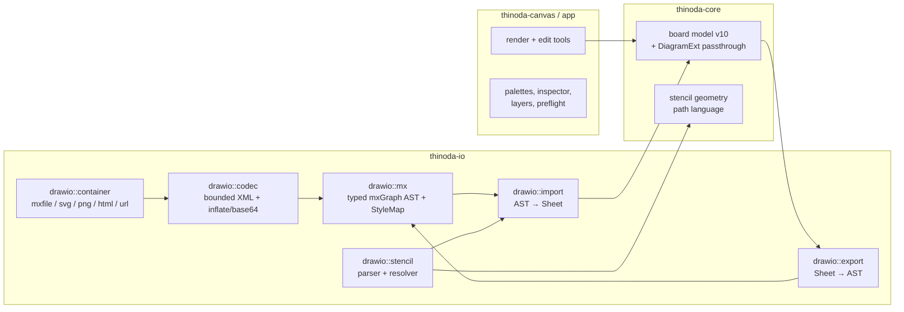

_Last updated: 2026-11-06 07:56:21 UTC (non-binding repository metadata)._ <!-- docs-stamp -->

# draw.io (diagrams.net) support: research, concept and phase plan

Status: 🟡 in progress — Milestone A (codec, import, export) landed 2026-11-05; see [§4.1](#41-implementation-progress). Tracked in [BACKLOG](BACKLOG.md#p1--drawio-diagram-support-user-request-2026-11-05) and [PLAN](PLAN.md#drawio-diagram-support-2026-11-05).

## 1. Problem & goal

Users want to open, edit, save, import, export and copy/paste draw.io diagrams in
Thinoda, without leaving the app and without breaking existing documents, formats or
exports. "Full support" is defined measurably by three tiers, tracked in a published
**support matrix** (`docs/DRAWIO.md`) with release gates:
- **Lossless**: 100 % of cells/attributes/styles round-trip for every file (gate: all
  corpus + fuzz-derived files).
- **Rendered**: all core mxGraph handlers, all 34 markers, all edge styles, all bundled
  generic libraries render faithfully (gate: ≥ 98 % of handlers used by bundled libraries
  and core sidebar palettes; visual diff vs. draw.io reference SVGs within tolerance).
- **Editable**: every rendered element editable via Thinoda UI (gate per phase).
Anything outside a tier is reported in diagnostics as "preserved, shown approximately".

**Confirmed decisions (user):**
1. draw.io content is **converted into Thinoda's native board model**; core is extended
   (waypoints, ports, layers, dash/fonts, generic stencil shapes …) and anything not yet
   modeled is kept in a **lossless passthrough envelope** so it survives round-trips.
2. **`.drawio` is a first-class editable format**: Open edits in place, Save writes
   `.drawio` back; loss preflight only when something cannot be represented.
3. **Stencils**: bundle Apache-2.0 generic libraries; vendor icon sets (AWS, Azure, GCP,
   Cisco, …) via an **optional, user-triggered library download**, faithful placeholder
   until available.

## 2. Research summary

### 2.1 Live investigation (app.diagrams.net, build 32.6.10)
- Compression verified from `Graph.compress/decompress`:
  `base64( deflateRaw( encodeURIComponent(xml) ) )`; decode reverses and applies
  `zapGremlins` (strip control chars). Optional zlib variant (`deflate`) exists.
- 832 registered shape handlers (`mxCellRenderer.defaultShapes`), ~200 sidebar palettes.
- 34 arrow markers: classic, classicThin, block, blockThin, open, openThin, oval, baseDash,
  doubleBlock, diamond, diamondThin, manyOptional, dash, box, cross, circle, circlePlus,
  halfCircle, async, openAsync, mermaidExtension, mermaidDiamond, ERone, ERmandOne, ERmany,
  ERoneToMany, ERzeroToMany, ERzeroToOne, sysML* (6).
- Edge styles: orthogonal, elbow, entityRelation, loop, sideToSide, topToBottom, segment,
  isometric, sequence (+ `curved=1`, straight = none).
- Perimeters: rectangle, ellipse, rhombus, triangle, hexagon(2), center, lifeline,
  orthogonal, backbone, callout, parallelogram, trapezoid, step, cloud, outline, …
- Default vertex style: `shape=label; perimeter=rectanglePerimeter; fontSize=12;
  fontFamily=Helvetica; align=center; verticalAlign=middle; fillColor/strokeColor/fontColor=default`.
  Default edge: `shape=connector; endArrow=classic; rounded=1; fontSize=11;
  labelBackgroundColor=default`.
- **Colors may be `default`, `none`, `#rrggbb`, or `light-dark(a,b)`**; the model has an
  `adaptiveColors` setting (dark-mode adaptation).
- Named stylesheet entries: text, edgeLabel, label, icon, swimlane, group, ellipse, rhombus,
  triangle, line, image, roundImage, rhombusImage, arrow, fancy, color presets, plain-*.
- Sketch mode (`sketch=1`, rough.js, `fillStyle` hachure/solid/zigzag/cross-hatch/dashed/
  zigzag-line), `fontStyle` bitmask bold=1 italic=2 underline=4 strike=8.
- Export surface: PNG/SVG/PDF/JPEG/VSDX/HTML/XML/URL, animated GIF; embedded-diagram PNG via
  `zTXt` chunk keyword `mxfile` (legacy `tEXt`), SVG via root `content` attribute.

### 2.2 File format essentials (jgraph/drawio + mxgraph, Apache-2.0)
- Containers: `.drawio`/`.dio`/`.xml` (`<mxfile host agent version etag modified type
  compressed>` with N `<diagram id name>` pages, each compressed text **or** literal
  `<mxGraphModel>`); legacy bare `<mxGraphModel>`; `.drawio.svg`; `.drawio.png`;
  `.drawio.html`; PDF with embedded XML; `#R<compressed>` URLs.
- `mxGraphModel` attributes: dx, dy, grid, gridSize, guides, tooltips, connect, arrows,
  fold, page, pageScale, pageWidth, pageHeight, background, backgroundGradient, math,
  shadow, adaptiveColors, backgroundImage.
- Cells: id 0 = root, id 1.. = layers (children of 0, `visible`, `locked` style), vertices
  & edges with `parent` (layer/group/container/edge for labels), `source/target`,
  `collapsed`, `connectable`, `visible`. Geometry: x/y/w/h, `relative`, `sourcePoint/
  targetPoint/offset`, `<Array as="points">` waypoints, `alternateBounds`.
- Edge labels = child vertices of the edge (relative geometry: x ∈ [-1,1] along edge +
  pixel `offset`).
- `<UserObject>`/`<object>` wrappers: `label`, arbitrary custom attributes (Edit Data),
  `placeholders="1"` with `%name%`, `tooltip`, `link` (URL, `data:page/id,…`, actions),
  `tags`.
- Style string: `[stylename|key=value];…` — leading tokens are named styles, `none`
  removes inherited keys; unknown keys must be preserved.
- Stencils: `shape=mxgraph.<ns>.<name>` resolved from XML stencil sets
  (`<shape><background><foreground><connections>` path language) or JS-coded shapes;
  `shape=stencil(<deflate-base64 XML>)` inline stencils.
- Security: `html=1` labels are untrusted HTML (sanitise / convert, never render raw);
  deflate/base64 bombs; deep nesting; huge cell counts; external image URLs (no auto-fetch).

### 2.3 Thinoda today (verified in code)
- Board model (`crates/thinoda-core/src/board.rs`): `CanvasObjectKind = Shape | Ink |
  Connector` (331-341); 29 `ShapeKind`s; `ObjectStyle {fill, stroke, text_color,
  stroke_width, opacity}` (218-242); connector `{from/to: Topic|Object|Point, route:
  Straight|Elbow|Curve, arrow_start/end: bool, label, color, width}` (764-821); flat
  groups (no nesting), lock flags, single `CanvasLayer` with `Band::{Below,Above}` paint
  bands; cards (Sticky/Text/Image) are floating topics; zones are sheet-level.
- **Missing for draw.io**: waypoints, ports/fixed connection points, arrow-type enum, dash
  patterns, fonts/size/alignment per shape, gradients, shadows, rounded/arcSize params,
  flip, named layers (visibility/lock), nested groups/containers, swimlanes/tables, free
  text & image objects, hyperlinks/custom properties/tooltips on objects, stencil shapes,
  rich labels on shapes, line jumps, unknown-data preservation (serde ignores unknown).
- I/O (`crates/thinoda-io/src/lib.rs`): central `Format` enum with IMPORTABLE/EXPORTABLE,
  `from_path` (extension only → `.drawio.svg` double extensions need special handling),
  `detect_format` (`.xml` is sniffed for FIM first, then falls back), `ImportReport` +
  `ImportWarning` consent flow, `ExportLoss` preflight (`board_export.rs`),
  `NATIVE_FORMAT_VERSION = 9` with `required_native_version` gating.
- Deps already present: `quick-xml 0.42`, `base64 0.23`, `image` (png/jpeg), `resvg 0.48`.
  Raw-deflate/zlib is only *transitive* (via `zip`) → a **direct** dependency (e.g.
  `miniz_oxide`) must be added, wasm-checked and license-noted.
- Document lifecycle (`crates/thinoda-app/src/doc.rs`): `is_native` = Thinoda|XMind
  (20-21) → only these are writable in place; other imports are conversion-only with the
  source path protected (`from_import_report` 263-295); `prepare_save` (614-625) allows
  native + MindManager. **XMind is the precedent for a writable foreign format.**
- `import_read_policy` (lib.rs 495) bounds only known formats; others fall back to
  unbounded `fs::read` (570). Existing XML importers reject DOCTYPE (fim.rs 190,
  mindmanager.rs 420).
- `ImportWarning` is a small `Copy` enum mapped exhaustively in ui.rs (~7439) and
  cloud_program.rs (2172-2179) — no room for counts/details/actions.
- Canvas and IO have **separate** board renderers (thinoda-canvas/src/render.rs ~1080/1178,
  thinoda-io/src/render/board.rs ~184), both calling `unit_outline` — not one shared path.
- Undo memory accounting (thinoda-core/src/document.rs 161-223) and `mask_canvas`
  (board.rs 1294-1307, used by `Workbook::masked_copy`) only know today's text fields.
- Copy/paste assigns fresh native ids (thinoda-core/src/clipboard/board.rs 28-29).
- Groups are flat; objects have a single global `rect`; no parent hierarchy.
- UI: `board_ui.rs` (shape library 1395, connector controls 1038, route tiles, color/width
  pickers), `menus.rs`/`native_menus.rs`, `export_preflight.rs`, `board_clipboard.rs`
  (board payload + HTML/plain representations), `i18n.rs` (11 languages incl. Auto).
- CI: fmt, clippy (`-D warnings`, also wasm32 for web crates), tests, importer mutation
  tests, fuzz smoke (XMind/FreeMind/OPML), Playwright browser tests.

## 3. Concept

### 3.1 Architecture

- New module tree `crates/thinoda-io/src/drawio/` (container, codec, mx, style, import,
  export, stencil, sanitize, tests) — mirrors existing `xmind.rs`/`mindmanager.rs` pattern.
- **Typed mxGraph AST** (`MxFile → MxDiagram → MxGraphModel → MxCell{id, parent, value:
  Label|UserObject, style: StyleMap, geometry, …}`) is an internal intermediate; it is
  *not* persisted. `StyleMap` keeps **ordered** key/value pairs + leading named tokens so
  export can reproduce untouched styles in their original order.

#### 3.1.1 Round-trip ownership contract (resolves passthrough lifecycle)
Three storage levels, each with a single authoritative owner:
| Level | Type | Contents |
|---|---|---|
| Workbook | `DrawIoDocumentExt` (new optional `Workbook` field) | mxfile attrs (host, agent, version, etag, type, compressed), container kind (`.drawio`/`.drawio.svg`/`.drawio.png`), compression policy, page order, unknown top-level children, source fingerprint |
| Sheet | `DrawIoPageExt` | `<diagram id name>`, mxGraphModel attrs not first-class, unknown model children, **tombstones** of deleted source cell ids |
| Object | `DrawIoCellExt` | `source_id`, `style_rest` (ordered unmapped keys), `attrs_rest` (unknown attrs/children, bounded), **owned-key mask** |

Rules (each backed by a test):
1. **Ownership table** per mapped style/attribute (`fillColor→style.fill`, `gradientColor→
   style.gradient`, …) is code, not convention. A key is either first-class *or* in
   `style_rest`, never both (validated). Editing a first-class field never touches
   `style_rest`; first-class fields that become unset are emitted as draw.io defaults.
   Keys whose meaning *depends* on an owned key (e.g. `gradientDirection` when gradient is
   removed, `arcSize` when `rounded=0`) are listed in the table as **dependents** and
   dropped together with their owner.
2. **Ids**: export uses `source_id` when present and unique; new objects get fresh ids
   (`<sheet-prefix>-<n>` collision-checked against all cells and tombstones). Copies keep
   `style_rest`/`attrs_rest` (unknown styling survives) but **clear `source_id`**, except
   one case: the board clipboard payload gains a provenance envelope
   `{ document_uuid, sheet_id, transfer_token, disposition: Copy|Cut }`; `source_id` is
   kept **only** when a completed Cut is pasted once into the same document (token
   matches, not yet consumed). Duplicate, Copy, stale/second paste of a cut, OS-serialized
   payloads and cross-document pastes all clear it. Tests for each case.
3. **Deletion** removes the object and its passthrough; its id goes into tombstones (only
   to avoid id reuse). Unknown cells that could not be mapped at all are imported as
   **opaque preserved objects** (selectable, movable, deletable placeholder with bounds) —
   never invisible hidden data — so the user can see and delete them.
4. **Reparent/group/ungroup** re-computes geometry in the new parent's space (§3.2.1); the
   passthrough follows the object.
5. **Undo**: passthrough blobs are immutable `Arc<…>`, shared across snapshots and counted
   once in history memory accounting.
6. **Privacy**: `masked_copy`/`mask_canvas` masks labels, tooltips, links, properties,
   HTML labels and drops `attrs_rest` text content.
7. **Budgets**: cumulative caps per object, sheet and workbook for passthrough bytes;
   exceeding them is an import diagnostic, not silent truncation.
8. **Non-draw.io documents** never get these fields; a native sheet saved to draw.io gets
   fresh ids and default envelope.

- **Native format v10** gate: `required_native_version` returns 10 only if a workbook uses
  any new field **or passthrough** (so existing documents keep writing v6–v9 exactly as
  today). Older
  Thinoda builds refuse v10 instead of silently dropping data (existing pattern).

### 3.2 Core model extensions (all `#[serde(default, skip_serializing_if)]`)

#### 3.2.1 Scene hierarchy & geometry (resolves parent-tree/relative-geometry gap)
- New `parent: Option<SceneParent>` on `CanvasObject` where `SceneParent = Layer(id) |
  Object(id)` (container/group/vertex **or connector** — edge labels and edge-attached
  children). `None` = default layer = today's behaviour.
- `CanvasGroup` stays for Thinoda's existing flat groups (no semantic change). draw.io
  groups/containers are **objects** of kind `Container { style: Group|Container|Swimlane|
  Table|TableRow|Cell, collapsed, alternate_size }`, so nesting is a tree with
  cycle/depth validation (max depth bound). Thinoda's group commands on draw.io sheets
  create `Container{Group}` objects; on non-draw.io sheets they keep using `CanvasGroup`.
- Geometry modes: `rect` stays **sheet-space** for every object (so all existing
  hit-testing, selection, zones and exports keep working); a derived `local_geometry`
  is computed only at draw.io import/export (parent offset composition; relative
  geometry for edge labels/children). Moving a container moves descendants (sheet-space
  update in one undoable command).
- Edge labels: `ConnectorLabel { id: LabelId, text, rich, position ∈ [-1,1], offset,
  style, source_id }` list on the connector (multiple labels, stable ids); the existing
  single `label: String` is the serialized form while there is exactly one unpositioned
  default label (v≤9 byte-identity, 3.2.3 pattern). A label cell with extra
  children/styling that can't map becomes an opaque preserved child.
- Paint order: within a layer, draw.io order = depth-first tree order; Thinoda stores
  objects in that order inside `CanvasLayer.objects` and z-order commands operate among
  siblings of the same parent (tested).
- Rotation: both systems rotate clockwise around the frame centre (board.rs
  `normalize_rotation`) — direct mapping. `direction` (north/south/east/west) is a
  separate stencil-orientation field applied to geometry, not to the frame; `flipH/V`
  likewise. Perimeter (`perimeter=…`) is a per-shape property used by the router.
- `visible=0` → object `hidden` flag (rendered nowhere, listed in Layers panel);
  `connectable=0` → no ports offered.
- Edge-to-edge connections: `Endpoint::Object` may reference a connector (nearest point
  on its path); edge-to-label connections use new `Endpoint::Label { connector, label:
  LabelId }`. Both validated (no self/cyclic edge chains that cannot be routed),
  round-trip tested with multiple labels and an edge attached to a specific label.

#### 3.2.2 Field extensions
| Area | Extension |
|---|---|
| Shapes | `ShapeKind` stays; add `CanvasObjectKind::Stencil { name: StencilRef, label }` (namespaced id like `mxgraph.flowchart.document`, core JS-shape id, or inline-stencil resource id); built-in draw.io core shapes map to existing `ShapeKind` **only when geometry is pixel-identical** (golden-tested), else to `Stencil`. |
| Text | `CanvasObjectKind::Text` (free text) and `Image { resource | external_url, aspect }`; `LabelStyle { font_family, font_size, bold/italic/underline/strike, align, v_align, wrap, spacing, label_position, background, border }`; rich labels reuse the v8 inline-text model; HTML→rich text mapping table (b/i/u/s/font/color/br/p/ul/ol/li/a/sub/sup) with anything else kept as preserved HTML + plain-text fallback. Fonts: family name kept; missing fonts fall back via existing font stack, noted in diagnostics. |
| Connection style | Per object `ConnectionStyle { perimeter: Option<Perimeter>, perimeter_spacing, ports: PortPolicy (Default per kind / Constraints(list) / None), connectable }`; `None` = default derived from `ShapeKind`/stencil (Phase 1 uses only these derived defaults). Imported non-default values affect routing, hit-testing, export (tested). |
| Style | `ObjectStyle` += `dash: Option<DashPattern>`, `fill_opacity`, `stroke_opacity`, `gradient: Option<Gradient>`, `shadow`, `rounded + arc_size`, `flip_h/v`, `direction`, `fill_style`, `sketch`. Colors: `ThemedColor = Fixed(Color) | Default | None | LightDark(Color, Color)`. |
| Connectors | `waypoints: Vec<Vec2>`; `route` += `Orthogonal`, `EntityRelation`, `Isometric`, `Segment`, `Loop`, `SideToSide`, `TopToBottom` (Elbow kept); `start_marker/end_marker: Option<Marker { kind: ArrowKind(34), filled, size }>`; `Endpoint::Port { object, x, y, dx, dy, perimeter }`; labels per 3.2.1; `jump: Option<LineJump>`; dash. |
| Structure | Named **layers** `Vec<BoardLayer { id, name, visible, locked }>` in `CanvasLayer`; objects reference layer via `parent`. |
| Metadata | Per-object `link: Option<Link>` (`Url` w/ scheme allow-list, `Sheet(SheetId)`, `Action(raw)` preserved-only), `tooltip`, `properties: Vec<(String,String)>`, `tags`, `placeholders`. |
| Sheet | `DiagramPage { page_size, page_scale, grid, background, background_image, math, adaptive_colors }` in `BoardSettings`. |

#### 3.2.3 Connector marker migration (compatibility-critical)
- Keep `arrow_start`/`arrow_end` bools **as the serialized form** whenever the marker is
  `None`/`Classic(filled, default size)`; add `start_marker`/`end_marker` fields that are
  serialized **only** for non-default markers. Custom `Deserialize` helper reads both;
  if both present and inconsistent → validation error. In-memory API is the new
  `Marker`; bools derived. v≤9 files therefore round-trip byte-identically and older
  Thinoda builds never see a marker field they would silently ignore (v10 gate).
- Same pattern for every other extended field: legacy representation preserved, new
  field present only when it carries information, `required_native_version` detects
  every new field (exhaustive test that constructs one workbook per new field and
  asserts version 10, plus forged v9 manifests containing v10 fields are rejected).

Mind-map topics/cards remain untouched; draw.io import produces **hidden-root board
sheets** (`SheetRootMode::Hidden`) so mind-map features stay unaffected.

### 3.3 Format detection & file handling
- New `Format::DrawIo` (`.drawio`, `.dio`), `Format::DrawIoSvg` (`*.drawio.svg`),
  `Format::DrawIoPng` (`*.drawio.png`); `from_path` gains a **full-file-name** check
  before the extension check so `x.drawio.svg` != plain SVG export.
- `detect_format`: for `.xml`, keep FIM sniff first, then sniff `<mxfile>`/`<mxGraphModel>`
  root; plain `.svg`/`.png` with embedded `mxfile` content are offered as draw.io on
  **import/open** (sniff), while Export to plain SVG/PNG stays unchanged.
- `import_read_policy` gets explicit draw.io entries (outer file-size limits per container,
  never the unbounded `fs::read` fallback); inflate is bounded by absolute size + ratio.
- Direct dependency `miniz_oxide` (raw deflate + zlib), verified on wasm32, recorded in
  THIRD_PARTY_NOTICES; `cargo deny`/license check updated.
- Read-only (import-only) sources: `.drawio.html`, PDF-embedded, `#R` URLs; `.vsdx`
  deferred (backlog).

### 3.4 UX & UI integration (Thinoda look & feel, not a draw.io clone)

#### 3.4.1 Shape placement & on-canvas editing — draw.io behaviour (user requirement)
Today: picking a shape arms `BoardTool::Shape(kind)`; every click/drag creates a shape,
but selection handles, rotation, label editing and connector creation are suppressed
until the user switches back to Select (`controls()` gates on `BoardTool::Select`,
board_input.rs ~884). New behaviour, for **every board sheet** (not only draw.io), for all
shape-library items (29 built-ins, bundled/vendor stencils, library images):
1. **Pick**: click a library tile → shape is *armed* (tile highlighted; a translucent
   ghost of the shape at default size follows the pointer, snapped to grid). Or **drag**
   the tile onto the canvas → ghost while dragging, created at drop point (drag-drop
   creates exactly one shape and does not change the armed state). Keyboard/AccessKit:
   Enter/Space on a tile inserts at a free spot near the viewport centre (right of the
   current selection if any), selects it and arms the shape (screen-reader announcement).
2. **Hover = edit**: while armed, whenever the pointer is over a shape (the new one *or*
   any existing shape) or over its affordance zone, the ghost hides and that shape shows
   draw.io-style affordances: drag body = move; corner/edge handles = resize; rotate
   handle = turn; double-click / F2 / start typing on the selected shape = edit label;
   four **direction arrows** = click to clone+connect in that direction, drag to draw a
   connector and drop on another shape/port to connect (modifiers as in draw.io:
   Ctrl/Cmd+click = clone only, Shift+click = connector only, Ctrl/Cmd+drag onto empty
   space = connected clone at the drop point); port dots on hover. Clicking a shape
   selects it — it never creates on top.
3. **Click empty space = create**: a click on empty canvas creates another instance of
   the armed shape centred at the (snapped) point and selects it; click-drag on empty
   canvas keeps today's drag-to-size creation.
- **Leave armed mode**: Esc, clicking the armed tile again, choosing another tool, or V.
  A compact hint chip on the board toolbar shows "Click empty space to add · Esc to finish"
  (localised, dismissible, announced once).
- **Hit priority** (tested): handles > direction arrows/ports > object body (incl. small
  hover tolerance) > zones/frames > empty canvas. Topics, cards, ink and frames count as
  "not empty" (click selects, never creates on top).
- **Touch/pen** (no hover): tap empty = create; the created/selected shape shows the same
  affordances; tap a shape = select; long-press on an object opens the context menu as
  today. Direction arrows: tap = default clone+connect; press-and-hold on an arrow
  (0.6 s without moving) opens the quick-shape popover. This replaces the planned
  "more" chevron: the hold is limited to the arrow, so the object long-press context
  menu is unaffected, and the arrows stay uncluttered; tested.
- **Undo**: separate gestures are separate history entries (create, move, rotate, label
  edit). Each **compound quick action** — click-empty create, clone+connect, quick-shape
  insert+connect, drop-on-empty create+connect — is **one atomic edit / one undo entry**;
  acceptance tests assert a single Undo restores the exact prior workbook and selection.
- Sticky/Text/Frame/Connector tools keep their current behaviour (they enter text editing
  or connector drawing immediately); the armed-shape model is reused later for stencils.
- Existing tests that assert "no controls while a creation tool is active" are updated to
  the new contract; new canvas tests cover every row above incl. touch and AccessKit.

#### 3.4.1a Connector & quick-action parity with draw.io (user requirement)
Observed in app.diagrams.net (user screenshots) and to be fully inventoried from the live
app + its shortcuts reference in Phase 0 (each gesture recorded with modifier variants):
- **Shape-aware perimeters**: connectors end exactly on the visible outline (ellipse,
  rhombus, triangle, hexagon, cylinder, parallelogram, callout, stencil outlines,
  rotated/flipped shapes) — today Thinoda clips to the (rotated) bounding rect
  (`clip_to_rect`/`clip_to_rotated_rect`, layout.rs 686/709). New `Perimeter` per
  `ShapeKind`/stencil (draw.io perimeter names), `perimeterSpacing`, used by router,
  hit-testing and export.
- **Floating vs fixed ends**: drop on the shape body/outline → *floating* (end slides
  along the perimeter, outline highlighted); drop on a connection point (×) → *fixed*
  port. Endpoint handles show state like draw.io (filled = connected, outline-highlight =
  floating, × = fixed point); Alt while dragging toggles; connection points (`×`) appear
  on hover over any shape while dragging an end (built-ins: 4/8/16 default points per
  shape kind; stencils: `<constraint>`s).
- **Direction arrows on hover** (light-blue ↑→↓←): click = clone + connect in that
  direction (respecting spacing/grid, avoiding overlaps); drag = draw connector, drop on a
  shape/port to connect or on empty space to create a connected clone; hold/hover on an
  arrow → **quick-shape popover** (recent + related shapes, e.g. circle/rect/ellipse/
  diamond as in screenshot 2) → click inserts that shape connected in that direction.
  Modifier variants follow draw.io's own arrow tooltip (implemented in 1b): click =
  clone + connect (or connect to an existing neighbour in that slot), Ctrl/Cmd+click =
  clone without connector, Shift+click = connector without clone, drag = connector to the
  drop target or a free end, Ctrl/Cmd+drag = connected clone at the drop point. Keyboard:
  each arrow is a Tab stop after the selection's resize/rotate handles; Enter/Space (with
  the same modifiers) activates it and keeps focus on the new shape's arrow for chaining.
  Quick-shape popover (1b part 2): resting the mouse 0.6 s on an arrow, holding it down
  the same time (touch), or Shift+F10 on a focused arrow opens a 5×2 tile picker beside
  the arrow — the source's own kind first, then common draw.io shapes; hovering or
  focusing a tile ghosts that shape and its connector at the target slot; click/Enter
  inserts it connected (one undo entry). Arrow keys/Tab move between tiles, Esc closes
  and refocuses the arrow, a click outside closes without acting on the board, and the
  mouse-opened picker closes when the pointer leaves the arrow and picker.
  Alt+Shift+Arrow and similar draw.io shortcuts stay unmapped because Alt+Arrow already
  duplicates in Thinoda.
- **Connect from outline**: hovering near a shape's outline highlights it; dragging from
  there starts a connector (no tool switch). Edge-to-edge connections supported.
- **Selected-edge floating toolbar** (screenshot 1): line style (straight/curved/…),
  end-arrow picker, waypoint style (straight/orthogonal/elbow/curved/entity relation),
  add/edit label (A), "…" opens the full connector inspector. Positioned near the edge
  midpoint, never covering the edge; keyboard reachable; reuses existing board toolbar
  widgets/icons. Selected **shape** quick toolbar likewise (fill, stroke, text, style
  presets, "…"), following the same visual language.
- **Virtual bends**: midpoint dots on each segment of the selected edge; drag = create
  waypoint; orthogonal edges drag whole segments; double-click waypoint = remove;
  "Clear waypoints" in toolbar "…".
- **Selection handles** (screenshot 2): 8 resize handles, rotate handle top-right,
  Shift = keep aspect, Alt = from centre, grid/guide snapping with smart guides.
- **Labels on edges**: double-click edge = add label at that position; drag label along
  the path (stores position ∈ [-1,1] + offset).
- **Reconnect**: drag an end from one shape to another; dragging a connected shape keeps
  edges attached and re-routes.
- **Deletion semantics** (Phase 8): *Delete* keeps today's behaviour — incident
  connectors survive with ends converted to free points (board.rs ~1855-1913); *Delete
  all* (Ctrl+Delete, as draw.io) also removes incident connectors, transitively removing
  edges attached to removed edges/labels; locked items block the command with a message;
  one atomic undo entry. Command tests for incoming/outgoing/shared/edge-chain cases.
- Every action is undoable, localized, AccessKit-named and keyboard-reachable; touch uses
  the same affordances on the selected item (no hover needed).

#### 3.4.2 Files & dialogs
- **Open/Import**: draw.io files in the normal Open dialog filter ("draw.io diagram"),
  drag-and-drop onto window/web drop zone, recent files with a draw.io badge. Multi-page
  files become sheets (tabs) with original page names.
- **Import report**: structured `ImportDiagnostic { code, severity, count, page,
  examples, preserved: bool, action: Option<DiagnosticAction> }` (e.g. "3 AWS icons shown
  as placeholders — *Download AWS library*", "2 math labels shown as source"). The coarse
  `ImportWarning` is *derived* from diagnostics, so the existing exhaustive matches
  (ui.rs, cloud_program.rs) keep compiling. Transport: `ImportReport` gains
  `diagnostics: Vec<ImportDiagnostic>`; `OpenDoc::from_import_report` stores them in a
  transient `pending_import_diagnostics` consumed by the report dialog (not persisted);
  identical path for desktop, wasm, cloud/VFS loaders; `DiagnosticAction` dispatches an
  app `Cmd` (e.g. open Libraries manager). Tests per loader + action callback.
  **Preserved-but-unrendered** items are
  informational (no destructive-consent prompt); only real data loss requires consent.
- **Save loss preflight**: reuse `export_preflight.rs`; lists only items that cannot
  round-trip (mind-map topics → boxes+edges, ink → freehand path stencils, …); one-click
  "Save as .thinoda instead".

#### 3.4.3 Editing surfaces
- **Shape library**: extend `shape_library` with sections (Thinoda, General, Flowchart,
  Basic, Arrows, UML, BPMN, ER, Network, Mockup, Tables/Containers) + "More libraries…"
  manager; search over names/tags; recents row; keyboard navigable; tiles render real
  stencil geometry; tiles are drag sources (3.4.1).
- **Inspector**: extend board context controls in the same visual language: Style,
  Text, Arrange (position/size/rotation/flip/z-order/layer), Connector (route tiles,
  34-marker grid, sizes, line jumps, waypoint reset), Data (link, tooltip, properties,
  tags). Advanced: "draw.io style" text field, validated on apply, writes through the
  ownership table (3.1.1).
- **Connectors**: waypoint handles (drag to add/move, double-click remove), ports on
  hover, fixed vs floating (Alt toggles), Tab between ports.
- **Layers panel**: compact side panel (View menu + board toolbar), visibility/lock,
  rename, reorder, move selection to layer; hidden when only the default layer exists.
- **Clipboard**: copy also as draw.io XML; paste of draw.io XML / compressed payloads /
  `#R` links inserts at cursor; size-capped like existing board clipboard payloads.
- **Dark mode**: `default`/`light-dark()` resolve against Thinoda's Light/Dark/Auto theme.
- **Accessibility**: localized accessible names for tiles, arrows, ports, markers; all
  controls keyboard-operable; announcements for create/connect/layer changes.
- **Localization**: every new string in `i18n.rs` for all 10 languages.
- **Web parity**: same flows in wasm (file picker/download, drag-drop, clipboard API).

### 3.5 Editable-format document contract (doc.rs)
- `is_native` stays Thinoda|XMind; new `DocFormat::is_editable_foreign()` = XMind|DrawIo*
  used by `from_import_report` (keep source path only for editable formats),
  `prepare_save`/`finish_save` (write same container + compression policy from
  `DrawIoDocumentExt`), autosave & crash recovery (recovery snapshot is always native
  `.thinoda` v10, restoring origin metadata), cloud/VFS save paths.
- Source fingerprint (size+mtime+hash) captured on open; Save detects external change
  and offers *Overwrite / Save as… / Reload*.
- Mixed workbooks (user adds a mind-map sheet to a draw.io document): sheets are
  exported per 3.4.2 preflight; nothing silently dropped.
- Embedded containers (`.drawio.svg/.png`) re-render their image part on save.
- Tests: every other import format still opens protected/conversion-only; XMind
  behaviour unchanged; save-reopen-save is stable (idempotent bytes for uncompressed).

### 3.6 Security acceptance criteria
- Reject DTD/entities (same as fim.rs/mindmanager.rs); bounded XML depth/attr/text sizes.
- Cumulative caps: cells, pages, passthrough bytes, data-URI bytes and inline-stencil
  bytes checked before allocation (declared/encoded lengths). **Inflate** is incremental
  into fixed-size chunks with a hard output ceiling and ratio check enforced *during*
  decoding (checked arithmetic, shared budget across nested containers e.g. PNG zTXt →
  mxfile → compressed diagram); tests assert abort before a measured peak-memory bound
  (native + wasm).
- HTML labels parsed into an inert internal rich-text representation; unknown markup kept
  as escaped text; never rendered as HTML, never scripts/styles/iframes.
- Embedded SVG images sanitized (no scripts/external refs) or rasterized via resvg with
  external loading disabled; never auto-fetch images, fonts or libraries.
- Link scheme allow-list (http, https, mailto, internal page links); `data:action/…` and
  others preserved but not executable; opening links asks as today.
- Adversarial corpus (zip-bomb deflate, billion-laughs, deep nesting, huge style strings,
  cyclic parents, id collisions) in unit tests + `drawio_import` fuzz target in CI smoke.

### 3.7 Non-breaking guardrails
- All model additions optional/defaulted; existing documents serialize byte-identically
  (golden tests over all existing fixtures); v10 only when new data is present.
- `Format` additions don't change existing extension mapping (sniffing only on open).
- **Exhaustive-consumer inventory** (Phase 0) of `CanvasObjectKind`, `ShapeKind`,
  `Endpoint`, `ConnectorRoute`, `Format`, `ExportLoss`, `ImportWarning`, `BoardTool`;
  each phase that extends one updates all listed consumers.
- Rendering is not shared today (canvas render.rs vs io render/board.rs) → Phase 4
  introduces renderer-neutral scene primitives used by both; parity tests compare canvas
  scene, SVG/PNG/PDF/print/presentation/thumbnail, hit-testing and bounds.
- Undo memory accounting counts `Arc` passthrough once; `masked_copy` masks new text.
- In-progress UI stays behind an internal setting until its phase completes; each phase
  ships green CI.

### 3.8 Licensing
- draw.io/mxgraph and generic stencils: Apache-2.0 → THIRD_PARTY_NOTICES; only stencil
  XML data is bundled, Rust code written from spec; per-library provenance manifest
  (source repo commit, file SHA-256, license per file).
- Vendor sets (AWS, Azure, GCP, Cisco, IBM, …) not bundled; optional user-triggered
  download from pinned URL + SHA-256, vendor terms shown first; PRIVACY.md updated.

## 4. Phase plan

Each phase: implement → tests → CI gates (fmt, clippy native+wasm32 `-D warnings`, tests,
importer mutation tests, fuzz smoke, browser tests when UI touched) → written critique →
commit with explicit pathspecs (never `git add -A`).

| # | Phase | Depends on | Outcome |
|---|---|---|---|
| 0 | Foundations | — | ADR/issue, corpus, provenance, consumer inventory, benchmarks, docs |
| 1 | Shape placement, quick actions & perimeters | 0 | draw.io-style pick / hover-edit / click-to-create, direction arrows, quick-shape popover, floating toolbars, true-outline connectors |
| 2 | Codec, AST & security | 0 | Bounded read/write of every container to typed AST |
| 3 | Core scene model & round-trip contract | 0 | Hierarchy, v10 fields, ownership/passthrough, marker migration |
| 4 | Renderer-neutral primitives & parity | 3 | One scene description for canvas + all exports |
| 5 | Stencil engine & generic baseline | 3, 4 | Stencil parser, core JS shapes, constraints → ports, bundled generic libs |
| 6 | Import MVP | 2, 3, 4, 5 | Open `.drawio` → board sheets, diagnostics, page links |
| 7 | Editable document contract & save-back | 6 | Save `.drawio` in place, preflight, round-trip guarantee |
| 8 | Connector editing UX | 1, 7 | Waypoints, ports, markers, routes, jumps |
| 9 | Style, text, data UX + library sections | 1, 5, 7 | Inspector, rich labels, links/properties, picker sections |
| 10 | Layers, containers, swimlanes, tables | 7 | Structure editing |
| 11 | Embedded containers & clipboard | 7 | `.drawio.svg/png` read+write, html/pdf/`#R`, clipboard interop |
| 12 | Vendor library download | 5, 9 | Optional libraries manager |
| 13 | Advanced fidelity | 7 | Sketch, math, placeholders, adaptive colors, page view, tooltips |
| 14 | Hardening & release | all | Perf budgets, fuzz, a11y, i18n, docs |

Phase 1 is independent of draw.io file support and delivers the requested interaction
change early; it only uses today's `Endpoint::Object` connections (port-precise
connections arrive in Phase 8 without changing the gestures).

### Phase 0 — Foundations (`p0-foundations`)
- GitHub issue + ADR (CONTRIBUTING requires discussion for major formats/deps/assets).
- Fixture corpus `crates/thinoda-io/tests/fixtures/drawio/` authored in app.diagrams.net
  with own content (all containers, compression modes, legacy model, multi-page, layers,
  groups, containers, swimlane, table, all 34 markers, all edge styles, waypoints,
  ports, edge labels, UserObject/properties/placeholders, links, html, math, sketch,
  light-dark, data-URI + external images, inline stencil, vendor shape).
- Provenance manifest for bundled stencil libraries; exhaustive-consumer inventory;
  **interaction inventory** of draw.io (every hover/drag/click/modifier/keyboard gesture
  for shapes, edges, arrows, popovers, toolbars — screenshots + notes) as acceptance
  checklist for Phases 1 and 8;
  benchmark targets (e.g. 5k cells / 5 MB: open < 1.5 s desktop, < 4 s web; save < 1 s;
  peak memory < 3x file+model; pan p95 frame < 16 ms desktop / < 33 ms web).
- `docs/DRAWIO.md` + BACKLOG/PLAN entries + feature→field→phase mapping appendix.

### Phase 1 — Shape placement, quick actions & perimeters (`p1-shape-placement`)
- Implement 3.4.1: armed state + ghost preview, tile drag source/drop target (desktop +
  web), keyboard insert-at-free-spot, hover affordances while armed (lift the
  `BoardTool::Select` gate in `controls()` for armed shape mode with the hit-priority
  table), click-empty create, exit rules, hint chip, touch behaviour, undo granularity.
- From 3.4.1a, everything that needs **no model change**: shape-aware perimeters for the
  29 built-in `ShapeKind`s (derived defaults, nothing persisted), direction arrows
  (click/drag/drop variants), quick-shape popover, connect-from-outline, edge-to-edge drop
  onto an edge path (existing `Endpoint::Object` already accepts any object id — verify;
  else deferred to Phase 8), selected-edge floating toolbar (straight/elbow/curve routes
  and start/end arrow toggles that exist today), shape quick toolbar, add/edit the
  existing single edge label (positioned label dragging → Phase 8), reconnect.
- i18n + AccessKit names; update affected tests (board_tests.rs, board_ui.rs
  shape_library tests, fim_authoring) and add new ones; browser test for web drag-drop;
  FREEFORM.md/user docs updated.

### Phase 2 — Codec, AST & security (`p2-codec-ast`)
- `drawio::codec` (bounded raw/zlib inflate via `miniz_oxide`, base64 tolerant,
  percent-decode, zapGremlins; writer identical to draw.io); `drawio::mx` typed AST
  with ordered `StyleMap`; geometry incl. points/offset/alternateBounds.
- `import_read_policy` entries; all 3.6 criteria; `drawio_import` fuzz target.
- Tests: AST round-trip over corpus; golden compressed string from the live app.

### Phase 3 — Core scene model & round-trip contract (`p3-core-model`)
- 3.1.1 + 3.2 in `thinoda-core`: `SceneParent`, containers, edge labels, layers,
  Text/Image/Stencil/opaque kinds, style/connector/metadata fields, `DrawIoDocumentExt`/
  `DrawIoPageExt`/`DrawIoCellExt`, ownership table, tombstones, marker migration.
- `required_native_version` → 10 for every new field; forged-manifest rejection;
  `validate.rs` (no cycles, depth bound, layers/ports/parents exist, ownership disjoint).
- Undo accounting, `mask_canvas`, clipboard provenance envelope (3.1.1 rule 2) updated.
- Tests: golden byte-identity of existing fixtures; edit/delete/dup/group/ungroup/
  cross-doc paste/undo/save-reopen lifecycle tests.

### Phase 4 — Renderer-neutral primitives & parity (`p4-render-parity`)
- Scene primitive layer (paths, fills incl. gradient/hatch, strokes incl. dash, markers,
  text runs, images, clips) consumed by canvas and thinoda-io renderers.
- Rendering for every 3.2 field; `ExportLoss` entries for PPTX/other approximations.
- Parity tests canvas vs SVG/PNG/PDF/print/presentation/thumbnails, hit-testing, bounds.

### Phase 5 — Stencil engine & generic baseline (`p5-stencils`)
- Stencil XML path language → primitives; inline `stencil(…)`; `<constraint>` → ports.
- Rust ports of JS-coded core shapes needed by generic libraries (process, document,
  card, tape, cube, step, note, callout, flexArrow, umlActor, lifeline, …).
- Bundled generic libraries (compressed, lazy, size budget in CI); library index.
- Unknown stencil → placeholder (bounds + label + icon), data preserved.

### Phase 6 — Import MVP (`p6-import`)
- Formats/sniffing (3.3); pages → hidden-root sheets; AST → model mapping incl.
  hierarchy, labels, layers, links (page link ↔ `SheetId` map); `ImportDiagnostic`.
- Open dialog filter, drag-drop, recents, web picker; mutation tests + fuzz smoke.

### Phase 7 — Editable document contract & save-back (`p7-save-back`)
- 3.5 in doc.rs; `drawio::export` (ownership merge, stable ids, compression policy,
  page-link rewrite on rename/duplicate/delete); preflight; Save As variants.
- Round-trip property tests: draw.io → Thinoda → draw.io semantically equal for every
  corpus file; Thinoda-native sheet → draw.io → Thinoda stable.

### Phase 8 — Connector editing UX (`p8-connectors`)
- Remaining 3.4.1a items that need the v10 model: fixed connection points (×) incl.
  default per-kind point sets and stencil constraints, floating/fixed toggle (Alt),
  virtual bends + waypoints, orthogonal segment dragging, all route styles in the edge
  toolbar, 34-marker picker, line jumps, multiple edge labels, smart guides; direction
  arrows/quick-shape popover become port-aware; stencil perimeters; persisted
  `ConnectionStyle` editing; positioned/multiple label dragging; Delete vs Delete all.

### Phase 9 — Style, text & data UX (`p9-style-text-data`)
- Inspector sections, rich label editing on shapes, link/tooltip/properties/tags
  editors, advanced style field, `BoardStyleClipboard` extension, library sections in the
  shape picker (stencil tiles inherit Phase 1 pick/drag/hover behaviour).

### Phase 10 — Layers, containers, swimlanes, tables (`p10-structure`)
- Layers panel; containers (move children, collapse/expand, drop-into highlight);
  swimlane & table editing.

### Phase 11 — Embedded containers & clipboard (`p11-embedded-clipboard`)
- `.drawio.svg` / `.drawio.png` read+write; html/PDF/`#R` import; clipboard copy as
  draw.io / paste from draw.io (native + web), size-capped.

### Phase 12 — Vendor library download (`p12-vendor-libraries`)
- Libraries manager; pinned manifest (URL, version, SHA-256, license URL); cache dir /
  IndexedDB; placeholders re-render after download; offline; PRIVACY/NOTICES.

### Phase 13 — Advanced fidelity (`p13-fidelity`)
- Sketch (deterministic seed) & hatch fills, math via `thinoda_core::equations`,
  placeholders `%name%`, adaptive colors, page view/background image, tooltips, page links.

### Phase 14 — Hardening & release (`p14-hardening`)
- Benchmarks vs Phase 0 targets, support-matrix tier gates (§1), fuzz CI, a11y audit,
  i18n completeness, user guide,
  CHANGELOG (release-please conventional commits).

### 4.1 Implementation progress

**Milestone A — codec, import and native-model export (2026-11-05).** A vertical slice
of Phases 2, 6, 7 and 11 that maps draw.io onto *today's* board model, before the
Phase 3 scene-model extensions exist:

- `crates/thinoda-io/src/drawio.rs`: bounded XML DOM (no DTDs or unknown entities,
  depth/element/page/size caps), raw-deflate and zlib inflation with an output cap,
  `.drawio` / `.dio` / bare `mxGraphModel` / `.drawio.svg` (`content`) /
  `.drawio.png` (`tEXt`, `zTXt`, `iTXt`) containers and content sniffing.
- Import: pages → hidden-root sheets; nested and relative geometry, groups, swimlanes /
  containers → frames, notes → sticky cards, text, lines, edges with deferred, free and
  labelled endpoints, rotation and `direction`, colours and opacity, links. Anything
  without a native equivalent (dashes, waypoints, rich HTML, images, unknown stencils,
  hidden or orphan cells, custom properties) becomes a placeholder or is dropped and is
  reported through the existing `ImportWarning` consent dialog; the source file is never
  overwritten.
- Export (`File › Export › draw.io` and Save As `.drawio`): uncompressed
  `mxfile` with one page per sheet. Board content round-trips idempotently
  (`thinoda*` style keys carry cards, ink, bands and frame clipping). Mind-map
  topics, relationships, boundaries and summaries are flattened to shapes and connectors;
  the board loss preflight lists *Mind-map topics and links flattened to shapes*, *Topic
  notes, labels, markers or tasks omitted*, *Presentation slides omitted*, inline text
  formatting and board grid/snap settings. Sheets with equations or embedded resources
  are refused, as for other editable formats.
- Opening a `.drawio` file imports a copy (like MindManager): Save asks for a
  destination and cannot overwrite the imported source. In-place, lossless save-back
  needs the Phase 3 ownership/passthrough model and remains Phase 7 work. Autosave stays
  limited to native formats.

Not yet covered: everything in Phases 1, 3–5 and 8–14, ink pressure (exported as a
plain polyline without a loss row), clipboard interop, drag-and-drop of
`.drawio.png` (still inserted as a picture; `.drawio.svg` opens as a diagram), and the
fixture corpus from Phase 0.

**UX addition — GitHub corner mark (user request, 2026-11-05).** Like diagrams.net's
lower-right GitHub kitten, Thinoda shows the GitHub mark (Primer Octicons
`mark-github`, MIT; notice in THIRD_PARTY_NOTICES) at the far right of the status bar
and of the home screen's template actions. It is a real button: muted until hovered or
focused, a translated tooltip and accessible name (*Thinoda on GitHub*, all UI
languages) plus the URL, Enter/Space or click opens <https://github.com/AxelWol/Thinoda>
through the guarded URL opener, and it never edits the document. Status bars narrower
than 480 pt omit it so sheet tabs and status controls keep their room; it stays
reachable from the home screen and About. Covered by `tests/github_badge.rs` and
`tests/bottom_bar.rs`.

**Phase 1a — armed-shape placement (draw.io behaviour).** Picking a shape tile now
*arms* it instead of hijacking every click:

- While a shape is armed, hovering existing content (board objects, frame edges and
  title bands, mind-map topics, selection handles) shows the normal Select cursor and
  hover feedback; pressing there selects, moves, resizes or rotates exactly like the
  Select tool. Only a click or tap on empty space (a frame *interior* counts as empty)
  creates the armed shape, as one undoable edit. A translucent, snapped ghost outline of
  the shape follows the pointer over empty space (no crosshair over content).
- Exit rules: Esc or V returns to Select (so type-to-edit cannot start with "v" while
  armed); clicking the armed tile again disarms it. With a board selection, Enter/Space
  edit its label instead of creating another shape.
- A translated hint chip under the toolbar (*Click empty space to add · Esc to finish*)
  explains the mode. It is dismissible for the session, and hidden on canvases narrower
  than 520 pt or shorter than 160 pt. egui has no live-region API, so it is not announced;
  the armed tile's selected state remains the accessible signal.
- Touch: a tap on content selects, a tap on empty space creates; drags behave as in
  Select mode.
- Tests: `armed_shape_*` in `board_tests.rs` (mouse, touch, keyboard, undo
  granularity) and `armed_shape_hint_*` in `board_ui.rs`.

**Phase 1b — direction arrows (draw.io behaviour).** A single, unlocked, ungrouped
shape shows four accent arrows (↑→↓←) just outside its bounds when it is selected or
hovered (arrows hide when the shape is smaller than 40 pt on screen; cards, connectors
and topics get none):

- Click: if another shape or topic sits in the next slot in that direction (one shape
  extent plus an 80 pt gap, draw.io's default edge length), connect to it and select it;
  otherwise insert an unlabelled clone there (stepping further while the slot is
  occupied) connected by a new connector, and select the clone so clicks can chain.
  Ctrl/Cmd+click inserts only the clone; Shift+click inserts only a connector ending in
  the neighbour or a free point.
- Drag: a dashed preview follows the pointer and outlines the target under it. Release on
  a shape/topic connects to it; release on empty space leaves a free end, or with
  Ctrl/Cmd drops a connected clone centred on the (snapped) point (ghost outline while
  dragging). Releasing on the source does nothing.
- Each compound action is one undo entry (`Document::add_connected_canvas_object`).
- Keyboard and assistive tech: the selection's arrows are Tab stops after its resize and
  rotate handles ("Add connected shape above/to the right/below/to the left").
  Enter/Space activate them (Ctrl/Cmd and Shift variants included) and focus the same
  arrow on the result. Hover-only arrows are not focusable and use separate widget ids.
  The quick-shape picker footer (translated) explains the click, modifier and drag
  variants and how to open the picker, replacing the earlier tooltip.
- Touch: tapping an arrow behaves like a click.
- The rotate handle moved to the top-right corner (draw.io's position) so it no longer
  collides with the up arrow.
- Tests: `direction_arrow_*` and `hover_arrows_*` in `board_tests.rs`, and
  `connected_object_is_one_undoable_edit_and_rolls_back_on_failure` in `document.rs`.

**Phase 1b part 2 — quick-shape popover.** Resting the mouse 0.6 s on an arrow,
pressing and holding it (touch path; a release after the hold no longer clicks), or
Shift+F10 on a focused arrow opens an egui popup beside the arrow, aligned to its
direction. It lists ten tiles (the source's own kind first, then rectangle, rounded
rectangle, ellipse, diamond, triangle, hexagon, parallelogram, cylinder, cloud,
document), each an AccessKit button named after the translated shape. Hovering or
focusing a tile paints a ghost of that shape plus a dashed connector at the slot the
arrow would fill. Clicking a tile or pressing Enter/Space inserts the clone with that
shape, connected, as one "Add connected shape" undo entry; keyboard use then focuses
the same arrow on the new shape. Tab/Shift+Tab and the arrow keys move between tiles
(wrapping horizontally, by row vertically). Esc closes and refocuses the arrow; a click
outside closes it without acting on the board; a mouse-opened picker closes when the
pointer leaves the arrow and picker. The picker also closes when the document, sheet,
camera or tool changes or an editor opens. Resting again on the same arrow needs the
pointer to leave it first. Tests: `quick_picker_*` in `board_tests.rs`.

Remaining Phase 1 slices: shape-aware
perimeters (1c), floating edge/shape toolbars (1d), tile drag-and-drop and keyboard
insert at a free spot (1e).

## 5. Out of scope / backlog
- VSDX import/export, Gliffy/Lucid/Miro import, Mermaid/PlantUML generation, auto-layouts,
  draw.io plugins, animated GIF export, real-time collaboration.

## 6. Risks
- **Model blast radius** → defaults, golden tests, consumer inventory, phase gating.
- **Interaction regression (Phase 1)** → hit-priority table + exhaustive canvas tests; the
  change touches every board, so it lands first and isolated.
- **Perimeter change alters existing documents' look**: connectors to non-rect shapes
  will end on the true outline in canvas and exports → intended improvement, called out
  in CHANGELOG; golden export snapshots updated deliberately in Phase 1.
- **Overlay clutter** (arrows + toolbars + handles) → show only for hovered/selected
  item, fade delays as in draw.io, never cover the object; hidden during pan/zoom.
- **Stencil breadth** (800+ handlers) → prioritise by corpus; unknown → placeholder.
- **Binary/wasm size** → compressed lazy libraries, CI budget.
- **HTML/SVG security** → 3.6.
- **Round-trip drift** → ownership table + property tests.

## 7. Rubber Duck findings & resolutions
| # | Severity | Finding | Resolution |
|---|---|---|---|
| 1 | blocker | Passthrough lifecycle undefined (edit/delete/copy/undo) | 3.1.1 ownership contract + lifecycle tests (Phase 3) |
| 2 | blocker | No parent tree / relative geometry / edge-label children | 3.2.1 scene hierarchy; sheet-space `rect` kept |
| 3 | major | doc.rs only treats Thinoda/XMind as writable | 3.5 editable-format contract (Phase 7) |
| 4 | major | No workbook-level home for mxfile data | `DrawIoDocumentExt`/`DrawIoPageExt` |
| 5 | major | Stencils/constraints/page links needed before import | Phase 5 before Phase 6; link map in Phase 6/7 |
| 6 | major | bool→marker migration underspecified | 3.2.3 dual representation + exhaustive v10 tests |
| 7 | major | Renderers not unified; exhaustive matches | 3.7 inventory + Phase 4 primitives |
| 8 | major | `ImportWarning` too coarse | `ImportDiagnostic`, derived coarse warning |
| 9 | major | Security criteria vague | 3.6 acceptance criteria + adversarial corpus |
| 10 | major | Undo memory / masking / clipboard ignore passthrough | Arc accounting, masking, caps (Phase 3) |
| 11 | major | Unbounded read fallback; deflate only transitive | 3.3 read policy + direct `miniz_oxide` |
| 12 | minor | Phase 0 lacked ADR, provenance, measurable budgets | Phase 0 deliverables |

**Round 2** (after adding draw.io shape placement + connector quick actions):
| # | Severity | Finding | Resolution |
|---|---|---|---|
| R1 | blocker | Edge labels lacked identity; label drag/edge-to-label not modelable in Phase 1 | `LabelId`, `Endpoint::Label`; positioned label drag moved to Phase 8 |
| R2 | blocker | Cut-vs-copy `source_id` rule contradicted clipboard (fresh ids, no provenance) | Clipboard provenance envelope with one-shot cut token |
| R3 | major | Perimeter/spacing had no persistent field | `ConnectionStyle`; Phase 1 uses derived defaults only |
| R4 | major | Delete vs Delete-all unassigned & conflicts with current detach | Defined semantics, Phase 8 |
| R5 | major | Diagnostics had no transport to UI | `ImportReport.diagnostics` + transient `OpenDoc` field, per-loader tests |
| R6 | major | Undo rules contradicted compound quick actions | Compound actions = one atomic undo entry |
| R7 | major | "Full fidelity" vs placeholders | Three-tier support matrix with release gates (§1) |
| R8 | major | "Cap before decoding" not implementable for deflate | Incremental chunked inflate with in-flight ceiling |
| R9 | minor | No touch gesture for quick-shape popover | Press-and-hold on the arrow itself (implemented in 1b part 2 instead of the chevron); object long-press unchanged |
