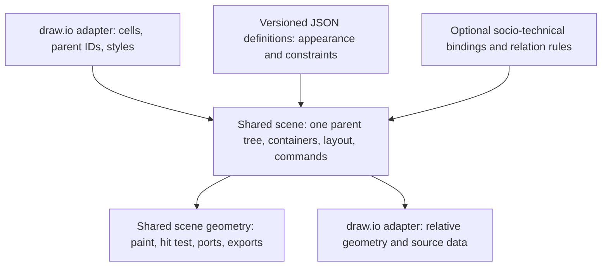

# Common nested containers and swimlanes

Research and design: 2026-11-13. **Implementation in progress; SC0/SC1 remain
partial, SC2 has partial layout-policy support, and SC3 has a bounded nested
import/export slice; original-fixture and full loss-policy acceptance remain
open.**
This is the common structural contract for [draw.io support](DRAWIO.md) and
[socio-technical editing](SOCIO-TECHNICAL.md). It refines DRAWIO.md section
3.2.1, rather than introducing a second container implementation.

User requirement: "draw.io also has support for nested swimlanes. please
investigate and create one common solution."

## 1. Research findings

draw.io swimlanes are not just a set of rectangle symbols:

- The [official swimlane documentation][swimlanes] describes an outer pool
  containing lanes, lane insertion/reordering, child drop/reparent, automatic
  expansion, duplicate-with-content and collapse. Collapse hides descendants
  without deleting them; external connections remain represented.
- The [official container-table documentation][tables] describes another
  structural form: table, row and container cells containing ordinary shapes.
  Children and connections move with the table. Dropping a child into a table
  cell does **not** automatically grow the row/column. This differs from the
  documented swimlane behavior, so one unconditional auto-grow rule is wrong.
- [Cross-functional flowcharts][crossfunctional] combine row/column categories.
  A two-dimensional container table must not be flattened to a one-dimensional
  pool stack, nor interpreted as two simultaneous semantic parents.
- In the inspected [draw.io Graph.js][graph], `layoutManager.getLayout` reads
  `childLayout=stackLayout`, `horizontalStack`, `stackSpacing`, `stackBorder`,
  four margins, `resizeParent`, `resizeParentMax`, `resizeLast`, and
  `allowGaps`. It defaults parent resize and resize-parent-max to enabled,
  enables cross-axis fill for ordinary parents, and defaults last-child resize
  off. It schedules nested child/parent layouts; `getLanes` and `isLane`
  identify children of a stack. Lane insertion is a parent/child operation,
  not a BPMN operation.
- The underlying [mxSwimlane][mxswimlane] shape separates header size
  (`startSize`), header/content paint and `horizontal` orientation. In its
  unrotated/default-direction rendering, `horizontal=1` gives a **top header**;
  `horizontal=0` gives a **left header**. This is independent of
  `horizontalStack`, which controls the direction of child stacking.
  Do not infer this mapping from the phrase "horizontal swimlane".
- [mxStackLayout][mxstack] offsets layout by the header once and distinguishes
  parent resizing from filling the last child. Its comments/source provide
  useful legacy behavior, not proof of full current-editor parity.

The draw.io source was inspected at revision
`c72c9a98b7a6ce392556ed04c05e0ff19f43f5c3`; documentation and local corpus
inspection are the other evidence. No live-editor visual-parity test is
claimed by this research.

### Existing corpus and current Thinoda limitation

A bounded decode of the existing Apache-2.0 example corpus found **88 nested
lane/table-container occurrences**, including three container levels in
`docs/draw-io-examples/cross.xml` and nested swimlane cells in
`maths-examples.drawio` page 2. That count includes table-related containers;
it is not a count of 88 independently supported nested-lane diagrams.

The current SC3 import slice promotes directly nested draw.io container cells
to scene containers. Their source parent ancestry and sheet-space rectangles
are preserved, and swimlane `horizontal` plus `startSize` map to the shared
`header-frame-v2` stencil. Connectors attached to imported containers retain
object endpoints. Flat containers continue using Zones for compatibility.

This is not full SC3 support. Only direct container-to-container nesting is
promoted; nested containers under intervening non-container/group cells remain
on the warned legacy path. Stack axis, spacing and uniform effective padding
are imported as a warned partial policy; collapse state and stored layout
policies are not yet exportable. Nested scene trees without those policies export
parent-relative geometry, container markers and top/left headers only when
every scene container participates in direct container-to-container nesting.
Isolated scene containers and other unsupported scene/header combinations
remain refused. Separate import warnings identify partial layout behavior,
collapsed containers imported expanded, and cards nested in scenes imported as
standalone board cards; draw.io clipboard fragments report ancestry as a loss.
Supported scene exports in the corpus are checked for normalized scene
idempotence across repeated round trips, and the included draw.io example
corpus round-trip gate passes. A nested pool/lane/task export was opened in
app.diagrams.net and visually confirmed with its top pool header, left lane
header, task and connector. Targeted assertions for original nested source
fixtures and browser-console validation remain open.

## 2. One engine, three responsibilities

| Layer | Owns | Does not own |
|---|---|---|
| JSON definition/interpreter | Shape geometry, header/body paint, label regions, ports, handles and declared generic interaction constraints | Participant identity, workflow execution or executable library code |
| Shared scene/container engine | One parent tree, ordered children, layout/resize/reparent/collapse, geometry, visibility, selection and routing integration | Pool ownership, performer responsibility, sequence/message validity |
| Optional socio-technical model | Participants, roles, use cases, accountability, typed relations, binding meaning and modeling diagnostics | Another parent tree, another lane layout or another renderer |
| Format adapters | Source parent IDs, local/relative geometry, style mapping, preserved source data and conversion diagnostics | Hidden semantic inference or arbitrary JavaScript execution |

**A swimlane is a structural container with a header/layout policy. A BPMN-like
pool or lane is an optional semantic binding on that container.** Ordinary
draw.io shapes, even BPMN stencils, acquire no socio-technical meaning on open.

## 3. Shared structural contract

### 3.1 Identity, parents and geometry

- Extend the existing scene direction with one `SceneParent` relation:
  default/named layer or another object, with stable IDs and ordered children.
  Containers include group, general container, swimlane and table/row/cell
  structural roles. These are reusable structural operations, not per-symbol
  `ShapeKind` additions.
- Store one authoritative parent per occurrence; validate existence, cycles,
  depth and cumulative budgets. The tree is independent of mind-map topic
  parents, Zone membership and semantic boundary memberships.
- Keep existing canonical rectangles and connector controls in **sheet space**.
  Import/export converts source geometry in the adapter. A child rectangle
  is relative to the source parent origin, not automatically its body origin;
  layout may place it below/beside a header. Do not apply header offsets twice.
  Relative edge children/labels use their separate geometry rules from DRAWIO.
- Global drag updates the unique descendant closure exactly once. Reparent
  preserves sheet position before any explicit target layout; source/local
  coordinates are derived, not stored as a competing authoritative rectangle.
- Hidden descendants keep their sheet-space geometry. Moving a collapsed
  ancestor translates hidden descendants and stored expanded bounds once too;
  expanding must not restore pre-move coordinates.
  In the saved collapse representation, the container object's rectangle is its
  active compact frame; `SceneStructure.collapsed[id]` holds its expanded frame.
  Their origins may differ (for example a right-side compact header), and
  neither replaces descendant geometry.
- Exclude selected descendants when their ancestor already moves. Preserve
  sibling paint order, hit-testing and locked/selectable state. A parent move
  moves locked descendants as a unit unless the container itself is locked;
  individually locked descendants cannot be reparented directly.
- Existing flat `CanvasGroup` behavior and Zone membership remain unchanged.
  New nested grouping on draw.io and socio-technical sheets uses scene group
  containers. Do not combine a flat-group move and an ancestor move twice.
  **SC0 decision:** scene ancestry and socio-technical occurrence bindings use
  `CanvasObjectId` only. Board cards and topic trees remain outside scene
  ancestry and semantic bindings in v1; use ordinary text/shape objects for
  notes inside a scene. Do not convert cards implicitly on import, paste or
  export. Any future card-occurrence adapter or explicit migration is separately
  scoped and is not a v1 prerequisite.

### 3.2 Swimlane/container policies

Define generic policies once, with bounded typed fields. JSON packages choose
defaults; document instances store overrides. Rust implements the shared
policy operators. Format-specific names map at the adapter boundary.

| Policy | Proposed common behavior |
|---|---|
| Header | Independent side, extent, label direction, header/body fill and separator. Source direction/flip map explicitly; header side and stack axis are separate |
| Layout | `Free`, `Stack(axis)` and later `Table(grid)`; nested layout runs in a bounded deterministic schedule, never until an unconstrained fixed point |
| Stack | Sibling order plus extents, spacing, margins, cross-axis fill and minimum sizes; preserve manual extents unless the chosen resize policy changes them. `FillLast` grows only the final child along the stack axis; parent-resize policies preserve child sizes |
| Resize | The shared policy supports preserve, fill-last, grow-only-parent, fit-parent and distributed gaps. Parent sizes are computed bottom-up before deterministic top-down placement. Parent resize takes precedence over fill-last; source-specific geometry mapping remains open. No recursive proportional scaling by default |
| Auto-grow/drop | Plain swimlane defaults may grow; container-table cells default not to. Preserve supported imported flags; preview bound semantic reparent rather than making it a side effect of geometric overlap |
| Collapse | Store expanded bounds separately; render header/compact frame and fold external connectors to the nearest visible ancestor boundary. Restore full contents/geometry on expand |
| Clipping | Explicit body/content clipping, not implied by being a container. Headers and crossing external connectors must not disappear behind the body clip |
| Group conversion | Explicit, undoable command. Ordinary grouping does not assign performer or process meaning |
| Unsupported source policy | Preserve bounded source policy with a specific diagnostic; geometry-only editing is possible, but edits needing an unsupported layout are refused until explicit conversion to a supported policy |

V1 shared authoring covers free containers and nested stack swimlanes, including
mixed header/stack axes. Container-table structure and absolute geometry can
be preserved before full table authoring. SC4 delivers the table layout slice;
until then table resize/reflow support remains explicitly incomplete.
General custom `childLayout` algorithms are not implemented or executed simply
because a JSON library or draw.io file requests them.

On resize, compute minimum sizes bottom-up once, then allocate parent/child
extents top-down once for each affected subtree. If policy constraints conflict,
reject the command with a named constraint; do not oscillate, truncate content
or silently disable an imported policy. SC0 fixes numerical tolerances and
budgets; conformance fixtures test that schedule against the supported source
policy combinations, not against every draw.io layout.

### 3.3 Edges across nested containers

The shared scene permits ordinary connections across any eligible objects.
Notation rules are optional diagnostics/guards above it.

- New cross-container connectors live at the endpoints' nearest common scene
  ancestor, or the layer when appropriate. Imported edge parents are preserved
  when supported, otherwise explicitly remapped with a diagnostic. Being the
  scene parent of an edge does not imply owning its semantic exchange.
- Moving both endpoint subtrees together translates manual controls once.
  Moving one endpoint preserves unrelated sheet-space manual controls and
  reroutes affected attachment segments; automatic routes recompute. One
  transaction deduplicates edge updates whether the edge itself was selected
  or belongs to the moved subtree.
- For a layout where endpoint subtrees move by different deltas, each edge is
  handled once: controls follow when both endpoint subtrees have the same net
  translation; otherwise manual controls stay in sheet space and anchored ends
  recompute from their real endpoints.
- Collapse keeps the **real endpoint ID**. Only visible routing terminals
  project to an ancestor boundary; expand restores the original attachment.
  An edge whose endpoints are both hidden inside the same collapsed ancestor
  is hidden in that presentation, not deleted.
- Edge parents are stored. On explicit endpoint reparent, recompute the edge's
  common ancestor in the same command, preserving sheet-space controls; if the
  parent changes, place it after existing sibling edges and preserve relative
  order among all moved edges. Preview this paint-order consequence. Other
  geometry moves do not silently normalize imported edge parents.
- Container borders/headers participate in the route geometry. Tests distinguish
  child ports, container ports, nested clipping and label bounds. Do not claim
  arbitrary obstacle-avoidance routing before it exists.
- Connector dash/marker styling is one shared board/scene feature reused by
  ordinary draw.io edges and socio-technical sequence/exchange styling.

### 3.4 Optional semantic bindings: no second ownership tree

For the first socio-technical workflow, **scene ancestry is the authority for
structural membership**: a step's nearest bound process-scope ancestor defines
its process; the nearest bound responsibility-lane ancestor defines its lane.
A missing scope means an explicitly unallocated draft. A nested lane remains
within that process. Unbound intermediate containers/groups are transparent
when finding the nearest bound ancestor. No parallel `step.parent_scope` tree
is persisted. V1 process/lane bindings are offered only on supported free or
stack containers; table-cell semantic binding is deferred.

Participant ownership of a process and role/performer references on a lane are
semantic properties, not another scene hierarchy. Overlapping organization,
software-scope, trust and visibility boundaries are membership relations and
overlays, never competing scene parents. A table row/column categorization
also does not create multiple structural parents.

All generic reparent, ungroup, delete and paste commands consult a shared
binding-aware transaction hook:

- Unbound sheet: apply scene behavior only; no socio-technical diagnostics.
- Bound workflow: show proposed responsibility/scope changes and affected
  relation diagnostics, including inherited performer changes beneath a moved
  nested lane. Confirm one atomic command or cancel. Preserve relation types;
  never turn a sequence into an exchange just to make validation pass.
- Disallow destructive ungrouping of a bound process/lane until the user chooses
  to move children into an explicit target or retain unallocated drafts.
- Moving a scope changes its geometry and descendants, not its participant
  owner. Moving an overlay changes neither hierarchy nor boundary membership.

Collapse is **not** black-box semantics. A collapsed process still owns its
hidden steps. A black-box process has no modeled internal steps. Promotion
to black-box refuses/discloses existing behavior instead of hiding it and
pretending it does not exist.
Collapsed headers and legends need an explicit collapsed affordance so readers
can distinguish hidden modeled behavior from a black-box process.

### 3.5 Persistence and lifecycle capabilities

Assign version numbers at implementation time, independently for these
capabilities. A plain scene-only document must not need the semantic capability.

| Capability / phase owner | Required coverage |
|---|---|
| Scene ancestry, nested containers, collapse / SC1 | Native gate, clipboard/recovery/private snapshot gates, validation, history accounting, sheet duplicate/merge and masking |
| Header/layout policies, shared dash style / SC2 | Policy-aware versions and old-envelope rejection; all scene consumers resolve identical geometry/style |
| Table reflow / SC4 | Gate only if introducing stored data not already retained safely; retain unsupported source styles honestly |
| Semantic graph and bindings / STC2 | Independent native/transport gates, structural validation, draft diagnostics and explicit non-native loss preflight |
| Pinned JSON definitions / SC2 | One immutable-resolution mechanism across save/reopen/copy and missing-definition diagnostics. STC2 consumes it for notation packages; semantic compatibility is separate from visual fallback |

SC0 decides whether SC1/SC2 are internal-only steps delivered under one scene
format version or independently released capabilities. Do not allocate two
versions merely because there are two rows; do not expose an intermediate
reader/writer that ignores stored layout fields.

Copying a container includes its subtree and internal edges, remaps all IDs and
keeps explicit partial external links as unresolved draft metadata in semantic
mode. Ordinary scene paste handles missing endpoint shapes through the existing
explicit detachment/loss policy. A child copied alone is pasted at the layer
with its sheet-space position retained; paste into a chosen target is an
explicit reparent. Bounded closure overflow rejects without partial insertion.

Visual collapse/clip does not remove source data from save, clipboard, export
metadata or sharing. Mask all new labels, policies containing user text and
retained source fields through the existing masked-copy contract.

## 4. Import, export and promotion

1. **Import unbound:** decode cell parents, styles, expanded/collapsed geometry,
   stack/table policies and endpoint identities. Preserve the supported scene
   tree. No label, BPMN stencil name, dashed edge or lane title assigns semantics.
2. **Native editing:** use common container and connector commands. Scene-only
   users receive structural/layout diagnostics, never process-rule warnings.
3. **Explicit promote:** preview which containers become scopes, nested lanes
   or remain visual groups, who owns/fulfills each, and which edges are sequence,
   exchange or unclassified. Suggestions are not persisted until confirmed.
   Ambiguous source content remains unbound; promotion need not cover a sheet.
4. **Export scene:** emit source parent-relative geometry, order, expanded bounds
   and mapped policy styles. Geometry-only export is not semantic round trip.
   Do not add a semantic extension until STC6's reconciliation gate passes.
5. **Reimport extended documents:** separately reconcile the semantic extension
   against source baseline IDs, endpoints and ancestry. External reparenting
   must not restore old ownership. On conflict, require a choice or retain a
   disclosed scene-only copy; do not silently resurrect deleted model elements.

## 5. One phased structural milestone

Carve SC0-SC3 out of draw.io's structural Phase 10. This is **one shared
milestone**, not another complete Phase 10 rewrite. STC1 consumes it.
SC4 extends it without a second implementation; STC v1 need not wait for full
tables. SC0 has no implementation prerequisites. SC1 delivers the needed
Phase 3 model slice; SC2 uses the Phase 4 shared-rendering and implemented
Phase 5 interpreter slices; SC3 uses the bounded codec/import and supported
save-contract slices of Phases 2, 6 and 7. These are explicit dependencies on
the relevant capabilities, not declarations that all those parent phases
must close before common container work starts.

| Phase | Depends on | Deliverable and exit gate |
|---|---|---|
| SC0 - Common contract and corpus | None; coordinated with STC0 | Freeze parent/coordinate and command contracts, binding-hook interface, card/topic treatment, supported policy combinations, maximum depth/bytes and layout budgets. Classify nested corpus and add original pool/lane/sub-lane and mixed-orientation cases. Pin reference renderer/source version. If cards require a format-wide migration, stop/rescope to non-card scene objects explicitly rather than flatten imported cards silently |
| SC1 - Safe generic hierarchy | SC0; relevant Phase 3 model slice delivered here | Persist/reopen parent/order/container/collapse data; bounded transforms, copy/delete/reparent, history and version gates. All generic mutation paths invoke the binding hook: test with no-op unbound behavior and a stub bound validator. Test depth/cycle/old-envelope rejection, no double moves including collapsed hidden descendants, locked descendants and keyboard containment navigation |
| SC2 - Nested swimlane behavior | SC1; relevant Phase 4/5 rendering/interpreter capabilities | Shared JSON header/body definitions, free/stack layout and resize/drop/collapse routing; connector dashes and definition resolution. One resize including induced sibling changes is one undo step. Canvas/hit-test/SVG/PDF parity and native/web authoring; nested depth-by-child-count workload meets SC0's measured latency and bounded-operation budgets without semantic code |
| SC3 - draw.io structural fidelity | SC2; bounded Phase 2/6/7 adapter capabilities | Import/edit/export/reimport original nested fixtures and classified corpus cases. Preserve parents, relative geometry within SC0 tolerances, IDs/order, header axes, policies, collapsed bounds and terminals. Require normalized scene idempotence over repeated round trips; verify in draw.io and report unsupported policies exactly. This is the scene-only milestone gate |
| SC4 - Container tables | SC3 | Shared table/row/cell layout and insertion/deletion/resize without flattening. Exercise `cross.xml`, nested container cells, row/column categories and no-auto-grow behavior in the same engine |

**Integration order:** SC0 and STC0 establish one contract. SC1-SC3 deliver the
reusable foundation. STC2 then adds semantics on top; STC3 adds semantic editing,
STC4 accepts the socio-technical release. Prototype-only graph work may overlap
SC implementation, but dependent lifecycle gates cannot be marked complete
early. Full table authoring, unrelated draw.io libraries, edge-label child
fidelity and arbitrary custom layouts remain separately tracked work.

Keeping the bounded SC3 gate before STC2 is deliberate: this common-solution
proposal proves that the new native nested structure maps back to draw.io
before adding a second consumer's semantics. It requires the declared
free/stack subset, not complete draw.io save-back fidelity. If that limited
adapter gate proves disproportionate, changing it to run in parallel is an
explicit plan revision, not an unnoticed relaxation.

Assign one scene/schema owner at SC0 and one adapter owner; changes to shared
fields require review against both plans and explicit owned-path commits.
Do not fork the same engine into a socio-technical subsystem.

### 5.1 First implementation checkpoint: SC0 executable contract

`thinoda-core::scene_hierarchy::SceneHierarchy` is an immutable, object-only
prototype over the existing canvas. It is not a second persisted ownership tree
and is not wired into the live editor. Its purpose is to exercise the shared
structural algorithms before committing a document schema:

- Validate shape-container identities, unique parents, missing references and
  cycles. Bound objects/groups/cards by existing board limits and parent chains
  to **32 links**; iterative traversal uses canvas order for stable siblings.
- Preview reparenting without changing any sheet-space rectangles or controls.
  Selected descendants remain under their selected ancestor. Invalid topology,
  excess depth and locked source/target ancestry reject the candidate.
- Preview an atomic translation of the unique selected descendant closure,
  reusing the existing board geometry helper. A parent carries individually
  locked descendants; direct movement/reparent of a locked child is refused.
  Internal manual connector controls follow two moved object endpoints once;
  connector-to-connector attachments propagate by dependency. Moving controls
  on an edge with a stationary terminal does not falsely count as a rigid
  endpoint translation. Unselected crossing-edge controls stay in sheet coordinates.
- Preserve unrelated legacy object-only group movement. Refuse mixed card groups,
  hierarchy membership in legacy flat groups and rotated containers explicitly
  in this prototype, rather than flattening cards or inventing occurrence rules.

The core fixtures cover pool/lane/sub-lane ancestry, ink, internal/crossing/free
connector ends, rollback, locks, exact depth overflow and a 20,000-object scene
at the full supported depth.
The size fixture verifies bounded iterative behavior, not an SC2 latency benchmark.

**Release boundary:** this type deliberately has no serialization interface, and
no model fields, format versions, import/export behavior or UI controls changed.
Its translation result is geometry-only preview data, not a savable nested
document. Existing editor mutations retain their existing behavior.

At this first checkpoint SC0 was **partial**. Card occurrences, binding-hook contracts, ordered
reparent insertion, edge-parent reconciliation, source-policy/corpus fixtures,
numerical/layout budgets and measured keyboard/rendering behavior were still
open; the next checkpoint below advances the command contract.
SC1 remains open in full: do not wire previews into live commands until
native/clipboard/recovery/private-snapshot gates, history, delete/partial-copy
behavior, all generic mutation paths and editable-export loss protection land
together. Headers, stack/table layout, collapse and semantic bindings are not
implemented by this checkpoint.

### 5.2 Command-contract checkpoint: ownership, order and binding validation

The same immutable hierarchy now maintains ordered child lists through chained
reparent previews, instead of rebuilding order from the original flat canvas.
An actual parent change appends selected roots in their prior hierarchy traversal
order. Reparenting to the current parent preserves order; selecting descendants
alongside an ancestor still moves only the ancestor's structural unit.

Explicit endpoint reparenting reconciles affected edges to the nearest common
container, including edges attached to other edges. A bounded dependency queue
computes owners before dependents, independently of source paint order.
Changed edges append after existing destination children in their **prior
traversal order**, not dependency-evaluation or selection order. Unrelated
imported edge parents remain intact. Geometry-only translation never normalizes
edge ownership.

For this object-only contract, a container endpoint contributes itself to the
common-container search; an ordinary endpoint starts at its parent. Free points
and topic endpoints contribute the layer until scene occurrences exist. Real
endpoint IDs, labels, rectangles, fixed ports and control points do not change
when ownership changes. Parent-depth validation runs again after induced edits,
so edge reconciliation cannot quietly introduce a 33rd parent link.

An induced change to an edge outside the carried subtree is rejected if its
direct lock, old ancestor or proposed ancestor is locked. Locked edges already
carried by a selected ancestor retain their lock and follow the structural unit.
The prototype still refuses hierarchy membership in legacy flat groups.

Both current mutation previews route through a shared read-only
`SceneEditContext` callback, once, **after** structural/geometry reconciliation:
the context exposes the operation, before/after trees, candidate geometry,
selection, affected closure and final edge-owner deltas. Sibling order changes
remain visible through the two trees even when an edge's final owner equals its
original owner. A validator error rejects the complete candidate. The unbound
convenience methods supply a no-op validator; bound live commands must supply the
document's validator, not choose that convenience path.

Fixtures exercise inherited scope changes through an unbound intermediate
container and a nested lane, unbound acceptance, bound-policy rejection,
unchanged source geometry, repeated reparent order, connector dependency chains,
free/topic endpoints, locks, induced depth overflow, malformed connector
dependencies and a 20,000-object edge-fanout case. This remains a core contract
spike, not a measured SC2 latency or live-editor acceptance claim.

**Remaining boundary:** no persisted schema, native/transport versions, generic
legacy command integration, semantic model or UI was added. SC0 remains partial:
card-occurrence decisions, supported source policies/corpus cases, document-byte
and layout budgets, keyboard/rendering prototypes and reference-hardware
measurements remain open. The callback is the initial preview validation
interface, not the complete semantic confirmation/diagnostic protocol. SC1 must
still integrate every generic mutation path with history and the full storage/
clipboard/recovery/export-loss contract before exposing nested editing.

### 5.3 Persistence checkpoint: object-only free containers

The authoritative relation is now `CanvasLayer.scene`: a set of container object
IDs and a child-to-parent map. Canvas object order supplies sibling order;
the immutable `SceneHierarchy` is a validated derived index, not another stored
tree. Empty metadata is omitted, so plain documents keep their previous format
requirements. Geometry remains in sheet space.

This slice explicitly supports **canvas objects only**. Existing unrotated
shapes can be marked as free containers; topic/card ownership is unchanged.
Scene members cannot also belong to legacy flat groups. Unrelated legacy mixed
object/card groups remain usable, including atomic moves alongside a scene.
There is no new per-symbol shape variant or second layout implementation.

Supported core commands mark/unmark empty containers, reparent, move and delete
subtrees, create common-owner object-to-object connectors and copy/paste with ID
remapping. Partial child copies detach omitted ancestry; container copies carry
descendants and internal connectors. External surviving endpoints follow the
existing explicit detachment behavior. Parent/child selections move once;
parents carry individually locked descendants, while direct edits enforce
ancestor locks. Free-container resize changes the frame, **not** child geometry.
Style edits remain available. Translation of a chained reparent preview writes
the preview's current ancestry and ordering, not its borrowed source's relation.

Stored structure participates in validation, undo/redo, failed document-edit
rollback, history byte estimates, whole-sheet duplication/merge and masked
copies. Removing a Sankey endpoint also prunes ownership of the automatically
removed flow; it does not leave a dangling scene child. These are unbound core
commands. The reparent validator is available, but a production semantic
transaction/confirmation protocol is still future work.

| Transport | Scene-aware version |
|---|---|
| Native `.thinoda` | 27 |
| Whole-sheet clipboard | `THINODA-SHEET-23` |
| Mixed board clipboard | `THINODA-BOARD-CLIPBOARD-20` |
| Recovery | `THINODA-RECOVERY-SCENE-1` |
| Pending-ink recovery | `THINODA-RECOVERY-INK-SCENE-1` |
| Private XMind workbook | `THINODA-XMIND-SCENE-1` |

Older/forged envelopes and unversioned hierarchy are rejected. Clipboard accepts
LF and CRLF. Recovery preserves pending ink and older supported features under
the new envelope. Malformed or old private XMind snapshots cannot silently fall
back to its public outline when scene fields are present. XMind preservation is
a private Thinoda snapshot, **not** native XMind nested-container authoring.

Unsupported editable exports are refused even with lossy consent. The guard
also covers the lower-level draw.io encoder used by the explicit draw.io
clipboard action; ordinary native clipboard transport remains available.
Native storage, private XMind snapshots and visual SVG/PNG/JPEG/PDF/PowerPoint
remain available. Visual output is not editable structural interchange.

Until sibling/layout-aware commands are implemented, container rotation,
generic container geometry replacement, hierarchy-member legacy grouping/band
changes, scene paint reordering and connector reconnection are refused explicitly.
Object-category replacement is also refused in a scene. These are conservative
limitations, not claims that the remaining authoring paths are finished.

**Release boundary:** this checkpoint adds savable free-container structure and
safe core commands, not new authoring controls or accepted nested swimlane UX.
SC0 and SC1 remain partial. Collapse, keyboard containment navigation, all
binding-aware live mutations, header/stack/table policies, source corpus and
latency budgets, draw.io structural fidelity and native/web acceptance remain
open. Later stored policies need their own compatible version decision; v27
readers do not silently accept future scene fields. The Software starter group
is planned for STC3/STC4, after supported semantic authoring, not shipped here.

### 5.4 Live command checkpoint: sibling ordering and reconnection

After integrating develop's newer data-driven stencil support, existing paint
commands now operate on scene sibling lists rather than flattening the canvas.
Front/back and forward/backward preserve selection order within each parent
and paint band. Selected descendants of a selected ancestor stay in that
ancestor's unit; child order, geometry, locks and stored ownership do not change.
Selections spanning parents are handled independently. This supersedes the
scene paint-order refusal recorded in the previous checkpoint.

Existing connector endpoint editing now reconciles the edited edge's owner and
any dependent connector owners in one candidate. The same bounded dependency
solver used by reparenting computes nearest common containers; changed edges
append to their new siblings in **prior traversal order**, not solver order.
Affected old/new ancestry and induced external-edge locks can reject the edit.
Final depth validation catches a 33rd parent link. Cyclic/missing object targets
are rejected, while free/topic ends remain their real endpoints and contribute
the layer. Unrelated imported owners and unchanged-terminal style edits are not
silently normalized. Manual controls, labels, fixed ports and dependent edge
geometry remain unchanged unless the caller explicitly edits them.

Reorder and reconnect previews expose one reconciled read-only binding context
and permit one-shot rejection. Reparent's geometry context now also contains
the final stored ancestry/order instead of only unchanged object geometry.
Existing `Document`/canvas actions provide one undo step per successful paint
or endpoint operation. Direct generic object editing can no longer bypass the
still-unsupported hierarchy-member band-change guard.

Core fixtures cover nested selections, multiple parents/bands, stable selected
blocks, inherited locks, reversed connector dependency/paint order, real free
and topic attachments, validator rejection, depth overflow, history and native
clipboard preservation. A maximum **20,000-object** reconnection fanout exercises
all induced owner changes without recursive/fixed-point propagation. Headless
canvas fixtures also click overlapping nested shapes after paint reordering and
drag a fixed attachment across containers with a dependent connector, then
undo/redo the complete change.

**Remaining boundary:** no additional fields or format gate are required;
the existing scene-aware transports retain these operations. There are still no
new container-authoring controls, collapse state, layout/header policies or
semantic graph. The shared validator is not yet a complete document-level
confirmation protocol for every generic mutation. SC0/SC1 remain partial;
SC2/SC3 and STC2-STC4, including the Software starters, remain open. Container
rotation, conflicting legacy grouping, member band changes and category
replacement remain explicit limitations.

### 5.5 Containment-navigation checkpoint

The shared read-only resolver navigates parent, first child and previous/next
sibling in stored order, including layer-root siblings. Leaves, empty containers
and layer boundaries are no-ops; navigation never wraps or hides locked objects.
Targets follow reparent/reorder previews without changing source data. The same
32-parent-link and 20,000-object bounds apply.

On a sheet with scene metadata, a single canvas-object selection supports:

| Shortcut | Target |
| --- | --- |
| Alt+PageUp | Parent container |
| Alt+PageDown | First immediate child |
| Alt+Shift+PageUp | Previous sibling |
| Alt+Shift+PageDown | Next sibling |

These are selection/reveal/focus operations, not document commands. They do not
allocate identifiers, change dirty state, add history or invalidate redo.
Body/canvas focus is required; text editors, focused resize/endpoint/stencil
controls, minimap, popups, active gestures and other tools retain keyboard
ownership. Mixed/multiple selections do not activate these shortcuts. Legacy
flat groups retain their whole-group selection behavior. Existing Tab spatial
reading order, Home/End connection controls, map shortcuts and board Alt-arrow
duplication/rotation are unchanged. Extra Command/Ctrl modifiers do not activate
containment navigation.

AccessKit labels distinguish marked containers from ordinary shapes and expose
immediate child counts, parent names and applicable navigation help. Indexed,
bounded ancestry checks now announce inherited locks without a linear canvas
lookup per ancestor/object. Malformed or over-depth ancestry fails closed for
mobility presentation. All application locales include the new labels/help.
The focusable-button accessibility structure is retained; this is not yet a
full accessibility tree exposing semantic participants or collapsed contents.

Core fixtures cover ordered roots/children, no-wrap boundaries, locked
descendants, unknown identities, derived edits and maximum depth/width.
Headless keyboard fixtures verify actual selection/focus/reveal, offscreen
siblings, unchanged saved/history/redo state, control/editor ownership,
multiple selections, flat boards and localized containment/lock descriptions.
Native screen-reader and browser shortcut acceptance remain release gates,
not outcomes inferred from headless coverage.

**Remaining boundary:** collapse, layout/header policies, full binding-aware
document integration, structural draw.io fidelity, semantic authoring and the
Software start-page examples remain open. No storage/version change is needed.
SC0/SC1 are still partial; this checkpoint does not complete the socio-technical
editor.

### 5.6 Document-transaction checkpoint: shared runtime guard

`DocumentEditValidator` installs one optional runtime policy on a document.
Generic sheet commands invoke it once on a read-only `DocumentEditContext`
after Sankey/FIM reconciliation, dangling-endpoint repair, resource checks and
board validation. The context includes the operation label, sheet index and
complete before/after sheets. Workbook commands and reload provide the complete
before/after workbook instead; sheet-scoped identities are not paired by a
second ownership model.

The guard sits at the transaction boundary, not just the reparent helper.
Move, resize, paint order, style, ungroup, delete, add and clipboard transactions
therefore cannot bypass an installed policy by choosing an unbound `Sheet`
convenience method. Sheet duplicate/delete/reorder/merge and direct bulk edits
use the workbook guard. Low-level sheet helpers remain useful for constructing
unbound data and detached proposals; bound live editing must use the guarded
document.

A veto restores the candidate before dirty state, history, redo or identifier
allocation becomes observable as a committed edit. Whole-workbook edits now
snapshot/restore metadata too: retaining only sheets would leave a rejected
proposal partly applied and omit metadata from undo. The same complete
workbook snapshot serves history accounting and undo/redo. Changing only the
active sheet remains a view change without an undo entry.

Clones and history-free previews retain the validator. `replace` retains it
across the existing **trusted reset** boundary but, like construction, does not
invoke it or preserve history; it must not substitute for a guarded edit.
`reload` does invoke it before replacement or marking the document saved.
Undo/redo restores already accepted snapshots without running policy again.
Only explicitly configuring `None` clears the guard.

Core fixtures exercise a binding stub that rejects a task's inherited scope
change beneath unbound intermediate containers, including edits made through
ordinary sheet and workbook commands. They also cover normalized connector
owners/point detachment, invalid candidates rejected before the callback,
clipboard identifier rollback, whole-workbook metadata/reload rejection,
unchanged redo/history accounting, accepted/no-op transactions and guard
retention by clones/previews/resets. A headless keyboard delete verifies that a
policy refusal surfaces through the canvas error channel without deleting the
object or clearing its selection.

**Remaining boundary:** this is a synchronous acceptance/veto hook, not a
semantic graph, diagnostic presentation or modal confirmation protocol. The
semantic-aware application must install its policy for every document,
including presently unbound documents whose history may later restore bindings.
Policy installation on load/promotion/recovery and prepared proposals with
explicit decisions and stale-state checks remain STC integration gates. No
stored fields or format version change. Collapse, layout/header policies,
structural draw.io fidelity, semantic authoring and Software examples remain
open; SC0/SC1 are still partial.

### 5.7 Collapse-projection checkpoint: immutable presentation

`scene::CollapsePreview` borrows an immutable source sheet and accepts explicit
compact frames for marked containers. It copies only compacted objects and
indexes visibility; it is not serializable or a replacement sheet. Expanded
bounds, child geometry, ports, endpoint IDs, connector ownership and manual
controls remain in the source. Removing the preview restores ordinary rendering.

The shared scene builder omits hidden descendants and internal connectors from
geometry, hit testing and derived bounds. Crossing object terminals project to
the visible compact ancestor using existing perimeter/routing geometry. A hidden
child's fixed port is not reused on its ancestor. Ports on actually visible
containers keep their existing behavior. Native shapes and JSON stencil frames
use their existing geometry interpreters, not a second collapse renderer.

Nested configuration remains independent: an outer collapsed frame hides an
inner compact frame; removing the outer configuration reveals the inner one.
Connector visibility is solved in dependency order, independent of paint order,
using the same iterative dependency walk as cycle validation. Targets that are
hidden internal connectors project to a visible container; visible connector
targets use the midpoint of their projected route. Imported crossing edges can
remain visible even when stored beneath a hidden container. Real visible
container self-loops are not mistaken for hidden internal edges.

Free terminals retain sheet-space coordinates; coordinate inclusion alone never
infers ownership. Structurally hidden free/free edges remain hidden, while
layer-owned ones remain visible. Topics/cards remain separate map objects.
Moving the source ancestor carries hidden descendants once through existing
commands; callers must supply correspondingly translated compact frames.

Fixtures cover all three route modes, nested collapse, fixed ports, manual
controls, edge dependencies in reversed paint order, JSON stencil geometry,
invalid input, maximum 32-link ancestry and a 20,000-object connector chain.
These demonstrate bounded traversal, not representative interactive latency.
Empty collapse configuration preserves ordinary rendering, including Sankey.
Nonempty collapse on Sankey sheets fails explicitly rather than approximating
weighted ribbons.

**Remaining boundary:** no persisted collapse metadata, new format capability,
collapse controls, app activation or collapsed-state accessibility is added.
Compact-frame/header policies, layout, obstacle avoidance and complete
paint/label/export parity across consumers remain open. The preview must not be
treated as a savable collapsed sheet. Persistence/lifecycle gates and native/web
acceptance are still required; SC0/SC1 and the overall editor remain partial.

### 5.8 Collapse persistence checkpoint: saved frames and lifecycle

`SceneStructure.collapsed` maps collapsed container IDs to their expanded
rectangles. The object itself stores its active compact rectangle; children
and connector controls remain in sheet space. This lets shared canvas/export
consumers use the same compact object for geometry, styles and labels, without
each inventing a second rendering projection. Empty collapse metadata is omitted,
and expanded documents retain their previous minimum format versions.

Sheet and document `set_canvas_container_collapsed(id, Some(frame))` collapse;
`None` restores the saved expanded frame. Transactions check inherited locks,
container identity, frame bounds and positive compact dimensions. Compact and
expanded origins may differ, without translating children. Repeating the same
collapse is a no-op, not an overwrite of the original expanded bounds.
Changing compact size, ordinary
resize or clearing container status requires expanding first; header-driven
resize policies have not been implemented. Sankey sheets still refuse collapse.
These are shared core commands, not exposed UI affordances.

Movement carries compact and expanded frames, nested collapsed frames and
hidden locked descendants once, validating the resulting expanded geometry
before accepting. Reparent/order previews retain collapse metadata. Deletion
prunes it; undo/redo and whole-workbook snapshots retain it. History accounting
includes the saved frames. Native board copy includes hidden descendants,
remaps collapse IDs and translates both frames when pasted. Partial copies
retain only collapse state for included containers.

The ordinary scene builder now applies saved collapse through the same bounded
visibility/terminal projection as transient previews. Its existing validated-sheet
precondition remains: load/import/recovery/paste validate the saved graph before
rendering. Parent walks are capped at 32 links; connector visibility and cycle
validation share an iterative dependency order. A transient preview extends
stored collapse rather than implicitly expanding it.

| Transport | Collapse-aware version |
|---|---|
| Native `.thinoda` | 29 |
| Whole-sheet clipboard | `THINODA-SHEET-24` |
| Mixed board clipboard | `THINODA-BOARD-CLIPBOARD-23` |
| Recovery | `THINODA-RECOVERY-COLLAPSE-1` |
| Pending-ink recovery | `THINODA-RECOVERY-INK-COLLAPSE-1` |
| Private XMind workbook | `THINODA-XMIND-COLLAPSE-1` |

These envelopes also preserve pinned/embedded JSON stencil definitions and
other previously supported fields. Readers reject collapse under older
envelopes, including forged scene/stencil-aware envelopes. Private XMind
preservation remains Thinoda-specific; it is not native XMind container support.
Unsupported editable exports remain refused, including explicit draw.io clipboard.

Core fixtures cover nested restoration after movement, offset compact frames,
history, locks, invalid frames/state, clipboard remapping and downgrade rejection. Headless
canvas coverage verifies hidden descendants are absent from accessible reading
order and cannot be entered through containment navigation. SVG and contextual
editable PowerPoint fixtures verify hidden objects are omitted; native/private
XMind and recovery fixtures round-trip both plain and stencil-bearing documents.
Masked-copy coverage verifies that scene ancestry and expanded restore frames
survive while labels, alt text and stencil resources are removed.

**Remaining boundary:** no collapse buttons/shortcuts, header/compact-size
defaults, collapsed-state announcements, layout policies, obstacle avoidance or
live native/browser acceptance is claimed. Native/visual paths consume the shared
state, but complete paint/label/port/presentation parity and measured latency
still need the SC2 acceptance matrix. Production semantic policy installation,
prepared confirmations, structural draw.io fidelity, semantic authoring and the
Software examples remain subsequent work; SC0/SC1 are still partial.

### 5.9 Explicit collapse authoring checkpoint

The shared native/web object-properties panel offers collapse/expand for one
selected marked container. Expanded containers expose compact width/height,
initially equal to the current frame; no arbitrary header size is inferred.
Changing these inputs is a view draft, not a document edit. Collapse retains
the current origin; expand uses the complete saved restore frame. The guarded
document command owns history and preserves hidden contents and endpoint IDs.

Drafts and actions are scoped to viewport, document identity/instance, sheet,
object, tool and revision. Input widget identity also changes with revision so
an unfinished numeric edit cannot cross a document mutation. Applying rechecks
the live target and gesture/draft/modal/pending-ink gates. Core bounds and
installed policies can veto the transaction; errors use the normal toast channel,
without success-shaped state changes. The selected frame remains selected and
is revealed. Individually locked descendants do not disable parent collapse;
inherited locks do.

All application locales include controls and state labels. Visible accessible
containers announce expanded/collapsed state and child counts. Empty collapsed
containers no longer offer unsupported resize/rotate handles; expanded containers
retain resize but not unsupported rotation. Ordinary board shapes are unchanged.

Headless UI fixtures exercise exact dimensions, nonmutating drafts, restore and
undo, locked contents, inherited locks, stale owner/revision rejection, numeric
draft expiry and policy refusal. Shared canvas fixtures cover actual state
announcements and handle availability. This is not live screen-reader/browser
acceptance. No storage/version change is needed.

**Remaining boundary:** ordinary UI creation/reparenting, automatic header sizing,
free/stack policies, structural draw.io fidelity, semantic authoring and Software
examples remain open. SC0/SC1 and the complete editor are still partial.

### 5.10 Free-container authoring checkpoint

Object properties now let users mark eligible unrotated, ungrouped shapes as
free containers, then assign shape/ink parents using a keyboard-accessible picker.
The picker identifies duplicate/unnamed containers by object ID. It excludes
the selected object and its descendants, inherited-locked destinations, collapsed
containers and containers hidden by another collapsed ancestor. Targets come
from the shared hierarchy and collapse projection, not geometry containment.
Connector ownership remains derived through existing endpoint reconciliation,
not an independent editable parent selector.

Parent changes keep source rectangles and controls in sheet space, append roots
using existing sibling-order rules and reconcile affected connector owners.
Clearing container status requires empty, expanded contents. Geometry/layout
does not move simply because ownership changed. These commands do not introduce
drag/drop containment, stack layout or semantic role/pool inference.

Document-level container-state and reparent commands use the existing complete
transaction guard and history. App actions revalidate document/sheet/selection/
tool/revision and inherited locks before invoking them. Parent-option lock
filtering uses the hierarchy's indexed bounded lookup, avoiding one linear
canvas scan per candidate. Errors retain the ordinary error channel.

Focused headless properties tests create containers, assign/remove a parent,
verify unchanged geometry/selection, undo each action and refuse invalid/stale
actions. The document-policy matrix covers both new command entry points,
including unchanged history/redo on veto. Locale catalogs include every control.

**Remaining boundary:** no semantic graph or prepared semantic confirmation is
present. Header/stack policies, card occurrences, structural interchange,
measured interaction budgets and full native/web acceptance remain open. The
Software examples are still a separate pending task; this checkpoint does not
mark any broad phase complete.

### 5.11 Early Software starter examples

The start-page Software group now offers human/service handoff, approval workflow
and incident-response diagrams. These are native editable free-container scenes:
one enclosing frame, three nested participant frames, activities and real object
connectors, including approval branches and an incident-monitoring loop.
Human/software labels describe peers; they are not persisted semantic bindings.
A visible legend explicitly states the absence of typed semantics and automatic
lane layout. This brings a useful structural subset forward from STC3/STC4
without relaxing those phases' semantic lifecycle or release gates.

The header frame is a versioned JSON definition in `thinoda.general` revision 2,
interpreted by the existing bounded engine. Its editable header height clamps
to the active frame, including a compact collapsed frame. The 36-unit drawing
preset neither chooses compact bounds nor reflows/moves children. No renderer branch,
new shape variant or second ownership model is introduced. It is a visual frame,
not an automatic container marker, stack policy or bound participant type.
Existing stencil entries retain their original ordering and definition hashes.
Its plain-art draw.io mapping does not bypass the hierarchy export refusal.

Locale catalogs cover the group, examples, activity/participant text, legend and
header property. Installed-definition parameter localization uses the existing
static catalog whitelist; imported custom labels remain literal. Gallery previews
use the actual instantiated documents in every locale and appearance.

Fixtures verify valid localized ancestry, header clamping before/after collapse,
unchanged hidden geometry, undoable property editing, native save/reopen, shared
SVG object geometry, subtree movement/undo and category preview visibility.
No live native/browser or screen-reader acceptance is claimed. Typed semantic
versions must be authored explicitly later, not inferred from existing labels.

### 5.12 Initial nested-container ancestry import

The draw.io importer promotes directly nested container chains into the shared
scene tree while retaining sheet-space rectangles. The focused pool/lane/task
fixture verifies parent IDs, coordinates, header extent/orientation, and a
connector attached to the pool. Simple un-nested containers continue to import
as Zones. The same fixture verifies native model validation and reports lost
ancestry when preparing a board clipboard fragment.

The source import is no longer warned merely because a supported direct nested
chain exists. `childLayout=stackLayout` imports its axis, spacing, and padding
when the combined border and four margins are uniform. Asymmetric margins are
not approximated. These are partial mappings: Graph.js also fills children
across the stack axis and defaults to resizing the parent, neither of which is
represented by the imported `Preserve` resize mode, so stack imports warn.
Unsupported/non-direct nesting and collapsed state also use the warned path.
For scenes with no stored layout or collapse state, the writer now emits
parent-relative geometry, deterministic object IDs, container markers and
top/left header styles; a pool/lane/task fixture round-trips ancestry,
sheet-space geometry and object terminals. Export still refuses stored
layout/collapse policies, right/bottom headers and scene objects that also
belong to a group or Zone. Corpus cases that can be exported must preserve scene
structure, geometry, object order and terminals across repeated round trips.
Original fixture coverage and draw.io UI verification remain open.

### 5.13 Bounded layout, persistence and undoable application

The core has a pure, one-container preview primitive for free and horizontal
or vertical stack layouts. Header side and stack axis are independent. Stack
previews preserve child sizes and sibling order, align to the leading cross-axis
edge, and reject overflow rather than clipping or resizing the parent. Inputs
are bounded by the canvas object limit and board coordinate range. A shared
scene preview schedules nested policies in parent-first scene order,
composes net child/subtree translations, and applies each object's geometry
delta once. Connector controls follow when all moved object endpoints share a
net delta; cross-subtree controls remain in sheet space. The complete candidate
is passed once to the read-only binding validator, and vetoes leave the source
canvas unchanged.

The optional typed policies are now persisted per container in `SceneStructure`,
validated with the active frame, removed when their container is disabled or
deleted, filtered on partial copy and ID-remapped on paste. Native v30 and board
clipboard v24 preserve them and reject older envelopes that contain them. The
stored-policy preview can apply a container subtree's nested policies through
one undoable document edit.

The native/web property panel can now draft, save and clear a container's free,
horizontal-stack or vertical-stack policy, and separately arrange its contents.
Policy edits and geometry application are separate undo steps. Spacing, padding
and header extent are editable; the header side is shown but retained unchanged.
Scene construction now resolves a declared `thinoda.containerHeader` stencil
binding once and carries its render data to canvas paint, label placement,
outline/detail hit geometry and SVG/PDF export. The new JSON
`header-frame-v2` definition maps stored header side and extent to its divider
and label region. The original `header-frame` definition remains unchanged so
existing pinned stencil hashes continue to resolve. Stencils without the
binding retain their own appearance; their header extent still reserves layout
space. The policy panel exposes side editing only for stencils whose binding
declares all four side choices; unsupported stencils show the stored side
read-only. Draft initialization preserves a bound stencil's declared side and
extent.

This remains below SC2 acceptance: clipping, persistent routing policy, measured
workload budgets and native/web visual/accessibility acceptance remain open.
Supported top/left headers, parent-relative geometry and nested source
hierarchy are reconstructed on export and were visually checked in
app.diagrams.net. Export still refuses collapsed frames, stored layout policies,
right/bottom headers, custom container stencils, group/Zone overlap and isolated
scene containers rather than approximating them.

The stack policy includes opt-in `FillLast`, `GrowParent` and `FitParent` modes.
`FillLast` grows only the final child along the stack axis, preserving its
cross-axis size and all other children. `GrowParent` computes minimum parent
bounds from child extents, spacing, padding and header side/extent, then grows
without shrinking. `FitParent` uses those exact bounds, so it may grow or shrink
the frame. Both parent policies preserve child sizes and compute nested frames
bottom-up before placing children top-down. Parent resizing and fill-last are
mutually exclusive; choosing either parent mode never resizes the final child.
Layout under a collapsed ancestor or resizing a collapsed child is refused.
`Distribute` preserves child sizes and divides all available primary-axis slack
equally among the gaps between siblings; padding stays fixed, and zero/one-child
stacks remain leading-aligned. If the children plus configured minimum gaps do
not fit, the layout is rejected rather than shrinking contents.
`Preserve` remains the default. Fill-last requires native v31 / clipboard v25,
grow-parent requires v32 / v26, and fit-parent requires v33 / v27. Older
distributed-gap policies require native v34 / clipboard v28; older envelopes
containing a non-default mode are rejected.

## 6. Adversarial acceptance and critique

- Pool > lane > sub-lane > task, mixed header/stack axes, zero-sized header,
  and empty lanes preserve coordinates without accumulating header offsets.
- Move/reparent a selected parent plus selected descendant and a crossing edge:
  exactly one translation and one undo; preserve an individually locked child.
- Nested grow-only, fit-parent and distributed-gap schedules terminate within the declared
  budget. Parent resizing preserves child extents and takes precedence over
  fill-last; distribution preserves child sizes, and table cells do not inherit
  swimlane auto-grow.
- Collapse one ancestor of an externally connected task, then a second:
  endpoint identity survives, the nearest visible projection changes, and
  expand restores both routing and geometry. Collapse never changes black-box state.
- Move the collapsed ancestor before expanding; hidden descendants and expanded
  bounds follow once. Reparent an edge endpoint and verify stable sibling edge
  order and control points. Repeat the normalized interchange round trip twice
  without accumulating coordinate drift.
- Group a step in an unbound container inside a bound lane, then move it out
  of that group: scope/lane stay unchanged. Moving a nested bound lane previews
  any inherited performer changes.
- Open a nested BPMN-looking draw.io file without promotion: no process model,
  no automatic type conversion and no socio-technical diagnostic.
- Promote only some containers, move a bound task through a generic command,
  or ungroup a bound pool: preview explicit semantic consequences, never
  mutate topology through a rendering/layout operation.
- Cross-format round trip and clipboard stress the exact depth/byte limits,
  altered parent IDs, missing definitions and hostile policy metadata.
- A keyboard user can enter/leave containers, navigate parent/sibling/child,
  reorder and choose a reparent target without pointer drag.

**Design critique:** this deliberately makes nested layout and structural
fidelity a first-class shared investment. It is larger than painting pools,
but prevents inconsistent move/collapse/export behavior and a second hierarchy.
Sheet-space geometry avoids a disruptive all-board coordinate migration, at
the cost of transactional descendant updates. The supported layout subset is
explicit because reproducing all draw.io editor behavior is not a small phase.
The principal unresolved implementation risks are text/binding integration and
resize-policy interactions; legacy card-occurrence integration is explicitly
deferred by SC0. SC0/STC0 must stop or rescope if their remaining spikes fail.
See the
[full review and dispositions](SOCIO-TECHNICAL-REVIEW.md).

## Sources

[swimlanes]: https://www.drawio.com/docs/diagram-types/swimlane-diagrams/
[tables]: https://www.drawio.com/docs/manual/shapes/tables/container-tables/
[crossfunctional]: https://www.drawio.com/docs/diagram-types/cross-functional-flowcharts/
[graph]: https://github.com/jgraph/drawio/blob/c72c9a98b7a6ce392556ed04c05e0ff19f43f5c3/src/main/webapp/js/grapheditor/Graph.js
[mxswimlane]: https://github.com/jgraph/mxgraph/blob/master/javascript/src/js/shape/mxSwimlane.js
[mxstack]: https://github.com/jgraph/mxgraph/blob/master/javascript/src/js/layout/mxStackLayout.js
