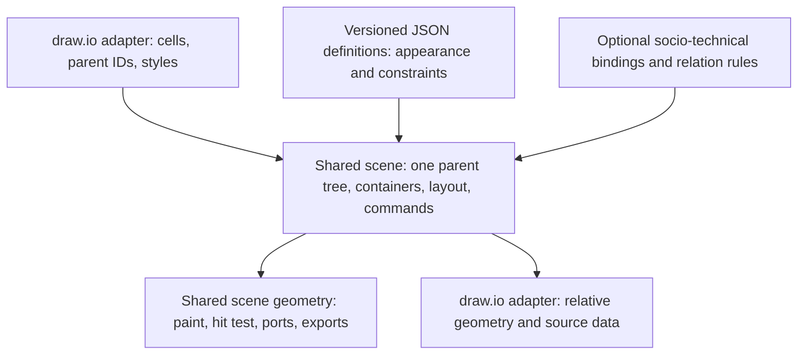

# Common nested containers and swimlanes

Research and design: 2026-11-13. **Proposed; implementation not started.**
This is the common structural contract for [draw.io support](DRAWIO.md) and
[socio-technical editing](SOCIO-TECHNICAL.md). It refines DRAWIO.md section
3.2.1, rather than introducing a second container implementation.

User requirement: "draw.io also has support for nested swimlanes. please
investigate and create one common solution."

## 1. Research findings

draw.io swimlanes are not just a set of rectangle symbols:

- The [official swimlane documentation][swimlanes] describes an outer pool
  containing lanes, lane insertion/reordering, child drop/reparent, automatic
  expansion, duplicate-with-content and collapse. Collapse hides descendants
  without deleting them; external connections remain represented.
- The [official container-table documentation][tables] describes another
  structural form: table, row and container cells containing ordinary shapes.
  Children and connections move with the table. Dropping a child into a table
  cell does **not** automatically grow the row/column. This differs from the
  documented swimlane behavior, so one unconditional auto-grow rule is wrong.
- [Cross-functional flowcharts][crossfunctional] combine row/column categories.
  A two-dimensional container table must not be flattened to a one-dimensional
  pool stack, nor interpreted as two simultaneous semantic parents.
- In the inspected [draw.io Graph.js][graph], `layoutManager.getLayout` reads
  `childLayout=stackLayout`, `horizontalStack`, `resizeParent`,
  `resizeParentMax`, `resizeLast`, margins, spacing and border. It schedules
  nested child/parent layouts; `getLanes` and `isLane` identify children of a
  stack. Lane insertion is a parent/child operation, not a BPMN operation.
- The underlying [mxSwimlane][mxswimlane] shape separates header size
  (`startSize`), header/content paint and `horizontal` orientation. In its
  unrotated/default-direction rendering, `horizontal=1` gives a **top header**;
  `horizontal=0` gives a **left header**. This is independent of
  `horizontalStack`, which controls the direction of child stacking.
  Do not infer this mapping from the phrase "horizontal swimlane".
- [mxStackLayout][mxstack] offsets layout by the header once and distinguishes
  parent resizing from filling the last child. Its comments/source provide
  useful legacy behavior, not proof of full current-editor parity.

The draw.io source was inspected at revision
`c72c9a98b7a6ce392556ed04c05e0ff19f43f5c3`; documentation and local corpus
inspection are the other evidence. No live-editor visual-parity test is
claimed by this research.

### Existing corpus and current Thinoda limitation

A bounded decode of the existing Apache-2.0 example corpus found **88 nested
lane/table-container occurrences**, including three container levels in
`docs/draw-io-examples/cross.xml` and nested swimlane cells in
`maths-examples.drawio` page 2. That count includes table-related containers;
it is not a count of 88 independently supported nested-lane diagrams.

Current code does not retain this structure as an editable scene tree:

- `crates/thinoda-io/src/drawio.rs:2110-2164` resolves parent-relative positions
  while visiting cells, but converts a container into a Zone and replaces the
  current Zone context on descent.
- `drawio.rs:2185-2244` approximates frames as Zones; `2956-2985` applies
  memberships and flattens grouping into board groups.
- `crates/thinoda-core/src/board.rs:345-349` explicitly makes `CanvasGroup`
  flat; `model.rs:487-510` gives Zones no nested-parent field.

Thus importing visible nested rectangles is not nested-swimlane support.
The future shared milestone must preserve structure, editing behavior and
interchange, not just approximate the initial picture.

## 2. One engine, three responsibilities

| Layer | Owns | Does not own |
|---|---|---|
| JSON definition/interpreter | Shape geometry, header/body paint, label regions, ports, handles and declared generic interaction constraints | Participant identity, workflow execution or executable library code |
| Shared scene/container engine | One parent tree, ordered children, layout/resize/reparent/collapse, geometry, visibility, selection and routing integration | Pool ownership, performer responsibility, sequence/message validity |
| Optional socio-technical model | Participants, roles, use cases, accountability, typed relations, binding meaning and modeling diagnostics | Another parent tree, another lane layout or another renderer |
| Format adapters | Source parent IDs, local/relative geometry, style mapping, preserved source data and conversion diagnostics | Hidden semantic inference or arbitrary JavaScript execution |

**A swimlane is a structural container with a header/layout policy. A BPMN-like
pool or lane is an optional semantic binding on that container.** Ordinary
draw.io shapes, even BPMN stencils, acquire no socio-technical meaning on open.

## 3. Shared structural contract

### 3.1 Identity, parents and geometry

- Extend the existing scene direction with one `SceneParent` relation:
  default/named layer or another object, with stable IDs and ordered children.
  Containers include group, general container, swimlane and table/row/cell
  structural roles. These are reusable structural operations, not per-symbol
  `ShapeKind` additions.
- Store one authoritative parent per occurrence; validate existence, cycles,
  depth and cumulative budgets. The tree is independent of mind-map topic
  parents, Zone membership and semantic boundary memberships.
- Keep existing canonical rectangles and connector controls in **sheet space**.
  Import/export converts source geometry in the adapter. A child rectangle
  is relative to the source parent origin, not automatically its body origin;
  layout may place it below/beside a header. Do not apply header offsets twice.
  Relative edge children/labels use their separate geometry rules from DRAWIO.
- Global drag updates the unique descendant closure exactly once. Reparent
  preserves sheet position before any explicit target layout; source/local
  coordinates are derived, not stored as a competing authoritative rectangle.
- Hidden descendants keep their sheet-space geometry. Moving a collapsed
  ancestor translates hidden descendants and stored expanded bounds once too;
  expanding must not restore pre-move coordinates.
- Exclude selected descendants when their ancestor already moves. Preserve
  sibling paint order, hit-testing and locked/selectable state. A parent move
  moves locked descendants as a unit unless the container itself is locked;
  individually locked descendants cannot be reparented directly.
- Existing flat `CanvasGroup` behavior and Zone membership remain unchanged.
  New nested grouping on draw.io and socio-technical sheets uses scene group
  containers. Do not combine a flat-group move and an ancestor move twice.
  Keep legacy cards/topic trees intact; do not make a topic's mind-map parent
  a container parent. Existing imported cards need a scene-occurrence adapter
  or a consented representation change, decided in SC0, not silent flattening.

### 3.2 Swimlane/container policies

Define generic policies once, with bounded typed fields. JSON packages choose
defaults; document instances store overrides. Rust implements the shared
policy operators. Format-specific names map at the adapter boundary.

| Policy | Proposed common behavior |
|---|---|
| Header | Independent side, extent, label direction, header/body fill and separator. Source direction/flip map explicitly; header side and stack axis are separate |
| Layout | `Free`, `Stack(axis)` and later `Table(grid)`; nested layout runs in a bounded deterministic schedule, never until an unconstrained fixed point |
| Stack | Sibling order plus extents, spacing, margins, cross-axis fill and minimum sizes; preserve manual extents unless the chosen resize policy changes them |
| Resize | Distinguish grow-parent, grow-only-parent, fill-last and explicit distribute. Parent growth wins over fill-last where the source stack specifies that precedence. No recursive proportional scaling by default |
| Auto-grow/drop | Plain swimlane defaults may grow; container-table cells default not to. Preserve supported imported flags; preview bound semantic reparent rather than making it a side effect of geometric overlap |
| Collapse | Store expanded bounds separately; render header/compact frame and fold external connectors to the nearest visible ancestor boundary. Restore full contents/geometry on expand |
| Clipping | Explicit body/content clipping, not implied by being a container. Headers and crossing external connectors must not disappear behind the body clip |
| Group conversion | Explicit, undoable command. Ordinary grouping does not assign performer or process meaning |
| Unsupported source policy | Preserve bounded source policy with a specific diagnostic; geometry-only editing is possible, but edits needing an unsupported layout are refused until explicit conversion to a supported policy |

V1 shared authoring covers free containers and nested stack swimlanes, including
mixed header/stack axes. Container-table structure and absolute geometry can
be preserved before full table authoring. SC4 delivers the table layout slice;
until then table resize/reflow support remains explicitly incomplete.
General custom `childLayout` algorithms are not implemented or executed simply
because a JSON library or draw.io file requests them.

On resize, compute minimum sizes bottom-up once, then allocate parent/child
extents top-down once for each affected subtree. If policy constraints conflict,
reject the command with a named constraint; do not oscillate, truncate content
or silently disable an imported policy. SC0 fixes numerical tolerances and
budgets; conformance fixtures test that schedule against the supported source
policy combinations, not against every draw.io layout.

### 3.3 Edges across nested containers

The shared scene permits ordinary connections across any eligible objects.
Notation rules are optional diagnostics/guards above it.

- New cross-container connectors live at the endpoints' nearest common scene
  ancestor, or the layer when appropriate. Imported edge parents are preserved
  when supported, otherwise explicitly remapped with a diagnostic. Being the
  scene parent of an edge does not imply owning its semantic exchange.
- Moving both endpoint subtrees together translates manual controls once.
  Moving one endpoint preserves unrelated sheet-space manual controls and
  reroutes affected attachment segments; automatic routes recompute. One
  transaction deduplicates edge updates whether the edge itself was selected
  or belongs to the moved subtree.
- Collapse keeps the **real endpoint ID**. Only visible routing terminals
  project to an ancestor boundary; expand restores the original attachment.
  An edge whose endpoints are both hidden inside the same collapsed ancestor
  is hidden in that presentation, not deleted.
- Edge parents are stored. On explicit endpoint reparent, recompute the edge's
  common ancestor in the same command, preserving sheet-space controls; if the
  parent changes, place it after existing sibling edges and preserve relative
  order among all moved edges. Preview this paint-order consequence. Other
  geometry moves do not silently normalize imported edge parents.
- Container borders/headers participate in the route geometry. Tests distinguish
  child ports, container ports, nested clipping and label bounds. Do not claim
  arbitrary obstacle-avoidance routing before it exists.
- Connector dash/marker styling is one shared board/scene feature reused by
  ordinary draw.io edges and socio-technical sequence/exchange styling.

### 3.4 Optional semantic bindings: no second ownership tree

For the first socio-technical workflow, **scene ancestry is the authority for
structural membership**: a step's nearest bound process-scope ancestor defines
its process; the nearest bound responsibility-lane ancestor defines its lane.
A missing scope means an explicitly unallocated draft. A nested lane remains
within that process. Unbound intermediate containers/groups are transparent
when finding the nearest bound ancestor. No parallel `step.parent_scope` tree
is persisted. V1 process/lane bindings are offered only on supported free or
stack containers; table-cell semantic binding is deferred.

Participant ownership of a process and role/performer references on a lane are
semantic properties, not another scene hierarchy. Overlapping organization,
software-scope, trust and visibility boundaries are membership relations and
overlays, never competing scene parents. A table row/column categorization
also does not create multiple structural parents.

All generic reparent, ungroup, delete and paste commands consult a shared
binding-aware transaction hook:

- Unbound sheet: apply scene behavior only; no socio-technical diagnostics.
- Bound workflow: show proposed responsibility/scope changes and affected
  relation diagnostics, including inherited performer changes beneath a moved
  nested lane. Confirm one atomic command or cancel. Preserve relation types;
  never turn a sequence into an exchange just to make validation pass.
- Disallow destructive ungrouping of a bound process/lane until the user chooses
  to move children into an explicit target or retain unallocated drafts.
- Moving a scope changes its geometry and descendants, not its participant
  owner. Moving an overlay changes neither hierarchy nor boundary membership.

Collapse is **not** black-box semantics. A collapsed process still owns its
hidden steps. A black-box process has no modeled internal steps. Promotion
to black-box refuses/discloses existing behavior instead of hiding it and
pretending it does not exist.
Collapsed headers and legends need an explicit collapsed affordance so readers
can distinguish hidden modeled behavior from a black-box process.

### 3.5 Persistence and lifecycle capabilities

Assign version numbers at implementation time, independently for these
capabilities. A plain scene-only document must not need the semantic capability.

| Capability / phase owner | Required coverage |
|---|---|
| Scene ancestry, nested containers, collapse / SC1 | Native gate, clipboard/recovery/private snapshot gates, validation, history accounting, sheet duplicate/merge and masking |
| Header/layout policies, shared dash style / SC2 | Policy-aware versions and old-envelope rejection; all scene consumers resolve identical geometry/style |
| Table reflow / SC4 | Gate only if introducing stored data not already retained safely; retain unsupported source styles honestly |
| Semantic graph and bindings / STC2 | Independent native/transport gates, structural validation, draft diagnostics and explicit non-native loss preflight |
| Pinned JSON definitions / SC2 | One immutable-resolution mechanism across save/reopen/copy and missing-definition diagnostics. STC2 consumes it for notation packages; semantic compatibility is separate from visual fallback |

SC0 decides whether SC1/SC2 are internal-only steps delivered under one scene
format version or independently released capabilities. Do not allocate two
versions merely because there are two rows; do not expose an intermediate
reader/writer that ignores stored layout fields.

Copying a container includes its subtree and internal edges, remaps all IDs and
keeps explicit partial external links as unresolved draft metadata in semantic
mode. Ordinary scene paste handles missing endpoint shapes through the existing
explicit detachment/loss policy. A child copied alone is pasted at the layer
with its sheet-space position retained; paste into a chosen target is an
explicit reparent. Bounded closure overflow rejects without partial insertion.

Visual collapse/clip does not remove source data from save, clipboard, export
metadata or sharing. Mask all new labels, policies containing user text and
retained source fields through the existing masked-copy contract.

## 4. Import, export and promotion

1. **Import unbound:** decode cell parents, styles, expanded/collapsed geometry,
   stack/table policies and endpoint identities. Preserve the supported scene
   tree. No label, BPMN stencil name, dashed edge or lane title assigns semantics.
2. **Native editing:** use common container and connector commands. Scene-only
   users receive structural/layout diagnostics, never process-rule warnings.
3. **Explicit promote:** preview which containers become scopes, nested lanes
   or remain visual groups, who owns/fulfills each, and which edges are sequence,
   exchange or unclassified. Suggestions are not persisted until confirmed.
   Ambiguous source content remains unbound; promotion need not cover a sheet.
4. **Export scene:** emit source parent-relative geometry, order, expanded bounds
   and mapped policy styles. Geometry-only export is not semantic round trip.
   Do not add a semantic extension until STC6's reconciliation gate passes.
5. **Reimport extended documents:** separately reconcile the semantic extension
   against source baseline IDs, endpoints and ancestry. External reparenting
   must not restore old ownership. On conflict, require a choice or retain a
   disclosed scene-only copy; do not silently resurrect deleted model elements.

## 5. One phased structural milestone

Carve SC0-SC3 out of draw.io's structural Phase 10. This is **one shared
milestone**, not another complete Phase 10 rewrite. STC1 consumes it.
SC4 extends it without a second implementation; STC v1 need not wait for full
tables. SC0 has no implementation prerequisites. SC1 delivers the needed
Phase 3 model slice; SC2 uses the Phase 4 shared-rendering and implemented
Phase 5 interpreter slices; SC3 uses the bounded codec/import and supported
save-contract slices of Phases 2, 6 and 7. These are explicit dependencies on
the relevant capabilities, not declarations that all those parent phases
must close before common container work starts.

| Phase | Depends on | Deliverable and exit gate |
|---|---|---|
| SC0 - Common contract and corpus | None; coordinated with STC0 | Freeze parent/coordinate and command contracts, binding-hook interface, card/topic treatment, supported policy combinations, maximum depth/bytes and layout budgets. Classify nested corpus and add original pool/lane/sub-lane and mixed-orientation cases. Pin reference renderer/source version. If cards require a format-wide migration, stop/rescope to non-card scene objects explicitly rather than flatten imported cards silently |
| SC1 - Safe generic hierarchy | SC0; relevant Phase 3 model slice delivered here | Persist/reopen parent/order/container/collapse data; bounded transforms, copy/delete/reparent, history and version gates. All generic mutation paths invoke the binding hook: test with no-op unbound behavior and a stub bound validator. Test depth/cycle/old-envelope rejection, no double moves including collapsed hidden descendants, locked descendants and keyboard containment navigation |
| SC2 - Nested swimlane behavior | SC1; relevant Phase 4/5 rendering/interpreter capabilities | Shared JSON header/body definitions, free/stack layout and resize/drop/collapse routing; connector dashes and definition resolution. One resize including induced sibling changes is one undo step. Canvas/hit-test/SVG/PDF parity and native/web authoring; nested depth-by-child-count workload meets SC0's measured latency and bounded-operation budgets without semantic code |
| SC3 - draw.io structural fidelity | SC2; bounded Phase 2/6/7 adapter capabilities | Import/edit/export/reimport original nested fixtures and classified corpus cases. Preserve parents, relative geometry within SC0 tolerances, IDs/order, header axes, policies, collapsed bounds and terminals. Require normalized scene idempotence over repeated round trips; verify in draw.io and report unsupported policies exactly. This is the scene-only milestone gate |
| SC4 - Container tables | SC3 | Shared table/row/cell layout and insertion/deletion/resize without flattening. Exercise `cross.xml`, nested container cells, row/column categories and no-auto-grow behavior in the same engine |

**Integration order:** SC0 and STC0 establish one contract. SC1-SC3 deliver the
reusable foundation. STC2 then adds semantics on top; STC3 adds semantic editing,
STC4 accepts the socio-technical release. Prototype-only graph work may overlap
SC implementation, but dependent lifecycle gates cannot be marked complete
early. Full table authoring, unrelated draw.io libraries, edge-label child
fidelity and arbitrary custom layouts remain separately tracked work.

Keeping the bounded SC3 gate before STC2 is deliberate: this common-solution
proposal proves that the new native nested structure maps back to draw.io
before adding a second consumer's semantics. It requires the declared
free/stack subset, not complete draw.io save-back fidelity. If that limited
adapter gate proves disproportionate, changing it to run in parallel is an
explicit plan revision, not an unnoticed relaxation.

Assign one scene/schema owner at SC0 and one adapter owner; changes to shared
fields require review against both plans and explicit owned-path commits.
Do not fork the same engine into a socio-technical subsystem.

### 5.1 First implementation checkpoint: SC0 executable contract

`thinoda-core::scene_hierarchy::SceneHierarchy` is an immutable, object-only
prototype over the existing canvas. It is not a second persisted ownership tree
and is not wired into the live editor. Its purpose is to exercise the shared
structural algorithms before committing a document schema:

- Validate shape-container identities, unique parents, missing references and
  cycles. Bound objects/groups/cards by existing board limits and parent chains
  to **32 links**; iterative traversal uses canvas order for stable siblings.
- Preview reparenting without changing any sheet-space rectangles or controls.
  Selected descendants remain under their selected ancestor. Invalid topology,
  excess depth and locked source/target ancestry reject the candidate.
- Preview an atomic translation of the unique selected descendant closure,
  reusing the existing board geometry helper. A parent carries individually
  locked descendants; direct movement/reparent of a locked child is refused.
  Internal manual connector controls follow two moved object endpoints once;
  connector-to-connector attachments propagate by dependency. Moving controls
  on an edge with a stationary terminal does not falsely count as a rigid
  endpoint translation. Unselected crossing-edge controls stay in sheet coordinates.
- Preserve unrelated legacy object-only group movement. Refuse mixed card groups,
  hierarchy membership in legacy flat groups and rotated containers explicitly
  in this prototype, rather than flattening cards or inventing occurrence rules.

The core fixtures cover pool/lane/sub-lane ancestry, ink, internal/crossing/free
connector ends, rollback, locks, exact depth overflow and a 20,000-object scene
at the full supported depth.
The size fixture verifies bounded iterative behavior, not an SC2 latency benchmark.

**Release boundary:** this type deliberately has no serialization interface, and
no model fields, format versions, import/export behavior or UI controls changed.
Its translation result is geometry-only preview data, not a savable nested
document. Existing editor mutations retain their existing behavior.

At this first checkpoint SC0 was **partial**. Card occurrences, binding-hook contracts, ordered
reparent insertion, edge-parent reconciliation, source-policy/corpus fixtures,
numerical/layout budgets and measured keyboard/rendering behavior were still
open; the next checkpoint below advances the command contract.
SC1 remains open in full: do not wire previews into live commands until
native/clipboard/recovery/private-snapshot gates, history, delete/partial-copy
behavior, all generic mutation paths and editable-export loss protection land
together. Headers, stack/table layout, collapse and semantic bindings are not
implemented by this checkpoint.

### 5.2 Command-contract checkpoint: ownership, order and binding validation

The same immutable hierarchy now maintains ordered child lists through chained
reparent previews, instead of rebuilding order from the original flat canvas.
An actual parent change appends selected roots in their prior hierarchy traversal
order. Reparenting to the current parent preserves order; selecting descendants
alongside an ancestor still moves only the ancestor's structural unit.

Explicit endpoint reparenting reconciles affected edges to the nearest common
container, including edges attached to other edges. A bounded dependency queue
computes owners before dependents, independently of source paint order.
Changed edges append after existing destination children in their **prior
traversal order**, not dependency-evaluation or selection order. Unrelated
imported edge parents remain intact. Geometry-only translation never normalizes
edge ownership.

For this object-only contract, a container endpoint contributes itself to the
common-container search; an ordinary endpoint starts at its parent. Free points
and topic endpoints contribute the layer until scene occurrences exist. Real
endpoint IDs, labels, rectangles, fixed ports and control points do not change
when ownership changes. Parent-depth validation runs again after induced edits,
so edge reconciliation cannot quietly introduce a 33rd parent link.

An induced change to an edge outside the carried subtree is rejected if its
direct lock, old ancestor or proposed ancestor is locked. Locked edges already
carried by a selected ancestor retain their lock and follow the structural unit.
The prototype still refuses hierarchy membership in legacy flat groups.

Both current mutation previews route through a shared read-only
`SceneEditContext` callback, once, **after** structural/geometry reconciliation:
the context exposes the operation, before/after trees, candidate geometry,
selection, affected closure and final edge-owner deltas. Sibling order changes
remain visible through the two trees even when an edge's final owner equals its
original owner. A validator error rejects the complete candidate. The unbound
convenience methods supply a no-op validator; bound live commands must supply the
document's validator, not choose that convenience path.

Fixtures exercise inherited scope changes through an unbound intermediate
container and a nested lane, unbound acceptance, bound-policy rejection,
unchanged source geometry, repeated reparent order, connector dependency chains,
free/topic endpoints, locks, induced depth overflow, malformed connector
dependencies and a 20,000-object edge-fanout case. This remains a core contract
spike, not a measured SC2 latency or live-editor acceptance claim.

**Remaining boundary:** no persisted schema, native/transport versions, generic
legacy command integration, semantic model or UI was added. SC0 remains partial:
card-occurrence decisions, supported source policies/corpus cases, document-byte
and layout budgets, keyboard/rendering prototypes and reference-hardware
measurements remain open. The callback is the initial preview validation
interface, not the complete semantic confirmation/diagnostic protocol. SC1 must
still integrate every generic mutation path with history and the full storage/
clipboard/recovery/export-loss contract before exposing nested editing.

## 6. Adversarial acceptance and critique

- Pool > lane > sub-lane > task, mixed header/stack axes, zero-sized header,
  and empty lanes preserve coordinates without accumulating header offsets.
- Move/reparent a selected parent plus selected descendant and a crossing edge:
  exactly one translation and one undo; preserve an individually locked child.
- Nested stack auto-grow and grow-only/fill-last combinations terminate within
  the declared budget. Table cells do not inherit swimlane auto-grow.
- Collapse one ancestor of an externally connected task, then a second:
  endpoint identity survives, the nearest visible projection changes, and
  expand restores both routing and geometry. Collapse never changes black-box state.
- Move the collapsed ancestor before expanding; hidden descendants and expanded
  bounds follow once. Reparent an edge endpoint and verify stable sibling edge
  order and control points. Repeat the normalized interchange round trip twice
  without accumulating coordinate drift.
- Group a step in an unbound container inside a bound lane, then move it out
  of that group: scope/lane stay unchanged. Moving a nested bound lane previews
  any inherited performer changes.
- Open a nested BPMN-looking draw.io file without promotion: no process model,
  no automatic type conversion and no socio-technical diagnostic.
- Promote only some containers, move a bound task through a generic command,
  or ungroup a bound pool: preview explicit semantic consequences, never
  mutate topology through a rendering/layout operation.
- Cross-format round trip and clipboard stress the exact depth/byte limits,
  altered parent IDs, missing definitions and hostile policy metadata.
- A keyboard user can enter/leave containers, navigate parent/sibling/child,
  reorder and choose a reparent target without pointer drag.

**Design critique:** this deliberately makes nested layout and structural
fidelity a first-class shared investment. It is larger than painting pools,
but prevents inconsistent move/collapse/export behavior and a second hierarchy.
Sheet-space geometry avoids a disruptive all-board coordinate migration, at
the cost of transactional descendant updates. The supported layout subset is
explicit because reproducing all draw.io editor behavior is not a small phase.
The principal unresolved implementation risks are legacy card occurrence
integration, text/binding integration and resize-policy interactions; SC0/STC0
must stop or rescope if their spikes fail. See the
[full review and dispositions](SOCIO-TECHNICAL-REVIEW.md).

## Sources

[swimlanes]: https://www.drawio.com/docs/diagram-types/swimlane-diagrams/
[tables]: https://www.drawio.com/docs/manual/shapes/tables/container-tables/
[crossfunctional]: https://www.drawio.com/docs/diagram-types/cross-functional-flowcharts/
[graph]: https://github.com/jgraph/drawio/blob/c72c9a98b7a6ce392556ed04c05e0ff19f43f5c3/src/main/webapp/js/grapheditor/Graph.js
[mxswimlane]: https://github.com/jgraph/mxgraph/blob/master/javascript/src/js/shape/mxSwimlane.js
[mxstack]: https://github.com/jgraph/mxgraph/blob/master/javascript/src/js/layout/mxStackLayout.js
